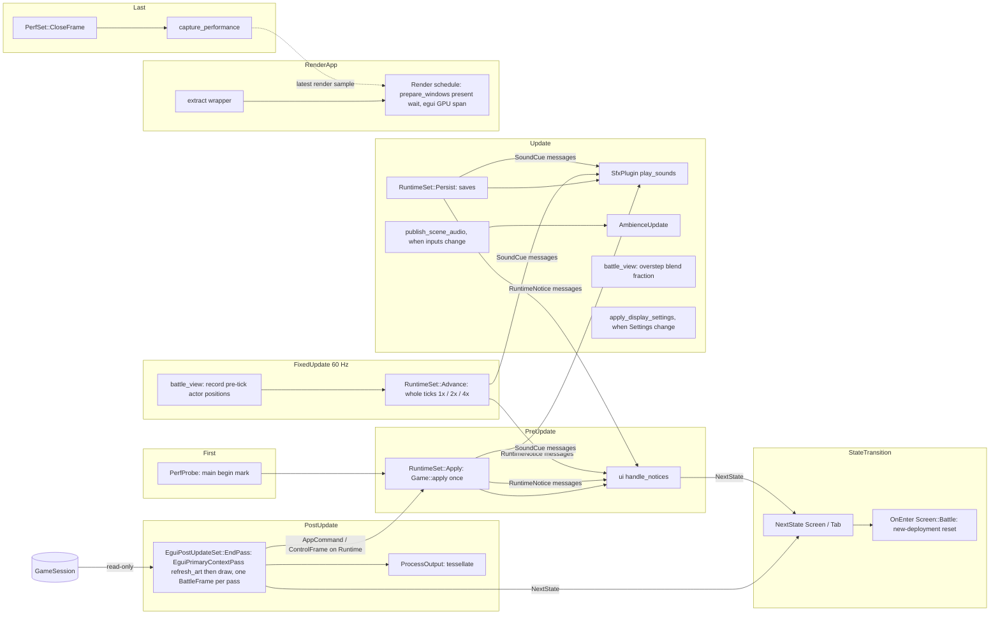

# Lastlight architecture

Lastlight is an independent two-package Cargo workspace. `horde_core` is engine-free Rust; `horde-defense` (`crates/horde_game`) adapts that model to Bevy, egui, Windows input, assets and audio. It does not share build outputs, lockfiles or authoritative state with the monorepo's other experiments.

## Ownership

One row per module. Paths are relative to the crate's `src/` (`crates/horde_core/src` for core rows, `crates/horde_game/src` for game rows); other paths are relative to this workspace. `python -I -B scripts/check_views.py` fails when a module or directory to depth 2 has no row here, when a row names a module or file that does not exist, when a row's first cell backticks nothing or a `core`/`game` row names a path outside that crate, or when a guard test named in the last column is neither a Rust `#[test]` fn in `crates/` nor an existing workspace file. `lib.rs`, `main.rs` and test-only `tests`/`*_tests` modules need no row.

| Module (file) | Owns | Does not own | Entry points / key types | Guard tests |
|---|---|---|---|---|
| core `command.rs` | Typed gameplay commands and `Game::apply`, the single frontend mutation path, with every player-intent rule and typed `CommandError` (see "Mutation path"); `SetRecruitTactics` (W2-13, ruling D12), the live takeover tactics: it edits a Ready or Defending recruit's npc tactics (a Defending recruit's roster npc is the main run's npc, so the change takes effect at its next npc turn), and a Guarding or Deployed recruit gives `RecruitNotReady` | Queueing, saves or presentation | `Command`, `CommandOutcome`, `CommandError`, `NpcTactics`, `MAX_RECALL_PERCENT` | `recall_threshold_above_limit_is_rejected_without_mutation`, `purchase_charges_and_returns_the_new_item_identity`, `set_recruit_tactics_edits_ready_and_defending_only`, `mid_battle_tactics_change_takes_effect_next_turn_deterministically` |
| core `rules.rs` | Saved RNG and the pure Fourth Edition Lite procedures: rolls, defense, protection, injury, skill costs, range and aim; blasts with no attack roll (`resolve_blast`, `resolve_object_blast`, ruling W-7, W2-29) | Combat scheduling, aim commitment, equipment legality (`sim`); NPC target policy | `Rng`, `Stats`, `check_roll`, `defense_succeeds`, `swing_damage`, `resolve_blast`, `resolve_object_blast` | `critical_boundaries_and_automatic_defenses`, `protection_precedes_wounding_and_floors_injury`, `resolve_blast_draws_defense_only_when_dodged` |
| core `content.rs` | Validated encounter, equipment, level and structure definitions with stable authored IDs (`ItemDefId`, level and structure IDs); modes, slots and enemy kinds | Runtime input or rendering | `Mode`, `Slot`, `EnemyKind`, `StructureKind`, `ItemDefinition`, `LevelDefinition` | `authored_content_validates`, `item_ids_resolve_through_the_index_and_survive_edited_clones` |
| core `world.rs` | The data-driven geographic campaign: countries, borders, sea routes, stage themes and `WorldProgress` | Battle rules, rendering | `WorldContent`, `Country`, `StageTheme`, `WorldProgress`, `world()` | `border_unlock_requires_complete_country_and_stage_replay_is_idempotent`, `islands_are_reachable_via_symmetric_explicit_sea_routes` |
| core `catalog.rs` | Shared catalogue plumbing: the `CATALOG_OVERRIDES` table of `LASTLIGHT_*` override variables, typed `ContentError` (`Io`, `Parse`, `Invalid`, `TooLarge`), fallible `try_load()`/`init_catalogs()` and `content_fingerprint` | Any other environment variable; the catalogues' contents | `init_catalogs`, `ContentError`, `CatalogSource`, `content_fingerprint` | `content_fingerprint_is_deterministic_and_covers_item_ids`, `missing_override_file_is_an_io_error_naming_the_path` |
| core `balance.rs` | Validated next-deployment controls: Easy, Normal, Hard and Custom presets and their extras. An active encounter keeps a frozen copy | Changing a running attempt | `BalancePreset`, `BalanceSettings`, `BalanceCatalog` | `preset_extras_catalogue_values_default_and_bounds`, `presets_validate_and_atomic_edits_freeze_active_arena_and_rules` |
| core `enemy_catalog.rs` | Validated enemy composition: archetypes, visual sprite IDs, elites, death effects and weighted pools (12 wave tiers, `mean_pool_health`). Resolved profiles are save snapshots | Sprite cells and drawing (`visual_assets/enemy_visuals.rs`) | `EnemyCatalog`, `ResolvedEnemy`, `EnemyVisual`, `resolve_kind` | `shipped_components_resolve_complete_profiles_and_stable_pools`, `legacy_resolved_enemy_and_snapshot_serialize_byte_identically`, `catalogue_has_twelve_tiers_with_monotone_mean_health`, `waves_0_to_4_byte_identical` |
| core `skill_catalog.rs` | The validated, extensible skill DAG keyed by stable string IDs: effects, unlocks, class modifiers, goals and search | Purchase rules (`campaign/progression.rs`) | `SkillCatalog`, `SkillNode`, `UnlockId`, `SkillEffect`, `skills()` | `authored_dag_is_extensible_and_rejects_cycles_references_and_bad_numbers`, `unlocks_are_data_keyed_and_unknown_ids_are_rejected` |
| core `ordnance.rs` | Authored enemy-only area attacks: the catalogue, legal target cells and saved release cues | Resolving damage or refills in presentation | `OrdnanceKind`, `OrdnanceCatalog`, `ThrowRequest`, `ReleaseCues` | `authored_catalog_rejects_impossible_flight_radius_and_fire`, `flight_and_fire_save_resume_are_identical_and_forged_ammo_is_rejected` |
| core `progression.rs` | Bounded world-clear progression, frozen per encounter: wave tiers, `GAMEPLAY_ENEMY_CAP`, the two-axis threat (rank and `FrontPosition`: front ramp, boss ranks, the boss damage rank term, the preset extras fold), the growth knee (enemy health and damage grow by the early slopes to `growth_knee_rank`, then by `health_per_rank_late` and `damage_per_rank_late`, W2-32), the rank boss armor (`boss_armor_multiplier` and `npc_boss_armor_add` past rank 4, applied at spawn by `place_enemy`, W2-32), gear scaling, milestones and camp prices | Rank from retries | `ProgressionCatalog`, `ProgressionSnapshot`, `FrontPosition`, `BossRank`, `GAMEPLAY_ENEMY_CAP`, `xp_to_advance_from`, `ProgressionCatalog::boss_armor_multiplier`, `ProgressionCatalog::npc_boss_armor_add` | `progression_rewards_reject_unsorted_milestones`, `level_grant_and_camp_price_ship_the_design_tables`, `front_ramp_final_over_first_normal_is_at_least_1_35`, `boss_rank_derivation_usa_24`, `every_floor_tier_exists_in_enemy_catalog`, `growth_matches_gear_within_band`, `snapshot_wave_tiers_at_10_20_40_are_7_10_11`, `rank_20_boss_armor_exceeds_rank_0_both_modes`, `ranks_zero_to_four_snapshot_pinned` |
| core `quality.rs` | Item quality tiers, stat and value ratios and loot events, rolled on their own counter key, absolute or relative to a base quality | The combat RNG | `Quality`, `QualityCatalog` (`roll`, `roll_relative`), `shift`, `LootEvent` | `six_quality_tiers_validate_palette_weights_and_strictly_increasing_multipliers`, `drop_quality_uses_a_purpose_counter_without_extra_combat_rng_and_checkpoint_rewards_repeat_once`, `roll_relative_with_common_base_and_no_floor_equals_roll` |
| core `loot.rs` | Drop rules (design-loot-economy §3): the highest droppable tier and the drop tier an attempt freezes at deploy. None marks an attempt deployed before v7, which keeps the legacy drop path; the relative drop quality and the elite floor (decision 7); the weighted single-draw `DropTable` (drop tier, slot and trained-class weights, plan LE-5) | The drop site and receipts (`sim/combat.rs`); the quality catalogue (`quality.rs`) | `max_drop_tier`, `deploy_drop_tier`, `drop_quality`, `ELITE_QUALITY_FLOOR`, `DropTable`, `DROP_TIER_WEIGHTS`, `TRAINED_CLASS_WEIGHT`, `SLOT_WEIGHTS` | `deploy_drop_tier_takes_the_higher_of_template_and_unlocked`, `weighted_drops_favour_current_tier`, `trained_class_weighted`, `npc_mode_weights_its_own_weapon_class`, `definition_pick_consumes_exactly_one_draw`, `late_country_stage_sets_unlocked_drop_tier`, `drop_quality_consumes_no_combat_rng`, `relative_roll_never_drops_a_tier4_below_epic`, `elite_drop_quality_is_at_least_uncommon_and_boss_drop_has_no_floor` and `every_elite_kill_drops_uncommon_or_better` (W2-35, `sim/elite_tests.rs`) |
| core `weapons.rs` | Authored firearm identity | The NPC attack profile, which stays pinned separately | `WeaponClass`, `WeaponSpec` | `pistol_cap_is_applied_once_after_all_pellets_and_weakpoint_damage`, `frozen_weapon_and_skill_snapshots_reject_unsafe_numbers` |
| core `survivors.rs` | Cosmetic survivor identity and the immutable `EquipmentVisual` snapshot of owned and equipped metadata | Combat numbers | `SurvivorId`, `Appearance`, `EquipmentVisual` | `survivors_are_cosmetic_and_legacy_saves_keep_the_original_identity`, `equipped_visuals_are_authored_actual_instances_and_frozen_for_the_attempt` |
| core `defenders.rs` | Defender identity: `DefenderId` and its saved `DefenderSeat` (absent means the mode owner), recruit identities, archetypes, blockers, origin traits, the derived defender cards, recruit offers, power readings and service records. Types and pure functions only | Mutating a game | `DefenderId`, `DefenderSeat`, `resolve`, `DefenderBlocker`, `Archetype`, `OriginTrait`, `DefenderCard`, `RecruitOffer`, `DefenderPower`, `PowerBand`, `ServiceRecord` | `resolve_table`, `defender_id_round_trips_through_mode_and_seat` |
| core `stats.rs` | Simulation-clock DPS (`DpsTracker`, 300 ticks, by source) and compact persistent `RunRecord`s | Paying rewards; wall-clock time | `DpsTracker`, `RunRecord`, `DamageTotals`, `GearRecord` | `five_simulation_second_dps_is_source_separated_and_rejects_corrupt_aggregate_windows`, `all_finished_outcomes_have_one_untruncated_persistent_record_and_reopening_pays_nothing` |
| core `status.rs` | Generic timed `StatusEffect`s kept as a sorted per-actor `Statuses` list with apply, refresh, tick, expire and validate | What a status does to combat (the simulation reads it) | `StatusId`, `StatusEffect`, `Statuses` | `statuses_stay_sorted_refresh_to_the_longer_clock_and_expire_on_zero`, `validation_rejects_unsorted_expired_unknown_and_overlong_entries` |
| core `kind_map.rs` | `KindMap<K, V>`: complete enum-keyed maps saved as objects keyed by variant name, replacing positional per-kind arrays | Catalogue lookups | `KindMap`, `StableKind` | `serializes_as_a_name_keyed_object_and_fills_missing_kinds` |
| core `hash.rs` | The one FNV-1a: save checksums, content fingerprints, stable world hashes and the `mix`/`keyed` streams. Constants and byte order are frozen because outputs are saved | Cryptographic hashing (`sha256.rs`) | `fnv1a`, `fnv1a_step`, `mix`, `keyed` | `quality_roll_is_bit_identical_after_moving_mix_to_hash`, `keyed_tags_are_distinct_frozen_ascii` |
| core `sha256.rs` | The one std-only FIPS 180-4 SHA-256, for asset provenance audits. Compiled only under `cfg(test)` or the `test-support` feature | Any production build; saves | `digest`, `hex` | `fips_180_4_vectors`, `hex_is_lowercase_64_chars` |
| core `schema.rs` | Serde skip predicates and legacy-neutral defaults for saved fields (schema v7 C1/C2): a new field is skipped at exactly its neutral value, compared by bits | The meaning of each field (its owner) | `is_default`, `is_false`, `is_zero_f32`, `is_one_f32`, `one_f32` | `neutral_one_multipliers_are_absent_and_round_trip_bit_exactly`, `default_and_golden_games_serialize_no_v7_key` |
| core `strategy.rs` | Late-campaign recruitment, garrisons and seeded plague pressure; the clock advances only while the global simulation runs | Per-tick combat | `StrategyState`, `Recruit`, `Outbreak`, `GuardAssignment` | `assignment_prevents_parallel_double_use`, `seeded_strategic_clock_survives_serialization` |
| core `campaign.rs` | `Campaign`, its `Default`, `validate` and worker clones: currency, unique gear and advancement. The run history is a copy-on-write `Arc<Vec<RunRecord>>` | Hit detection or cosmetic effects | `Campaign` | `clone_for_worker_copies_the_progression_ledgers`, `authored_purchases_stack_and_reject_unmet_prerequisites_without_spending` |
| core `campaign/armory.rs` | Owned items, presets, equipment reservations and weapon access | Sale eligibility (`campaign/sale.rs`) | `Item`, `Preset` | `personal_rifles_require_a_real_purchase_or_loot_instance_as_well_as_training`, `delete_preset_unblocks_sale` |
| core `campaign/auto_sell.rs` | The saved auto-sell rule and the per-report receipt (schema v7 §3.1, §3.4), both skipped at their defaults | Executing sales (`sim/auto_sell.rs`) | `AutoSellRule`, `AutoSoldReceipt`, `MAX_AUTO_SOLD_LINES` | `rule_rejects_a_poor_threshold_and_serializes_every_field`, `receipt_validation_rejects_13_lines_and_bad_quality_sum` |
| core `campaign/ledger.rs` | Coin and XP transactions: rewards, purchases, sales and run bookkeeping | Prices and eligibility | `Campaign` transaction methods | `coins_never_go_negative_overflow_or_drop_without_a_purchase`, `run_rewards_are_granted_exactly_once` |
| core `campaign/loadout.rs` | Defender profile derivation, item comparison and upgrade recommendations | Purchases | `DefenderProfile`, `ItemComparison`, `Recommendation`, `UpgradeJudge` | `recommendation_unchanged_after_refactor`, `upgrade_gain_true_for_fire_axe_over_crowbar` |
| core `campaign/progression.rs` | Skills, body attributes, player and survivor development, level and lane progression, node payments | The skill DAG (`skill_catalog.rs`) | `Player`, `Npc`, `BodyAttribute`, `NodePayment` | `fresh_body_training_is_coin_graph_progression_and_never_double_applies_legacy_ranks`, `progression_ledgers_round_trip_and_skip_at_default` |
| core `campaign/sale.rs` | The one sale-eligibility rule (`Campaign::sale_block`) read by quotes, batch plans and execution; strict `Command::SellItem`; the settlement plan `Campaign::plan_settlement` (`SaleOrigin::Settlement`, overflow policy "keep the item": an item whose coins would overflow the wallet is skipped and returned as the `kept_on_overflow` count, so the plan always fits `execute_plan`) | Storing the auto-sell rule; choosing the settlement candidates (`sim/auto_sell.rs`) | `SaleBlock`, `SaleQuote`, `SalePlan`, `SaleOrigin`, `Campaign::plan_settlement` | `sell_paths_share_one_eligibility_function`, `batch_wallet_overflow_sells_nothing`, `settlement_origin_skips_only_the_in_battle_guard`, `wallet_overflow_keeps_items` |
| core `campaign/tree_value.rs` | The analysis-only skill value model (design progression-tree section 2): per-node ln gain on one axis (firepower, survival, melee, ordnance, fortification) at the reference ranks `g` and `g + 4` against the director's wave pool, dominance groups, branch value per coin and the `pacing --values` table. No rule, save or RNG reads it | Rules and prices; the wave-4 static tree rules (`tests/progression_tree.rs`) | `NodeValue`, `ValueAxis`, `DominanceGroup`, `node_value`, `value_table` | `field_fitness_ehp_gain_matches_ratio`, `quick_throw_is_zero_today`, `dominance_groups_pair_vitality_with_health_add` |
| core `campaign/tree_view.rs` | Read-only skill-tree queries: node state with its requirement checklist, purchase path, typed stat preview and focus node | Purchasing | `NodeState`, `Requirement`, `NodePath`, `StatDelta` | `node_state_is_buyable_exactly_when_the_purchase_preflight_accepts`, `construction_blocker_names_the_next_missing_step` |
| core `campaign/view.rs` | Read-only campaign queries: `node_status`, `recommendation_fallback`, `feature_unlock` (the first catalogue node granting a feature: its id, name, cost and required liberations), shop offers and the next gear-level rank | Labels and layout | `NodeStatus`, `UpgradeFocus`, `OfferPreview`, `FeatureUnlock` | `node_status_matches_the_purchase_preflight_across_campaign_states`, `fortification_and_weapon_training_fallbacks_pick_their_catalogue_nodes`, `feature_unlock_companion_is_75_after_1_liberation`, `feature_unlock_is_pure` |
| core `campaign/world.rs` | Country progress, blueprints, structure upgrades and saved layouts | In-battle placement during a tick | `Placement` | `country_layouts_are_isolated_preserved_and_apply_only_an_affordable_prefix` |
| core `sim.rs` | `Game`/`Attempt` model types, deployment wrappers, `tick` orchestration, `save_snapshot` and re-exports; one-field schedules, actors, collision and contact, maneuvers and reward events (phase logic lives in the children); the armor a hit meets by `HitSource` (ranged armor against shots and turret fire out of contact) and stagger immunity (no hit-stop; NPC prone, stun and dropped weapon cleared after every injury, W2-30); a spit's range and target: `spit_range`, the far-half guard `spit_from_far_half` that the resolution in `sim/combat.rs` shares, and `Attempt::spit_target`, where the spit in hand lands (W2-28) | UI, audio, filesystem calls | `Game`, `Attempt`, `Input`, `TICKS_PER_SECOND`, `Game::tick`, `Game::save_snapshot`, `Attempt::spit_target` | `pause_freezes_every_authoritative_clock`, `seeded_headless_runs_reach_the_pinned_state_digests`, `seeded_headless_runs_keep_their_pinned_gameplay_traces`, `shield_ranged_armor_applies_to_shot_and_turret_until_contact`, `npc_juggernaut_major_wound_clears_stagger_flags_and_matches_draw_count`, `spit_target_is_where_the_winding_spit_lands`, `far_half_guard_is_one_predicate_for_resolution_and_aim` |
| core `sim/auto_sell.rs` | `Game::auto_sell_preview` and the `SetAutoSell`/`ApplyAutoSellToStash` commands (W1-23); the settlement sales, both through `settlement_sale`: hook H1 `Game::settle_auto_sell` (W2-14), called by `finish` for this run's drops, never in a worker or with the rule off, and hook W-a `drain_expedition_sale` (W2-16), called by `settle_parallel` for an expedition's queued drops; the pure `Game::results_loot` view (W2-17). Every sale goes through a `Campaign` plan and `execute_plan`: `plan_sale` for the stash, `Campaign::plan_settlement` at settlement, whose wallet-overflow count fills the receipt's `kept_on_overflow` | Eligibility and the settlement plan (`campaign/sale.rs`); the rule and receipt types (`campaign/auto_sell.rs`) | `AutoSellPreview`, `AutoSellScope`, `ResultsLoot`, `Game::settle_auto_sell` | `apply_auto_sell_to_stash_rejects_a_stale_quote_without_mutation`, `apply_to_stash_ignores_enabled_and_never_sells_shop_items`, `rule_sells_only_this_runs_drops_below_threshold`, `wallet_overflow_keeps_items`, `worker_loot_sold_exactly_once_in_main_campaign` |
| core `sim/combat.rs` | Enemy attack resolution, damage application and corpse reaping; a spitter's strike from its station (`Spit`, the NPC range penalty, the far-half guard through `sim.rs`'s `spit_from_far_half`, W2-27); the exploder's fuse and death burst and the splitter's children (W2-29: a fused exploder leaves without reward, a burst never hits the defender and its victims are reaped the next tick, split children never drop); the hazard seam on spit (W2-30: the Personal multiplier before armor, `hazard_damage_taken` in both modes); the reap's drop site (W2-35, ruling E8), which on an attempt with a frozen drop tier splits a normal term (a boss, or a non-split kill's 3% roll or every 20th kill, one `a.rng` definition pick) from an elite term (every non-boss, non-split elite drops; an elite-only drop picks with the keyed ELITE_PICK and draws no combat RNG, so elite status never changes a kill's combat RNG draw count), and rolls every elite drop through `drop_quality` with the Uncommon floor; an attempt deployed before v7 (no drop tier) keeps the legacy normal-term drop only | Spawn pacing; `Attempt::spit_target` (`sim.rs`) | Crate-private tick phases | `terminal_npc_hits_remove_enemy_and_commit_reward_and_corpse_in_the_exact_tick_at_every_observation_batch`, `every_corpse_survives_effect_expiry_and_save_resume_without_an_arbitrary_cap`, `npc_spitter_uses_range_penalty_and_dodge`, `spitter_never_winds_up_or_damages_from_the_far_half`, `spit_target_is_where_the_winding_spit_lands`, `npc_exploder_fuse_detonates_on_turn_without_reward_or_corpse`, `npc_death_burst_hits_enemies_in_radius_in_id_order_never_defender`, `chain_bursts_resolve_one_tick_later_and_terminate`, `start_of_tick_reap_frees_a_burst_victims_slot_before_the_director`, `npc_split_children_use_own_npc_stats_and_draw_no_rng`, `spit_on_the_defender_runs_through_the_hazard_seam`, `elite_status_never_changes_combat_rng_draw_count`, `elite_only_drop_uses_keyed_pick_and_draws_no_rng`, `split_child_kill_takes_the_drop_draw_and_never_drops`, `every_elite_kill_drops_uncommon_or_better` (`sim/elite_tests.rs`) |
| core `sim/country.rs` | Choosing a country without deploying (CD6): the `SelectCountry` command and the pure `outbreak_plan` and `country_choice_preview` reads behind "Plan response" and the country dossier | Deploying (`BeginDefense` in `sim/defense.rs`); the legacy `EnterCountry` (`command.rs`) | `OutbreakPlan`, `CountryChoicePreview` | `select_country_never_creates_an_attempt`, `begin_defense_from_plan_replays_final_stage_and_contains_the_outbreak` |
| core `sim/defense.rs` | Choosing the next defender (ruling D9): `next_defender`, the `SetNextDefender`/`BeginDefense` commands, the dispatch reset, and the pure `available_defenders` (with each defender's power), `defender_card`, `active_defender`, `battle_defender_card` and `service_record` reads (the service history derived from the run history and the saved containments) | The takeover deploy and finish (`sim/lifecycle.rs`); the power number (`sim/power.rs`) | `DefenderCard`, `DefenderOption`, `DefenderRole`, `ServiceRecord` | `set_next_defender_typed_rejections_leave_state_unchanged`, `begin_defense_for_mara_matches_legacy_deploy_digest`, `service_record_is_derived_from_run_history_and_containments` |
| core `sim/director.rs` | The spawn director: wave pacing, boss arrival and enemy materialisation, a split child's placement included (W2-29); one weighted pick spawns `group_size` members with no extra draw, each within the cap (`spawn_group`, W2-30; `spawn_pick` is its test-only wrapper) | Rule resolution | Crate-private tick phases | `spawn_capacity_skips_without_a_deferred_burst`, `grouped_spawns_and_frozen_scaling_survive_pause_and_checkpoint_without_catch_up`, `splitter_at_cap_minus_one_spawns_exactly_one_child_and_saves`, `npc_sprinter_group_spawns_group_size_members_without_extra_rng` |
| core `sim/events.rs` | The typed `SimEvent` stream: saved per-`Game` sequence numbers, the transient `drain_events` outbox and expedition forwarding | Presentation decisions; saving the outbox | `SimEvent`, `SimEventRecord`, `BattleId`, `Actor` | `appended_event_kinds_map_to_their_typed_events`, `sequence_numbers_never_repeat_across_save_resume_and_attempts` |
| core `sim/fixtures.rs` | Deterministic render and review fixtures: `peak_render_fixture`, `maximum_progression_render_fixture`, `stress_render_fixture` (400 drawn enemies cycling every catalogue archetype as wave picks, so elites roll at the field's rate, at the last wave tier; three workers; never saveable) and `save_clone_fixture`; the `Game::staging()` seam. Un-gated because shipped practice scenes build on them | Live player campaigns | `Staging`, `stress_render_fixture`, `save_clone_fixture` | `stress_fixture_reaches_400_enemies_within_1800_ticks`, `stress_fixture_is_not_saveable`, `stress_render_fixture_includes_every_catalog_archetype_and_an_elite`, `save_clone_fixture_sizes_the_stash` |
| core `sim/journey.rs` | Main-round continuation: `continue_journey` (deploy `next_defender()` on the next stage, or liberate the country) and `leave_journey` | Worker battles (`sim/parallel.rs`) | `JourneyContinuation` | `journey_every_outcome_stops_for_upgrades_and_continuation_uses_reported_country_safely`, `leaving_journey_persists_without_erasing_report_and_old_resume_infers_only_once` |
| core `sim/lifecycle.rs` | Deploy, retry, withdraw, settle and repeat runs | Per-tick combat | `Game` lifecycle methods | `deployment_and_retry_start_immediately_and_live_building_preserves_actions`, `settling_twice_changes_nothing` |
| core `sim/manual.rs` | Personal-mode manual actions: heal, brace, melee, shooting and ordnance | Enemy movement | Crate-private tick phases | `reload_cancelled_by_melee_never_grants_ammunition`, `melee_contact_eligibility_and_exclusive_recovery` |
| core `sim/migrations.rs` | The ordered raw-JSON migration chain run before typed decoding, v1 to v7. Each step freezes its source version's meaning (v1→v2 item indices to IDs and per-kind arrays to maps; v2→v3 counters to `statuses`, unlock flags to IDs, `target_urgency`; v3→v4 quality maps; v4→v5 ordnance maps; v5→v6 level IDs; v6→v7 path-based `or_insert` back-fills: defender seats, NPC appearance, report drops, level-grant ledger, milestones) | Reading the current catalogues to interpret old data | `SAVE_VERSION` (7), `migrate` | `v1_positions_become_ids_and_maps_everywhere_and_the_step_is_idempotent`, `migrated_v1_fixture_resaves_as_current_version_and_resumes_byte_identically` |
| core `sim/movement.rs` | Enemy movement, structure blocking and contact; enemies never block each other (W1-69); a ranged enemy stations at the clamped `ranged_stop` and spits at the nearest wall between it and the line (W2-27) | Rule resolution | Crate-private tick phases | `enemies_in_one_lane_never_block_each_other`, `enemies_still_stop_at_structures`, `enemies_keep_lanes_and_contact_has_a_windup`, `spitter_stations_at_clamped_stop`, `wall_in_lane_intercepts_spit`, `reach_zero_profile_identical` |
| core `sim/npc.rs` | NPC maneuver decisions and target selection | Enemy movement | Crate-private tick phases | `npc_resolutions_are_typed_and_inspectable_without_log_prose`, `wounded_npc_at_zero_is_not_automatically_dead` |
| core `sim/pacing.rs` | Headless pacing harness v2 (W2-01) of the fresh-profile loop, un-gated so the `pacing` example and the regression tests share one implementation: the profile registry (`pacing_registry`, `by_id`, `DEFAULT_PROFILE_ID`, the legacy `pacing_profiles`) and each profile's `PacingPlan` (equip drops, sell, defender, farm; W2-42), `simulate_pacing` (seed index 0) and `simulate_pacing_seed` (any seed index, from the fresh game `pacing_start` builds with `pacing_seed`), the threaded `pacing_sweep`, and `MilestoneStats` and `EarnedAfter` over seeds; the goal-5 evaluators (`sim/pacing/targets.rs`, W2-03), the goal-6 evaluators (`sim/pacing/goal6.rs`, W2-04) and the strategy plans with their goal-3 evaluators (`sim/pacing/strategy.rs`, W2-43, a bot that acts only through commands) | Balance decisions (the release-only `tests/pacing_targets.rs` gates measure; wave 4 tunes) | `PacingProfile`, `PacingPlan`, `PacingReport`, `MilestoneStats`, `pacing_registry`, `by_id`, `DEFAULT_PROFILE_ID`, `pacing_profiles`, `pacing_sweep`, `simulate_pacing`, `simulate_pacing_seed`, `StrategyPlan`, `simulate_strategy` | `crates/horde_core/examples/pacing.rs` (report), `pacing_sweep_is_order_independent_of_thread_count`, `milestone_stats_counts_missing_as_max_runs_plus_one`, `unlock_order_rejects_mara_before_fortifications`, `w2_42_rows_vary_the_acceptance_profile_by_one_option`, `takeover_defender_sends_the_survivor_after_a_recruit_loses`, `strategy_bot_acts_only_through_commands`, `goal5_first_victory_run_2_to_4` (release-only) |
| core `sim/parallel.rs` | Worker battle ownership, reservations, idempotent settlement and reported `SettlementIssue`s; the expedition outcome `summary` (added to each settlement pass, finalised at the settled transition, Ruling D10) and the 32-battle cap (`MAX_BATTLES`), whose pruning drops settled battles oldest first and folds an unacknowledged notice into `strategy.folded_outcomes` | A second combat implementation | `SettlementIssue`, `UNKNOWN_EXPEDITION`, `Game::unacknowledged_outcomes` (acknowledging is `Command::AcknowledgeOutcomes`) | `parallel_worker_victories_award_completion_xp_and_difficulty_once_per_settlement`, `worker_history_uses_one_parent_owner_and_checkpoint_outbox_settles_once`, `each_settled_expedition_yields_exactly_one_notice_across_save_reload`, `pruning_folds_unacknowledged_outcomes_and_conserves_the_count`, `pruning_prefers_acknowledged_and_legacy_battles` |
| core `sim/persistence.rs` | Versioned coherent generations (see "Persistence"): envelope v7, checksums, typed `SaveError`, validation, the 64 MiB generation ceiling and atomic writes with a `.bak` of the last readable generation; a defeated hostile is saveable only as a death burst's victim on the save's tick, anchored on the burst source's corpse (W2-29) | New combat decisions during load | `Game::save`, `Game::load`, `Game::to_save_json`, `SaveError`, `RULESET_VERSION` | `envelopes_carry_version_ruleset_and_fingerprint_and_reject_unknown_versions`, `oversized_commit_preserves_both_readable_generations_and_any_temporary_file`, `save_load_save_is_byte_equal`, `save_rejects_a_defeated_hostile_beside_a_defender_fuse`, `burst_victim_save_survives_a_full_event_window` |
| core `sim/power.rs` | Defender power (CD11): the pure `deployment_inputs` a deploy starts from (profile with the balance scaling, snapshot, max health; `deploy_as` reads the same helper) and the analytic `defender_power` rating on them, 100 for a fresh starter at threat 0 in either combat model; `next_threat` | Ranking or recommending (`available_defenders`, `outbreak_plan`); the country's modifiers | `DeploymentInputs`, `DefenderPower`, `PowerBand` (in `defenders.rs`) | `fresh_starter_power_is_100_at_threat_zero_in_both_models`, `defender_power_inputs_match_the_deployed_attempt` |
| core `sim/progression_rewards.rs` | Progression settlement (W2-C, rulings E1 and E2): `settle_progression_rewards` pays the level-up grants above `level_grant_paid` and the reached, unclaimed rank milestones (coins and a keyed, RNG-free item pick) once, in the root game only, called from `finish` after the H1 auto-sell and from `settle_parallel` after a credited expedition victory when no main run is live | The grant and milestone values (`progression.rs` rewards block); the pick (`Campaign::milestone_item_definition`); the receipt types (`sim.rs`) | (crate-private) | `level_grant_is_paid_once_at_root_finish`, `worker_victory_level_up_pays_the_grant_once_in_the_parent_and_never_in_the_worker` |
| core `sim/recruitment.rs` | Recruitment choice (decisions 5 and 15): the pure `recruit_offer` read (two distinct archetypes, the first today's rotation and the second keyed with `tags::RECRUIT_OFFER`, never the strategy RNG; name, appearance, origin trait and the core price) and the `Recruit`/`RecruitAs` commands | Committing the recruit (`StrategyState::recruit_as` in `strategy.rs`) | `RecruitOffer`, `RecruitBlocker`, `ArchetypeChoice` (in `defenders.rs`) | `recruit_offer_has_two_distinct_archetypes_and_recruit_as_applies_the_choice`, `recruiting_draws_no_strategy_rng` |
| core `sim/smoke.rs` | Seeded headless exercises run by the shipped `--smoke` command; un-gated | Anything test-only | `desktop_smoke`, `smoke` | `crates/horde_core/examples/campaign_smoke.rs` (exercise only) |
| core `sim/structures.rs` | Turret and trap behaviour each tick | Construction payment | Crate-private tick phases | `construction_bounds_invalid_spend_salvage_and_blocking`, `walls_hold_every_enemy_and_traps_still_trigger` |
| core `sim/telemetry.rs` | Per-attempt `CombatTelemetry` counters | Rewards | `CombatTelemetry` | `telemetry_maps_round_trip_and_skip_when_empty`, `rejects_archetype_kills_above_spawned` |
| `crates/horde_core/examples/save_clone.rs` | The save-clone benchmark (W1-50, G1.8): `Game::save_snapshot` timed over `save_clone_fixture` at 1,000, 2,500 and 5,000 items; results in VALIDATION.md | Any gate inside `cargo test` | `cargo run --example save_clone` | `consecutive_snapshots_share_unchanged_component` |
| game `launch.rs` | `LaunchConfig`: every argument and frontend `LASTLIGHT_*` variable, parsed and validated once in `main` (`--help` lists them) | Reading the environment anywhere else (core's catalogue loader reads only the override paths) | `LaunchConfig`, `ReviewOptions`, `PerfOptions`, `PresentModeOverride`, `HELP` | `ordinary_play_has_no_review_options_and_default_window`, `perf_present_mode_and_pipelined_parse_and_are_review_variables` |
| game `profile.rs` | `ProfilePaths`, `LoadedProfile` and the one startup `settings.json` read (`read_settings`), which preserves an unreadable original before defaults | Saving (the runner's storage service) | `ProfilePaths`, `LoadedProfile`, `read_settings`, `load_profile` | `non_json_settings_file_is_preserved_before_defaults`, `dropped_key_preserves_original_and_warns` |
| game `settings.rs` | User `Settings` (`SETTINGS_VERSION` 1, the `[String; 8]` core bindings plus `ExtraBindings`, display fields `vsync`, `low_latency`, `window_mode`, palette and quality markers), per-key tolerant decoding, egui style and font | Applying display settings (`render_plan.rs`) | `Settings`, `SettingsDecode`, `Action`, `WindowModeSetting`, `configure`, `install_font` | `old_13_key_settings_file_loads_with_new_defaults`, `one_bad_key_falls_back_alone` |
| game `render_plan.rs` | The display plan, fixed from the startup settings read: present mode (VSync gives Fifo, Low latency Mailbox, neither AutoNoVsync), pipelined rendering (`PIPELINED_DEFAULT`, off under Low latency, a launch override wins), window mode and one queued frame (`desired_maximum_frame_latency` 1); `apply_display_settings` applies present and window mode live | Reading settings files; pipelining changes without a restart | `RenderPlan`, `render_plan`, `primary_window`, `default_plugins`, `DisplayPlugin` | `present_mode_matrix`, `default_launch_is_fifo_pipelined_with_one_queued_frame`, `apply_display_settings_updates_window_live_but_not_pipelined` |
| game `logging.rs` | Bevy `LogPlugin` configuration (default filter, `RUST_LOG` override), the plain-text file layer under `LaunchConfig::log_directory` (`<save dir>/logs/`, or `<temp>/lastlight-review-<pid>/logs/` for an isolated review with a staged scenario and no `LASTLIGHT_SAVE_DIR`), the bounded ring of the newest 200 lines and the panic hook that writes `crash-<timestamp>.txt` | Installing a subscriber in core | `DEFAULT_FILTER`, `file_layer`, `install_panic_hook` | `log_ring_keeps_only_the_newest_lines`, `crash_report_names_version_os_panic_and_backtrace` |
| game `runner.rs` | `SimRuntimePlugin` facade and re-exports: rendering publishes intents, these services apply commands, advance fixed ticks and persist | Drawing, playing audio, domain rule checks or alternative combat rules | `SimRuntimePlugin`, `GameSession`, `Runtime` | `country_command_requires_confirmed_survivor_and_retains_cosmetic_identity` |
| game `runner/command.rs` | Queue entries (`AppCommand`: gameplay `Command`s plus the runner's own intents: durable reset and save, `OpenSaveFolder`, `ReloadProfile`), `RuntimeNotice`, `ControlFrame`, `AttackAims` | Executing them | `AppCommand`, `SaveIntent`, `RuntimeNotice`, `ControlFrame` | `successful_purchases_confirm_and_rejected_ones_stay_silent` |
| game `runner/folder.rs` | `FolderOpener`: showing the profile directory in the OS file manager for `AppCommand::OpenSaveFolder` (`explorer.exe`, `open` or `xdg-open`); tests swap in `RecordingOpener` | Widget code starting a process | `FolderOpener`, `SystemFolderOpener`, `folder_to_open` | `open_save_folder_uses_profile_directory` |
| game `runner/runtime.rs` | `GameSession` (the only mutable `Game`) and `Runtime`: the command queue, one-shot controls, save bookkeeping, tick execution and the sound cues of drained events | Domain rules | `GameSession`, `Runtime`, `push_cue` | `runtime_consumes_throw_edge_once_even_at_observation_speed_four`, `kill_and_attempt_finished_events_map_to_their_cues` |
| game `runner/apply.rs` | Pure services over `RuntimeCtx`: `flush`, `step`, storage polling and durable-save wiring, so runner tests need no App | Bevy scheduling | `RuntimeCtx`, `flush`, `step` | `authored_node_purchase_command_charges_once_and_preserves_id_ownership`, `a_sound_emitted_on_the_finishing_tick_is_played` |
| game `runner/plugin.rs` | `SimRuntimePlugin` and the `RuntimeSet::{Apply, Advance, Persist}` placement (see "Scheduling") | The work each set does | `SimRuntimePlugin`, `RuntimeSet`, `RuntimeParams` | `deploy_notice_enters_battle_resets_controls_and_camp_tab_is_a_real_sub_state` |
| game `runner/persistence.rs` | The single-writer storage `Service` (see "Persistence"): one worker, one in-flight job, the latest pending snapshot, `PersistenceMetrics` | A live `Game` mutex; navigation and epochs (main thread) | `PersistenceMetrics`, `Stamp`, `Gate` | `enqueue_and_poll_never_wait_and_only_the_latest_pending_snapshot_is_written`, `shutdown_drains_inflight_and_latest_pending_before_joining_the_worker` |
| game `sfx.rs` | `SfxPlugin`: plays `SoundCue` messages on a prioritised six-voice budget that follows the effects bus | Deciding what happened in combat | `SfxPlugin`, `EffectVoice`, `MAX_EFFECT_VOICES` | `important_audio_cues_are_not_displaced_by_fire_and_sources_take_turns`, `effect_bus_updates_pending_voices_and_mutes_without_recreating_them` |
| game `audio.rs` | Survival SFX cue metadata, variant paths, the offline synthesiser (an ignored exporter test) and the real-time `CueGate` | Combat RNG; playback | `Cue`, `CueGate`, `variant_path`, `runtime_wav_paths` | `every_variant_is_repeatable_click_free_and_has_mix_headroom`, `real_time_gate_bounds_accelerated_feedback_and_keeps_critical_cues_independent` |
| game `atmosphere_audio.rs` | Scene classification, six persistent environment channels, a bounded 1.2 s normalised crossfade and audio-bus gain | Combat clocks, weather damage or hit resolution | `AtmosphereAudioPlugin`, `SceneAudioTarget`, `AmbienceUpdate` | `mix_and_crossfades_are_bounded_at_all_slider_levels`, `mute_is_immediate_even_during_crossfade` |
| game `battle_view.rs` | The presentation seam between the simulation and the battlefield painter; re-exports the children | Writing to the attempt or deciding outcomes | `BattleViewPlugin`, `BattleViewModel`, `BattleScreen` | `view_model_mirrors_the_attempt_headlessly_without_mutating_it` |
| game `battle_view/interpolation.rs` | Pre-tick actor positions and the fixed-overstep blend fraction (1 in capture sequences and automated screenshots) | Simulation timing | `BattleViewPlugin`, `blend_fraction`, `ActorInterpolation`, `SceneBlend` | `actor_positions_blend_between_fixed_ticks_by_the_overstep`, `a_full_four_tick_fixed_step_still_blends_from_its_snapshot`, `blended_positions_follow_ids_across_deaths_spawns_and_reorders` |
| game `battle_view/field.rs` | `BattleViewModel`, the pure per-frame snapshot of one attempt: actors (id, kind, interpolated position, pose, health, a ranged windup's `aim_target`), corpses, structures, fire zones, projectiles, `FxView`, the defender, a holding boss's `boss_phase` (W2-37) | Drawing | `BattleViewModel`, `EnemyView`, `CorpseView`, `FxView`, `DefenderView`, `BossPhaseView` | `view_model_mirrors_the_attempt_headlessly_without_mutating_it`, `legacy_enemies_without_a_profile_draw_their_kind_or_level_boss`, `field_views_equal_the_by_id_reference_on_peak_and_stress`, `every_windup_event_has_a_windup_view_in_the_same_frame` |
| game `battle_view/readouts.rs` | Weapon, ordnance-slot, reticle and field readouts and the log tail | Presentation clocks | `WeaponView`, `OrdnanceSlotView`, `ReticleReadout`, `FieldHint`, `LOG_TAIL` | `reticle_uses_exact_ammo_and_frozen_reload_ticks_without_a_presentation_clock`, `first_deployment_hints_follow_the_attempt_milestones` |
| game `battle_view/screen.rs` | `BattleScreen`, built from `&Game`: geometry, pause and tick, theme, last loot, weapon and reload clock, ordnance slots, abilities, supply, field facts, log tail, aim-assist targets, blueprints; `arena_geometry` | Layout | `BattleScreen`, `arena_geometry` | `battle_screen_mirrors_the_attempt_headlessly_without_mutating_it`, `aim_assist_snaps_to_the_nearest_enemy_inside_the_radius_only` |
| game `battle_view/placement.rs` | `placement_preview`: validity and occupant of the aimed construction cell | Placement legality (core) | `PlacementPreview`, `placement_preview` | `placement_preview_reports_the_aimed_cell_validity_and_occupant` |
| game `art.rs` | The egui art facade: re-exports the painters below | Simulation state | `battlefield`, `fit_field`, `ArenaProjection`, `camp_scene` | `table_has_exactly_one_row_per_enemy_kind` |
| game `art/palette.rs` | The seven shared interface colours | Quality colours (`settings.rs` palette) | `INK`, `PANEL`, `TEXT`, `MUTED`, `AMBER`, `GREEN`, `RED` | — |
| game `art/camera.rs` | Uniform zoom-to-fit: `clearing_size` is the per-geometry base clearing, `fit_field` scales it by the smaller axis ratio and centres it; with area == reference (the open arena, the observer box) a field that already fills an axis is unchanged bit for bit, and a smaller area shrinks it (`ui/battle/layout.rs` keeps the open fit then) | Reading the attempt, the simulation or its RNG; screen bands (`ui/battle/layout.rs`) | `FieldFit`, `clearing_size`, `fit_field`, `REFERENCE_LANES`, `MIN_CLEARING` | `fit_field_zoom_table_at_both_target_sizes`, `fit_field_keeps_every_filling_geometry_bit_identical` |
| game `art/projection.rs` | `ArenaProjection`: world to screen and back for the fitted arena, plus the bounded `effects_clip` for feedback over ambient space | Choosing the arena rect (`art/camera.rs`); input and collision bounds | `ArenaProjection`, `world`, `inverse` | `projection_covers_every_dynamic_lane_and_preserves_world_cursor_and_radius_geometry`, `world_mapping_keeps_every_lane_and_the_fixed_defender_anchor` |
| game `art/backdrop.rs` | World dressing and atmosphere outside the authoritative arena: biome props and the peripheral strip, placed once per `DressingKey` and repainted from a small cache; the canvas ground leaves out the patches under the field | Legal combat space | `world_backdrop`, `world_atmosphere` | `dressing_tracks_all_actual_clearing_edges_and_keeps_complete_sprites_outside_legal_space`, `biome_dressing_uses_arid_rocks_tropical_canopies_and_boreal_pines`, `canvas_ground_skips_patches_under_the_field`, `backdrop_dressing_is_reused_across_passes` |
| game `art/figures.rs` | Procedural figure, structure and bar painters and the per-kind fallback looks | Sprite art (`visual_assets.rs`) | `figure`, `structure`, `bar` | `table_has_exactly_one_row_per_enemy_kind`, `table_reproduces_the_legacy_colours_and_overlays` |
| game `art/scenes.rs` | The camp and country illustration scenes | Battle drawing | `camp_scene`, `country_scene`, `country_scene_textured` | — |
| game `art/battlefield/mod.rs` | The egui renderer of a `BattleViewModel`, painted back to front; `battlefield_for_attempt` for each observed worker | Accuracy rolls, health, range or rewards | `battlefield`, `battlefield_for_attempt`, `RenderOptions`, `sample_motion` | `battlefield_primitives_are_independent_of_enemy_count`, `live_battlefield_runs_stay_within_the_egui_gates` |
| game `art/battlefield/batch.rs` | Layer meshes with reserved capacity: one actors mesh over the packed atlas in painter order (lane feet far to near, x descending, then drawn feet, then id), shadows, bars and particles, so primitives do not grow with enemy count | Choosing what is drawn | `MeshBuilder`, `ActorMeshes`, `ShadowMesh`, `FieldMeshes` | `batched_actor_layer_keeps_painter_order_across_sheets`, `particles_paint_as_one_untextured_mesh` |
| game `art/battlefield/corpses.rs` | The cached settled-corpse `Arc<Mesh>` keyed by run and `CorpseCacheKey`, appended as bodies settle and windowed at `CORPSES_SETTLED_DRAWN`; collapsing bodies | Saved `CorpseRecord`s, which it only reads | `CorpseCacheKey`, `SettledMesh`, `BodyStamp` | `settled_mesh_is_reused_until_a_body_settles`, `corpse_cache_does_not_keep_another_runs_bodies_with_the_same_ids` |
| game `art/battlefield/enemies.rs` | Live hostiles: sprite, shadow, contact and windup gauges, a ranged windup's dashed aim line (W2-28), impact light, health and boss callouts, a holding boss's phase ring and "PHASE n - NAME" label (W2-37) | Hit timing | `paint`, `tint`, `RigShadow` | `batched_sprite_quads_match_legacy_actor_layout`, `spitter_windup_draws_aim_line_to_wall_or_defender`, `boss_phase_hold_shows_phase_label_and_ring_for_90_ticks` |
| game `art/battlefield/fx.rs` | Weather, impact particles and short-lived event effects bounded by `fx_lifetime` | Event history | `FxOptions`, `fx_lifetime`, `particles`, `events` | `fx_painters_draw_nothing_past_fx_lifetime` |
| game `art/battlefield/ordnance.rs` | Burning ground (every zone's ground, then every zone's flames, so the flames share one textured run; W2-47) and grenades and Molotovs in flight | Damage and charges | `fire_zones`, `thrown` | `fire_zones_cost_the_same_primitives_for_one_zone_or_three` |
| game `art/battlefield/structures.rs` | Traps, walls and turrets with their damage, health and charge readouts | Structure behaviour (`sim/structures.rs`) | `paint` | — |
| game `art/battlefield/terrain.rs` | Ground, the contact line and the construction grid | Placement legality | `paint`, `construction_grid` | `continuous_ground_preserves_the_shared_line_without_a_combat_grid` |
| game `visual_assets.rs` | The presentation-asset facade: `ArtTextures`, actor sheets, the packed `BattleAtlas`, the soft shadow and player-model drawing | Simulation state | `ArtTextures`, `BattleAtlas`, `soft_shadow_quad`, `draw_player_model` | `every_settled_body_is_batched_without_a_count_cap`, `peripheral_sprite_bases_share_the_requested_ground_plane` |
| game `visual_assets/atlas.rs` | Measured sheet sizes, cell rectangles and the cut weapon-icon grid | Loading | `RigAtlas`, `RigSheet`, `WalkSheet`, `ACTOR_SIZE` | `weapon_icon_atlas_cells_cover_every_firearm_and_ordnance_icon_with_solid_pixels` |
| game `visual_assets/enemy_visuals.rs` | `assets/art/enemy_visuals.json` (schema 2 with elite tells whose affix ids must be in core's elite table; schema 1 still loads), keyed by the catalogue's visual sprite id and validated once at startup; `crisp_lane_px` | Enemy stats (`enemy_catalog.rs`) | `EnemyVisualCatalog`, `EliteTell`, `crisp_lane_px`, `initialize` | `v1_fixture_loads_and_gets_builtin_elite_tell`, `v2_unknown_affix_rejected`, `bundled_mapping_covers_every_catalogue_archetype_and_legacy_kind` |
| game `visual_assets/flash.rs` | Hit-flash masks derived from source alpha, their white silhouettes packed into the battle atlas at load (one texel per 2x2 mask block), and the painters that light them: one posed quad per flash on the packed atlas, the mask runs otherwise | Hit timing | `FlashMasks`, `HitFlash`, `actor_hit_flash`, `hit_flash_quad`, `hit_flash_runs` | `impact_mask_ignores_transparent_rgb_and_translucent_fringe`, `every_enemy_gait_and_boss_has_a_bounded_solid_silhouette_flash`, `flash_silhouette_matches_mask_runs`, `hit_flash_is_one_quad_per_sprite` |
| game `visual_assets/ground_material.rs` | Read-only terrain material composition with sparse edge blending; each ground mesh is an `Arc<Mesh>` cached by `GroundKey` (rect, hidden field, theme, texture), without the patches a hidden field covers | Simulation coordinates | Crate-private composition | `original_material_is_visible_across_the_viewport_and_stays_in_its_biome_swatch`, `ground_mesh_is_reused_across_passes` |
| game `visual_assets/loading.rs` | Art handles and everything derived from them (see "Asset pipeline"); `VisualAssets::ready` | Drawing | `VisualAssets`, `load_assets`, `refresh_art`, `PATHS` | `rejected_sheets_recover_on_a_valid_reload_and_rebuild_derived_state`, `packed_atlas_rebuilds_with_the_sheets_and_respects_the_device_limit` |
| game `visual_assets/player_preview.rs` | Read-only equipment and defender previews from the same packets as battlefield actors | Mutating gear | `paint_model`, `defender_preview`, `hold_sample` | `equipment_preview_uses_actual_battle_packet_geometry_without_mutating_gear` |
| game `visual_assets/validation.rs` | Whether a loaded sheet can back the rectangles measured on it | Fallback drawing | Crate-private checks | `non_rgba8_replacements_are_rejected_without_indexing_pixels` |
| game `animation.rs` | Read-only tick and event animation: poses, weather, deaths, bounded scene caches (8) and particles (128) | Clocks, random draws, action decisions or hit geometry | `SceneCache`, `SceneAnimation`, `ActorPose`, `MAX_SCENES`, `MAX_PARTICLES` | `paused_ticks_freeze_motion_weather_and_cached_deaths`, `effects_and_encounter_history_remain_bounded_under_repeated_sampling`, `enemy_pulses_match_the_latest_event_scans` |
| game `defender_presentation.rs` | Samples authoritative action history for the player model and keeps bounded source-space projectile-release origins | Saves; attack rolls | `sample`, `release_sample`, `ReleaseOrigins` | `brace_pose_and_historical_release_survive_event_expiry_and_save_resume`, `each_projectile_uses_its_own_release_and_resumed_flight_recovers_evicted_events` |
| game `gear_appearance.rs` | The read-only adapter that rebuilds a visual snapshot from frozen gear in old deployments | Today's inventory | `from_frozen_gear` | `legacy_rendering_recovers_only_deployed_gear_without_changing_the_game` |
| game `player_model.rs` | Original-pixel player models: the bundled catalogue and the built-in model; re-exports the children | Game mutation | `bundled_catalogue`, `builtin` | `actual_bind_packets_reconstruct_every_original_rgba_byte_and_alpha_class` |
| game `player_model/appearance.rs` | Selects the declared original appearance (stages 1 to 4) | Inventory guessing | `resolve_appearance`, `ResolvedAppearance` | `every_authored_item_style_can_resolve_on_both_survivors_without_losing_the_body` |
| game `player_model/assembly.rs` | Bind-only model assembly | Aiming and animation | `resolve_model` | `selected_real_starter_equipment_keeps_the_original_bind_exact_with_no_generated_visible_fill` |
| game `player_model/attachments.rs` | Additive equipment, repair and hold authoring | Rewriting original documents and masks | `AttachmentDefinition`, `HoldDefinition`, `AttachmentSocket` | `action_cel_schema_rejects_protected_owners_missing_activation_and_illegal_aliases` |
| game `player_model/attachment_compile.rs` | Cached additive source geometry | Original ownership maps | `CompiledAttachment` | `all_six_firearms_and_three_outfits_select_distinct_actual_cached_geometry` |
| game `player_model/backend_egui.rs` | The egui output adapter: cached managed upload and drawing of compiled parts | Choosing skins, bones or pixels | `draw_egui`, `textures` | `egui_adapter_submits_only_selected_cached_parts_with_white_tint_and_shared_transform` |
| game `player_model/bind.rs` | The one source-to-display mapping and compiled bind | Fitting or stretching parts | `CompiledBind`, `SourceToDisplay`, `ModelPlacement` | `all_anatomical_sockets_and_visual_effect_origins_share_the_same_bind_transform` |
| game `player_model/catalogue.rs` | Authored source, bind and skin contracts | Image decoding, rendering | `PlayerModelCatalogue`, `ModelDefinition`, `SkinDefinition` | `bundled_catalogue_matches_the_manifest_and_reads_sources_from_the_asset_root` |
| game `player_model/equipped_pose.rs` | Deterministic source-coordinate FK and contact constraints; `resolve_equipped_model` returns pixels, sockets, muzzle and throw origin | Image fitting, a mutable `Game` or a presentation clock | `resolve_pose`, `resolve_equipped_model` | `held_contacts_bone_lengths_and_muzzle_follow_actual_drawn_geometry_for_every_gun_and_facing`, `throw_and_melee_effect_origins_are_on_the_actual_drawn_hand_and_weapon` |
| game `player_model/pose.rs` | The immutable bind result shared by pixels, previews and effect sockets | Posing | `ResolvedPlayerPose`, `DrawPacket`, `PlayerPoseSample` | `repeated_paused_and_reduced_samples_resolve_identical_actual_pixels_and_sockets` |
| game `player_model/source_masks.rs` | Ownership compiled once from source bytes, retained unchanged | Scanning images while rendering | `compile_catalogue`, `CompiledCatalogue`, `CompiledModel` | `packet_masks_preserve_the_compiled_semantic_owners_without_a_whole_body_layer`, `removing_any_source_slot_removes_exactly_its_pixels_and_no_baked_fallback_remains` |
| game `player_model/startup.rs` | Bounded startup loading of the manifest and sources (bundled package when absent, fail closed when malformed) | Widget or frame filesystem work | `initialize_player_models`, `StartupPlayerModels`, `load_from_asset_root` | `bundled_catalogue_matches_the_manifest_and_reads_sources_from_the_asset_root` |
| game `player_model/verification.rs` | Lossless inspection of the actual bind-pose draw packets | A second renderer | `audit_bind`, `BindAudit`, `PartAudit` | `parity_auditor_rejects_duplicate_visible_packets_and_hidden_fill_at_bind`, `parity_auditor_checks_actual_cached_uv_geometry_and_rejects_missing_meshes` |
| game `inspector.rs` | Read-only inspection of authoritative battlefield objects: hover, dossier, NPC decision | Rolls or simulation mutations | `Target`, `target_at`, `hover`, `dossier`, `npc_decision` | `inspecting_actual_objects_does_not_change_state_or_randomness` |
| game `worldmap.rs` | The cached country-map tessellation | World data | `MapCache` | `every_rendered_country_ring_preserves_its_geographical_area`, `closed_concave_ring_with_duplicate_vertices_fills_without_wedges` |
| game `ui.rs` | `UiPlugin` facade, `draw_screen` (one screen per pass, one `BattleFrame` per battle pass), `publish_controls` and shared widgets | Mutating `GameSession`, ticking the game or paying rewards | `draw`, `draw_screen`, `player_model_review_report` | `stills_menus_and_camp_prepare_headless` |
| game `ui/primary_action.rs` | The amber primary action (AMBER fill, INK text) and the per-frame primary registry `draw_screen` clears first, with its Screen/Modal surface split | Detecting primaries by fill; reading the registry at runtime | `primary`, `primary_in_bar`, `primary_in_modal`, `PrimaryRecord`, `Surface` | `primary_is_amber_and_registered`, `at_most_one_screen_primary_matrix`, `registry_empty_on_running_battle_frame` |
| game `ui/context.rs` | `UiCtx`, what one widget pass may touch (read `&Game`, queue commands, edit UI state, request transitions), built by `UiParams` | `GameSession` writes | `UiCtx`, `UiParams`, `request_save`, `ambience_target` | `settings_save_failure_is_visible_and_never_claims_a_return_or_success` |
| game `ui/plugin.rs` | `UiPlugin` (egui, camera, draw pass, window lifecycle, scene-audio bridge) and the window-free `NavigationPlugin` | Inserting resources (`FrontendParts::insert_into`) | `UiPlugin`, `NavigationPlugin` | `deploy_notice_enters_battle_resets_controls_and_camp_tab_is_a_real_sub_state` |
| game `ui/notices.rs` | The one system that turns `RuntimeNotice`s into feedback and `NextState`; the `OnEnter(Screen::Battle)` reset | Assuming an operation succeeded | `handle_notices`, `enter_battle` | `deploy_notice_enters_battle_resets_controls_and_camp_tab_is_a_real_sub_state`, `feedback_expires_success_but_keeps_errors_and_never_changes_a_battle` |
| game `ui/screen.rs` | `Screen` and its camp sub-state `Tab`; per-screen policy as exhaustive matches | Per-screen resources | `Screen`, `Tab`, `ScreenAmbience` | `every_screen_is_listed_once_and_returns_somewhere` |
| game `ui/state.rs` | One frontend resource per concern (`Navigation`, `BattleUi`, `SettingsUi`, …) and `FrontendParts`, assembled at startup and by tests | Game state | `FrontendParts`, `Navigation`, `BattleUi`, `SettingsUi` | `settings_and_history_return_to_the_page_they_were_opened_from` |
| game `ui/test_support.rs` | Hermetic `test_frontend` (default `LaunchConfig`, private temp directory) and stand-ins for the runner passes, notices and transitions | The real save, `LOCALAPPDATA` or `LASTLIGHT_*` | `test_frontend` | `test_frontend_saves_only_under_the_temp_directory` |
| game `ui/menu.rs` | The main menu and new-journey confirmation | The archive and reset (runner) | Crate-private screen | `new_game_requires_confirmation_archives_previous_progress_and_restarts_survivor_choice`, `menu_title_and_all_main_actions_fit_the_minimum_window_at_maximum_scale` |
| game `ui/camp.rs` | Country selection and the persistent preparation shell | Strategy ticks | Crate-private screen | `first_country_selection_starts_and_saves_a_personal_defense_waiting_to_begin` |
| game `ui/home.rs` | Camp home, the default camp tab: next defense, the defender roster (core status, readiness and `defender_power`), alerts, expeditions, offers, recent reports, and the footer that owns the world clock; the pure `home_primary` rule the camp footers share | Defender, power or status rules (core) | `home`, `home_footer`, `home_primary`, `HomePrimary` | `camp_default_tab_is_home`, `clock_controls_only_on_home`, `roster_shows_core_power_and_status_labels`, `home_primary_after_liberation_is_choose_next_country` |
| game `ui/briefing.rs`, `ui/briefing/view.rs` | The deployment briefing and its view model; a planned deployment is UI intent | Creating an attempt | Crate-private screen and view | `preparation_keeps_the_planned_replay_and_defender_without_creating_an_attempt` |
| game `ui/character.rs` | Survivor choice and character presentation | Purchases (core) | Crate-private screen | `a_fresh_campaign_previews_then_confirms_survivor_before_selecting_a_country` |
| game `ui/camp_prices.rs` | Recruit and training buttons: label, enable check and hover text from the core camp prices (`Campaign::recruit_price`, `Campaign::npc_training_price`) | Prices or purchases (core) | Crate-private `PriceButton`, `recruit`, `training_point` | `camp_price_labels_follow_core_price_at_rank_10`, `camp_screens_render_core_prices_not_literals` |
| game `ui/chrome.rs` | Shared native presentation grammar: headers, counts, humanised labels | Simulation or persistence | Crate-private helpers | `counts_agree_with_their_noun`, `the_header_names_each_screen_once` |
| game `ui/navigation.rs` | Task navigation and active-field wayfinding | Authority (commands) | Crate-private helpers | `the_hub_tab_returns_every_prepare_page_to_journey_upgrades_in_one_click` |
| game `ui/armory.rs`, `ui/armory/view.rs` | Armory presentation and its view model; changes are queued intents | Sale eligibility (core) | Crate-private screen and view | `item_sale_requires_review_and_confirmation_before_changing_the_wallet`, `sell_button_disabled_with_block_label_for_equipped_item` |
| game `ui/battle/mod.rs` | Battle presentation: every attempt value comes from `BattleScreen` or the HUD view model in the pass's `BattleFrame` | Reading the attempt beyond the painter and inspector | Crate-private screen | `pointer_pause_and_resume_freeze_and_restart_authoritative_ticks` |
| game `ui/battle/frame.rs` | `BattleFrame`: one `BattleScreen`, HUD view and field `BattleViewModel` per egui pass | Rebuilding views per widget | `BattleFrame` | `battle_views_build_once_per_egui_pass`, `discarded_pass_builds_once_per_pass` |
| game `ui/battle/layout.rs` | The main battle screen's geometry per frame: top band, hint band, `FX_TOP_HEADROOM`, the fitted arena and the construction overlay that never rescales it | Arena fit maths (`art/camera.rs`) | `BattleLayout`, `TOP_BAND`, `HINT_BAND`, `FX_TOP_HEADROOM` | `construction_panel_overlays_instead_of_shrinking_the_field`, `hint_band_never_shrinks_a_filling_field` |
| game `ui/battle/field.rs` | The battle screen of one pass: arena, hint callout, construction overlay, cursor and controls laid out from `BattleLayout` | Painting (`art/battlefield/mod.rs`) | `battle` | `npc_controls_do_not_take_a_permanent_column_from_the_fullscreen_arena` |
| game `ui/battle/input.rs` | Combat input gathering: aim, assisted aim, target cell, reticle ownership | Firing rules (core) | `gather_combat_input`, `assisted_aim`, `target_cell` | `one_render_frame_click_and_motion_uses_the_mouse_press_event_position`, `quick_fire_tap_survives_release_and_reaim_before_a_fixed_opportunity` |
| game `ui/battle/overlays.rs` | Corner HUD, arrival groups, field hint callout, pause banner, INCOMING cues | HUD values (`ui/hud.rs`) | `corner_hud`, `field_hint_callout`, `pause_banner`, `incoming_cues` | `arrival_groups_read_naturally`, `hud_reports_actual_reload_and_outer_lane_damage_without_advancing_them` |
| game `ui/battle/attack.rs` | The bar's personal buttons, Management's field actions (Reload, Strike contact lane, Toggle firing), the attack selector and the ordnance cursor | Throw legality (core) | `personal_controls`, `field_actions`, `attack_selector`, `ordnance_cursor` | `all_attack_controls_and_the_single_line_helper_fit_above_the_minimum_arena` |
| game `ui/battle/retreat.rs` | Hold-to-retreat: the bar's "Retreat & train" / "Recall & train" dispatch `Command::Withdraw` only after a 0.8 s wall-clock hold (pointer, or focused with Enter or Space); AMBER fill, quarter steps in reduced effects; an early release shows a 1.5 s hint, Escape cancels through the router (`CancelRetreat`) | The withdrawal itself (core); the battle tick | `retreat_button`, `hold_step`, `retreat_fill`, `RETREAT_HOLD_SECS` | `single_click_retreat_does_not_withdraw`, `held_retreat_withdraws_after_0_8s_and_opens_results`, `retreat_hold_stepped_in_reduced_effects` |
| game `ui/battle/details.rs` | The field details panel: first-defense guidance, the stage setting and weather, and the resolution log tail | Log content (core) | `field_details` | — |
| game `ui/battle/construction.rs` | Construction controls and the placement cursor | Placement legality and payment (core) | `construction_controls`, `placement_cursor` | `owned_defense_blueprints_allow_live_building_without_an_automatic_pause`, `actual_short_and_full_geometry_round_trips_cells_building_and_aoe` |
| game `ui/hud.rs`, `ui/hud/view.rs` | Compact authoritative HUD readouts and their pure view model | Easing or wall-clock interpolation | Crate-private view | `hud_reports_actual_reload_and_outer_lane_damage_without_advancing_them` |
| game `ui/reticle.rs` | The cursor readout of frozen ammunition and action timers beside the native crosshair | True aim | Crate-private painter | `resources_stay_readable_at_every_clearing_edge_without_moving_true_aim`, `strict_diagnostic_reticle_draws_once_without_claiming_os_cursor_despite_hover_or_focus` |
| game `ui/damage.rs` | Real-time presentation of resolved damage, bounded by `LIMIT`; the pop steps through fixed font sizes whose glyphs are warmed once, so battle frames add nothing to the font atlas | Results (core) | `LIMIT` | `resolved_damage_merges_once_and_survives_accelerated_simulation_ticks_for_real_time`, `identical_results_are_distinct_by_sequence_and_each_presents_once`, `damage_popups_stop_uploading_font_texture_after_warmup` |
| game `ui/loot.rs` | Real-time feedback for banked receipts, bounded by `LIMIT` | Rewards or authoritative random state | `LIMIT` | `receipts_show_once_for_real_time_duration_independent_of_observation_speed`, `visual_bursts_are_bounded_and_prioritize_high_quality_without_changing_receipts` |
| game `ui/feedback.rs` | Presentation-only feedback and navigation motion | Battle, reward, recovery or strategic time | Crate-private helpers | `dismissing_an_error_restores_neutral_feedback_without_claiming_success` |
| game `ui/progression.rs` | The connected upgrade home: every rule is a core query, purchases go through `Command::BuySkillNode` | Tree rules (`campaign/tree_view.rs`) | Crate-private screen | `node_states_map_to_canvas_badges_and_detail_chips`, `learn_dispatches_the_purchase_keeps_the_selection_and_shows_the_main_delta` |
| game `ui/progression/upgrade_graph.rs` | The upgrade graph facade: re-exports the children below | Node state (core) | `Graph`, `View` | `graph_canvas_takes_exactly_the_size_it_is_given_in_a_horizontal_parent` |
| game `ui/progression/upgrade_graph/model.rs` | Canvas constants and faded fills | Layout | `CANVAS`, `fade_fill` | `faded_fills_stay_opaque_and_blend_toward_the_canvas` |
| game `ui/progression/upgrade_graph/wires.rs` | Prerequisite wire routing, long-edge stubs and the wire cache | Prerequisites (core) | `WireCache`, `wire_stub`, `LONG_EDGE` | `long_cross_graph_edges_become_short_stubs_at_the_child`, `authored_prerequisite_wires_clear_every_unrelated_icon_and_caption` |
| game `ui/progression/upgrade_graph/viewport.rs` | `Graph` and `Graph::show` (kept whole), bounded zoom and pan, the minimap and caption layout | Purchases | `Graph`, `View`, `default_scale`, `bounded_pan`, `minimap_rect` | `zoom_is_bounded_and_keeps_the_point_under_the_cursor`, `the_minimap_keeps_most_of_the_canvas_corner_free` |
| game `ui/progression/upgrade_graph/pictogram.rs` | Node pictograms and the lock mark | Node state | `lock_mark` | `world_nodes_draw_survivors_and_fortification_nodes_draw_their_structure` |
| game `ui/progression/upgrade_graph/navigation.rs` | Arrow-key navigation to the nearest node | Purchases | `nearest_in_direction` | `arrows_pick_the_nearest_node_in_that_direction` |
| game `ui/results.rs` | The upgrade home after every main round; rewards are already settled | Paying rewards | Crate-private screen | `victory_stops_at_upgrades_until_continue_deploys_the_next_defense_without_repaying` |
| game `ui/history.rs` | Read-only run analysis from the persistent settlement ledger | Deleting or paying runs | `HistoryUi` | `filters_preserve_settlement_order_and_read_real_records_without_mutation` |
| game `ui/preferences.rs` | The settings screen: unapplied drafts, binding capture, save-and-return | Applying display settings (`render_plan.rs`) | Crate-private screen | `binding_capture_ignores_its_activation_click_and_swaps_duplicates`, `settings_save_failure_is_visible_and_never_claims_a_return_or_success` |
| game `ui/operations.rs`, `ui/operations/view.rs` | Operations presentation, its view model and the observer window | Worker settlement (core) | Crate-private screen and view | `a_personal_field_remains_returnable_from_operations_without_reset_or_resume`, `observer_builds_one_field_view_per_visible_worker` |
| game `ui/review/mod.rs` | Isolated screenshot fixtures, gesture scheduling, the motion-export release of a fixture held paused (W2-56) and the `ReviewFrameFacts` sidecar | The ordinary user profile; balance proof | `ReviewFrameFacts`, `schedule_gesture_review`, `schedule_motion_release` | `every_still_has_an_expectation_row`, `loot_replay_is_exclusive_to_explicit_isolated_capture_modes`, `boss_phase_motion_export_plays_the_whole_hold` |
| game `ui/review/fixtures.rs` | Staged campaign and battle fixtures the matrix builds on | Live saves | `prepare_battle`, `prepare_history`, `prepare_operations` | `history_review_uses_real_settlements_and_damage_instead_of_authored_plot_points` |
| game `ui/review/matrix.rs` | The review scenario matrix: scene name to staged screen | The scene registry (`review_scenes.rs`) | Crate-private matrix | `stills_battles_prepare_headless`, `stills_results_and_history_prepare_headless` |
| game `ui/review/player_model.rs`, `ui/review/workshop.rs` | Review-only player-model grids and workshop, parity, parts, matrix and repair screens | Battle drawing | `rig_review`, `NativeModelReport` | `stills_menus_and_camp_prepare_headless` |
| game `review_scenes.rs` | The review scene registry every build compiles: names are ids and only appended | Staging (`ui/review`) | `REVIEW_SCENES`, `ReviewScene`, `lookup`, `list_lines` | `a_build_accepts_exactly_the_scenes_it_lists`, `names_are_unique_and_never_shadow_a_workshop_prefix` |
| game `review_tools.rs` | `ReviewToolsPlugin` (`review` feature, review launches only): automated captures, capture sequences, frame facts and the frame report | Ordinary play or practice | `ReviewToolsPlugin` | `sidecar_json_has_required_keys` |
| game `capture_sequence.rs` | Opt-in deterministic motion capture into a fresh directory, with an explicit fixed-step clock and manifest v2 | Real-time performance sampling | `SequenceCapture`, `capture_frames` | `manifest_records_reduced_effects_and_viewport`, `interrupted_run_frames_are_never_accepted_or_overwritten` |
| game `diagnostics.rs` | The opt-in `PerfProbe` (absent in normal play), `PerfPlugin`, `PerfSet::CloseFrame`, work timers and interface spans (see "Performance") | Gating; anything in normal play | `PerfProbe`, `PerfPlugin`, `PerfSet`, `work_timer`, `install` | `normal_play_installs_no_perf_probe`, `interface_work_is_attributed_to_the_same_frame` |
| game `diagnostics/egui_probe.rs` | Egui pass, tessellation and shape-count spans in `PostUpdate`, the texture uploads each pass asks bevy_egui for, and the battlefield painter's own paint jobs and vertices (W2-47) | Drawing | `EguiCounts`, `egui_counts`, `TextureUploads`, `texture_uploads`, `BattlefieldCounts`, `battlefield_counts` | `egui_counts_split_textured_quads`, `texture_uploads_count_every_set_entry_and_its_bytes`, `battlefield_counts_take_only_the_battlefield_clip` |
| game `diagnostics/render_probe.rs` | Render-world spans: extract, `Render` schedule and present wait | Main-world timing | Crate-private systems | `perf_launch_installs_probe_and_records` |
| game `diagnostics/gpu_span.rs` | Informational GPU time of the egui pass, degrading to "unsupported" | Any gate | `gpu_timing_support` | `gpu_timing_support_reports_missing_timestamp_features`, `gpu_report_rejects_inconsistent_timestamps` |
| game `diagnostics/frame_report.rs` | The bounded frame report v3 (`LASTLIGHT_PERF_REPORT`), written at the end of `Last` | The budget comparison (`scripts/measure_performance.ps1`) | `capture_performance`, `FrameCapture` | `v3_keeps_every_v2_key_and_adds_phases`, `cpu_frame_quantiles_are_per_sample_sums` |
| game `perf_budget.rs` | Constants mirroring `docs/PERF_BUDGET.json` (gates, presentation caps) with a two-way equality test | Simulation | `CAPS`, `CPU_FRAME_P99_MS_MAX`, `CORPSES_SETTLED_DRAWN`, `BATTLEFIELD_PRIMITIVES_MAX` | `perf_budget_json_matches_presentation_caps`, `perf_scenes_agree_across_script_budget_and_review_matrix`, `measure_performance_gates_the_battlefield_primitives_and_vertices` |
| game `debug_tools/mod.rs` | `DebugPlugin` (`dev` feature): F2 and F3 overlays, F5 single tick, F6 dump, F7 recorder | Default and `--no-default-features` builds | `DebugPlugin`, `run_replay` | `panel_reports_the_live_attempt`, `dump_writes_the_save_payload` |
| game `debug_tools/recording.rs` | The JSONL recording format and writer | Replaying | `Recorder`, `Header`, `Line`, `FORMAT` | `a_session_recorded_through_the_runner_replays_to_the_same_digest` |
| game `debug_tools/replay.rs` | Headless `--replay`: rebuilds the `Game` from the header and feeds recorded commands and inputs | A Bevy `App` | `replay`, `replay_file`, `ReplayReport` | `replay_detects_a_tampered_recording`, `header_mismatches_warn_and_garbage_is_an_error` |
| game `asset_audit.rs` | Test-only provenance and orphan audit of shipped and archived assets and the CREDITS index | Game state | `shipped_files`, `file_sha256`, `render_credits_index` | `shipped_art_has_provenance_with_matching_sha256`, `credits_index_lists_every_shipped_asset_exactly_once` |
| game `repo_checks.rs` | Test-only repository checks: PowerShell 5.1 safety of `scripts/` and documented script commands | Game state | Test functions | `powershell_scripts_are_51_safe`, `docs_invoke_scripts_with_windows_powershell` |
| `crates/horde_game/src/architecture_tests.rs` | Test-only source scan: presentation never reads the core RNG | Game state | Test functions | `presentation_never_reads_core_rng` |
| `scripts/measure_performance.ps1` | Native frame evidence against `docs/PERF_BUDGET.json`: peak, progressed-peak and stress scenes, `-Profile`, `-VsyncOff`, `-Repeat`, budget exit codes | Building or gating outside its own run | `-Scene`, `-Profile`, `-SelfTest` | `scripts/tests/run_script_tests.ps1`, `perf_scenes_agree_across_script_budget_and_review_matrix` |
| `scripts/lib/Native.ps1` | The shared Windows PowerShell 5.1 harness: `Invoke-Native` and target resolution through `CARGO_TARGET_DIR` | PowerShell 7 APIs | `Invoke-Native`, `Resolve-HordeTarget` | `scripts/tests/run_script_tests.ps1`, `powershell_scripts_are_51_safe` |
| `scripts/check_views.py` | The View graph check and this table's coverage gate | Rust behaviour | `check`, `check_architecture` | `scripts/tests/test_check_views.py` |

## Mutation path

`Game`'s fields are `pub(crate)` in `horde_core` (serde names unchanged, so the save format is untouched). Outside the crate, state changes go through:

- `Game::apply(&Command)`: every player intent, with its rules and typed `CommandError`.
- Runtime plumbing that is not a player intent: `tick`, `drain_events`, `take_settlement_issues` and `set_paused` (the runner pauses on a finished attempt, replay and startup review staging call it directly; the player's pause is `Command::SetPaused`). Save loading and reconciliation stay inside `Game::load`/`decode_save_generation`.
- `Game::staging()` (`sim::fixtures::Staging`): the one seam for synthetic scenes (review fixtures and matrix, shipped practice scenes). It bypasses every command rule on purpose and must never touch a live player campaign; it is un-gated because practice ships in every build.
- `sim::desktop_smoke`: the `--smoke` exercise lives in core, so the binary needs no field access for it.

Tests use the `test-support` cargo feature of `horde_core`, which adds `*_mut` accessors (`campaign_mut`, `attempt_mut`, `attempt_slot_mut`, `last_result_mut`, `strategy_mut`, `battles_mut`, `ParallelBattle::game_mut`), setters (`set_seed`, `set_global_paused`, `set_next_attempt_id`, `set_repeat_remaining`), `with_strategy` and `sha256`. Core's integration tests enable it through a self dev-dependency (`horde_core = { path = ".", features = ["test-support"] }`); core unit tests get it through `cfg(test)`; `horde-defense` enables it only as a dev-dependency, so default, `--no-default-features` and `--features dev` builds never contain the mutators (`cargo tree -e features,normal -p horde-defense -i horde_core` shows no `test-support`). `--all-targets` builds may unify the feature into the binary, so a plain `cargo build`/`cargo run -- --smoke` is the check that production code does not use it.

Frontends read through accessors (`campaign()`, `attempt()`, `last_result()`, `strategy()`, `battles()`, `global_paused()`, `seed()`, `next_attempt_id()`, `repeat_remaining()`, `ParallelBattle::game()`). Widget code only sees `&Game` through `Res<GameSession>`/`UiCtx`, so the type system routes writes through the runner, and presentation never reads the core RNG (`presentation_never_reads_core_rng`).

## Scheduling

Only real dependencies are ordered: position snapshots before `Advance`, notices after `Apply` (so command outcomes transition before this frame's draw), `play_sounds` after `Persist`, scene audio before `AmbienceUpdate`, texture registration before draw, and the native cursor after egui output. Notices written by `Advance`/`Persist` are read the next frame, before its state transition. `show_window` runs under a run condition until the window is visible. Runner passes take `GameSession` without change detection and mark it changed only when they mutated the game, so `Res<GameSession>` change ticks mean real changes; drawing cannot mutate it at all.

The probe marks exist only in a review build launched with `LASTLIGHT_PERF_REPORT`: the main frame runs from the `First` begin mark to `PerfSet::CloseFrame` at the end of `Last`; `egui_pass` spans `EguiPostUpdateSet::EndPass` (every multipass draw plus `end_pass`) and `egui_tessellate` spans `ProcessOutput`; in the render world `extract` wraps the extract function only (never the pipelined channel wait), `render_schedule` spans `ExtractCommands` to `PostCleanup` and `present_wait` spans `prepare_windows`. `capture_performance` runs after `CloseFrame`, so every phase of frame i lands in sample i.

| Resource / state | Owner | Purpose |
|---|---|---|
| `LaunchConfig` | `main` | Parsed arguments and environment |
| `RenderPlan` | `render_plan` | Present mode, pipelining and window mode this process started with |
| `GameSession { game }` | runner | Authoritative game |
| `Runtime` | runner | Command queue, controls, storage service |
| `ProfilePaths`, `Settings` (user settings) | profile / settings | Save files and preferences |
| `State<Screen>`, `State<Tab>` (sub-state of `Screen::Camp`) | ui | Current view and camp tab |
| `Navigation` | ui | Remembered tab, return stack for settings/history, pending battle reset |
| `StatusUi`, `CampaignUi`, `ArmoryUi`, `BattleUi`, `HistoryUi`, `SettingsUi`, `MenuUi` | ui | Per-screen UI state |
| `ArtTextures` | ui | Per-frame egui textures |
| `PerfProbe` | diagnostics | Present only in a review build with a frame report |

Egui may repeat layout passes. A repeated render pass cannot buy an item twice, advance combat or write a file: `Runtime` deduplicates same-frame semantic commands and holds pressed actions until a real fixed step consumes them. Held input and pressed edges are separate. Observation speed executes complete authoritative ticks, never scaled damage or extra actions per simulated second. Tactical pause covers the main battlefield, parallel workers, recovery, spawns, rewards and plague pressure.

`RuntimeNotice` acknowledges command outcomes, durable saves, completed attempts and expedition settlement failures. The runner holds no domain rules: it forwards each gameplay `Command` to `Game::apply` and reports the typed `CommandError` text unchanged. Menus and close handling react to those results; they do not assume that an operation succeeded. Failed writes keep the game open. Startup loading and isolated practice construction are application setup, outside widget layout. Unreadable generations are preserved before replacement.

## Persistence

A save is one coherent generation: an envelope `{version, checksum, ruleset_version, content_fingerprint, payload}` with envelope **v7** (`SAVE_VERSION`), `RULESET_VERSION` 3 (W2-49: W1-69's lane change and the wave-2 rules; 2 was W1-20's strict sale) and the catalogue `content_fingerprint`. Catalogue drift only warns, once per process per distinct saved/current pair. The FNV-1a checksum covers the payload; versions 0 and above v7 are `SaveError::UnsupportedVersion`. Older versions run the raw-JSON chain in `sim/migrations.rs` before typed decoding; a current-version payload decodes directly. New saved fields follow `schema.rs`: legacy-neutral defaults, skipped at exactly that value, so old saves and `state_digest` are unchanged. v1 to v6 saves and old settings files keep loading.

`commit_generation` checks the encoded size against the 64 MiB ceiling before touching anything, writes and syncs a `.tmp`, copies the current file to `.bak` only if it still reads, then renames. `Game::load` falls back to `.bak` and reports both errors as `SaveError::Recovery`. A malformed save is rejected rather than partly merged with another generation.

runner/persistence.rs::Service has one worker, one in-flight job and one latest pending snapshot; coalescing retains user intents. Core `Game` remains engine-free and owned on the main thread. The main frame takes `Game::save_snapshot` (the transient outbox is skipped and the run history is shared copy-on-write, so the clone stays inside its 1.0 ms gate; see `crates/horde_core/examples/save_clone.rs`) and enqueues it; the worker owns encoding, validation, recovery and atomic filesystem writes. Completion tickets and epochs are interpreted only by `Runtime`. No live `Game` mutex, renderer resource or gameplay callback is shared with storage.

`Runtime.durable_transition_pending` covers already-queued critical requests as well as in-flight and reset work. SetPaused then Save is an ordered barrier: later mutations and raw Settings edits or rebinding are rejected or frozen until acknowledgment. Background autosave completion cannot clear user pending state for a newer transition. Ordinary simulation and input are not stalled by periodic filesystem latency.

NewJourney is a serialized epoch barrier across old saves, full archive and fresh commit; only matching success replaces the live Game. Old Quit acknowledgments are ignored after epoch change, and a Quit during reset is recaptured against the resulting paused generation. Shutdown drains and joins separately. `PersistenceMetrics` and frame report v3 distinguish main-frame polling and snapshot costs, background write cost, focus and bounded or partial samples. See [JOURNEYS.md](JOURNEYS.md); before/after timing and limitations belong in [VALIDATION.md](VALIDATION.md).

ThrownOrdnance.release_cues saves the facts needed to reconstruct the historical source-model release pose after event pruning or an ended brace. The presentation adapter uses these facts without creating a new attack or release; missing old cues follow the validated legacy sampler. A source regression covers save/resume with the projectile still airborne and original bounded cues expired.

## Performance

The gates live in [PERF_BUDGET.json](PERF_BUDGET.json); `perf_budget.rs` mirrors it and `perf_budget_json_matches_presentation_caps` holds the two equal in both directions. `scripts/measure_performance.ps1` builds with default features (so the review fixtures exist) for `-Profile dev` or `playtest`, runs the peak, progressed-peak and stress scenes with `LASTLIGHT_PERF_REPORT`, reads frame report v3 and exits non-zero when a budget is missed. The CPU frame p99 (main plus render-world CPU, summed per sample before taking quantiles) is gated only on `-VsyncOff` runs. Presentation caps (enemy ceilings, settled and collapsing corpses drawn, particles, scenes, damage popups, loot fly-ups) bound what is drawn per frame, never what is saved. Battle frames upload no egui texture once warmup is over (`egui.texture_uploads_after_warmup_max` 0, W1-64): bevy_egui writes every partial font-atlas update into `Assets<Image>`, so the render world re-extracts and re-uploads the whole atlas. Damage popups therefore draw only fixed font sizes whose glyphs `ui/damage.rs` warms once per fonts generation, and every font face places glyphs on whole pixels (no subpixel bins); frame report v3 totals the uploads as `egui.texture_uploads`, and `measure_performance.ps1` fails any scene whose worst repeat uploaded one. The battlefield egui gates (`egui.battlefield_primitives_max`, `egui.battlefield_vertices_max`) hold headless in `art/battlefield/tests.rs` and live in every perf run (W2-47): `ui/battle/field.rs` records the clip the battlefield painter drew with, the tessellation probe counts the paint jobs clipped to it as `egui.battlefield_primitives` and `egui.battlefield_vertices` ({mean, max} per frame), and `measure_performance.ps1` fails a scene whose worst repeat's maximum is over its gate.

The display plan comes from `render_plan.rs`: the window asks for one queued frame (`desired_maximum_frame_latency` 1) instead of Bevy's two, present mode follows VSync and Low latency, and pipelined rendering follows a `LASTLIGHT_PERF_PIPELINED` launch override when one is set (it wins in both directions, so it can turn pipelining on under Low latency); otherwise Low latency turns it off and `PIPELINED_DEFAULT` decides. The frame report records the plan and the source of each half: `present.source` for the present mode (only `LASTLIGHT_PERF_PRESENT_MODE` makes it `launch-override` and stops VSync and Low latency applying live) and `present.pipelined_source` for pipelining (`LASTLIGHT_PERF_PIPELINED`). Normal play installs no probe at all (`normal_play_installs_no_perf_probe`).

## Asset pipeline

Scene art (`actors`, `props`, `keyart-v2`, `terrain`, `walkers`, the `defender-rig` weapon-icon sheet and `menu-survivors`) loads only through the AssetServer, with pixels retained in the main world. `visual_assets::refresh_art` reads `AssetEvent<Image>` and, for a sheet that first appears or reports `LoadedWithDependencies`/`Modified`, re-uploads its egui texture and rebuilds what derives from it: hit-flash masks (published into the egui context beside the textures), the weapon-icon atlas, the packed battle atlas and the sheet checks. A sheet whose size or cells do not match its metadata (enemy cells from `enemy_visuals.json`, survivor/portrait/corpse cells, prop cells) or is not 8-bit RGBA is logged and drawn with procedural fallbacks; a later valid reload clears the rejection, and a later bad one logs again. With the `dev` feature's `file_watcher` this makes art hot-reload. `VisualAssets::ready` (every sheet processed) is the readiness signal review captures wait for.

Only catalogues that startup must validate before the app exists are embedded with `include_str!`: the `horde_core` catalogues, `assets/art/enemy_visuals.json` and the bundled player-model documents (`player_model::bundled_catalogue`, the single copy matching `player_models/manifest.json` and used when the manifest is absent). The UI font is embedded so egui never renders without it. No PNG is embedded: player-model source images are read from the asset root by the bounded startup loader, the same files the AssetServer serves. Every shipped asset has one provenance record and one CREDITS entry (`asset_audit.rs`).

## Closed enums inside the workspace

Core enums that frontends match on and that may grow (`EnemyKind`, `StatusId`,
`SkillEffect`, `SimEvent`, `StructureKind`, `OrdnanceKind`, …) are deliberately
**not** `#[non_exhaustive]`. Both crates live in this workspace, so an
exhaustive `match` in `horde-defense` is a compile-time checklist: adding a
variant breaks every site that must decide how to present it. `#[non_exhaustive]`
would turn that into a silent `_ =>` fallback. Prefer moving per-variant numbers
into data (enemy profiles, skill `Unlock` IDs) so that a new variant is needed
only for genuinely new behaviour. Revisit only if `horde_core` is published for
out-of-workspace consumers.

## Simulation event stream

Every event the simulation emits receives a monotonic `seq` from the emitting `Game` (saved, so it never repeats after load; a live attempt owns the cursor and hands it back on finish) and is queued as a `SimEventRecord { seq, tick, battle, event }` in a transient outbox. `Game::drain_events` returns them in emission order, including the events of the tick on which an attempt finishes and a closing `AttemptFinished`. Expedition records are forwarded with `BattleId::Expedition(id)`; `(battle, seq)` is unique. Variants carry the data consumers need (resolved `Actor` with structure kind, defender mode and weapon class, ordnance kind, rules summary), so the runner selects sounds without inspecting a possibly ended attempt. Undrained records are capped. `Attempt.events` remains a bounded `VecDeque` window for scene replay; each window event shares its record's `seq`, which damage numbers use for deduplication. Legacy windows are renumbered on load. `Attempt.latest_resolution` gives the inspector the latest rules resolution without parsing log prose. Settlement failures stay on the separate `take_settlement_issues` channel because recalls produce them outside ticks.

## Domain interfaces

The `Game` aggregate remains the coherent public domain facade. Each worker uses the same battle procedures with an independent saved random state and actual reserved equipment. Monotonic settlement cursors transfer earned currency and remap new loot identities once. A transfer the shared campaign rejects (loot insert, stage clear for the expedition's explicit country, recruit release) is recorded as a transient, unsaved `SettlementIssue` that the runner drains into a notice instead of discarding. Completed workers compact their copied inventory; the root armory remains unlimited.

Personal attacks resolve geometric input directly. NPCs select legal maneuvers from visible information, then resolve the supported rules once. Cosmetic tracers consume that result. Enemy lanes and the defender anchor are authoritative world coordinates; screen size, UI scaling and map zoom cannot change them.

Authored catalogues (`content`, `world`, `skills`, `enemies`, `ordnance`, `progression`, `quality`, `balance`) share `horde_core::catalog` and load once at startup: the frontend calls `init_catalogs()` first, so a bad override prints a clean error and exits instead of panicking. The accessors (`content()`, `world()`, ...) stay process-wide `OnceLock`s; if `init_catalogs()` was not called they lazily load the override and, if that is invalid, log an error and use the bundled default. Validation checks finite values, supported profiles, identity/enum ordering, creation budgets, graph connectivity, footprints and progression invariants. Save validation covers reservations, workers, actor references and advancement ledgers.

Screens do not re-derive game rules. Read-only queries in `campaign/view.rs` and `campaign/tree_view.rs` answer them (`Campaign::node_status`, `recommendation_fallback(UpgradeFocus)`, `feature_unlock(CampaignFeature) -> Option<FeatureUnlock>`, `next_gear_level_rank`, `shop_offer(s)`); `Attempt::brace_active_at` owns the brace pose rule and `Attempt::reload_duration_ticks` the reload length both readouts show. Screens that read many deep fields render from a pure per-screen view model in a `view` submodule; egui code keeps only layout, labels, colours and intent dispatch. The battle screen reads the attempt only through `BattleScreen` and the HUD view model in the pass's `BattleFrame`; it hands the attempt itself only to the battlefield painter (for the survivor rig; the operations observer builds one field view per visible worker through `art::battlefield_for_attempt`), the inspector tools and the damage and loot feedback trackers.

## Bevy choices and tradeoffs

The application uses named systems, explicit schedule placement, a configured `Time<Fixed>`, resources for application ownership, AssetServer handles, and a single camera. The fixed core deliberately remains a plain Rust aggregate instead of mirroring every authoritative actor into mutable Bevy components. This preserves deterministic order and lets the same rules run in headless tests and parallel workers. Rendering uses a native egui canvas, with gameplay-independent textures and read-only inspection.

Startup is split: `LaunchConfig::from_process` is the only reader of arguments and the frontend environment (the catalogue override variables are read once by `horde_core::catalog` during `init_catalogs`), `profile::read_settings` reads `settings.json` once before the App exists so `render_plan` can fix the display plan, `LoadedProfile::load` reads the save, and `FrontendParts::new` touches neither (`FrontendParts::load` composes them and applies review or practice scenarios, then `insert_into` turns the parts into App resources and the initial `Screen` state). Widgets take a `UiCtx` that borrows those resources; the draw system builds it from `UiParams`, tests build it from an owned `FrontendParts`. Egui harness tests live in `ui/tests/` (shared harness in `mod.rs`, one `*_tests.rs` file per screen). The runner's pure functions take a `RuntimeCtx` (game, runtime, settings, paths, notice and cue sinks), so headless runner tests need no App. CPU and native frame benchmarks measure these choices rather than claiming that decomposition alone proves performance.

See [REVIEW_ARCHITECTURE.md](REVIEW_ARCHITECTURE.md), [REVIEW_COMBAT.md](REVIEW_COMBAT.md), [REVIEW_CAMPAIGN.md](REVIEW_CAMPAIGN.md) and [VALIDATION.md](VALIDATION.md) for the review findings, regressions and evidence limits.

## Presentation

The UI overhaul adds presentation-only `navigation`, `chrome` and `briefing` modules. `open_preparation` and `open_campaign` retain context and explicitly preserve the effective debrief pause; `open_briefing` selects the next active-country stage without creating an attempt. Recommendation focus is transient UI state, cleared after a successful relevant command. No navigation method directly ticks, grants rewards or edits the persistence model. See [UI_REDESIGN.md](UI_REDESIGN.md).

`animation` reads immutable attempts and events. Tick poses freeze with simulation; scene caches remain bounded to eight and particles to 128. Fallen actors persist in saved per-attempt corpse records with no saved cap and no timed eviction. Drawing is capped separately: settled bodies are one cached mesh windowed at `CORPSES_SETTLED_DRAWN` (2048, a safety cap above seven times the measured per-stage maximum) and collapsing bodies at `CORPSES_COLLAPSING_DRAWN`, so a long run draws its newest bodies and keeps every record. Loot and damage use separately bounded real-time presentation caches with no transactions. Reduced effects retains tactical cues.

BalanceSettings and `Attempt.lane_count`/`width_yards` freeze at deployment. Core owns build, spawn and target geometry, `DpsTracker` and `RunRecord` settlement. The battle camera is a uniform zoom-to-fit (`art/camera.rs`): the per-geometry clearing is scaled by the smaller axis ratio and centred in the arena area `ui/battle/layout.rs` leaves below the top band and hint band, so fewer lanes or yards zoom in, the lane:yard proportion is kept, and a field that already fills an axis is unchanged. The construction panel overlays the field and never rescales it; `FX_TOP_HEADROOM` keeps top-lane effects inside `effects_clip`, which permits bounded feedback over ambient space without expanding input or collision. The operations observer fits each worker field with the same `fit_field`.

DpsTracker uses 300 simulation ticks (five seconds) and source totals, not frame time. Parent-only history retains every finished outcome through once-drained saved worker outboxes; child games do not clone the parent's ledger. The History screen reads, filters and plots while fields are paused. Settings holds an unapplied draft until a validated SetBalance command commits future-run parameters.

Scene/effect atlases and manifest model sources use once-cached managed premultiplied conversion, NEAREST sampling and actual RenderDevice budgets; battlefield actors draw from one packed atlas when the device allows it and from two meshes otherwise. The arena shows the native crosshair cursor (no presentation lag) and paints only the resource readout beside it; true aim is separate from its clamped resource badge. Damage and loot caches never mutate Game. See [BALANCE_AND_RUN_STATS.md](BALANCE_AND_RUN_STATS.md), [PROGRESSION_SCALING.md](PROGRESSION_SCALING.md) and [VIEW_HIERARCHY.md](VIEW_HIERARCHY.md).

The pixel presentation uses separately cached scene/effect and model-source atlases, measured source bounds and nearest sampling. Runtime flash masks derive conservative geometry from the original alpha; transparent RGB cannot produce an additive rectangle. The packed battle atlas also holds each enemy mask's white silhouette, derived at load (no asset file), so the batched battlefield draws each hit flash as one posed quad lighting the same pixels as the mask runs. Dressing stays outside the authoritative arena. Enemy hit stop is the authoritative `StatusId::HitStop` entry in `Enemy::statuses` (read through `Enemy::hit_stop_remaining`), absent in old saves and validated against a six-tick cap; the defender's brace is `StatusId::Brace` on the attempt. Rendering reads the clock for flash and gait freeze; it cannot apply a second hit or change timing. See [PIXEL_PRESENTATION.md](PIXEL_PRESENTATION.md).

The opt-in `capture_sequence` adapter exclusively creates a fresh output directory, captures actual native frames and records authoritative ticks. Its explicit fixed-step capture clock requires an isolated named review, rejects persistent practice and performance-report combinations, and never applies to ordinary gameplay. See [REVIEW_ANIMATION.md](REVIEW_ANIMATION.md), [REVIEW_ATMOSPHERE.md](REVIEW_ATMOSPHERE.md) and [REVIEW_UX.md](REVIEW_UX.md).

The frontend publishes `SceneAudioTarget` before `AmbienceUpdate`. The runner selects at most two authoritative effect cues per native update and `sfx` caps effects at six voices. Pending playback settings and active sinks both obey current mute and gain settings. An observed parallel field supplies ordinary cues only while its observation is visible; other workers supply critical alerts.

`horde_core` only emits `tracing` events and never installs a subscriber: save and load, a `battle` span (`attempt`, `mode`, `seed`) with attempt start and finish at `info` (finish carries the outcome), NPC decisions and rules resolutions at `debug` with structured fields, and one `trace` per tick. Non-test code uses `info!`/`warn!`/`error!`; plain stdout is reserved for the `--smoke` report and startup messages emitted before the subscriber exists.

## Journeys and components

The primary Results route is the shared journey upgrade home. NewJourney uses a named durable archive/reset service outside widgets; ContinueJourney/LeaveJourney delegate the explicit core state machine and save acknowledgement. Existing main and worker generation state is protected before a fresh profile is committed.

The single connected catalogue owns body ranks, skills, fortification ownership and ranks and feature access through one preflight/payment kernel. Fresh personal XP does not mint CP; eligible legacy budgets use a spent-point ledger. NPC training remains its own rules budget.

EquipmentVisual is an immutable core snapshot of actual owned and equipped metadata. player_model startup validates manifest and data and compiles original ownership and attachment meshes before rendering. resolve_appearance and resolve_pose separate selection from articulation; resolve_equipped_model returns actual pixels, sockets, muzzle and throw origin. backend_egui owns cached managed upload and drawing, while visual_assets is the application facade. defender_presentation samples authoritative action history and retains bounded source-space projectile-release origins. Battle and equipped previews use this shared facade. No renderer transaction, attack roll or fixed defender movement is possible. [JOURNEYS.md](JOURNEYS.md) and [CHARACTER_COMPONENTS.md](CHARACTER_COMPONENTS.md) describe these seams.
