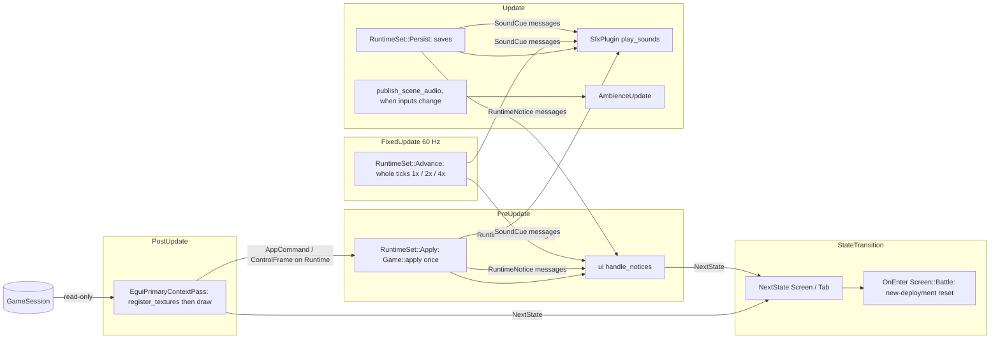

# Lastlight architecture

Lastlight is an independent two-package Cargo workspace. `horde_core` is engine-free Rust; `horde-defense` adapts that model to Bevy, egui, Windows input, assets and audio. It does not share build outputs, lockfiles or authoritative state with the monorepo's other experiments.

## Ownership

| Boundary | Owns | Does not own |
|---|---|---|
| `content`, `world` | Validated encounter/equipment/country definitions and scene tags | Runtime input or rendering |
| `command` | Typed `Command` data and `Game::apply`, the single frontend mutation path, with every player-intent rule and typed `CommandError` | Queueing, saves or presentation |
| `campaign`, `strategy` | Currency, unique gear, advancement, recruits, duties and outbreaks | Hit detection or cosmetic effects |
| `rules` | Saved RNG and supported dice, defense, protection and injury procedures | NPC target policy or animation |
| `sim` | One-field schedules, actors, collision/contact, maneuvers and reward events | UI, audio, filesystem calls |
| `sim/events` | Typed `SimEvent` stream: saved per-`Game` sequence numbers, the transient `drain_events` outbox and expedition forwarding | Presentation decisions or persistence of the outbox |
| `sim/parallel` | Worker battle ownership, reservations, idempotent settlement and reported `SettlementIssue`s | A second combat implementation |
| `sim/persistence` | Versioned coherent generations, checksums, validation and atomic writes | New combat decisions during load |
| `launch` | `LaunchConfig`: every argument and `LASTLIGHT_*` variable, parsed and validated once in `main` (`--help` lists them) | Reading the environment anywhere else |
| `profile` | `ProfilePaths` and the startup `LoadedProfile` read | Saving (the runner's storage service does) |
| `runner` (`SimRuntimePlugin`) | `GameSession` (the only mutable `Game`), `Runtime`: `AppCommand` queue (gameplay `Command`s plus durable reset/save intents), fixed-step execution, input edges, save coordination; writes `RuntimeNotice` and `SoundCue` messages | Drawing, playing audio, domain rule checks or alternative combat rules |
| `sfx` (`SfxPlugin`) | Reads `SoundCue` messages; voice budget, priorities, variant rotation and the effects bus | Deciding what happened in combat |
| `ui/*` (`UiPlugin`), `worldmap`, `inspector` | `Screen`/`Tab` states, `Navigation`, per-screen UI resources; read state, display decisions, collect intent; one notice system turns `RuntimeNotice`s into feedback and `NextState` | Mutating `GameSession`, ticking the game or paying rewards |
| `review_tools` (`ReviewToolsPlugin`, `review` feature) | Automated captures, capture sequences, frame reports; scheduled only for review launches | Ordinary play or practice |
| `art`, `visual_assets`, `animation` | Asset handles, padded atlas poses, read-only tick/event animation and bounded scene histories | Accuracy rolls, health, range or rewards |
| `atmosphere_audio` | Scene classification, six persistent environment channels, normalized crossfades and audio-bus gain | Combat clocks, weather damage or new hit resolution |

## Native scheduling

Only real dependencies are ordered: notices after `Apply` (so command outcomes transition before this frame's draw), `play_sounds` after `Persist`, scene audio before `AmbienceUpdate`, texture registration before draw, and the native cursor after egui output. Notices written by `Advance`/`Persist` are read the next frame, before its state transition. `show_window` runs under a run condition until the window is visible. Runner passes take `GameSession` without change detection and mark it changed only when they mutated the game, so `Res<GameSession>` change ticks mean real changes; drawing cannot mutate it at all.

| Resource / state | Owner | Purpose |
|---|---|---|
| `LaunchConfig` | `main` | Parsed arguments and environment |
| `GameSession { game }` | runner | Authoritative game |
| `Runtime` | runner | Command queue, controls, storage service |
| `ProfilePaths`, `Settings` (user settings) | profile / preferences | Save files and preferences |
| `State<Screen>`, `State<Tab>` (sub-state of `Screen::Camp`) | ui | Current view and camp tab |
| `Navigation` | ui | Remembered tab, return stack for settings/history, pending battle reset |
| `StatusUi`, `CampaignUi`, `ArmoryUi`, `BattleUi`, `HistoryUi`, `SettingsUi`, `MenuUi` | ui | Per-screen UI state |
| `ArtTextures`, `CustomCursor` | ui | Per-frame egui textures; whether the arena owns the pointer |

Egui may repeat layout passes. A repeated render pass cannot buy an item twice, advance combat or write a file: `Runtime` deduplicates same-frame semantic commands and holds pressed actions until a real fixed step consumes them. Held input and pressed edges are separate. Observation speed executes complete authoritative ticks, never scaled damage or extra actions per simulated second. Tactical pause covers the main battlefield, parallel workers, recovery, spawns, rewards and plague pressure.

`RuntimeNotice` acknowledges command outcomes, durable saves, completed attempts and expedition settlement failures. The runner holds no domain rules: it forwards each gameplay `Command` to `Game::apply` and reports the typed `CommandError` text unchanged. Menus and close handling react to those results; they do not assume that an operation succeeded. Failed writes keep the game open. Startup loading and isolated practice construction are application setup, outside widget layout. Unreadable generations are preserved before replacement.

## Simulation event stream

Every event the simulation emits receives a monotonic `seq` from the emitting `Game` (saved, so it never repeats after load; a live attempt owns the cursor and hands it back on finish) and is queued as a `SimEventRecord { seq, tick, battle, event }` in a transient outbox. `Game::drain_events` returns them in emission order, including the events of the tick on which an attempt finishes and a closing `AttemptFinished`. Expedition records are forwarded with `BattleId::Expedition(id)`; `(battle, seq)` is unique. Variants carry the data consumers need (resolved `Actor` with structure kind, defender mode and weapon class, ordnance kind, rules summary), so the runner selects sounds without inspecting a possibly ended attempt. Undrained records are capped. `Attempt.events` remains a bounded `VecDeque` window for scene replay; each window event shares its record's `seq`, which damage numbers use for deduplication. Legacy windows are renumbered on load. `Attempt.latest_resolution` gives the inspector the latest rules resolution without parsing log prose. Settlement failures stay on the separate `take_settlement_issues` channel because recalls produce them outside ticks.

## Domain interfaces

The `Game` aggregate remains the coherent public domain facade. Each worker uses the same battle procedures with an independent saved random state and actual reserved equipment. Monotonic settlement cursors transfer earned currency and remap new loot identities once. A transfer the shared campaign rejects (loot insert, stage clear for the expedition's explicit country, recruit release) is recorded as a transient, unsaved `SettlementIssue` that the runner drains into a notice instead of discarding. Completed workers compact their copied inventory; the root armory remains unlimited.

Personal attacks resolve geometric input directly. NPCs select legal maneuvers from visible information, then resolve the supported rules once. Cosmetic tracers consume that result. Enemy lanes and the defender anchor are authoritative world coordinates; screen size, UI scaling and map zoom cannot change them.

Authored catalogues load once at startup. Validation checks finite values, supported profiles, identity/enum ordering, creation budgets, graph connectivity, footprints and progression invariants. Save validation covers reservations, workers, actor references and advancement ledgers. Optional new fields retain explicit legacy defaults; a malformed save is rejected rather than partly merged with another generation.

## Bevy choices and tradeoffs

The application uses named systems, explicit schedule placement, a configured `Time<Fixed>`, resources for application ownership, AssetServer handles, and a single camera. The fixed core deliberately remains a plain Rust aggregate instead of mirroring every authoritative actor into mutable Bevy components. This preserves deterministic order and lets the same rules run in headless tests and parallel workers. Rendering uses a native egui canvas, with gameplay-independent textures and read-only inspection.

Startup is split: `LaunchConfig::from_process` is the only reader of arguments and the environment, `LoadedProfile::load` reads the save, and `FrontendParts::new` touches neither (`FrontendParts::load` composes them and applies review or practice scenarios, then `insert_into` turns the parts into App resources and the initial `Screen` state). Widgets take a `UiCtx` that borrows those resources (`&Game`, `&mut Runtime`, UI state, `NextState` requests); the draw system builds it from `UiParams`, tests build it from an owned `FrontendParts`. Tests use `ui/test_support.rs::test_frontend`, which is constructed from `LaunchConfig::default()` and a private temp directory, so it never sees `LOCALAPPDATA`, the real save or `LASTLIGHT_*` variables; its helpers stand in for the runner passes, the notice system and the state transition. The runner's pure functions take a `RuntimeCtx` (game, runtime, settings, paths, notice and cue sinks), so headless runner tests need no App. Persistence uses a named single-writer background service; only coherent immutable Game/settings snapshots cross that boundary. Snapshot capture/enqueue/poll stay on the main frame, while filesystem work is outside rendering/combat. CPU and native frame benchmarks measure that choice rather than claiming that decomposition alone proves performance.

See [REVIEW_ARCHITECTURE.md](REVIEW_ARCHITECTURE.md), [REVIEW_COMBAT.md](REVIEW_COMBAT.md), [REVIEW_CAMPAIGN.md](REVIEW_CAMPAIGN.md) and [VALIDATION.md](VALIDATION.md) for the review findings, regressions and evidence limits.

## Presentation follow-up

The UI overhaul adds presentation-only `navigation`, `chrome` and `briefing` modules. `open_preparation` and `open_campaign` retain context and explicitly preserve the effective debrief pause; `open_briefing` selects the next active-country stage without creating an attempt. Recommendation focus is transient UI state, cleared after a successful relevant command. The three camp destinations share native controls and explicit viewport reflow. No navigation method directly ticks, grants rewards or edits the persistence model. See [UI_REDESIGN.md](UI_REDESIGN.md).

`animation` reads immutable attempts/events. Tick poses freeze with simulation; scene caches remain bounded to eight and particles to 128. Fallen actors persist in saved per-attempt corpse records, settling into batches without a 24-body cap or timed eviction. Loot and damage use separately bounded real-time presentation caches with no transactions. Reduced effects retains tactical cues.

The frontend publishes `SceneAudioTarget` before `AmbienceUpdate`. `AtmosphereAudioPlugin` owns six persistent loop players and a bounded 1.2-second normalized crossfade. `runner` selects at most two authoritative effect cues per native update and caps effects at six voices. Pending playback settings and active sinks both obey current mute/gain settings. An observed parallel field supplies ordinary cues only while its observation is visible; other workers supply critical alerts.

The `logging` module configures Bevy's `LogPlugin` once (default filter, `RUST_LOG` override) with a plain-text file layer under `<save dir>/logs/` and a panic hook that writes `crash-<timestamp>.txt`; `horde_core` only emits `tracing` events and never installs a subscriber: save/load, a `battle` span (`attempt`, `mode`, `seed`) with attempt start/finish at `info` (finish carries the outcome), NPC decisions and rules resolutions at `debug` with structured fields, and one `trace` per tick. Non-test code uses `info!`/`warn!`/`error!`; plain stdout is reserved for the `--smoke` report and startup messages emitted before the subscriber exists.

Authored catalogues (`content`, `world`, `skills`, `enemies`, `ordnance`, `progression`, `quality`, `balance`) share `horde_core::catalog`: one `CATALOG_OVERRIDES` table maps each to its `LASTLIGHT_*` override variable, each exposes a fallible `try_load()` and a pure `from_json_str()` returning a typed `ContentError` (`Io`, `Parse`, `Invalid`, `TooLarge`). The frontend calls `init_catalogs()` first at startup, so a bad override prints a clean error and exits instead of panicking. The existing accessors (`content()`, `world()`, ...) stay process-wide `OnceLock`s; if `init_catalogs()` was not called they lazily load the override and, if that is invalid, log an error and use the bundled default.

The opt-in `capture_sequence` adapter exclusively creates a fresh output directory, captures actual native frames and records authoritative ticks. Its explicit fixed-step capture clock requires an isolated named review, rejects persistent practice and performance-report combinations, and never applies to ordinary gameplay. See [REVIEW_ANIMATION.md](REVIEW_ANIMATION.md), [REVIEW_ATMOSPHERE.md](REVIEW_ATMOSPHERE.md) and [REVIEW_UX.md](REVIEW_UX.md).

The pixel presentation replaces the active asset catalogue with separately cached scene/effect and model-source
atlases, measured source bounds and nearest sampling. Runtime flash masks
derive conservative geometry from the original alpha; transparent RGB cannot
produce an additive rectangle. Dressing stays outside the authoritative arena.
Normal combat has floating status/actions; skills and fortifications have a
dedicated immersive shell and presentation-only graph selection/pan/zoom.

Enemy hit stop is authoritative `Enemy::hit_stop_left`, defaulting to zero in old
saves and validated against a six-tick cap. Positive injury refreshes the bounded
movement pause; attack/NPC clocks continue. Rendering reads the counter for flash
and gait freeze; it cannot apply a second hit or change timing. Per-attempt corpse records are
persistent; settled drawing is batched. Settings navigation uses the shared
origin capture and durable save notices, with explicit main-menu choice and
visible failure. These are documented in [PIXEL_PRESENTATION.md](PIXEL_PRESENTATION.md).

## Current balance and analysis boundary

BalanceSettings and Attempt.lane_count/width_yards freeze at deployment. Core owns build/spawn/target geometry, DpsTracker and RunRecord settlement. ArenaProjection maps both extents to a centered clearing that grows physically; effects_clip permits bounded feedback over ambient space without expanding inputs/collision.

DpsTracker uses 300 simulation ticks/five seconds and source totals, not frame time. Parent-only history retains every finished outcome through once-drained saved worker outboxes; child games do not clone the parent's ledger. The History screen reads/filters/plots while fields are paused. Settings holds an unapplied draft until a validated SetBalance command commits future-run parameters.

Scene/effect atlases and manifest model sources use once-cached managed premultiplied conversion, NEAREST and actual RenderDevice budgets. Cursor visibility synchronizes after egui output; true aim is separate from its clamped resource badge. Damage/loot caches never mutate Game. See [BALANCE_AND_RUN_STATS.md](BALANCE_AND_RUN_STATS.md), [PROGRESSION_SCALING.md](PROGRESSION_SCALING.md) and [VIEW_HIERARCHY.md](VIEW_HIERARCHY.md).

## Current journey and component boundaries

The primary Results route is now the shared journey upgrade home. NewJourney uses a named durable archive/reset service outside widgets; ContinueJourney/LeaveJourney delegate the explicit core state machine and save acknowledgement. Existing main/worker generation state is protected before a fresh profile is committed.

The single connected catalogue owns body ranks, skills, fortification ownership/ranks and feature access through one preflight/payment kernel. Fresh personal XP does not mint CP; eligible legacy budgets use a spent-point ledger. NPC training remains its own rules budget.

EquipmentVisual is an immutable core snapshot of actual owned/equipped metadata. player_model startup validates manifest/data and compiles original ownership/attachment meshes before rendering. resolve_appearance and resolve_pose separate selection from articulation; resolve_equipped_model returns actual pixels/sockets/muzzle/throw origin. backend_egui owns cached managed upload/drawing, while visual_assets is the application facade. defender_presentation samples authoritative action history and retains bounded source-space projectile-release origins. Battle and equipped previews use this shared facade; the retired character_rig has been deleted. No renderer transaction, attack roll or fixed defender movement is possible. Original bind parity does not approve new poses/materials or prove current performance. [JOURNEYS.md](JOURNEYS.md) and [CHARACTER_COMPONENTS.md](CHARACTER_COMPONENTS.md) describe these seams.

## Storage service and durable transition seam

runner/persistence.rs::Service has one worker, one in-flight job and one latest pending snapshot; coalescing retains user intents. Core Game remains engine-free and owned on the main thread. A worker receives boxed immutable snapshots and owns encoding/validation/recovery/atomic filesystem writes. Completion tickets/epochs are interpreted only by Runtime. No live Game mutex, renderer resource or gameplay callback is shared with storage.

Runtime.durable_transition_pending covers already-queued critical requests as well as in-flight/reset work. SetPaused then Save is an ordered barrier: later mutations and raw Settings edits/rebinding are rejected/frozen until acknowledgment. Background autosave completion cannot clear user pending state for a newer transition. Ordinary simulation/input is not stalled by periodic filesystem latency.

NewJourney is a serialized epoch barrier across old saves, full archive and fresh commit; only matching success replaces the live Game. Old Quit acknowledgments are ignored after epoch change, and a Quit during reset is recaptured against the resulting paused generation. Shutdown drains/joins separately. PersistenceMetrics and FrameReportV2 distinguish main-frame polling/snapshot costs, background write cost, focus and bounded/partial samples. See [JOURNEYS.md](JOURNEYS.md); actual before/after timing and limitations belong in [VALIDATION.md](VALIDATION.md).

ThrownOrdnance.release_cues saves the facts needed to reconstruct the historical source-model release pose after event pruning or an ended brace. The presentation adapter uses these facts without creating a new attack/release; missing old cues follow the validated legacy sampler. A source regression covers save/resume with the projectile still airborne and original bounded cues expired.
