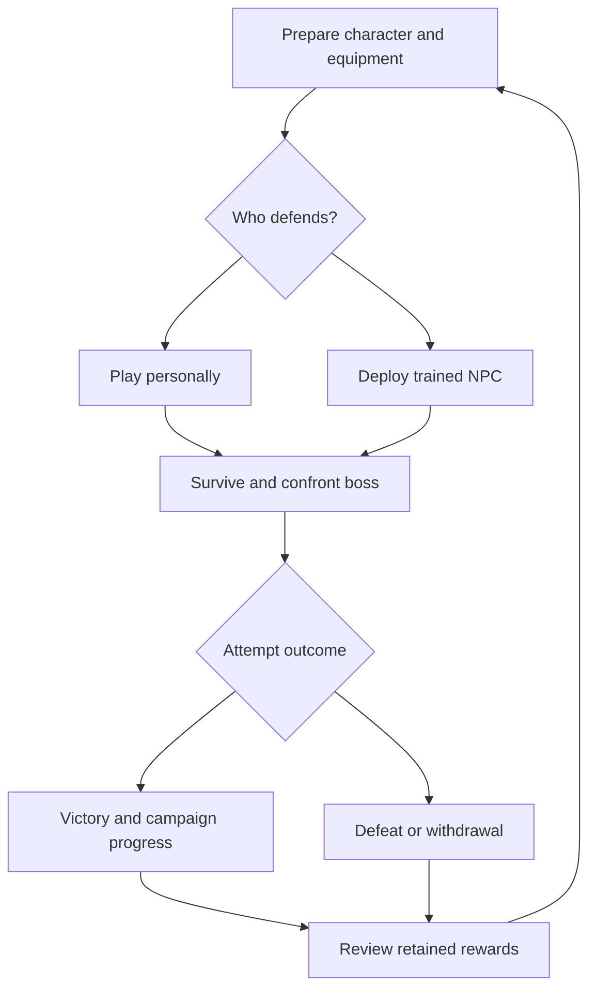

**Version 0.1 · 1 November 2026 · Concept baseline**

A stationary survivor holds a defensive line against an escalating stream of enemies. The player aims and shoots, uses melee when enemies reach the line, earns coins and equipment, and improves between attempts. Progress gradually adds traps, walls, and turrets. The player can also equip and train an NPC, then deploy that survivor to fight autonomously using a defined GURPS rules implementation.

The intended progression is **personal survival, character growth, delegated combat, and a fortified defense network**. Manual play and NPC deployment serve the same campaign and economy. They offer different decisions: execution during personal play, and preparation, training, and tactical oversight during NPC play.

**Markdown copy:** [horde-defense-incremental-gdd-v0.1.md](https://chatgpt.com/library?file_id=libfile_78b305bde8f88191ac5d914ea1b90a7c\&account_id=personal)

# 1 Document status and design authority

**Confirmed** means explicitly requested by the game creator. **Proposed baseline** means a concrete design choice introduced to make the concept coherent and implementable. Unless a section explicitly says otherwise, its additional mechanics are proposed baseline decisions. All numerical values are prototype hypotheses, not measured balance results.

The GURPS requirement is confirmed. Selecting Fourth Edition Lite as the initial reference, limiting the first implementation to supported rules, and introducing the battlefield adapters below are proposals. This document does not claim complete implementation of every GURPS rule or supplement.

“Improve the body” is interpreted as spending character points on physical capabilities. Permanent mutilation, mutations, cybernetics, and body-part surgery are outside this baseline.

## Confirmed requirements

| ID | Requirement | Design coverage |
| - | - | - |
| U01 | The player enters a level as a ranged unit | Deployment and manual combat |
| U02 | The player does not move and aims and shoots with the mouse | Fixed defender position and controls |
| U03 | The player stays on the left, in the middle of eleven lanes | Arena geometry; lane 6 |
| U04 | Enemies spawn at the outer right on one of eleven lanes | Spawn director |
| U05 | Enemies move only from right to left | Lane movement and obstruction rules |
| U06 | Enemies reaching the left attack the player until defeated or the player dies | Shared defense line and contact combat |
| U07 | Every enemy killed awards coins | Reward transaction rules |
| U08 | The player survives for a level-specific time before its boss appears | Encounter phases and clear condition |
| U09 | After death, retry and skill purchasing are available | Results and preparation flow |
| U10 | Enemies can drop loot, which the player can sell | Equipment and economy |
| U11 | Melee attacks are available | Targeted contact-lane melee |
| U12 | Later progression adds purchasable traps, turrets, and walls up to the screen midpoint | Construction phase |
| U13 | Newly spawned enemy quantities increase as an attempt progresses | Spawn-rate envelope |
| U14 | A character sheet and character points improve the player's body | Player development |
| U15 | An NPC can fight instead of the player | One-defender deployment choice |
| U16 | The NPC follows GURPS rules and can be equipped and trained | NPC rules, training, and equipment |
| U17 | Project Zomboid is an inspiration | Survival atmosphere and grounded equipment |

## Proposed product assumptions

| Area | Baseline |
| - | - |
| Platform | Desktop PC; mouse and keyboard first |
| Players | Single-player |
| Presentation | Readable 2D battlefield with eleven visible horizontal lanes and an original post-apocalyptic setting |
| Session shape | Short attempts, initially about two to five minutes before the boss, followed by preparation |
| Persistence | Coins, equipment, development, and campaign unlocks persist between attempts |
| NPC deployment | One active NPC replaces the player; no party combat |
| Automation | Live autonomous simulation while the game runs; one attempt by default |
| Commercial model | Undecided; prototype has no paid power, energy payments, or advertising interruptions |
| Technology | Engine-neutral design; implementation stack selected after the combat proof |

# 2 Vision and player experience

## Player fantasy

Start as a vulnerable survivor who can barely keep the line clear. Become more capable through training, better equipment, and effective decisions. Eventually command a prepared defensive position and a trained survivor who can hold it on your behalf.

Project Zomboid's official description emphasizes scavenging, constructing defenses, developing skills, and surviving a zombie threat. Those are useful inspiration points for atmosphere and equipment identity. This game concentrates that fantasy into a fixed battlefield and repeated attempts. [R1]

## Design pillars

1. **Aiming and prioritization matter.** The player chooses the most urgent threat across the entire field.

2. **Failed attempts produce useful growth.** Earned rewards survive defeat, and the debrief suggests a concrete next improvement.

3. **Automation expands the player's role.** NPCs and defenses introduce preparation and oversight without removing personal play.

4. **The battlefield remains understandable.** The player can identify danger, the cause of damage, and why an NPC acted.

5. **Builds express a strategy.** Equipment, body development, skills, NPC training, and structures create distinct strengths.

6. **New complexity arrives gradually.** The first attempt teaches aiming and contact danger; later milestones introduce management and construction.

## Core decisions

The player repeatedly answers: Which enemy needs attention now? Should I reload or finish this target? Is a contact enemy worth a melee attack? Which upgrade changes the next attempt most? Should I fight personally or deploy my NPC? Which lanes should receive limited defensive coverage?

# 3 Terms and scope boundaries

| Term | Meaning |
| - | - |
| Level | A selectable encounter definition with its own timer, enemy mix, boss, rewards, and construction allowance |
| Attempt | One deployment into a level, ending in victory, defeat, or withdrawal |
| Campaign | The persistent set of unlocked levels and progression milestones |
| Campaign tier | A group of milestones controlling equipment access and advancement allowances |
| Active defender | The player character or one selected NPC occupying the fixed position |
| Defense line | The shared left boundary; enemies reaching any lane can threaten the active defender |
| Close engagement | The abstract combat relationship created when an enemy reaches the defense line |
| Blueprint | Permanent ownership of a structure type |
| Build supply | A finite placement allowance for the current attempt; separate from coins |
| Tactical policy | NPC preferences that select legal actions; it does not determine dice results |

The initial game does not include free movement, an explorable open world, survival crafting chains, multiplayer, simultaneous NPC expeditions, permanent roster loss, offline earnings, or prestige resets. These are scope boundaries for the proposed first version, not rejected future ideas.

# 4 Core game loop

1. Choose an unlocked level and select personal play or an NPC.

2. Equip the active defender, spend available development resources, and review the level.

3. When construction is available, prepare a layout within the allowed area and supply budget.

4. Survive escalating enemies; collect kill rewards automatically.

5. At the level timer, face the boss while ordinary enemies continue arriving.

6. Defeat the boss, be defeated, or withdraw.

7. Review the result, improve, and retry or advance.



Coins and loot are banked when earned. The result screen summarizes those transactions; it does not pay them a second time.

# 5 Battlefield and spatial rules

## Fixed geometry

The combat viewport is the arena, excluding menus and sidebars. Its logical coordinates remain constant when the window or interface scale changes.

| Element | Rule |
| - | - |
| Lanes | Exactly eleven, numbered 1 at the top through 11 at the bottom |
| Middle lane | Lane 6 |
| Defender | Anchored on the left at the vertical center of lane 6 |
| Enemy entry | Just outside the right edge, with a visible arrival cue |
| Travel | Decreasing horizontal position within the assigned lane |
| Defense line | A vertical boundary immediately to the defender's right, spanning all lanes |
| Contact strip | Reserved space at the line that keeps attacking enemies visible |
| Construction zone | Between the contact strip and exactly 50% of the arena width |
| Approach zone | The right half; no player structures may occupy it |

Lanes 1–5 are above the defender, lane 6 aligns with the defender, and lanes 7–11 are below. All eleven remain visible during combat. The player and NPC may turn, lean, recoil, or change posture in place, but their anchor cannot translate.

For the combat proof, use a logical arena 30 yards wide and 11 yards high, with lane centers at `y = lane number − 0.5`. Place the defender at `(0.5, 5.5)`, the defense line at `x = 1.5`, the contact strip between `x = 1.5` and `x = 3`, and construction between `x = 3` and `x = 15`. Enemies spawn beyond `x = 30`. Range and movement use these world units, never pixels. These dimensions are proposed tuning inputs; any revision must update both combat profiles and their range tests.

## Shared defense line and close engagement

An enemy at the left edge of an outer lane cannot literally stand next to a character in lane 6. The proposed solution is an explicit tactical abstraction:

**Reaching any lane's defense line creates close engagement with the active defender. The enemy remains visible in its original lane, but contact attacks and eligible melee responses use that engagement relationship.**

This rule applies equally to personal and NPC play. It prevents an enemy from gaining an abstract attack range that the defender cannot answer. It does not move or teleport enemies, create a separate base-health pool, or allow basic melee to hit the whole screen.

The line must be visually continuous. An attack highlights its source lane and the defender's damage indicator together. The tutorial states: **“Enemies at any part of the line can attack you. Aim at a contact lane to strike back.”**

This abstraction is the highest-priority visual playtest. If it feels confusing or physically implausible, revising it requires an explicit concept decision about converging lanes or separate base health.

## Melee targeting under this abstraction

Basic melee selects one contact lane under the cursor and strikes its front eligible enemy. Enemies still approaching farther to the right are ineligible. Later sweep abilities can affect a stated number of adjacent contact lanes, subject to their own rules.

At actual line contact, use an effective distance of one yard and a frontal engagement for both contact attacks and defender responses. This replaces ordinary distance for melee reach and ranged distance modifiers against that contacted enemy. The cursor still selects the enemy at its displayed lane position. Enemies still walking behind the contact attacker keep their ordinary world distances until they reach the line (since W1-69 enemies never queue; they overlap).

The effective distance applies only between the active defender and that contacted enemy. Turrets and traps always evaluate range from their own world positions. Manual cursor targeting remains geometric, while any applicable personal weapon range effect uses the same declared contact relationship.

Ordinary contact enemies receive no flank or rear-attack treatment. The first melee loadout must support the adopted one-yard engagement; weapons requiring a different reach need an explicit later rule. “Close engagement” is this game's term and does not automatically invoke every tabletop close-combat subsystem. This spatial adapter applies to both modes and is not a literal tabletop map rule.

# 6 Modes and controls

## Personal play

| Input | Action |
| - | - |
| Mouse movement | Aim continuously across the battlefield |
| Primary mouse button | Fire; hold-to-fire supported at the weapon's maximum cadence |
| Secondary mouse button | Targeted melee against the selected contact lane |
| R | Reload |
| Number keys | Use equipped active abilities when unlocked |
| B | Open construction in tactical pause |
| Escape or pause button | Pause, settings, withdrawal, or save and quit |

Every essential action is remappable. Mouse-only alternatives should exist for reload, abilities, and pause. A firing toggle supplements hold-to-fire, and rapidly clicking grants no rate advantage. These choices follow the accessibility guidance on remapping and avoiding repeated-input barriers. [R2, R3]

## NPC deployment

The mouse inspects enemies, structures, and the NPC's current decision. It does not fire the NPC's weapon. The player may pause, adjust a policy, manage construction, and recall the NPC. A policy change takes effect at the next legal decision point and cannot reset an action timer.

The deployment mode is locked until the attempt ends. The inactive player or NPC contributes no additional shots, health, training rewards, or inventory capacity.

# 7 Personal ranged and melee combat

## Ranged combat

Personal play uses geometric aiming and hit detection. The starter weapon can reach every lane, including enemies already at the defense line. Initial firearms use immediate hit resolution with visual tracers, making aim feedback clear.

A shot first checks its legal origin, aim direction, ammunition, and weapon cadence. It then resolves contact with enemy collision geometry. The default projectile hits the first enemy; piercing and area weapons explicitly override that behavior. Friendly structures do not block allied shots in this baseline.

Body hits provide dependable damage. Weak points offer an additional reward on selected enemies, but mandatory progression cannot depend on consistently hitting tiny targets. Personal play does not receive a hidden NPC-style attack roll after a valid geometric hit.

## Ammunition and reloads

The first version uses magazines with renewable reserve ammunition. Reloads create windows of danger without requiring permanent coin purchases simply to participate. Magazine size, fire cadence, and reload duration are visible before deployment.

Empty weapons may auto-reload if enabled. Melee cancels an unfinished personal reload without granting ammunition; reloading must then restart. The UI makes that consequence visible. Later weapon exceptions must be explicit.

## Melee

Melee is available from the beginning. A basic strike affects one selected contact lane, has a visible cooldown, and consumes stamina. It commits the defender to an attack and recovery window during which firing and reloading are unavailable. That exclusive window is separate from the cooldown before another melee strike. A failed input with no eligible contact target spends no stamina.

A provisional personal melee profile is one strike every 1.2 seconds, costing 25 of 100 stamina. Exact damage and recovery rates depend on the enemy prototype. Interruption is a separately authored property: it must not silently invalidate bosses or allow permanent stun locks.

## Damage feedback

Separate hit, armor absorption, weak-point impact, and kill feedback. Every loss of defender health has a traceable attacker and source lane. Damage numbers are optional; important attack cues remain visible when numbers are hidden.

# 8 Enemies and contact behavior

## Enemy lifecycle

Enemies enter through a visible right-edge cue, advance in their lane, attack the first blocking structure they reach, and resume advancing when it is destroyed. At the defense line they attack the active defender. Death cancels unfinished actions and awards rewards once.

In NPC mode, death or loss of consciousness counts as terminal hostile defeat for this encounter. The defeated hostile stops acting, releases its contact position, and is removed from the active fight; its recorded outcome distinguishes unconsciousness from death. Temporary stun or knockdown is not terminal defeat. This scenario removal rule prevents unconscious enemies from blocking a lane indefinitely or waking for a second payout. The boss uses the same defeat definition.

No enemy switches lanes or finds a route around a wall. No baseline enemy damages the defender from the far half of the screen. Ranged attackers would require a separate future rule.

## Contact pressure

**Superseded 2026-11-06 (W1-69, user decision): enemies never block each other.** There is no per-lane attacker slot or queue; every enemy at the defense line or a live non-trap structure attacks, and structures still block.

Every enemy that reaches the defense line or the face of a live non-trap structure in its lane makes contact and attacks. Bodies in one lane overlap and are drawn slightly staggered; all of them remain targetable. Simultaneous contact damage is bounded by spawn pressure and the enemy cap, not by a slot per lane.

Reaching contact never grants a free immediate hit. A clear attack windup or the next legal NPC-mode combat action must occur first. Collision rules cannot let enemies pass through intact blockers.

## Initial enemy families

| Enemy | Role | Player decision |
| - | - | - |
| Shambler | Slow baseline enemy | Learn aiming and arrival time |
| Runner | Fragile, fast approach | Switch targets before it reaches the line |
| Brute | Slow, durable, dangerous contact | Plan sustained fire and reload timing |
| Armored survivor | Visible protection and a defined vulnerability | Use suitable equipment or a vulnerable region |
| Demolisher | Strong attacks against blocking structures | Protect critical defensive positions |

Only the first two families are necessary for the combat proof. Additional families must change a decision, not merely recolor a health bar. Every family used in NPC deployments requires a validated NPC-rules profile.

# 9 Spawn escalation and encounter pacing

## Growing arrival rate

The level defines a baseline enemies-per-second rate that grows with elapsed simulation time. Actual spawns occur in small staggered groups across the eleven lanes. The game never requires a wave to be cleared before the next one arrives.

An initial authoring model is:

```text
arrival_rate(t) = min(rate_cap, start_rate × (1 + growth × t / boss_time))
```

Here, `t` is elapsed attempt time, including the boss phase. The envelope increases until its authored ceiling. Brief local variation may change which lanes receive enemies, while the overall pressure trend increases. More simultaneous enemies, tougher enemies, and faster enemies are separate balance controls.

**Illustrative first-level inputs:** `start_rate = 0.20/second`, `growth = 3`, `boss_time = 180 seconds`, and `rate_cap = 0.80/second`. The rate rises from 12 to 48 enemies per minute. Without interruptions or spawn-cap effects, the expected pre-boss count is about 90. These numbers establish a test case, not a promised difficulty curve.

## Lane selection and fairness

Use weighted lane selection with short history constraints to avoid accidental excessive concentration. All eleven lanes are valid; the tutorial initially emphasizes a small subset before widening the pattern. Announced boss reinforcement lanes may intentionally concentrate pressure.

Spawn cues, silhouettes, and approach time must provide a response window. The director does not secretly select an unprotected lane in reaction to an unknown future input or dice result.

## Sustained pressure and capacity

“Endless” describes continued arrival until an attempt ends. It does not require an unlimited instantaneous spawn rate or an unlimited number of live objects.

Each level has an authored active-enemy ceiling with one reserved boss slot. The baseline skips ordinary arrivals scheduled while ordinary capacity is full; it creates no spawn debt. Capacity becomes available as enemies leave the active fight. This rule never deletes a live reward-bearing enemy, grants coins for skipped spawns, or postpones the boss timer. Capacity behavior must be deterministic and covered by stress tests.

# 10 Bosses and level completion

The survival timer announces the boss; it does not award victory. A short warning precedes the boss's arrival from the right. Ordinary enemies continue arriving during the fight within the level's pressure ceiling.

Defeating the boss completes the level immediately. Remaining ordinary enemies stop acting and are cleared without defeat rewards. One authoritative boss-defeat transaction owns the boss's coins, guaranteed equipment, any distinct completion bonus, completion state, and applicable first-clear unlocks. Generic enemy-reward handling and the results screen cannot issue another boss payout.

| Boss | Encounter concept | Required counterplay |
| - | - | - |
| Breacher | Armored boss in lane 6 with a dangerous contact attack | Damage during readable exposure and manage reloads |
| Caller | Announces extra enemies in selected lanes | Alternate between boss pressure and urgent reinforcements |
| Siege Brute | Strong structure attacks with a recovery window | Place obstacles purposefully and exploit recovery |

The first slice needs only the Breacher. Its initial exposure mechanic is a visible vulnerability phase that changes authored protection or susceptibility for ordinary supported attacks; it requires no anatomical hit-location subsystem. Every compulsory boss mechanic must be solvable by the NPC's legal actions. An exposure window must last long enough for the selected rules clock, reaction boundary, and relevant maneuver; a sub-second cursor challenge is unsuitable.

Outcome ordering is deterministic. In personal mode, if a boss defeat and player death are produced in the same authoritative combat step, count the clear as victory. NPC mode preserves its declared action order: an unconscious or dead actor does not perform an action merely because another event occurred during the same one-second interval. The first terminal result established by that order wins.

Repeated boss clears remain rewarding; first-clear unlocks cannot repeat. Delaying a boss defeat is permitted, but completion rewards should make clearing and replaying more productive than indefinitely stalling that same encounter.

# 11 Death, withdrawal, and persistence

## Reset contract

| State | After defeat or withdrawal | Next attempt |
| - | - | - |
| Coins already earned | Retained | Available |
| Loot already earned | Retained in shared armory | Available |
| Player XP and character points | Retained | Available for preparation |
| NPC points and training | Retained by that NPC | Available |
| Purchased skills and blueprints | Retained | Available to their documented owner |
| Campaign unlocks | Retained | Previously unlocked levels selectable |
| Health, stamina, fatigue, and temporary injuries | Attempt ends; baseline recovery applies | Reset to prepared starting state |
| Enemy positions and boss progress | Discarded | Level begins again |
| Placed structures and build supply | Discarded | Starting allowance restored |
| Saved layout | Retained as a plan | Rebuilt only if legal and affordable within supply |

Death is never a prerequisite for improving. Preparation is also available after victory and voluntary withdrawal. Defeat offers **Retry** and **Prepare and Upgrade**. Retry uses the existing prepared configuration and does not buy or allocate anything automatically.

Withdrawal preserves completed kill rewards and gives no unearned boss or clear reward. There is no payment simply for dying or withdrawing. In NPC mode, distinguish recall, unconsciousness/incapacitation, and a mechanically lethal result in the report.

For the active NPC, loss of consciousness or death ends the attempt after the triggering action's consequences resolve. Temporary stun, knockdown, disarmament, or interrupted maneuvers do not automatically end it; supported recovery actions continue. Turrets do not keep the attempt running after a terminal defender defeat. Recall remains available if the current state leaves no useful combat action.

Permanent NPC roster loss is disabled in the baseline. Between attempts, the campaign restores the NPC and its equipment, even after a lethal combat result. This is an explicit campaign recovery rule; the log must still describe the original result truthfully. Recovery requires no payment or real-time waiting.

# 12 Coins and progression economy

Coins are the shared persistent purchasing currency. Every eligible enemy death pays its configured coin amount, regardless of whether the killing blow came from the player, NPC, trap, or turret. A qualifying nonlethal hostile defeat in NPC mode pays the same configured reward once. Boss rewards use the single transaction defined in section 10.

| Resource | Earned from | Spent on | Ownership |
| - | - | - | - |
| Coins | Kills, boss rewards, selling loot | Skills, blueprints and their upgrades, training services | Shared |
| Player XP | Kills credited during personal deployments and defined personal milestones | Automatically fills character-level progress | Player |
| Player character points | Player levels and specified milestones | Body development | Player |
| NPC character points | Personal training objectives, first-clear achievements, bounded training services | Rules-defined NPC advancement | Individual NPC |
| Build supply | Starting allowance for the selected attempt | Structure deployment | Attempt only |

XP is not a spendable shop currency. Build supply cannot be converted into coins. In personal mode, eligible kills by the defender, traps, and turrets all grant player XP. In NPC mode, shared rewards and the selected NPC's applicable training-objective progress are earned; the inactive player does not receive duplicate XP. Deployment and results state which character gains development.

## Purchase pacing

The first useful purchase should be affordable from an ordinary short opening attempt. Early purchases should occur often enough to make the improvement loop visible. Major system unlocks are primarily milestone-gated and should not require a second long grind after qualification.

A practical price target is `typical eligible coins earned per minute × desired minutes to purchase`. Measure it on the content and mode the player has unlocked. Exponential upgrade prices require explicit comparison with income and useful power; incremental-game analysis highlights how these growth curves can diverge. [R4]

For a hypothetical attempt with 24 kills at 3 coins each and 2 unwanted items sold for 12 coins each, proceeds are `24 × 3 + 2 × 12 = 96 coins`. A 40-coin skill and a 50-coin training service would leave 6 coins. These values illustrate transaction clarity, not recommended final prices.

No essential progression requires a rare drop. Every progression-gating encounter must be beatable in each mode using reasonably obtainable gear, skills, and training available before that gate. Reaching the current point allowance must not create an impossible boss that is required to raise it. Replaying earlier levels remains a valid recovery option. Later levels should offer useful tier access and better achievable rewards without making previously purchased equipment immediately meaningless.

# 13 Player character sheet and body development

Personal play uses a compact body-development model. This model is separate from the NPC's GURPS point accounting, and its bonuses do not silently transfer to an NPC.

| Attribute | Intended effect | Boundary |
| - | - | - |
| Vitality | Maximum health | No invulnerability threshold |
| Strength | Melee force and selected weapon handling | Does not universally multiply bullet damage |
| Coordination | Reload and handling efficiency | Explicit minimum action durations |
| Endurance | Stamina and recovery | Cannot remove every melee limitation |
| Perception | Weak-point assistance or effectiveness | Explicit caps and clear tooltips |

The sheet displays base values, equipment effects, skill effects, final totals, and unspent points. Allocating a point previews a concrete change, such as health increasing from 100 to 105 under the prototype Vitality rule.

Start with one character point per player level. An example XP threshold is `20 + 15 × n^1.3`, where `n` counts completed level-ups; actual thresholds must be tuned with observed kills. Campaign tiers cap available attribute investment so indefinite farming does not bypass every encounter decision.

Allow free redistribution in preparation during the prototype. Do not invent movement-speed upgrades for an immobile character. A later body-modification system would need its own fiction, equipment interactions, and tradeoffs.

# 14 Skills and permanent purchases

| Branch | Purpose | Example effects |
| - | - | - |
| Marksmanship | Improve active shooting choices | Controlled penetration, reload recovery, precision rewards |
| Close combat | Recover from contact pressure | Improved interruption, adjacent-lane sweep, reduced melee cost |
| Survival | Increase resilience and recovery options | Limited emergency heal or a temporary defensive action |
| Engineering | Expand defensive options | Trap, wall, and turret blueprints; structure variants and upgrades |

Coins purchase skill ownership. Active abilities occupy a small, clearly displayed loadout; passive effects state whether they are personal, shared, or specific to a structure. Branch ownership is not a license to apply every personal modifier to NPC combat.

Body points improve baseline capabilities. Skills introduce actions, synergies, and specialization. The initial skill set should contain a few effects that change decisions rather than a large tree of barely perceptible percentages.

# 15 Loot, equipment, and selling

## Equipment model

The first complete loop uses four slots: ranged weapon, melee weapon, protective outfit, and accessory. A shared armory holds player and NPC equipment.

Each item has a persistent identity, slot, tier, rarity, authored stats, permitted users, sell value, and lock/favorite state. Where an item serves both modes, it has explicit personal-combat and NPC-rules profiles. One item's identity and ownership remain shared even when the two profiles use different numerical scales.

A percentage damage bonus in personal play must not automatically become a GURPS skill bonus. The comparison panel shows the effect for the currently selected defender. Unsupported combinations are blocked with a reason before deployment.

## Drops and collection

Coins and loot collect automatically because the defender cannot move. Cosmetic drops may appear briefly and travel toward the reward indicator, but never require a pickup click. Drop events resolve before the end-of-attempt summary.

Normal enemies have an authored drop chance (3%, and every twentieth kill drops). Elites always drop, at Uncommon quality or better. Bosses guarantee a relevant equipment reward in addition to coins. A bounded bad-luck rule or milestone reward protects essential progression. Higher rarity expands useful modifiers or specialization; it does not guarantee that an item suits every build.

Drop probability must follow kill volume. For example, a 3% chance across 200 eligible kills produces 6 expected item drops. This is a mathematical expectation, not a guarantee. Avoid a late-game stash flooded by hundreds of low-value notifications.

## Selling and loadout safety

Sell items in preparation. Show total proceeds before a batch sale. One sale rule decides every sale, single or batch: an item sells only when nothing holds it. Locked, favorited, protected starter and NPC-issue items, equipment worn by you, Mara or an idle survivor, items a saved preset references and items reserved by a deployment or a country guard cannot be sold. The armory disables the sale and states the first reason in plain text; unlock, unfavorite, unequip or delete the preset first. A sale never rewrites a loadout and never leaves a preset incomplete (ruleset 2).

Multiple presets may reference the same owned rifle because only one defender deploys at a time. Deployment reserves the actual item; a preset never creates a duplicate. A protected starter equipment set always remains available.

The baseline stash has no hard gameplay item-capacity limit. Automatically collected equipment is never discarded because a bag is full; sorting, filtering, and aggregated notifications control presentation. Equipping, comparing, and switching a valid loadout are free.

## Auto-sell

Auto-sell is an explicit preference in Equipment, off by default. When the player turns it on, the end of each run sells that run's new drops whose quality is below a threshold the player picks (default: Common and below), in the slots the player selects. It keeps a drop that would upgrade the defender who fought the run, and never sells an item the one sale rule protects: starter, locked, favorited, NPC-issue, equipped, preset, recruit and reserved items. It sells only when a run is settled, never during a battle, and draws no randomness. Expeditions and country operations follow the same rule unless the player turns that off. The result screen shows what was sold and for how much ("Auto-sold N · +C"); the battlefield never shows sale text. A separate "Apply rule to stash now" sells the current stash under the same rule after a confirmation that states the count and the proceeds. [PROGRESSION.md](PROGRESSION.md), "Auto-sell", is the exact rule.

# 16 NPC deployment and training

## Deployment contract

After the introductory attempt, provide one free, viable NPC with a validated starter build and protected equipment. The preparation screen offers **Fight Personally** or **Send Survivor**. Both select the same level, encounter geometry, spawn schedule, objective, reward table, and campaign unlocks.

NPC combat is autonomous while the game is running. It is not an abstract percentage-based expedition result. The player can observe the actual fight and understand its outcome.

## NPC character sheet

Expose identity, attributes, derived combat values, skills, equipment, training, tactical policy, and deployment history. The core attribute fields are Strength (ST), Dexterity (DX), Intelligence (IQ), and Health (HT). Relevant derived fields include HP, FP, Will, Perception, Basic Speed, and Dodge; use the selected edition's definitions and point accounting. [R8]

Present a simple readiness summary first, with the detailed rules view available on demand. Every stat must support a mechanic in the selected scope or be clearly marked informational. Do not sell a movement upgrade that cannot help the fixed defender.

## Advancement allowance

Each NPC has a campaign-tier advancement allowance. The limit counts every advancement point awarded, including allocated and unspent points. A first-clear achievement or finite training objective can award points within that allowance. Coin-funded training services can fill the remaining allowance, allowing someone who mainly plays manually to prepare the NPC without replaying the entire campaign.

The starter build has a separately validated creation budget; its initial points do not consume the advancement allowance. Shared campaign first-clear flags belong to the account, while NPC achievements are recorded once per NPC. A proposed early objective awards one point after 20 successful ranged hits; another awards one point after 120 cumulative combat seconds. Progress survives failed attempts. These finite objectives do not repeat indefinitely, and a completed objective waits unclaimed if the allowance is full. Apply eligible earned awards before offering paid training when new capacity opens.

The NPC spends its points using the adopted GURPS costs. Coins fund access or instruction; they do not bypass point costs. The campaign allowance, objective awards, and instant training service are original progression rules for this game.

Advancement limits rise at campaign milestones. Repeating the easiest level can earn coins and loot, but cannot generate unlimited NPC attributes or skills. Redistributing points does not reset the historical award counter. Points are personal and cannot be transferred between characters.

Training occurs immediately in preparation and represents elapsed instruction in the fiction. There are no real-time training timers. Preview cost, current value, resulting value, prerequisites, and allowance before purchase.

# 17 GURPS rules contract for NPC combat

## Reference and coverage

Use **GURPS Fourth Edition Lite, August 2004**, as the initial pinned reference, with an explicit supported-rule list and versioned corrections. The publisher describes Lite as a condensed treatment of character creation and core play. It is a manageable reference for the first implementation. [R5]

Core resolution uses 3d6 against effective skill, permitted active defense, then weapon damage, armor, and injury. HP at or below zero does not automatically mean death. Character improvement spends points according to the adopted costs. [R6]

The rules module must cover the interactions actually present in supported content: critical results, legal defenses, readiness, ammunition, range, relevant injury conditions, consciousness, and lethal outcomes. Do not label a system GURPS-compliant merely because it rolls three dice.

| Area | Required treatment |
| - | - |
| Character data and point spending | Follow the pinned reference for the supported traits and skills |
| Combat resolution | Validate against worked reference cases; no hidden second accuracy system |
| Maneuver timing | Respect the reference's action opportunities and ordering |
| Enemy, weapon, and armor profiles | Author and validate rules-compatible data |
| Fixed lanes and shared contact | Documented spatial adapter |
| Infinite reserve supply | Documented scenario provision; magazines and reload actions still matter |
| Recovery and advancement allowances | Documented campaign rules |
| Structures and automated weapons | Authored scenario objects with explicit attack and damage profiles |
| Unsupported supplements and advanced subsystems | Excluded until separately implemented and verified |

## Clock and action selection

GURPS combat uses one-second turns. The simulation must preserve legal action timing and turn order while animations remain smooth. [R6] NPCs select from supported maneuvers such as Aim, Attack, Ready, and defensive options. The official Fourth Edition Combat Cards are an additional maneuver cross-check. [R7]

A faster display or observation speed cannot grant additional actions per simulated second. Characters entering an existing encounter receive a defined place in the schedule. Reaching contact does not grant an extra attack outside that schedule.

The first NPC slice should use a small set of weapons whose rules are fully supported. Automatic fire, complex pellet behavior, detailed hit locations, grappling, and additional supplements require explicit coverage before their associated content is enabled.

## Resolve an attack once

1. Check that the action, target, range, equipment, and current state permit the attempt.

2. Calculate the effective skill and applicable supported modifiers.

3. Resolve the declared rules procedure and all required outcomes.

4. Apply one authoritative result to the world.

5. Animate the result and record its explanation.

Cosmetic tracers cannot reverse a resolved hit or accidentally turn a miss into collateral damage. Direct-play hit detection is not applied a second time to NPC attacks. If delayed projectiles are introduced later, their timing and collision rules need a separate contract.

## Two resolution profiles on one battlefield

Personal play resolves the player's aim geometrically. NPC deployments use the NPC rules profile for all combat participants, including attacking enemies and offensive structures. Every shared enemy, weapon, and defense therefore needs deliberately authored profiles for both modes.

These are explicit mode-specific combat models, not hidden difficulty changes. They share authored encounter patterns, rewards, objectives, and spatial restrictions. The deployment comparison exposes relevant equipment effects for each mode. Balance clear rates and earning rates separately; do not assume numerical parity merely because both modes show the same sprites.

## Stationary adaptation

An NPC may defend or change posture while remaining anchored. It receives no benefit that requires a retreat step it cannot take. Knockback or displacement incompatible with the fixed-position rule must be disabled or handled by an explicit adapter. Recalling the whole attempt is different from a defensive retreat maneuver.

Close-engaged enemies use the shared engagement rule in section 5. Their visual lane remains important for traps, walls, and targeting (since W1-69, user decision 2026-11-06, there are no contact queues). This is an intentional departure from literal tabletop map distance.

## Probability explanation

The UI must distinguish **attack-roll success**, **a hit after defense**, and **injury after protection**. A skill-roll probability alone does not describe the final chance to injure.

The following values are calculated by enumerating the 216 equally likely outcomes of three six-sided dice. They describe the threshold check only, before active defenses and damage resolution:

| Effective skill | Successful outcomes | Threshold success probability |
| - | - | - |
| 10 | 108 of 216 | 50.00% |
| 12 | 160 of 216 | 74.07% |
| 14 | 196 of 216 | 90.74% |
| 16 | 212 of 216 | 98.15% |

This nonlinear progression makes uncontrolled incremental skill inflation undesirable. Long-term growth should expand equipment choices, tactical options, trained specialties, and defensive capacity as well as carefully bounded numerical power.

# 18 NPC tactical behavior and observability

## Decision policy

The policy selects what to attempt; the rules module decides what happens. Begin with understandable presets:

| Policy | Priority |
| - | - |
| Balanced | Resolve imminent breaches, then use efficient attacks against approaching threats |
| Marksman | Take useful aiming opportunities when the line has enough time |
| Guardian | Protect contact lanes and critical structures |
| Boss focus | Pressure the boss while retaining emergency breach responses |

Offer a few adjustable preferences: target priority, aiming preference, reload preference, permitted risky actions, and a recall threshold. A preference cannot override action legality or force a favorable roll.

The NPC evaluates current visible enemies, their observed state, its equipment and condition, structure coverage, and announced encounter cues. It cannot inspect future dice, hidden loot, or unannounced spawns. Use deterministic target tie-breakers and limited target commitment to avoid constant switching that prevents an action from completing.

## Observable decisions

Show the current action, target, reason, and time to the next decision. An example status is: **“Aiming at Runner in lane 3 — urgent fast target; next action in 0.6 seconds.”** This is an illustrative UI example, not a precomputed combat result.

An expandable log records action, target, effective inputs, rolls, defenses, protection, injury, and conditions. Keep routine events compact while surfacing dangerous mistakes or unexpected outcomes. The debrief separates poor preparation, unfavorable random results, and policy decisions.

## Construction and oversight

The player manages construction through tactical pause in both modes. The NPC does not purchase or place structures autonomously in the first version. A saved affordable starting layout permits a complete hands-off combat attempt after deployment.

## Repeats and offline scope

Default deployment runs one attempt. An optional later repeat control can run an already-cleared level for a selected number of attempts, stopping on defeat, an invalid loadout, a new unlock, or the chosen limit. It never silently advances to a new level, trains, spends permanent coins, or sells equipment beyond what the player's own auto-sell rule sells.

Offline progression is outside the baseline. Pausing or closing the game does not create simulated rewards. Save and resume preserves the actual current attempt.

# 19 Tower defense progression

## Unlock sequence

The later tower-defense phase expands the existing arena without changing lane movement. A suggested campaign sequence is first-boss clear unlocks traps, second-boss clear unlocks walls, and third-boss clear unlocks turrets. These milestones are proposals, and the vertical slice should expose construction early through a test path.

The camp previews locked construction features with plain unlock conditions. The player sees that fortification is part of the game's intended progression before investing hours.

## Ownership and placement economy

Coins permanently purchase blueprints and upgrades. Build supply determines how many structures can be deployed in one attempt. Destruction therefore costs the current defensive position, while the next attempt remains affordable.

A sample allowance of 30 supply could support walls costing 3, traps costing 4, and basic turrets costing 10. These are illustrative numbers. A saved layout must fit the selected level's allowance and type limits; it cannot create structures free of cost.

The first version grants finite starting supply and no per-kill construction income. This keeps the initial placement model understandable and avoids an uncontrolled construction snowball.

## Placement rules

Use eleven rows and five placement columns within the legal left-half zone. A structure footprint must remain wholly within the zone, outside the contact strip, on a free cell, and clear of enemies. One structure occupies a cell; traps are not secretly stackable beneath turrets.

Open construction in tactical pause. All clocks, attacks, spawns, recovery, and resource generation stop. The player previews footprint, range, cost, and any invalid-placement reason before confirming. Cancellation spends nothing.

Before combat starts, moving or removing a structure gives a full supply refund. After combat starts, salvage returns `floor(0.5 × original supply cost × remaining health fraction)`. Destroyed structures return nothing. Repeated salvage and rebuilding cannot create supply. Active repair is deferred until the basic structure loop has been validated.

## Structure behavior

| Type | Behavior | Enemy interaction |
| - | - | - |
| Trap | Traversable trigger with an explicit damage or control effect | Enemy remains in its lane; charges or cooldowns govern reuse |
| Wall | Durable obstacle that buys firing time | Enemy stops and attacks until the wall is destroyed |
| Turret | Automatic ranged coverage with visible range and priority | Destructible blocker; enemies attack it when reached |

Turrets may target across lanes when their range permits. Their initial priority is the eligible enemy closest to the defense line, with a stable tie-breaker by spawn order. Ordinary enemies still never change lanes. Allied shots pass through allied structures in the baseline. Traps, turrets, and walls have the same placement limits in personal and NPC deployments.

## Keeping the defender useful

Limited supply prevents perfect coverage everywhere. Structure roles complement the defender: walls buy time, traps create damage opportunities, and turrets cover routine pressure. The active defender handles priority targets and emergencies.

Do not make bosses arbitrarily immune to defensive weapons. An effective engineering build should remain valid. Test whether meaningful aiming or NPC policy decisions remain after construction becomes available.

# 20 Campaign content and build identities

## First campaign arc

| Stage | New emphasis | Suggested setting |
| - | - | - |
| Opening | Aim, reload, contact melee, first upgrade | Abandoned roadside position |
| Early progression | Equip loot, train and deploy the NPC | Suburban barricade |
| Trap introduction | Predict traffic and weaken groups | Warehouse access road |
| Wall introduction | Buy time against durable threats | Industrial loading yard |
| Turret introduction | Distribute coverage across lanes | Fortified checkpoint |

Locations change mood and encounter composition, while the underlying eleven-lane geometry remains readable. The number and duration of commercial-release levels remain a content-budget decision.

## Build examples

| Build | Personal version | NPC version | Supporting defenses |
| - | - | - | - |
| Precise shooter | Deliberate high-value shots | Well-trained ranged specialist with a measured policy | Walls create aiming time |
| Contact defender | Strong targeted melee and interruption | Capable close-combat survivor with suitable protection | Traps reduce contact density |
| Engineer | Reliable gunplay supporting structures | Guardian policy defending critical blockers | Balanced wall and turret coverage |
| Rapid response | Fast threat switching and reload recovery | Balanced policy with suitable equipment and readiness | Turrets cover less urgent lanes |

These are target playstyles, not guaranteed balanced builds. Each must be demonstrated in playtests with realistic equipment access.

# 21 Screens and user journeys

| Screen | Player goal | Essential information and actions |
| - | - | - |
| Main menu | Start or resume | Continue, campaign, settings, exit |
| Camp | Improve the next attempt | Character, NPC, equipment, skills, engineering, wallet |
| Level selection | Choose a challenge | Timer, known threats, unlock condition, rewards, best results |
| Deployment | Choose who fights and verify readiness | Mode, defender, loadout, policy, supply, layout, start action |
| Character sheet | Understand and improve a body/build | Current values, contributions, point costs, previews |
| NPC sheet | Equip, train, and configure a survivor | Supported rules data, training allowance, tactics, history |
| Armory | Compare, equip, and sell | Mode-specific effects, sell totals, locks, preset references |
| Combat | Identify urgency and act | Health, weapon state, melee state, boss countdown, lane danger |
| NPC combat | Understand autonomous action | Combat HUD plus current decision and compact log |
| Construction pause | Place an affordable defense plan | Legal cells, footprint, range, supply, confirmation |
| Results | Understand outcome and choose next step | Retained rewards, defeat causes, unlocks, retry, prepare |
| Settings | Adapt controls and presentation | Rebinding, assistance, UI size, audio and effect controls |

## First-session journey

Teach the fixed position, aiming, firing, reloading, and one contact threat before exposing detailed progression. After the first attempt, show retained earnings and one affordable purchase. Introduce the NPC with a working default loadout and a one-attempt deployment. Introduce loot comparison when the first item arrives and construction when its milestone is reached.

Do not force an intentional death as a tutorial step. A successful opening attempt must still teach preparation and continued progression.

## Combat HUD hierarchy

The most prominent information is defender danger, ammunition or action state, and immediate lane threats. Boss timing and boss health come next. Routine coins and loot appear quietly. Avoid eleven permanently blinking lane indicators; highlight the most urgent threats with location and severity.

The debrief should explain actionable causes: repeated outer-lane breaches, time lost to reloads, low effective attack success, insufficient armor penetration, fatigue, or a critical structure loss. Suggestions must refer to improvements the player can actually access.

# 22 Art, audio, and accessibility

## Presentation direction

Use an original grounded zombie-survival setting, improvised equipment, visibly worn fortifications, and a survivor whose gear changes with the loadout. A restrained background palette should preserve strong silhouettes, attack cues, and the midpoint boundary during construction.

The fixed camera must keep lane positions stable. Avoid decorative camera movement that shifts the aim origin. Optional camera shake cannot conceal contact warnings or alter logical targeting.

Audio distinguishes incoming enemies, reload completion, melee readiness, a threatened line, structure destruction, and boss arrival. Important cues also have visual equivalents. Repetitive coin sounds should aggregate rather than play loudly for every late-game kill.

## Accessibility requirements

Provide full remapping, hold and toggle firing, adjustable aim assistance for personal mode, optional outlines, readable text scaling, reduced flash/shake/blood settings, and independent audio controls. Use shape or text with color for threat states. Pause is available throughout ordinary single-player combat.

All eleven lanes, the defense line, and spawn entrances must remain visible at supported resolutions. UI scaling may rearrange panels but cannot remove tactical space. NPC delegation is an additional play mode; accessibility should also be supported in personal play.

# 23 Technical and data requirements

## Separation of responsibilities

Keep encounter definitions, simulation state, combat resolution, NPC policies, persistent progression, and presentation separate. The rules engine produces authoritative events; animations consume them. The economy consumes reward events once.

| Record | Important contents |
| - | - |
| CampaignState | Unlocked levels, first-clear flags, shared wallet, blueprint ownership |
| PlayerCharacter | Body values, XP, points, personal skills, loadout references |
| NpcCharacter | Ruleset version, creation budget, validated character data, advancement ledger and allowance, personal objectives, policy |
| ItemInstance | Unique identity, item definition, authored modifiers, owner/reservation, lock state |
| EnemyDefinition | Movement family, contact behavior, reward definition, both combat profiles |
| LevelDefinition | Boss time, spawn curve, lane weights, enemy composition, boss, supply |
| DefenseDefinition | Footprint, supply cost, durability, targeting, both combat profiles |
| AttemptState | Defender, mode, seed, clocks, enemies, structures, action state, terminal result |
| RewardLedger | Already-applied kill, loot, milestone, and clear transactions |

Data validation rejects missing profiles, unreachable targets, impossible costs, invalid footprints, unsupported rule references, and layouts exceeding supply. A content author should be able to adjust a level without editing core simulation code.

## Save and resume

Use versioned saves and atomic persistence. Save changes to wallet, inventory, training, and unlocks consistently with their reward or purchase transaction. Preserve RNG state, current NPC maneuver, action timers, boss state, and applied reward identities when saving an attempt.

Each committed save generation keeps campaign state, inventory, active attempt, random state, and reward accounting mutually consistent. Recovery cannot combine a newer wallet with an older battlefield. Active-attempt reward identities remain available for recovery; finalized attempts compact those identities into a completion record and aggregate totals instead of growing a permanent per-kill ledger.

Resume restores that attempt without rerolling an already-resolved reward or resetting a reload for free. Autosaves should bound uncommitted progress loss; manual save and quit must explicitly acknowledge completion before closing. A backup or recovery path protects against interrupted writes.

## Performance and determinism

Choose a named minimum-spec machine before committing to frame-time targets. A provisional desktop target is 60 frames per second with responsive aiming during the representative peak encounter; it remains a validation goal until measured.

Bound live enemies, queued spawns, cosmetic corpses, particles, and logs independently. Do not allocate permanent history for every frame. Replayable seeds and meaningful simulation tracing should expose spawn, targeting, rules resolution, and rendering costs.

Authoritative outcomes must not depend on display frame rate. Changing observation speed advances all simulation systems consistently. Paused clocks do not accrue hidden catch-up work.

# 24 Balance hypotheses and evidence

## Questions to answer with playtests

| Question | Evidence |
| - | - |
| Is the shared contact line understandable? | Players correctly identify why an outer-lane enemy hurt them and how to respond |
| Is aiming satisfying before progression grows? | Players make deliberate target choices and identify hit feedback |
| Does a failed attempt feel productive? | Players understand retained rewards and choose an available improvement |
| Does melee have a useful niche? | It resolves contact emergencies without dominating all approaches |
| Is the NPC trustworthy? | Players can explain its decisions and connect training to outcomes |
| Are both modes viable? | Each can reach and clear new content with appropriate preparation |
| Is construction a meaningful evolution? | Different affordable layouts change survival and target priorities |
| Is progression too repetitive? | Measured attempts per useful purchase and per frontier clear remain reasonable |

## Instrumentation

Record time survived, first contact, deaths by lane and enemy, kills, coins per minute, usable drops, purchase timing, boss appearance and clear times, active damage contribution, structure effectiveness, and control mode.

For NPC attempts, additionally record decision distribution, invalid action attempts, aiming time, reload time, attack outcomes, protection effects, conditions, recall reasons, and point investment. Evaluate stochastic balance over repeated seeded runs rather than one fortunate outcome.

Compare upgrades at actual combat breakpoints. A damage increase that never reduces shots to kill may feel weaker than a smaller reload improvement. Compare actual clear performance and player comprehension, not only theoretical damage per second.

# 25 Development scope and release gates

## Increment 1 Combat proof

Implement eleven lanes, the fixed defender, mouse aiming, one ranged weapon, targeted contact melee, basic enemies, growing arrivals, one boss, and retry. Prototype the shared-contact visualization immediately. Add one retained coin purchase to test the improvement loop.

**Exit condition:** the battlefield and melee abstraction are understandable, and a complete attempt is enjoyable before content expansion.

## Increment 2 NPC rules proof

Implement one validated NPC, one compatible ranged and melee loadout, one tactical policy, the declared combat rules subset, training preview, and an explanatory log. Use the same level and reward definitions as personal play.

**Exit condition:** all selected rules interactions pass reference cases; the NPC can complete the level without an unimplemented boss response; action selection and resolution remain traceable.

## Increment 3 Integrated vertical slice

Join camp, character points, skills, equipment drops, selling, NPC training, one trap, one wall, one turret, results, and save/resume. Expose construction early for testing even if campaign players unlock it later.

**Exit condition:** fight, earn, improve, deploy, build, fail, retry, win, and resume all form one dependable loop in both modes.

## Increment 4 Playtest alpha

Expand to a small campaign arc with distinct enemies, multiple viable builds, authored NPC-compatible equipment, progressive construction unlocks, accessibility options, and measured peak encounters. Add bounded repeat deployment only after single-attempt behavior is stable.

**Exit condition:** repeated playtests demonstrate comprehensible progression, useful mode choice, durable saves, and acceptable performance on the named target hardware.

## Deferred expansion

Prestige, offline simulation, multiple concurrent NPCs, elaborate injuries, mutations, a larger roster, autonomous construction, multiplayer, and extensive GURPS supplements are separate later decisions. None should delay proof of the core mixed-mode loop.

# 26 Acceptance criteria

| ID | Acceptance criterion |
| - | - |
| AC01 | Exactly eleven lanes exist and the active defender remains anchored at lane 6 throughout an attempt |
| AC02 | Every ordinary enemy preserves its lane while advancing, waiting, attacking, and dying |
| AC03 | The starter ranged weapon can target enemies in every lane at approach and contact positions |
| AC04 | Contact in every lane can threaten the defender, and targeted melee uses the same close-engagement eligibility in both modes |
| AC05 | Arrival at contact cannot create an immediate extra attack; its source lane and attack opportunity are visible |
| AC06 | Enemy deaths cancel unfinished attacks and award the configured coins and eligible loot exactly once |
| AC07 | Spawn pressure grows according to its authored envelope without an unbounded deferred burst |
| AC08 | The timer spawns the boss; only the documented terminal condition completes the level |
| AC09 | Every mandatory boss response is available in both personal and NPC mode |
| AC10 | Defeat preserves earned currency, items, development, and unlocks; retry recreates initial encounter state |
| AC11 | Preparation is reachable after victory, defeat, and withdrawal |
| AC12 | Personal aiming is not followed by an undisclosed NPC attack roll |
| AC13 | NPC attacks resolve once through the declared rules; cosmetic effects cannot change the result |
| AC14 | NPC mode uses validated profiles for enemies, weapons, protection, and offensive structures |
| AC15 | An NPC at zero HP is handled by the declared injury rules and is not automatically labeled dead |
| AC16 | NPC decisions cannot use future random outcomes or unannounced encounter information |
| AC17 | NPC point limits include allocated and unspent awards and cannot be reset through respecialization |
| AC18 | A unique item cannot be duplicated through loadout presets or sold while reserved by a deployment |
| AC19 | Walls and turrets stop same-lane enemies; destroying the blocker resumes leftward travel without rerouting |
| AC20 | No structure footprint extends beyond the midpoint or into the contact strip |
| AC21 | Invalid placement spends no supply; salvage and rebuilding cannot increase supply |
| AC22 | Tactical pause freezes all simulation clocks and does not improve rewards or recovery |
| AC23 | Save/resume preserves current actions, random state, and reward accounting without duplicate payouts |
| AC24 | Supported frame rates and observation speeds preserve equivalent outcomes for equivalent simulation inputs |
| AC25 | A complete attempt is possible with protected starter equipment after all optional loot is sold |
| AC26 | Bounded repeat stops at its configured conditions and performs no implicit purchases, sales, or training |
| AC27 | Attack probability labels identify which resolution stage they describe |
| AC28 | All eleven lane entries and contact positions remain visible at supported UI scales |
| AC29 | Every progression gate is achievable in each mode using reasonably attainable pre-gate upgrades and equipment, without a rare-drop dependency |
| AC30 | An unconscious hostile releases its contact position and pays once; an unconscious boss triggers the documented clear condition |
| AC31 | Temporary NPC stun or knockdown permits legal recovery, while unconsciousness or death ends the attempt |
| AC32 | A personal melee action prevents firing and reloading throughout its committed attack and recovery window |
| AC33 | Automatic loot collection cannot discard an item because of a full gameplay stash |
| AC34 | Boss rewards, completion bonuses, and first-clear unlocks cannot be paid again by generic death processing or result-screen reopening |

# 27 Main risks and design decisions

| Risk | Proposed response | Decision or validation required |
| - | - | - |
| Shared contact looks physically implausible | Continuous line, targeted lane feedback, symmetrical melee eligibility | Validate in the earliest prototype |
| Manual and NPC combat have different numerical behavior | Explicit authored profiles and mode-aware comparisons | Compare progression and clear rates separately |
| GURPS scope expands without limit | Pinned source, coverage list, supported-content validation | Confirm whether Lite is sufficient for the desired first release |
| NPC skills inflate beyond useful probability ranges | Bounded points and horizontal capability growth | Tune chapter allowances and training prices |
| Traps and turrets eliminate meaningful decisions | Limited supply, differentiated threats, visible priorities | Test engineering builds in both modes |
| Bad rolls create permanent setbacks | Retained rewards and campaign recovery | Confirm whether later hardcore options are desired |
| A failed defense consumes future progression money | Permanent blueprints and renewed build allowance | Validate that the two resources are clear |
| Loot management overwhelms short attempts | Automatic collection, limited slots, protected batch selling | Measure drops per minute and cleanup time |
| Long runs overwhelm simulation and UI | Designed pressure ceilings and bounded transient state | Benchmark representative peak encounters |
| GURPS distribution rights are assumed from free reference PDFs | Treat publisher permission for the intended digital implementation as a production dependency | Resolve with Steve Jackson Games before distribution |

The free rules and reference aids establish access to source material; they do not establish a digital-game license for this project. This GDD keeps the requested GURPS direction and records that dependency without assuming either permission or a verified current prohibition. [R5, R6, R7]

## Decisions for concept review

The baseline already supplies working defaults. The most consequential choices to confirm are the shared close-engagement abstraction; the initial GURPS edition and supported scope; whether later NPC failure can cause permanent loss; the intended visual tone; and the eventual extent of offline or unattended progression.

# 28 Reference notes

The gameplay rules, economy proposals, example levels, and numerical hypotheses in this document are original design proposals. References support specific inspiration, accessibility guidance, incremental-economy reasoning, and the identified GURPS rule sources. They do not validate the game's balance.

- **R1 — [The Indie Stone, Project Zomboid official game overview](https://projectzomboid.com/blog/the-game/).** Inspiration for survival pressure, scavenging, character skills, and defenses.

- **R2 — [Game Accessibility Guidelines, Allow controls to be remapped or reconfigured](https://gameaccessibilityguidelines.com/allow-controls-to-be-remapped-reconfigured/).** Input design guidance.

- **R3 — [Game Accessibility Guidelines, Avoid repeated inputs](https://gameaccessibilityguidelines.com/avoid-repeated-inputs-button-mashing-quick-time-events/).** Guidance supporting alternatives to repeated clicking.

- **R4 — [Anthony Pecorella, The Math of Idle Games Part I, Kongregate](https://www.kongregate.com/en/pages/the-math-of-idle-games-part-i).** Primary developer analysis of progression, costs, and income curves.

- **R5 — [Steve Jackson Games, GURPS Lite Fourth Edition product page](https://warehouse23.com/products/gurps-lite-fourth-edition).** Publisher description and official reference acquisition.

- **R6 — [Steve Jackson Games, GURPS Lite Fourth Edition, August 2004](https://bsg-75.net/resources/rpg-systems/gurps/GURPS%20Lite%20%28Fourth%20Edition%29.pdf).** Rule reference, especially character development, combat, and injury. The publisher's freely distributable PDF was inspected through this hosted copy.

- **R7 — [Steve Jackson Games, GURPS Fourth Edition Combat Cards](https://warehouse23.com/products/gurps-fourth-edition-combat-cards).** Official maneuver reference; supported options must be checked against the selected rules scope.

- **R8 — [Steve Jackson Games, GURPS Update](https://www.sjgames.com/gurps/resources/4eupdate.pdf).** Secondary cross-check for Fourth Edition attribute and derived-stat definitions; not a source for mixing Third Edition combat into this game.

References checked on 1 November 2026. No artwork, proprietary rule tables, or rulebook files are bundled with this GDD.
