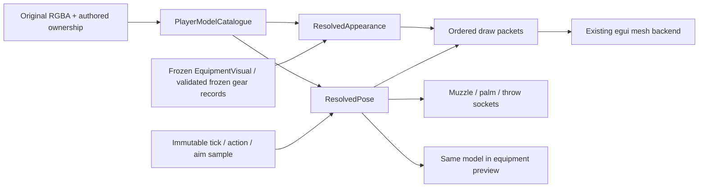

# Source-faithful player models — architecture proposal

**3 November 2026 · research/design only · implementation frozen.**

This proposal responds to the creator's repeated rejection of the assembled
survivors and latest instruction to research, review and coordinate a dedicated
model team before further implementation. It does not approve the current
rendered characters. No production code, assets or Cargo checks were changed or
run while authoring this document.

The acceptance baseline is the existing `menu-survivors-v1.png`: the actual
default starter appearance of Rook and June must reconstruct that artwork
**pixel-for-pixel in the bind pose**, using independently addressable parts.
Animation and alternative equipment follow that proof. A recognizable face,
correct IK endpoints or a green test suite cannot substitute for it.

## Findings that constrain the design

The first canonical native captures in
`target/journey-review/canonical-review/still-comparison.png` and `npc-actual.png`
showed a real improvement: original faces, hair, trousers and boots restored
identity and proportions. They also exposed remaining differences: a narrower
plain coat, different sleeve shading/caps, missing default carriage in the
comparison, and a detached-looking throwing arm. These are art-parity failures,
not a request to redesign the characters again.

The art-decomposition reviewer additionally reports overlapping original source
pixels in the frozen masks: head/upper-sleeve overlap of 590 pixels for Rook and
1,829 for June; upper/fore-sleeve overlap of 1,513 and 1,618 respectively. Its
measurement details belong in `PLAYER_MODEL_ART_DECOMPOSITION.md`. Most interior
reference alpha is approximately 253 rather than 255. Drawing a source pixel
twice therefore changes opacity even if its RGB looks unchanged. This makes
disjoint ownership an essential requirement, rather than an optimization.

Current partial safeguards are useful but incomplete:

- Whole-source height scaling, planted original lower pixels, separate
  palm/wrist sockets and shared gun transforms are worth retaining.
- The existing 15 focused rig tests passed **before** the last frozen fix batch.
  They do not establish full-body source equality. In particular, proving that
  a part uses the menu texture does not prove that every original pixel appears
  exactly once or that no replacement pixels appear.
- Generated clean torsos and sleeves currently replace visible source clothing.
  They must become occluded-region fill only; generation cannot guarantee a
  replacement matches the original visible pixels.
- Current sleeve polygon/color filtering and alpha thresholds are heuristic.
  They may remove real cloth, retain old hand outlines or drop translucent
  fringes. They cannot be the final ownership specification.
- Independent source rectangles, body dimensions, camera roots and per-part
  scale corrections accumulated across several renderer generations. One
  source catalogue and bind coordinate system must replace those competing
  assumptions.
- Several current draw/muzzle/throw paths rebuild a pose independently. A
  single immutable resolved pose should supply all those consumers.

The latest frozen, unvalidated work touches `character_rig.rs`, `canonical.rs`,
`canonical_tests.rs`, `visual_assets.rs` and `canonical-rig.json` (the rig files
and `canonical-rig.json` have since been removed): starter-review snapshots, carriage variants, torso width/top consumption, source-sleeve masks
and legacy test-loader configuration. It is a working checkpoint, not the
approved architecture or an accepted parity result. Existing
`CHARACTER_COMPONENTS.md` describes earlier iterations and is historical
context until the agreed implementation updates it.

## Keep the existing simulation and rendering boundary

Keep Bevy 0.20.0, bevy_egui 0.43.1 and the locked egui/epaint 0.36.2 versions.
The battlefield is already an egui canvas. A new Bevy Sprite/ECS scene, skeletal
animation dependency or renderer migration is unnecessary for this 2D cutout
problem.

Pinned primary API research supports that choice:

- `epaint::Mesh` already contains textured 2D triangles, UV-capable rectangle
  construction, transforms and mesh validation. This can express authored
  source masks and posed parts. Preserve painter order; meshes can only append
  directly when they share a texture. [epaint 0.36.2 Mesh](https://docs.rs/epaint/0.36.2/epaint/struct.Mesh.html)
- `Color32` uses premultiplied sRGBA. Preserve the established managed-image
  conversion and compare reference/reconstruction through the same conversion;
  source RGBA and uploaded premultiplied bytes are different representations.
  [epaint 0.36.2 Color32](https://docs.rs/epaint/0.36.2/epaint/struct.Color32.html)
- `TextureOptions::NEAREST` specifies nearest minification and magnification.
  Retain it for the existing pixel art instead of introducing smoothing to hide
  seams. [egui 0.36.2 TextureOptions](https://docs.rs/egui/0.36.2/egui/struct.TextureOptions.html)
- bevy_egui already provides context/image integration. Keep asset handles and
  upload ownership in the existing adapter, including the actual RenderDevice
  texture budget. [bevy_egui 0.43.1 EguiContexts](https://docs.rs/bevy_egui/0.43.1/bevy_egui/struct.EguiContexts.html)

These APIs establish feasibility. They do not establish that a particular mask,
pose, alpha treatment or character is visually correct.

Core remains unchanged: fixed ticks, input legality, hit detection, RNG, damage,
currency, inventory, reservations, saved attempts and world progression retain
their current owners. A visual muzzle is a read-only feedback origin, not a new
authoritative attack origin.

## Proposed module boundaries

Use a small `player_model` presentation subsystem behind the existing public
`visual_assets` facade. Names below describe responsibilities; they are not
permission to perform a broad rewrite before plan approval.

| Module | Owns | Must not own |
| --- | --- | --- |
| `catalogue` | Stable model/part/skin IDs, source metadata, validated relationships | UI, GPU handles, purchases |
| `source_masks` | Authored per-texel ownership runs and hidden-fill domains | Hue guesses, source-image edits |
| `bind` | Source-global bone binds, part bindings and anatomical sockets | Combat or inferred proportions |
| `appearance` | Resolve frozen equipment metadata into compatible skin/material bundles | Current-inventory guessing or granting gear |
| `pose` | Read-only motion sampling and one resolved bone/socket result | RNG, combat clocks, persistence |
| `assembly` | Visible part selection, occlusion graph and ordered draw packets | Asset loading or gameplay transactions |
| `backend_egui` | Texture binding, UV geometry and submission to the existing canvas | Alternative pose or equipment policy |
| `verification` | Ownership audit, exact bind reconstruction, native comparison and diagnostics | Approval from screenshots it never inspected |



`visual_assets` continues to load/cache original images and expose compatibility
functions. `art::battlefield` and the character preview should adapt their
inputs to this subsystem, not reimplement model selection or pose math.

A proposed narrow internal facade is:

```rust
resolve_appearance(catalogue, model_selection, frozen_equipment)
    -> Result<ResolvedAppearance, ModelError>;
sample_pose(catalogue, resolved_appearance, motion_sample, placement)
    -> Result<ResolvedPlayerPose, ModelError>;
draw_egui(painter, texture_bindings, resolved_player_pose);
```

`ResolvedPlayerPose` owns immutable ordered draw packets, transformed anatomical
joints and named sockets, including muzzle and throw palm. Consumers read those
socket values directly. `placement` contains the projected fixed actor anchor,
uniform display scale and clip; it does not contain mutable `Game` state.

Retain the existing public `defender_preview`, `defender_equipped_rig`,
`defender_muzzle` and `defender_throw_origin` entry points as migration wrappers
where needed. The production battlefield should resolve once and share the
result between body drawing and feedback, rather than requiring callers to
invoke several independently resolving wrappers. This change is internal to
presentation and does not change a core model or save contract.

## Data model and coordinates

Use string IDs such as `rook`, `june`, `jacket.near_sleeve` and
`starter_pistol.rook`. Avoid a public `female: bool` part-index protocol inside
the catalogue. Existing core appearance/survivor values map to a renderer model
ID at the adapter boundary; no save-schema change is necessary for Rook/June.

Conceptual records:

```rust
PlayerModelCatalogue {
    schema_version,
    sources: Vec<SourceImage>,
    models: Vec<PlayerModelDefinition>,
    skins: Vec<EquipmentSkin>,
}

SourceImage {
    id, path, dimensions, decoded_rgba_hash, provenance_file,
}

PlayerModelDefinition {
    id, source_frame, source_ground_anchor,
    bones: Vec<BoneBind>,
    sockets: Vec<SocketDefinition>,
    parts: Vec<PartDefinition>,
    default_starter_skin, occlusion_graph,
}

PartSourceMask {
    source_id, source_frame,
    runs: Vec<MaskRun>, // integer y, inclusive x0 / exclusive x1
    channel: VisibleOriginal | OccludedFill,
}

BoneBind {
    id, parent, source_bind_transform,
}

PartDefinition {
    id, source_mask_id, material_id, bone_binding, anchors,
}

EquipmentSkin {
    id, equipment_style_or_definition, compatible_models,
    replaces_material_bundles, parts, sockets, occlusion_rules,
}
```

This is a schema sketch, not a proposed Rust ABI. Catalogue validation must
reject missing IDs, cycles, invalid integer runs, out-of-frame masks, duplicate
ownership, unsupported skins and invalid bind/socket relationships. A fixed
four-column generated atlas layout must not be an extension requirement.

Rook's actual frame is `[282,42,652,848]` (806 pixels high); June's is
`[1128,60,1465,848]` (788 pixels high). Source frames and ground anchors belong
in this one catalogue. Face, hair, pelvis, trousers and boots retain their
original coordinates and relative sizes. There is no invented universal adult
48-pixel anatomy. A logical display-height convenience may remain, but the
only model-to-display scale is `display_height / source_frame_height`.

All bind matrices share source-global coordinates. For a bone-bound source
point, the posed mapping is conceptually:

`display_from_model × posed_bone × inverse(bind_bone) × source_point`.

At bind, posed and bind bones are identical, so every visible source point has
the same global display mapping. This must be an algebraic identity verified
for every part, not many approximately matching local pivots and scales.

The actor's authoritative battlefield anchor is projected once. Model-local
display geometry then attaches to that anchor. Sprite bounds cannot change
collision, aim, range or the eleven-lane model.

## Original visible pixels and hidden fill

The art-decomposition specialist must assign every visible reference texel to
one owner: body, garment, near/far sleeve, hand, weapon, carriage or another
explicit source part. This is authored semantic metadata, not runtime RGB
classification. Ownership follows original contours, including fingers,
collars, shoulder overlap and translucent outline pixels.

Requirements for the default starter bind:

1. Every original reference texel with nonzero alpha has exactly one visible
   owner. No omitted pixel, duplicate crop or altered alpha is permitted.
2. Its source coordinate and RGBA value remain unchanged. There is no recolor,
   geometric distortion, generated visible replacement or alpha threshold.
3. Original visible hands, sleeves, torso, carriage and pistol participate in
   the partition too. Direct face/pants reuse alone is insufficient.
4. No whole-character quad may sit underneath the assembled model as a hidden
   way to pass the comparison. Verification must audit the submitted parts.
5. Generated kit pixels contribute **nothing** to the default bind image.
   Merely placing fill behind an original alpha-253 pixel is insufficient:
   that underpaint still changes the composite.

The source PNG remains untouched. Masks are metadata. Source-space test
composition is a verification artifact, not a replacement asset-generation or
image-postprocessing pipeline. Preserve existing images and their notices.

Occluded fill needs its own source/mask channel and explicit exposure rules.
It is permitted only where a new pose or replaced skin exposes a region that
the original artwork never showed. At the default bind it is disabled or
clipped to zero contribution. It must not leak through partially transparent
original coverage or add new pixels outside the reference silhouette.

Depth is an authored occlusion graph with stable part IDs. Do not globally sort
by texture: that can hide a support forearm or put a hand behind the gun. Only
consecutive compatible packets may batch without changing their ordering.

## Skeleton, hands and firearm contract

Calibrate the skeleton from the source still, then demonstrate the same static
pose before sampling an aiming animation. Visible source sleeve and cuff
regions bind to their actual shoulder, elbow and wrist anchors. Hidden far-arm
reconstruction is explicitly labelled; it must not replace the visible near
arm with a similarly colored rounded kit piece.

Keep the useful distinction already introduced between anatomical wrist and
grasp contact:

- `ArmPose` ends at a wrist joint.
- `HandPose` contains separate source wrist and palm sockets and its transform.
- The transformed palm equals the weapon grip/support socket.
- The sleeve endpoint equals the transformed wrist.
- A long-gun stock seats at the source-derived shoulder; a pistol has the
  authored joined-hand grip.

An exact endpoint test is necessary but does not prove that the limb is visible
or that the wrist angle is natural. Static source-parity proof comes first;
the animation review then checks both arm silhouettes, cuff overlap, wrist
flexion, elbow choices and finger/weapon layering in the actual native output.

The default starter pistol skin must use its original menu-source pixels in the
bind reconstruction, including its original relationship with the hands.
The existing separate firearm atlas may provide alternative authored weapon
skins. It cannot silently replace the default original gun and still claim
zero-difference starter parity. All six classes need explicit physical scale,
grip/support/stock/bore/muzzle/magazine sockets and material compatibility.

Resolve a pose **once** for a render sample. An immutable result should contain
bone matrices, hand/weapon transforms, stable ordered part bindings, and world
positions for muzzle and throw-palm sockets. The backend, tracer/flash drawing
and previews consume that result. They must not call separate approximations
of `Pose::new` with subtly different appearance or action inputs.

## Actual equipment and old checkpoints

`DefenderProfile.equipment_visual` remains the primary frozen source of equipped
definition, level, quality and style metadata. Core retains item ownership,
stats, legal proficiency, reservations and all transactions.

The presentation-only adapter proposed by the parent may return
`Cow<EquipmentVisual>`: use an existing nonempty snapshot unchanged; otherwise
derive supported appearance only from the attempt's **frozen** gear records,
with validated definitions and slots. Never consult the current mutable
inventory to guess what an old deployment wore. Missing or mismatched records
remain absent. Rendering cannot mutate the attempt, saved JSON or RNG.

Default parity fixtures must create real starter profiles through the campaign
API for the selected survivor. In current content, `Work jacket` is
`armor.cloth` and `Field webbing` is `accessory.pouch`. The catalogue may map the
same real Field-webbing item to Rook's original pack and June's original front
webbing variant. Those parts appear only when the equipment metadata supports
them; an empty legacy snapshot is not permission to invent carriage.

Equipment skins replace material bundles. A jacket change replaces torso,
both sleeve regions and cuffs together while preserving skeleton proportions.
Armor/carriage may add compatible parts with explicit occlusion rules. They do
not become rectangular stat badges. Body skin and hair remain separately
owned. Gun skins own their matching contact/muzzle sockets; actual item level
or quality selects a different skin only where authored data specifies one.

Adding a model should require a source image, ownership masks, bind/socket
metadata, compatible starter/equipment skins and parity evidence. Adding a
skin should require source parts, a compatible material bundle and validation,
not new `if female`, cell-index or item-name branches. A future new core
survivor identity still needs its own separately reviewed persistence contract;
this renderer refactor does not pre-empt that change.

## Backend and performance boundaries

Retain the established original RGBA loading, managed premultiplied upload,
nearest sampling and actual GPU texture-size budget. Cache compiled mask
geometry and catalogue lookups by model/source revision. Decoded RGBA hash and
dimensions identify the source pixels; PNG provenance metadata can change the
file hash without changing those pixels, so keep both identities distinct.

Use reusable buffers and merge adjacent compatible mesh packets. Never truncate
mask runs to a convenient count: silently losing reference pixels invalidates
the contract. Validate declared budgets at catalogue load and fail authoring
clearly if they are exceeded. No image scan, catalogue parse or mask compilation
belongs in the per-frame draw loop.

Pose caches must include all relevant inputs, not just the simulation tick:
model/skin revision, frozen appearance, action sample, aim/facing, projection and
display scale. Render once per presentation sample even if egui repeats layout.
Combat motion remains tick-driven and paused with the attempt; preview/UI time
does not advance the battle. Reduced effects retains readable poses and cues.

Profile the accepted implementation with loaded assets at ordinary and dense
battlefields, plus multiple visible observer panels. Report actual CPU/GPU,
resolution, sample length and workload. Neither a small catalogue nor successful
unit tests establishes FPS or human playability.

## Required sequence and gates

Do not implement the next stage until the preceding gate is reviewable.

| Stage | Deliverable | Required evidence |
| --- | --- | --- |
| 1 — source audit | Immutable reference frames, authored visible ownership and hidden-region ledger | No dropped/duplicate original alpha; quantified coverage; source/provenance hashes |
| 2 — bind catalogue | Rook/June parts, materials, bind/socket graph and real default equipment mapping | Every source part has one owner and an identity bind transform |
| 3 — source parity | CPU reconstruction solely from the part catalogue | Zero changed RGBA pixels, zero max-channel error, zero missing/extra/duplicate owners |
| 4 — backend parity | Native egui reference and assembled default render | Same projection/sampling; zero difference at source resolution; inspect scaled results and alpha-compositing parity |
| 5 — equipment | Compatible garment/carriage/weapon bundles | Real snapshot-driven swaps; default still passes; missing legacy data invents nothing |
| 6 — motion | Aiming, recoil, reload, melee, throw, brace and reactions | Shared resolved sockets; source-relative proportions; both arms/feet visibly coherent; pause/reduced checks |
| 7 — integration | Battle and preview through one facade | Full locked verification plus actual native/human review and measured performance |

For CPU RGBA verification, preserve source transparent RGB in the test reference
or record it separately: a GPU composite cannot recover meaningful hidden RGB
at alpha zero. This does not permit dropping nonzero-alpha fringes. The primary
visible ownership audit covers **all nonzero alpha**, not alpha ≥128.

For native comparison, render reference and reconstruction through the same
upload, sampling, clip and blend path at an exact 1:1 source scale and integer
origin. Use black and white backgrounds to expose alpha/compositing mistakes;
compare the assembled pixels, not a page screenshot with different headings or
position. Any unavoidable backend rounding issue must be measured and explained
before a tolerance is proposed; do not silently replace the zero-difference
requirement with a similarity score. Keep source-resolution and scaled-display
results separate.

Keep the existing combat, save, economy and regression assertions. New parity
tests augment them. The old generic-kit geometry tests can remain historical
coverage, but must not be presented as active canonical acceptance. Native
review should show a literal reference/bind/posed comparison for both models,
then all six firearm classes, real wardrobe variants, repeated pause frames and
actual personal/NPC battlefield sizes. Static approval does not approve motion;
motion approval does not establish OS input or audio behavior.

## Coordinated work packages

The parent coordinates these dedicated roles; this document does not spawn or
authorize extra implementation agents:

1. **Primary research lead:** verify the technique and alpha/sampling constraints
   from primary sources; review the proposed gates and extension model.
2. **Art-decomposition specialist:** own semantic source-pixel assignments,
   source bind anchors, material/skin boundaries and hidden-fill ledger. Deliver
   a reviewed original/default reconstruction before motion work.
3. **Architecture owner:** finalize the catalogue, bind, appearance, pose and
   backend contracts from that evidence; identify migration seams and remove
   conflicting active paths only after replacement acceptance.
4. **Renderer implementer:** build the minimal data-driven source assembly and
   egui backend, then the shared resolved pose. No new visible-art redesign.
5. **Equipment/integration owner:** use frozen real metadata and compatible skin
   bundles through the existing preview/battle facade; keep core untouched.
6. **Independent visual verifier:** inspect exact diff artifacts and native
   references before approving bind, then equipment, then animations.

Implementation approval must settle ownership-mask format, default material
mapping, source-coordinate binds and the exact parity harness first. The
remaining current source checkpoint must be labelled frozen/unvalidated until
the parent decides which changes to retain, replace or discard. No automatic
rebaseline, new PNG generation, dependency change or production edit follows
from this proposal alone.
