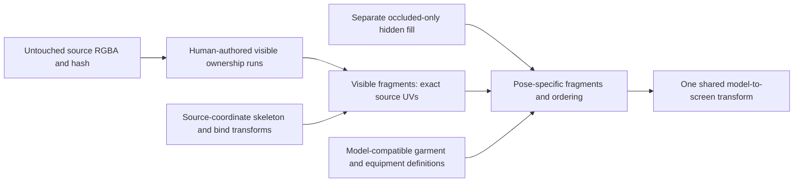

# Original survivor artwork: pixel ownership and modular decomposition

Research proposal, 3 November 2026. This document specifies the art-side contract
for a replacement rig; it does not approve the current assembled characters or
claim a completed segmentation. Production code and images were not changed for
this investigation. The original raster is the authority, not an approximate
reconstruction or the current generated component atlas.

## Required result

Rook and June must reconstruct their original default low-ready pose with zero
source-pixel differences. Every original visible sleeve, hand, gun, garment,
backpack, strap, pouch, face, hair, trouser and boot pixel remains the original
RGBA value at its original source coordinate in that pose. Parts move through
rigid transforms from that pose. A single model scale preserves source
proportions; independently stretching a sleeve or torso to fit a skeleton is
not an extraction.

Pixel equality applies to the original default costume and original pistol.
Different weapons, equipment and action poses need separate geometric and
visual acceptance. The source cannot reveal cloth, fingers or weapon surfaces
that were occluded when it was drawn. Any such material is explicitly labeled
`hidden_fill`, with its authoring provenance and bind-pose occluder recorded.
It must never replace original visible artwork to make the equality test pass.

## Evidence and source measurements

Inspected directly: `assets/art/pixel/menu-survivors-v1.png`,
`target/journey-review/canonical-review/still-comparison.png`, and
`target/journey-review/canonical-review/npc-actual.png`. The comparison and
battlefield images are review evidence from the prior candidate, not an
approved baseline. Measurements below used read-only Pillow analysis of the
original PNG and current JSON/source. No image was rewritten.

| Source property | Measured value |
| --- | --- |
| Original PNG | `assets/art/pixel/menu-survivors-v1.png` |
| SHA-256 | `4feb21b05c1ad5d281d4f0134fdfe546356ca71a204dba04b7c81c48bd356a3a` |
| Decoded format and extent | RGBA, 1774 × 887 |
| Analysis tiles | Rook `[0,0,887,887)`; June `[887,0,1774,887)` |
| Rook nonzero-alpha / partial-alpha pixels | 195,379 / 194,427 |
| June nonzero-alpha / partial-alpha pixels | 182,305 / 181,738 |
| Most common nonzero alpha | 253, for both characters |
| Rook nonzero-alpha bounding box | `[41,38,823,869)` |
| June nonzero-alpha bounding box | `[936,47,1722,865)` |
| Rook alpha-at-least-128 bounding box | `[285,43,651,846)` |
| June alpha-at-least-128 bounding box | `[1129,61,1462,846)` |
| Transparent pixels containing nonzero RGB | Rook 248; June 117 |

Coordinates throughout are full-source, top-left origin, positive x right,
positive y down. Rectangles are `[x0,y0,x1,y1)`, with exclusive right/bottom
edges. The analysis tiles retain provenance; their large faint speckles are
not a proposal to make the playable silhouette wider.

The current frame rectangles `[282,42,652,848)` and
`[1128,60,1465,848)` are useful layout frames, but are not lossless extraction
domains. They exclude 4,645 and 3,474 nonzero-alpha pixels respectively. The
largest excluded alphas are 6 and 3. These faint residues matter to a strict
zero-difference test even when they are visually negligible. Preserve and
assign them; do not quietly use alpha thresholding to redefine equality.

Most interior pixels also have partial alpha. Painting a source crop twice
changes alpha from `a` to `1-(1-a)^2`; at alpha 253 the second paint brings
coverage almost to 255. Disjoint ownership is necessary throughout the body,
not just around its outer fringe.

## What the original drawing actually contains

Rook has a broad olive hood/collar, a dark inner opening and zipper, a brown
backpack visible behind his near shoulder/arm, forward straps, a bent near
sleeve and two-handed low-ready pistol hold. His left-on-image boot and
right-on-image boot are fully distinct. June has a large red ponytail behind
her head/shoulder, a slate jacket, prominent tan chest and waist webbing,
similarly bent sleeves and a two-handed low-ready pistol. Her tan webbing is
part of the requested reference appearance, not an optional detail to lose
when rendering the comparison fixture.

The visible near sleeve is strongly evidenced; much of the far shoulder/arm
is hidden by the torso, equipment, hands and gun. A complete clean far arm or
arm-free torso cannot be recovered from this single flattened image. Skin
and pistol silhouettes interlock. A rectangle around either hand also
contains gun pixels, and a rectangle around the gun contains skin pixels.
Rook's straps and June's webbing cross the jacket; assigning the entire
rectangle to a garment would bake equipment into that garment.

### Source regions and socket seeds

The following are **inspection envelopes and candidate sockets**, not final
per-pixel masks. They make the first segmentation pass reproducible. Tight
semantic contours must be traced and reviewed against the actual source;
rectangles alone do not establish ownership. Existing metadata values are
reported as such, rather than treated as anatomical ground truth.

| Feature | Rook source envelope / socket | June source envelope / socket |
| --- | --- | --- |
| Current layout frame | `[282,42,652,848)` | `[1128,60,1465,848)` |
| Head/hair inspection envelope | `[400,42,582,248)` | `[1128,60,1408,280)` |
| Current neck seed | `(482,247)` | `(1290,259)` |
| Current pelvis/root seed | `(476,510)` | `(1304,510)` |
| Near shoulder seed | `(381,270)` | `(1210,280)` |
| Near elbow seed | `(404,405)` | `(1225,401)` |
| Near sleeve/wrist seed | `(504,425)` | `(1320,425)` |
| Near upper sleeve envelope | `[340,218,450,418)` | `[1168,242,1280,418)` |
| Near fore sleeve envelope | `[383,373,518,446)` | `[1200,373,1340,444)` |
| Far shoulder seed, weakly evidenced | `(549,267)` | `(1372,280)` |
| Hands + pistol inspection envelope | `[495,382,654,492)` | `[1310,382,1465,492)` |
| Backpack / webbing inspection envelope | `[282,188,590,510)` | `[1170,228,1408,510)` |
| Current lower-body split | pelvis y=500–600; legs y=600–745; boots y=745–848 | same y bands |
| Current left/right lower split x | 474 | 1300 |
| Current sole anchor seeds | `(384,848)`, `(558,848)` | `(1206,848)`, `(1394,848)` |

June's ponytail is a separate head-attached part behind the torso where
appropriate; her neck does not own jacket pixels just because they lie in
the head envelope. Rook's head envelope also contains some shoulder clothing.
The envelopes must not be drawn as overlapping full rectangles.

Distances from the three near-arm seeds are 136.945 / 101.980 pixels for
Rook's upper arm / forearm, and 121.926 / 97.985 for June. The current declared
forearm lengths, 113 and 119, are about 11% and 21% longer than these source
fore-sleeve axes. Resolve wrist anatomy once from the source, then derive bind
bone lengths; do not scale the source part to those old declarations.

Pistol muzzle, trigger grip, support contact, magazine and barrel axis need
new source-local sockets on the original pistol. The sockets in
`character-rig.json` refer to a different gun atlas and cannot establish
equality with this pistol. Place a muzzle on its actual barrel opening and
two points along its visibly downward-right barrel axis; do not use a
rectangle center or the character's hand center as a substitute.

## Representation: ownership is separate from bones and materials

Use stable string IDs such as `survivor.rook`, `survivor.june`,
`jacket.rook.original`, `hand.near`, and `weapon.pistol.original`. Cosmetic
selection may continue to map the two current identities, but a future model
must not require adding another `female` branch or another positional atlas
cell. Separate these concepts:

| Concept | Required data |
| --- | --- |
| Model | string ID, source hash, layout frame, root/ground anchors, skeleton/bind transforms, default costume |
| Visible part | string ID, source image ID, integer source ownership runs, bone ID, material/slot ID, bind transform |
| Ownership run | `[y,x0,x1]`, half-open, integer texel coordinates, no coverage weight |
| Garment | coordinated torso, near/far sleeves, cuffs and applicable hood pieces, model compatibility |
| Wearable | exact pack/strap/webbing ownership fragments, attachment nodes and occlusion relationships |
| Hand | exact original palm/finger fragments, wrist socket, grip socket and explicit weapon-relative front/back groups |
| Weapon | independent source fragments, muzzle/barrel/grip/support/stock/magazine sockets, compatible hold profile |
| Hidden fill | separately authored patch ID, author/provenance, parent part, bind-pose occluder, visibility policy |
| Source residue | unclassified faint source pixels, retained unchanged and attached explicitly; cannot contain unsegmented limbs |

One part may contain many disconnected runs, and one physical object may
require several draw fragments. The pistol can have a rear fragment behind
the hands and a foreground fragment above selected fingers. Webbing can be
split into torso-attached front pouches, behind-arm strap fragments and
backpack fragments. These share a logical equipment ID without being forced
into one draw layer.

At bind pose, every visible part's transform maps its source pixel coordinate
to the same source coordinate. A local bone representation is equivalent if
its bind transform and inverse bind cancel exactly. All parts then receive
one shared model-to-screen transform. No per-part fit-to-box normalization,
scale by alpha bounds, axis stretching, palette replacement or generated
torso is involved.



### Complete ownership and alpha rules

Author a mutually exclusive owner field over both complete source tiles.
Include a `source.transparency` payload for alpha-zero texels, preserving their
RGB for a raw-byte round trip without rendering them. Every alpha-positive
pixel has exactly one visible owner, including alpha 1–127. Do not use the
current red/green color heuristic to decide whether a pixel is cloth.

Choose ownership at visible surface boundaries by reviewing the source at
native size and integer zoom. When an original antialiased pixel mixes two
surfaces, keep its complete original RGBA and assign it to one reviewed
fragment. A flattened drawing has no unique inverse decomposition into the
unknown original paint layers. Do not invent fractional duplicate ownership
or claim to have recovered those missing layers.

Compile the owner field to exact horizontal runs. Coalesce vertically only
when adjacent rows have identical x extents, owner, bone, source and layer;
this preserves texel ownership while reducing geometry. Geometry boundaries
fall on texel edges and UVs address the same original texel rectangles.
Nearest sampling and the existing managed premultiplied upload path remain
consistent for the reference and decomposed draws.

Source residue must be counted and visible in the ownership inspector. Most
remote speckles have negligible alpha, but assigning an entire arm to a
static residue layer would defeat modularity. Require reviewed named owners
for all anatomical and equipment regions; report residual bounding boxes and
maximum alpha. Prefer attaching contiguous fringe pixels to their adjacent
semantic surface. Explicitly retain isolated speckles on the root.

## Occlusion and hidden surfaces

Use an acyclic order of fragments, rather than one universal order for whole
physical objects. The principal relationships in the right-facing reference
are:

```text
backpack / ponytail behind shoulder
    < far sleeve and rear straps where visible
    < torso / collar / front webbing
    < near sleeve

weapon rear fragment < selected palm/fingers < weapon front fragment
torso and sleeves < original visible hands at their reference overlaps
trousers < jacket hem and waist webbing where the source shows that overlap
```

These are authoring constraints, not permission to redraw one original pixel
twice. Record local exceptions as fragments. Do not put the entire far arm
above the torso: that produces an extra chest-crossing sleeve. Do not leave a
reference hand or pistol baked into torso pixels after its owning part moves.

Hidden fill is needed under the near shoulder, around the bent elbow/cuff,
behind the original hands and pistol, beneath removable straps/webbing and
where a pack covered the back of the jacket. Draw the proposed patch only
inside its declared bind-pose occlusion region. A partially transparent
occluder does not completely hide an underlying patch: for the zero-diff
default pose, suppress fill under source-owned pixels explicitly rather than
relying on alpha-over to hide it. Do not change source alpha to 255.

For articulated poses, fill may appear only where an approved part's
movement reveals that formerly occluded surface. Such pixels are authored
continuity, not reference-extracted truth. Keep the source-visible layer
above the corresponding seam support and test the junction at action
extremes. A duplicate near sleeve is not a recovered far sleeve.

## Authoring procedure

1. Freeze the source hash and coordinate convention. Build a source inspector
   that can show owners, original RGBA, layer IDs and bind/posed overlays
   without changing the PNG. Keep all ownership data as text metadata.
2. Trace the near/far visible surfaces in the original pose. Start with boots,
   trousers, pelvis, head/hair/neck, then jacket/hood, pack/straps/webbing,
   sleeves, hands/fingers and pistol fragments. Label visible surface, bone
   and material independently. Review ambiguous boundaries explicitly.
3. Assign the faint fringe and isolated residue; preserve the alpha-zero RGB
   payload. Compile runs, reject holes and duplicate owners, then reconstruct
   the complete original image from the partition. Require zero changed
   bytes before adding action transforms.
4. Define the exact reference skeleton and original pistol sockets in source
   coordinates. Verify the default assembled draw list contains the actual
   modular parts; a whole original figure painted behind moving arms is not
   an acceptable way to pass the bind test.
5. Author only necessary hidden continuity patches with explicit occluders.
   Prove that they contribute zero pixels to the default fixture. Record
   unknown far-arm anatomy rather than treating arbitrary old atlas parts as
   extracted evidence.
6. Add constrained aiming, recoil, reload, throw and melee transforms. Keep
   the original lower-body proportions and two visible planted soles. A
   battle weight shift is a separate reviewed pose, not a reason to squash
   the original trousers. Hands, muzzle and weapon sockets share the same
   final transforms used for drawing.
7. Add garment and weapon swaps, then examine source-default and swapped
   outfits together. A jacket swap replaces torso, both upper/fore sleeves,
   cuffs and applicable hood as one compatible set. A gun swap replaces all
   original gun-owned fragments and uses that gun's hold profile. Removing
   webbing reveals only explicitly authored jacket fill. A replacement
   garment can cover the original garment through a declared coverage mask;
   it must not leave original sleeves or pouches unintentionally visible.

The reference fixture must include Rook's original backpack and June's
original webbing. Define whether these are default costume components or
catalogued default equipment explicitly; an empty accessory slot must not
silently erase the requested reference appearance. Distinct real equipment
still needs its own truthful appearance. The fixture is a named appearance
definition, not a fabricated authoritative inventory.

## Acceptance gates

### Gate A: source partition and exact default pose

- Verify source hash, dimensions, run bounds, model/part IDs and acyclic
  fragment relationships. Every alpha-positive source pixel has one owner;
  every alpha-zero pixel is preserved for the raw reconstruction payload.
- Scatter all owning parts into their bind positions and compare all four
  decoded RGBA channels against the original complete 1774 × 887 image.
  Required result: zero differing pixels, zero differing bytes, maximum
  absolute channel error zero. Report counts separately for each tile and
  alpha 0 / 1–127 / 128–254 / 255. A transparent-RGB discrepancy must be
  explained and fixed in the raw partition, not omitted from its report.
- Separately composite the actual modular geometry using the same
  premultiplied conversion, sampling and tint as an unsplit reference draw.
  Compare on transparent, light and dark backgrounds. Required default-pose
  visible result: zero differences. Raw straight PNG bytes and GPU
  premultiplied bytes are different representations; compare like with like.
  CPU raw reconstruction alone does not verify draw order, coverage or GPU
  triangle seams.
- Inspect integer-scale native captures with overlays disabled. The original
  and modular default must have identical silhouette, head/body proportions,
  clothing detail, hands/gun, pack/webbing and separated feet. Verify no
  full-character fallback draw is present and no hidden fill contributes.

### Gate B: pose continuity and real equipment

For both identities, capture default low-ready, horizontal right/left aim,
up/down extremes, reload phases, throw windup/release/recovery, recoil,
brace and melee. Use both the original pistol and real owned long-gun
instances. Mirror the complete approved pose consistently; the prior
upper-only mirror with unmirrored lower body is not proof of a convincing
left-facing character. Do not claim the unseen opposite side is new source
art: a horizontal mirror is an explicit presentation convention.

Inspect shoulder-to-elbow-to-wrist continuity, both hands at their intended
contacts, stock placement, elbow bend, face/weapon interference, leg/foot
separation and garment seams. Check the tracer starts at the displayed
muzzle and thrown item release uses the displayed hand. Socket coincidence
is necessary but does not prove the visible pixels meet naturally. Record
native-scale and close comparison evidence; compilation is not visual
validation. Alternate poses have no original-pixel ground truth, so their
acceptance is anatomy/continuity review rather than a false zero-diff claim.

## Cache and render budgets

Cache source decoding, ownership validation, compiled runs/rectangles and
local UV geometry once per `(source hash, model/appearance revision)`. Static
`OnceLock` data is suitable for immutable bundled definitions; an authoring
reload needs an explicit revision key rather than silently reusing the first
mask. During animation update only transforms, fragment ordering/visibility
and resolved equipment selection. Do not scan image pixels or rebuild run
ownership every frame.

The complete source RGBA occupies 6,294,152 bytes. A temporary full-image
`u16` owner field occupies 3,147,076 bytes; retain compressed runs for runtime
and release authoring scratch storage. Source alpha-positive masks already
contain 5,093 Rook and 4,098 June horizontal runs before semantic splitting.
Naively emitting each run needs at least 36,764 vertices and 55,146 indices
for both figures together. Thus the existing less-than-2,048-runs-per-sleeve
assertion is not a whole-model budget or proof of adequate performance.

Coalesce exact rectangles and batch compatible texture/layer fragments;
cache their meshes. The source texture can be shared by both models, with
no extra full-size texture per part. Keep hidden-fill storage separate and
bounded. Set final vertex/index/fragment budgets after the actual partition
is compiled and measure the native menu, comparison scene, active defender
and observed NPC. Validate against the active device's texture limits using
the existing upload path; do not assume a larger adapter limit. Until those
measurements exist, performance is pending rather than inferred from these
memory estimates.

## Why the current candidate is not the solution

The visible review shows recognisable original heads, trousers and boots,
but the regenerated torso is a different long pocket coat. June's defining
tan chest rig and Rook's backpack disappear from default battle previews.
The broad shoulder caps and heavy sleeve seams differ from the original;
Rook's throwing arm visibly detaches from his shoulder. Both feet are now
visible, which should be preserved.

Source inspection explains additional exactness failures:

| Current mechanism | Measured / source-level problem |
| --- | --- |
| `CanonicalKit` torso, hands, wearables and far sleeves | Generated reconstruction replaces originally visible artwork; cannot give source-pixel equality. |
| `torso_source_point` | Independently fits generated torso x/y extents to reference dimensions rather than preserving original source geometry. |
| `source_sleeves` alpha and color filters | Removes 893/168 Rook upper/fore pixels and 500/173 June upper/fore pixels with alpha at least 128; additionally discards 679 low-alpha June upper pixels inside its polygon. These are measured against the current authored polygons, not final semantic masks. |
| Overlapping original crops | Rook head/near-upper share 590 nonzero-alpha source pixels and upper/fore share 1,513; June shares 1,829 and 1,618 respectively. Rotations may move these duplicates apart, but the ownership is already unsuitable for an exact bind reconstruction. |
| Forearm axis fit | Uses old forearm lengths instead of the measured original fore-sleeve axis, resizing extracted artwork. |
| Original pistol | Uses a different gun atlas with configured width and old sockets; original gun/hand partition is absent. |
| Current tests | Check selected source regions, texture IDs and socket math; they do not compare complete default RGBA or establish visual anatomy. |

Keep the old assets and attribution as historical material. Do not silently
rebaseline tests or rewrite the original PNG. First implement and pass the
source partition/default-pose gate; then implement and review the articulated
and equipment gates. This document itself does not complete either gate.
