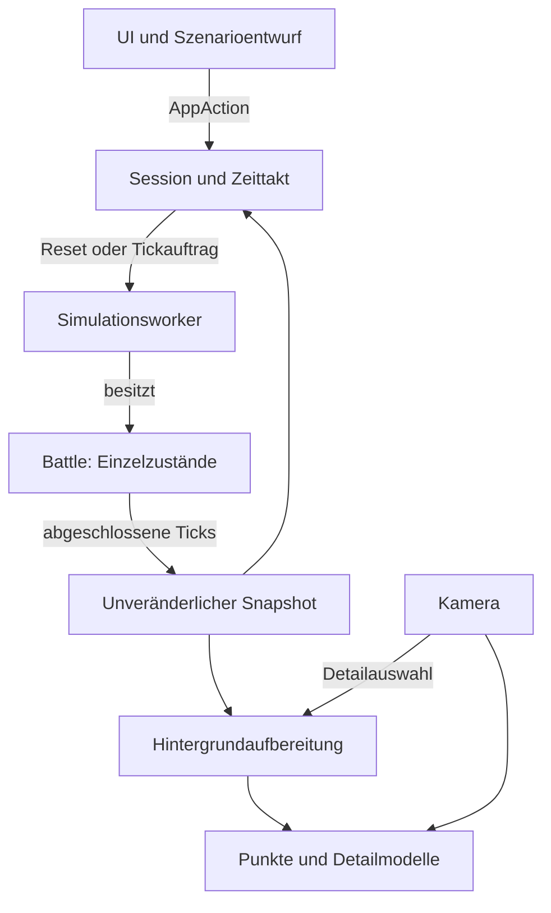

# Architektur der ersten Iteration

## Ziel und Umfang

Version 0.1 kombiniert einen nativen Spielablauf mit bis zu **1.000.000 individuellen Einheiten**, sieben Kategorien und GPU-instanzierter Darstellung. Das Limit gilt für beide Armeen zusammen. Jede Einheit behält ID, Position, Kategorie, Gesundheit und Lebenszustand. Ein Renderpunkt oder eine vereinfachte Aktivitätsstufe ersetzt diesen Zustand nicht durch einen Gruppenzähler.

Die logische Simulation verwendet feste Schritte von 50 ms. Ob sie in Echtzeit berechnet werden, hängt von Hardware und Gefecht ab. Prüfungen und Messbedingungen stehen in [TEST_RESULTS.md](TEST_RESULTS.md). Das Ziel von 20 Millionen erfordert ein weiteres Backend und ein anderes Transferbudget.

## Datenfluss und Eigentum

| Eigentümer | Schreibzugriff und Verantwortung |
|---|---|
| `ScenarioDraft` | Bearbeitbare Startkonfiguration; Änderungen starten noch keine neue große Welt |
| `SimulationWorker` | Einziger Eigentümer der maßgeblichen `Battle`; Reset und vollständige Tickaufträge |
| `battle_core::Battle` | Einheitenarrays, Raster, Arbeitsfelder, Kampfstatistik und Ergebnis |
| `Session` | Pause, Zielgeschwindigkeit, Rückstand, Generation, Auftragsstatus und letzter unveränderlicher Snapshot |
| `world` | Darstellungsdaten, räumliche Detailauswahl, Terrain und gemeinsame Modelle |
| `crowd` | GPU-Instanzbuffer, Render-Pipelines und Uploaddiagnose |

UI, Kamera und Renderer schreiben keine Kampfzustände. Die Kamera verändert ausschließlich die Präsentation. Der reine Rust-Kern hat keine Bevy-, Fenster- oder Grafikabhängigkeit.

## Maßgebliche Simulation

`UnitStore` verwendet kompakte parallele Vektoren statt einer Bevy-Entity pro Einheit. Der Arrayindex ist die stabile ID für die Schlacht. Tote Einheiten behalten ihren Platz; räumliche Abfragen und Darstellung ignorieren sie. Gemeinsame Werte stammen aus `UnitCategory::definition(UnitKind)`.

Ein Tick baut das räumliche Raster auf, liest einen konsistenten bisherigen Zustand, berechnet Bewegungswünsche und Angriffe, reduziert Treffer und übernimmt den nächsten Zustand. Schaden wird gleichzeitig angewendet: Ein im selben Tick getöteter Angreifer darf seinen bereits ausgelösten Treffer beitragen. Beidseitige Vernichtung kann ein Unentschieden ergeben.

Rastereinträge, Zähler und Offsets verwenden 32-Bit-Werte. Bewegungs- und Schadensarbeitsfelder werden wiederverwendet. Zielsuche und Separation besitzen feste Kandidatenbudgets, auch bei überfüllten Zellen. Das begrenzt Kosten, garantiert jedoch keine vollständige Nächster-Nachbar-Suche oder exakte Kollisionsfreiheit. Der Kern ist ein vereinfachtes Crowd-Modell.

### Aktivitätsstufen

Oberhalb von 20.000 Einheiten ergänzen ein 16-m-Raster mit Summenfeldern und konservative Gegnergrenzen das feine räumliche Raster:

- **Kontaktfront:** Möglicherweise erreichbare Gegner aktivieren volle lokale Zielwahl, individuelle Angriffe und Separation. Treffer prüfen weiterhin den Abstand zur einzelnen Zieleinheit.
- **Strategischer Bereich:** Jede Einheit behält ihren Zustand. Positionen werden jeden Tick integriert; die teurere Steuerungsrichtung wird nach stabiler ID gestaffelt alle acht Ticks erneuert. Dichteabhängiges Abbremsen ersetzt hier individuelle Separation.

Das feine Raster enthält alle lebenden Einheiten. Die Stufe richtet sich nach Gegnernähe, unabhängig von Sichtbarkeit und Kamera. Bei einer Million eng vermischten Gegnern können trotzdem fast alle Einheiten in der teuren Stufe liegen. Die Grundarbeit bleibt linear in Population und Rasterzellen; der Szenarioaufbau ist deshalb Teil jeder Messung.

### Parallelität und Reproduzierbarkeit

Ab 65.536 Einheiten verteilt der Kern lokale Arbeit bei verfügbarer Parallelität auf höchstens acht CPU-Worker. Blöcke von 4.096 IDs werden abwechselnd verteilt. Worker lesen dieselben unveränderten Eingaben und schreiben getrennte Ausgaben. Rasteraufbau und abschließende Übernahme bleiben seriell.

Jeder Angreifer speichert höchstens einen ausstehenden Treffer. Die Schadensreduktion erfolgt in aufsteigender Angreifer-ID; die Reihenfolge der Fließkommaadditionen hängt dadurch nicht von der Threadplanung ab. Ein Test vergleicht serielle und parallele Ergebnisse mit gemeinsam beschossenen Zielen. Plattformübergreifende Bitgleichheit wird nicht zugesichert. `step_ms` ist Telemetrie und keine Eingabe der Kampfregeln.

Weitere Regeln und Kandidatenbudgets: [battle_core/README.md](crates/battle_core/README.md).

## Kategorien und Gelände

Kategorie und Kampfprofil sind getrennte Eigenschaften. Das Szenario legt derzeit eine Kombination pro Armee fest; das Array speichert die Kategorie dennoch pro Einheit. Alte JSON-Dateien ohne Kategorie verwenden Creature.

Creature und Vehicle beachten die Bodensperre des Flusses und die Brückenroute. Buildings sind stationär. Air Unit, Sea Unit, Underground Unit und Space Unit bewegen sich frei auf der Ebene. Die Kategoriehöhen 0 / 8 / −3 / 32 m gehen in die Reichweitenprüfung ein. Sichtlinien, Erdabschirmung, Wasserbeschränkung, Aerodynamik und Umlaufbahnen sind nicht enthalten. Underground Units erhalten einen sichtbaren Oberflächenmarker.

Höhen und Terrain sind analytisch definiert. Die einfache Portalroute für den Fluss ist kein allgemeines Navigationssystem. Formationen bestimmen die Startpositionen. Fernkampftreffer verwenden direkte Reichweitenprüfung ohne simulierte Projektile.

## Asynchrone Anwendung und Zeitsteuerung

Die Bevy-Update-Sets laufen als **Input → Actions → Simulation → Presentation**. Das Update fordert Arbeit an und nimmt abgeschlossene Snapshots entgegen; es berechnet keinen großen Kampftick auf dem Fensterthread.

Der Worker besitzt eine aktuelle `Battle` und einen einzelnen Slot für das neueste Ergebnis. Die Anwendung hält höchstens einen Tickauftrag gleichzeitig offen. Resets tragen eine Generation, werden zusammengefasst und vor Arbeit sowie Veröffentlichung gegen die neueste Generation geprüft. Alte Ergebnisse können keine neue Welt überschreiben. Beim Reset wird das alte maßgebliche Backend vor der neuen großen Allokation freigegeben; die Darstellung kann ihren letzten Snapshot weiter anzeigen.

Ein Snapshot kopiert den abgeschlossenen `UnitStore`. Seine vorherigen Positionen stammen aus dem **vorher veröffentlichten** Snapshot, nicht nur aus dem letzten Physiktick. Die GPU kann dadurch auch über mehrere Ticks eines Auftrags interpolieren. `Arc` teilt bereits erzeugte Snapshots ohne weitere vollständige Kopie. Die anfängliche Snapshot-Erzeugung bleibt jedoch eine vollständige CPU-Kopie.

Bei mindestens 100.000 Einheiten fasst die Anwendung regulär mindestens zwei Ticks pro Veröffentlichung zusammen. Ein Auftrag enthält höchstens acht Ticks. Pause setzt ein Stoppsignal; der aktuelle Tick darf enden, weitere Ticks des Batches werden nicht begonnen. Einzelschritt ist nur pausiert, bereit, ohne laufenden Auftrag und ohne Endergebnis möglich. Interpolation wird beim Pausieren und Fortsetzen auf einen konsistenten Endpunkt gesetzt. Das Öffnen der Hilfe fordert dieselbe Pause nach dem aktuellen Tick an; das Schließen löst bewusst keinen automatischen Weiterlauf aus.

Der Akkumulator nimmt höchstens 0,25 Sekunden einer einzelnen Bilddauer an und begrenzt den Rückstand auf 0,4 Sekunden Spielzeit. Nicht nachgeholte Zeit wird diagnostiziert. Das verhindert endloses Aufholen, bedeutet bei Überlast aber langsamere Spielzeit. Es werden keine halben Ticks an den Kern übergeben. Gewählte Geschwindigkeiten sind Ziele, keine Echtzeitgarantie.

Interne Worker-Panics werden als Fehlerstatus zurückgegeben. Weitere Tickbefehle werden blockiert, Navigation und Wiederanlauf bleiben verfügbar. Das behandelt abfangbare Workerfehler, nicht Prozessabbruch oder Speichermangel.

## Darstellungsbrücke

Eine Bevy-Hintergrundaufgabe bereitet den letzten Snapshot auf. Es existiert höchstens eine solche Aufgabe zugleich; ältere Generationen werden verworfen. Große Szenariowechsel oder ein langsamer Renderer erzeugen keine unbegrenzte Aufbereitungsschlange.

Jede lebende Einheit erhält **einen GPU-Punkt mit eigener Position**. Bis zu 6.000 nahe Einheiten erhalten zusätzlich ein Kategorienmodell. Punkte bleiben unter den Modellen bestehen. `represented_units` zählt die eindeutige Population; Punkte plus Detailmodelle zählen dagegen die eingereichten Darstellungen. Bildausschnitt, Tiefe und Pixelauflösung bestimmen die tatsächlich sichtbare Ausgabe.

Die Detailauswahl untersucht 32-m-Raumbuckets innerhalb von 125 m um die Kamera. Pro Bucket werden höchstens ungefähr 256 gleichmäßig verteilte Kandidaten betrachtet, danach gilt das Gesamtbudget. Eine Kamerabewegung scannt dadurch nicht erneut alle Million Einheiten. Punktliste und Buckets entstehen beim neuen Snapshot im Hintergrund; die begrenzte Detailauswahl läuft auf dem Präsentationspfad.

Jede Armee verwendet eine Punkt- und eine Detailgruppe: höchstens vier aktive Crowd-Draw-Gruppen für die aktuelle homogene Konfiguration. Jede `ArmyBatch` trägt **`NoAutomaticBatching`**: Zwei Armeen können dasselbe Mesh verwenden, besitzen aber verschiedene eigene Instanzbuffer. Automatisches Zusammenfassen der Phase-Items würde einen der Buffer und damit eine Armee unterschlagen. Der Fehler wurde im Screenshot der Millionenfront sichtbar, obwohl die Uploadzähler stimmten; die erneute native Verifikation ist in [TEST_RESULTS.md](TEST_RESULTS.md) dokumentiert.

Gemeinsame prozedurale Meshes existieren für sieben Kategorien und drei Profile. Die horizontalen Modellabmessungen werden radial an den Gameplay-Körperradius angepasst, während Modellhöhe und Kategoriehöhe erhalten bleiben; Normalen werden entsprechend korrigiert. Terrainauflösung und Kamerareichweite passen sich der Szenariogröße an.

## GPU-Vertrag und Kosten

Der Host-/Shader-Datensatz besitzt **48 Bytes**:

| Feld | Inhalt |
|---|---|
| `positions: vec4` | Aktuelle und vorher veröffentlichte X/Z-Position |
| `appearance: vec4` | Lineare Teamfarbe und Modellskalierung |
| `behavior: vec4` | Richtung, Bewegungsstärke, Angriffsimpuls und stabile Animationsphase |

Die Kategorie steckt im gemeinsam verwendeten Mesh. Der Shader berechnet Interpolation, analytische Geländehöhe, Ausrichtung und einfache Animation. Pro Bild wird eine 16-Byte-Uniform übertragen. Ein verspäteter aufbereiteter Snapshot verwendet seinen Endpunkt statt des Interpolationsfaktors einer neueren Veröffentlichung, damit alte Positionspaare nicht zurückspringen.

Instanzlisten werden in der Render World über `Arc` geteilt. GPU-Buffer bleiben bestehen, wachsen auf gerundete Kapazitäten und erhalten Daten bei geänderter Revision. Eine Million Punkte umfasst **48.000.000 Bytes Nutzlast pro Veröffentlichung**; Detailmodelle kommen hinzu. Residente GPU-Kapazitäten und zeitweise gleichzeitig vorhandene CPU-Snapshots sind größer als diese einzelne Nutzlast. Häufige Vollübertragung bleibt deshalb ein relevantes Bandbreitenbudget.

Die Pipeline verwendet Weltpositionen und explizite Instanzdaten. Standard-Mesh-Culling ist deaktiviert, weil lokale Modellgrenzen die verteilte Population nicht beschreiben. Individuelles GPU-Culling, GPU-Draw-Argumente und GPU-Kampfsimulation sind noch nicht vorhanden. Die Renderdiagnose prüft eingereichte Punktzahlen und kompilierte Pipelines. Eine erfolgreich dargestellte Generation wird für die Ladeanzeige gespeichert; spätere Aufbereitungsarbeit zeigt dadurch nicht erneut den initialen Ladedialog. Pipelinefehler besitzen einen eigenen Status mit vollständigem technischem Log und weiterhin erreichbarer Navigation. Screenshots ergänzen die Zähler um sichtbare Ausgabe; sie messen keine GPU-Dauer.

`Battle::allocated_bytes()` zählt persistente Kerndatenkapazitäten. Zum Gesamtbudget gehören zusätzlich veröffentlichte Snapshots, Aufbereitungsdaten, Raumbuckets, GPU-Kapazitäten, Meshes, Worker-Stacks und Engine-Speicher. Der Diagnosewert ist weder Prozess-RAM noch VRAM.

## Persistenz und Verifikation

JSON enthält Startkonfigurationen. Die Anwendung akzeptiert reguläre Dateien, prüft die Metadaten vor und nach dem Öffnen und begrenzt den tatsächlichen Read auf 64 KiB plus ein Prüfbyte. Dadurch kann eine nach der Metadatenprüfung gewachsene Datei die Lesegrenze nicht umgehen. UTF-8, Name, Kategorien, Wertebereiche, Gesamtpopulation und unbekannte Felder werden validiert.

Speichern erzeugt mit `create_new(true)` eine eindeutige temporäre Datei im Zielverzeichnis. Eine vorhandene temporäre Datei oder ein gleichnamiger Symlink wird nicht überschrieben. Nach Schreiben, Synchronisieren und Schließen wird das Ziel durch Umbenennen ersetzt. Ein fehlgeschlagener Ersatz löscht niemals vorher die bestehende Zieldatei; nur die eigene temporäre Datei wird entfernt. Laufende Zustände und Replays sind nicht Teil dieses Formats. Beim Programmstart werden Shader und beide erforderlichen Fonts auf Vorhandensein geprüft.

Kerntests untersuchen Regeln und Dateninvarianten; der Headless-Benchmark misst CPU-Ticks und validiert den Schlusszustand; der Smoke-Test aktiviert UI-Aktionen und prüft Übergänge; der Rendercheck verbindet die reale Population mit Renderdaten, Pipelinebereitschaft und Screenshot. Physische Eingaben und visuelle Prüfung ergänzen diese Ebenen. Ausgeführte Läufe stehen in [TEST_RESULTS.md](TEST_RESULTS.md).

## Entwicklungsweg zu 20 Millionen

1. Zielhardware, Bildrate, Simulationsgeschwindigkeit, Detailbudget und ungünstige Gefechtsszenarien festlegen. Population allein ist kein ausreichendes Leistungsziel.
2. Referenzregeln und Toleranzen für Bewegung, Reichweite, simultanen Schaden, Domänen, Engstellen und Ergebnisse erhalten.
3. GPU-Zustandslayout, IDs, Sektoren und Speicherbudget entwerfen. Simulations- und Renderdatensätze trennen; die aktuellen Vollkopien nicht einfach verzwanzigfachen.
4. Zustände dauerhaft auf der GPU halten und Bewegung, Raster, begrenzte Nachbarsuche sowie Schadensreduktion auf Compute umstellen. Sektorgrenzen und Synchronisation prüfen.
5. Gemeinsame Navigationsfelder und situationsabhängige Aktivität weiterentwickeln. Sichtbarkeit darf keine Spielregeln verändern.
6. GPU-Culling, Distanz-/Bildschirm-LOD und indirekte Draws hinzufügen. Animation, Schatten, Effekte und Leichen erhalten eigene Budgets.
7. Statistiken, Picking, Speichern und Replays über kleine asynchrone Readbacks oder gezielte Checkpoints anbinden. GPU-Zeit, Tickzeit, Transfers und Speicher separat messen.
8. Kontaktgefechte mit 1, 5 und 20 Millionen unter dokumentierten Bedingungen nachweisen; auch vermischte Armeen, Engstellen und Szenariowechsel prüfen.

Die aktuelle Trennung liefert ein überprüfbares Referenzmodell. Der GPU-Kern, seine deterministische beziehungsweise toleranzbasierte Validierung und vollständige Bewegungsdomänen bleiben eigenständige Implementierungsarbeit.

### Vollständige Scene-Bereitschaft

Die erste Freigabe und native Aufnahmen warten zusätzlich zu den Einheitenpipelines auf die ausstehenden Standard-Renderpipelines. So werden Terrain und Materialien vor der Aufnahme berücksichtigt. Nach übereinstimmender Generation, Population und Pipeline-Bereitschaft folgen zwei weitere Renderupdates. Die ergänzende Bildprüfung unter `tools/verify_captures.py` untersucht die vorgegebenen Wiesenansichten auf sichtbares Gelände und die Millionenansicht auf beide Armeefarben; sie zählt keine individuell unterscheidbaren Einheiten.
