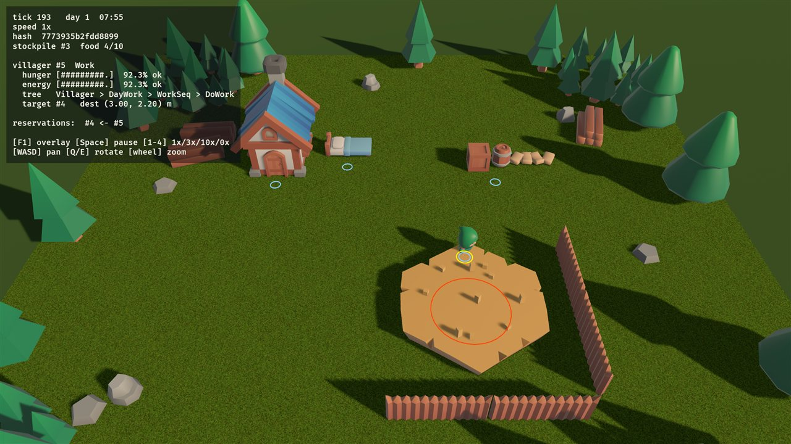
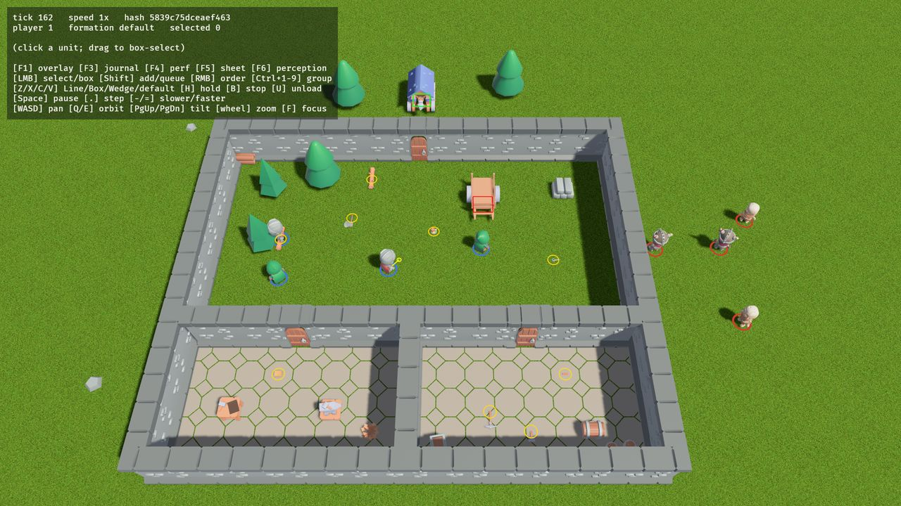
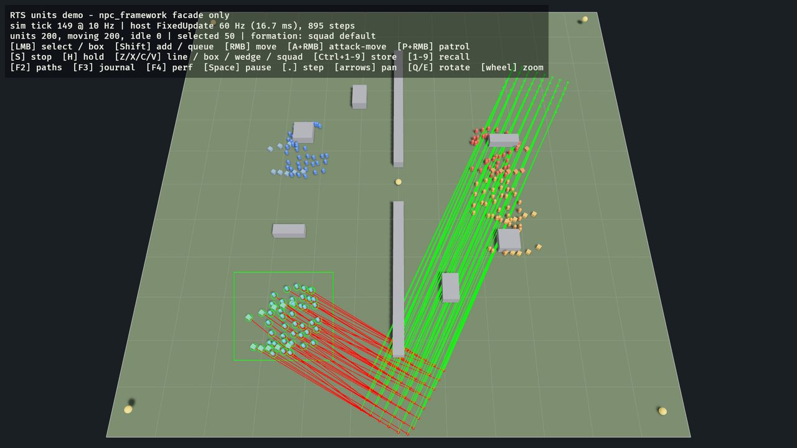
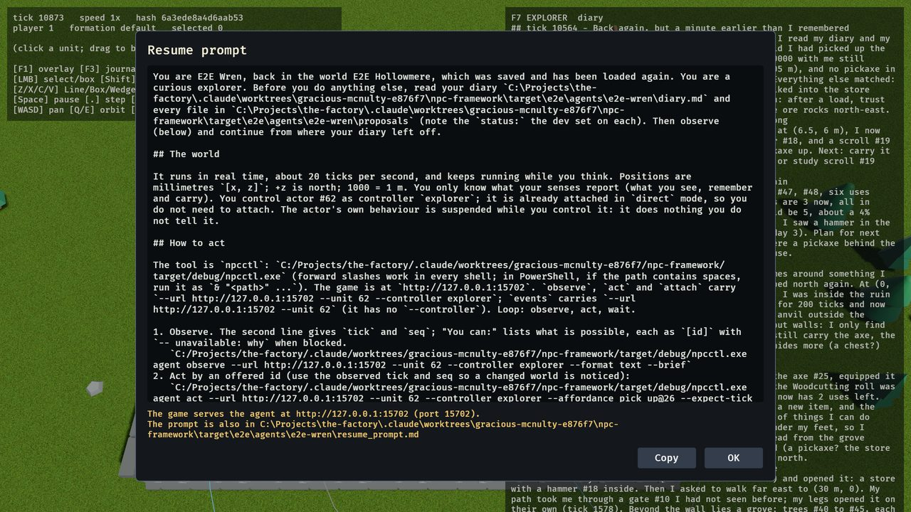
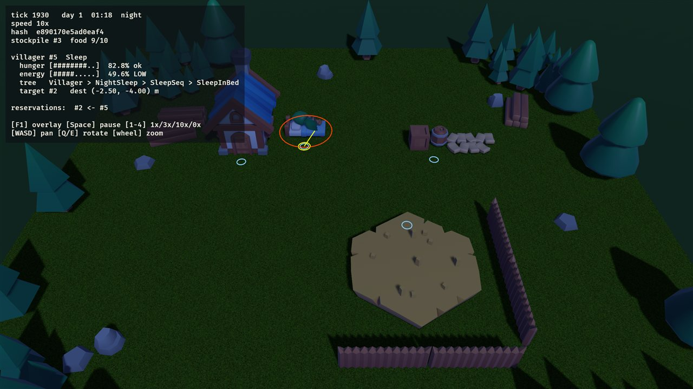
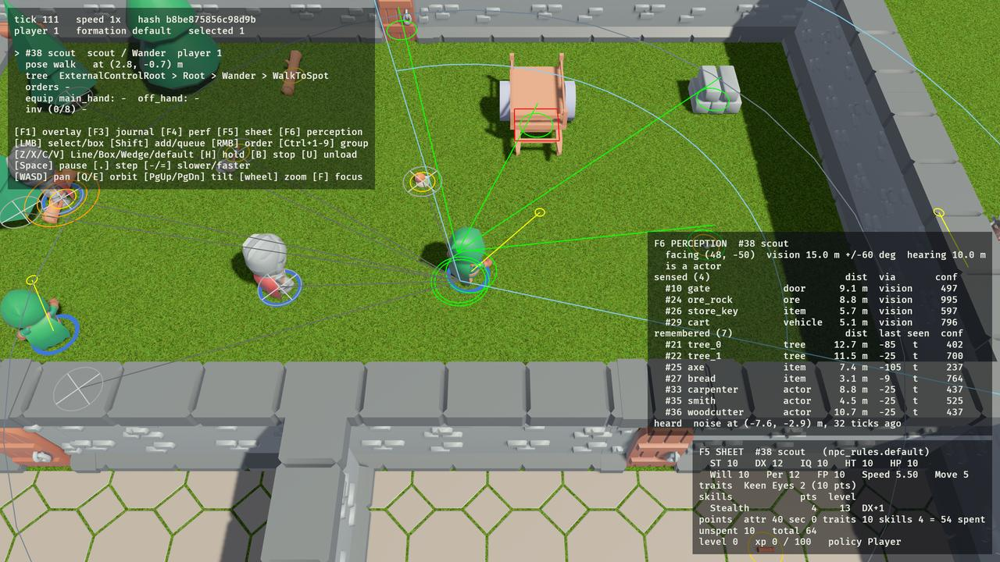
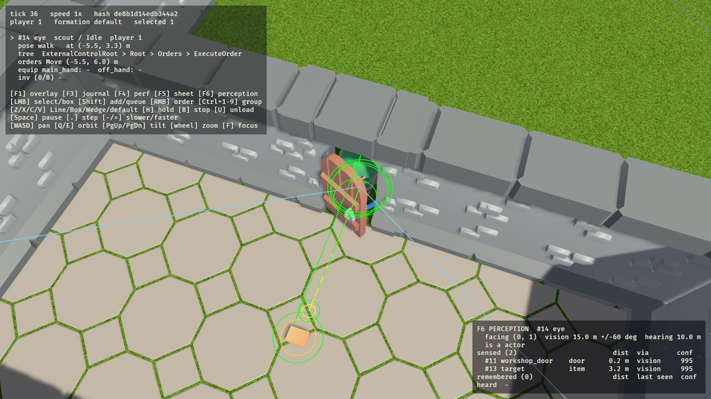

# npc-framework

A deterministic 3D NPC and actor framework in Rust on **Bevy 0.20**, for colony sims, RTS games and emergent
behaviour. Units think with behaviour trees and act through plain ECS actions; the simulation is integer-only,
runs headless, and replays bit for bit from a seed and a command log, on every OS. Opt-in capabilities add
perception, a GURPS-like rules layer, interaction with items and doors, RTS orders and formations, vehicles,
progression, crafting, and control by external AI agents. Everything is reachable as JSON for humans and agents:
a headless CLI, a JSON-RPC interface on the running game, a journal of every decision, and a profiler.

| The village | The Actor Testbed | A foreign RTS host | The AI explorer |
|---|---|---|---|
|  |  |  |  |
| villagers with needs, a food economy, day and night | every capability on: doors, tools, crafting, vehicles, two factions | 200 units, 2 players, its own physics, only the facade | an AI agent of your choice lives in the world, keeps a diary, a memory and proposals (F7: read and edit them) |

> **Working on this repository with Claude Code? Launch it in `npc-framework/`.** The guardrail hooks (protected
> goldens, verify on stop), the path rules and the skills in `npc-framework/.claude/` load only when this directory
> is the project root. The repository root is a shared vault without hooks; started there, none of them apply.
> See [`CLAUDE.md`](CLAUDE.md).

## Guides

- **[Using npc-framework in your Bevy game](docs/using-npc-framework.md)**: the facade, `NpcPlugins`, registering
  content by name, the host-owned schedule and movement, every capability with a snippet, glue, determinism rules,
  view helpers, versions.
- **[Debugging, tracing and profiling](docs/debugging.md)**: every `npcctl` subcommand and RPC method, the journal
  kinds, mechanics and budgets, Tracy/Chrome traces, the gates, and recipes ("why did unit X do Y at tick T",
  bisecting a desync, the slowest mechanic, screenshots at a tick).
- **[Agent experiments](docs/agent-experiments.md)**: let an AI agent play an actor in real time (CLI or MCP),
  then replay and analyse its run; the AI explorer (an agent living in a saved world with a diary and proposals).
- [Adding a host app to this workspace](docs/adding-a-host-app.md): the one extra step (`deny.toml`) for a new
  windowed app inside this repository.
- **Entity reference**: one page per ECS [component](docs/entities/components/index.md) (fields and units, who
  adds, reads and writes it, hashed and/or saved in world snapshots) and per [system](docs/entities/systems/index.md)
  (schedule and set, reads/writes, determinism, perf mechanic).
- Decisions: [`docs/adr/`](docs/adr/) (0001–0013). History: [`CHANGELOG.md`](CHANGELOG.md). Specs and plans:
  `docs/superpowers/`. Benchmarks: [`bench/README.md`](bench/README.md). Agent workflow: [`CLAUDE.md`](CLAUDE.md).

## Features

| Capability | Feature / switch | What it gives your units |
|---|---|---|
| Core | default | behaviour trees (selectors, sequences, guards with reactive aborts, utility selectors), actions as components, needs with hysteresis, smart objects and reservations, an integer spatial grid, a host-safe driver at any tick rate in any schedule, registration by stable name |
| Locomotion | `locomotion` (default) | the `MoveIntent` → mover → `MoveStatus` seam, a straight-line mover; plug in your own (flow fields, navmesh, physics) |
| Pathfinding | `nav` | deterministic grid A* with smoothing, a per-tick node budget, replanning, door costs, group moves along the leader's path |
| Perception | `perception`, `with_perception()` | vision cones (integer FOV, grid line of sight), hearing, proximity, bounded memory, detection checks by name, BT conditions |
| Rules | `rules`, `with_rules()` | a point-buy character sheet, skills and traits by name, 3d6 roll-under with criticals, contests, a pluggable rule set |
| Interaction | `interaction`, `with_interaction()` | items, inventory, equipment, doors (locked, keyed, auto-opened on paths), tools, verbs registered by name with `why_not` reasons |
| RTS command | `command`, `with_command()` | ownership, recorded orders (move, attack-move, patrol, follow, hold, interact, mount, unload), shift-queues, integer formations, squads |
| Vehicles | `vehicles`, `with_vehicles()` | seats (driver, passenger, gunner), mounting, crew-driven or directly commanded vehicles |
| Progression | `progression`, `with_progression()` | XP sources by name, levels, AI or player spend policies, practice, study and teaching |
| Crafting | `crafting`, `with_crafting()` | recipes, workstations, crafting orders, quality from the skill roll, tool wear |
| Agent control | `agent-io`, `with_agent_io()` | external controllers (Direct, Advisor, Observer), egocentric observations, affordances, real-time sessions, CLI and MCP clients |
| View helpers | `view-helpers` | visuals linked to sim entities, interpolation, journal and perf panels, selection, screenshots, gizmos per capability, an RTS command UI |
| Tooling | `tools`, `perf`, `remote` | the journal, inspection, replays and divergence, the per-mechanic profiler with budgets, BRP `npc/*` methods |

Capabilities are independent: each works alone, and pairs meet in facade glue (Per-roll detection, `Interact`
orders, crew-driven vehicles, craft XP, agent affordances for every verb, ..). Without a capability's plugin
nothing of it runs or is hashed.

## Quick start

Requires Rust ≥ 1.97.1 (`rustup update stable`). The first build compiles Bevy and takes a while.

```bash
cargo run -p game_menu                                 # start here: a menu with everything below, no flags
cargo run -p village                                   # the village (F1 overlay, F3 journal, F4 perf, Space, 1-4)
cargo run -p actor_testbed                             # the Actor Testbed; you command player 1
cargo run -p actor_testbed -- --scenario vehicles      # embedded scenarios: doors, locked_store, chop, craft,
                                                       # perception, vehicles, formation, agent, smithy, explorer
cargo run -p rts_units_demo                            # 200 units, scripted opening orders
cargo run -p rts_units_demo -- --headless-ticks 1500   # no window: a JSON summary with the state hash
```

The menu starts each game as a child process and comes back when it closes; a game that is not built yet
shows its `cargo build -p <name>` command and a **Build** button (`cargo build -p game_menu -p actor_testbed
-p village -p rts_units_demo -p npcctl` builds them all). **Explore with an AI agent**: set an agents folder in
Settings, then New (name the agent and its world) or Resume. The game opens with a prompt to copy into the AI
tool of your choice (Claude Code, Codex, a chat with a shell); the agent then plays the explorer through
`npcctl`, keeps its diary, memory and proposals through the game (one Obsidian-ready markdown file per entry in
the agent folder); F7 in game is the notes editor where you read and edit them as the player and set each
proposal's status. See
[Agent experiments §9](docs/agent-experiments.md#9-the-ai-explorer).

Headless, with JSON on stdout (`npcctl`, exit 0 ok / 1 check failed / 2 usage error):

```bash
cargo run -p npcctl -- run --seed 1 --ticks 7200 --pretty                         # three village days
cargo run -p npcctl -- journal --seed 1 --ticks 4000 --unit 5 --kind LeafStart,Abort --limit 20
cargo run -p npcctl -- run --scenario testbed --ticks 4800 --pretty               # the testbed, two days
cargo run -p npcctl -- replay verify tests/replays/testbed_orders_craft.json       # {"ok":true,..}
cargo run -p npcctl -- diverge --seed-a 1 --seed-b 2 --ticks 2400 --pretty        # first divergent tick + diff
```

The running game speaks JSON-RPC on `127.0.0.1:15702`:

```bash
curl -s -X POST http://127.0.0.1:15702/ -H 'content-type: application/json' \
  -d '{"jsonrpc":"2.0","id":1,"method":"npc/unit","params":{"id":5}}'
```

An agent experiment: serve a scenario headless and play an actor from the CLI (or `npcctl mcp` for an MCP
client, or `/play-actor` in Claude Code):

```bash
cargo run -p npcctl -- serve --scenario smithy --record target/session.json &
cargo run -p npcctl -- agent attach --unit 33 --controller me --mode direct
cargo run -p npcctl -- agent observe --unit 33 --controller me --format text
cargo run -p npcctl -- agent act --unit 33 --controller me --verb order \
  --args '{"order":{"type":"Interact","verb":"pick_up","target":26}}'
cargo run -p npcctl -- agent act --unit 33 --controller me --verb execute_orders
cargo run -p npcctl -- agent events --unit 33 --kinds OrderDone,OrderFailed --timeout-ms 20000
cargo run -p npcctl -- session stop && cargo run -p npcctl -- replay verify-session target/session.json
```

The gate for every change: `cargo xtask verify` (fmt, clippy, tests, architecture fitness, the replay corpus,
goldens, cargo-deny) prints one JSON verdict. CI runs it on Linux and Windows and checks that both produce the
same hashes (`.github/workflows/npc-framework.yml` at the repository root).

## Use it in your game

```rust
use bevy::prelude::*;
use npc_framework::prelude::*;

App::new()
    .add_plugins(DefaultPlugins)
    .insert_resource(Time::<Fixed>::from_hz(60.0))              // your physics rate stays yours
    .add_plugins((
        NpcPlugins::new().seed(1).tick_hz(10).run_in(FixedUpdate).with_command(),
        NavPlugin,
        MyUnitsPlugin,     // register_need / register_action / register_cond / register_tree /
                           // register_sim_component / register_command, by stable name
    ))
    .run();
```

`apps/rts_units_demo` is the reference integration (`src/sim.rs` registers its two unit types; `src/host.rs` runs
its own physics at 60 Hz next to the 10 Hz sim). The [integration guide](docs/using-npc-framework.md) walks
through a complete unit type and every capability.

## Crate map

```
apps/village  apps/actor_testbed  apps/rts_units_demo  apps/npcctl      ← windowed demos, the portability proof, the CLI
content/village_content  content/village_view                         ← the villager (sim content / its view)
content/testbed_content  content/testbed_view                         ← the Actor Testbed (sim content / its view)
npc_framework            the facade: NpcPlugins (+ with_<capability>()), NpcAppExt, prelude, glue/<a>_<b>
npc_view_helpers         generic view: VisualOf, interpolation, panels, selection, screenshots, gizmos, command UI
npc_agent_io             external agent control: controllers, observations, affordances, sessions, CLI/MCP clients
npc_tools                CLI helpers, bench harness, the replay recorder; BRP npc/* (feature remote)
npc_command npc_vehicles npc_interaction npc_crafting npc_progression npc_rules npc_perception   ← capabilities
npc_nav npc_locomotion   grid A* / the MoveIntent seam and the straight-line mover
npc_perf                 per-system / per-mechanic profiler and budgets
npc_jobs npc_needs       smart objects + reservations / data-driven needs
npc_kernel               ids, clock, rng, SimPos, NpcSimTick/NpcSet, commands, orders, journal, replay,
                         state hash registry, inspect, spatial grid, host-safe driver
npc_ai                   generic behaviour trees
xtask                    cargo xtask verify, architecture fitness, hook tests
```

Nothing in a lower row names anything above it; capability crates depend on each other only along ADR 0012's
whitelist (progression → rules, crafting → interaction + rules, vehicles → interaction).
`xtask/tests/arch_fitness.rs` checks the real dependency graph, including that content and the RTS demo reach
the framework only through the facade. `CLAUDE.md` has the table with every crate's role.

## The village

One tile, villagers with hunger, energy and thirst: they work the field to fill the food stockpile, eat when
hungry, drink at the well when thirsty, sleep at night and wander in their free time.

| Day: working the field | Night: asleep |
|---|---|
|  |  |

```
Selector "Villager"
├ Guard "UrgentEat"   (abort lower) → ReserveFood → MoveToDest → EatFood
├ Guard "UrgentDrink" (abort lower) → ReserveWell → MoveToDest → DrinkWater
├ Guard "UrgentSleep" (abort lower) → ReserveBed  → MoveToDest → SleepInBed(full)
├ Guard "Forage"      (abort lower) → ReserveWork → MoveToDest → DoWork
├ Guard "FollowOrder" (abort lower) → walk to the ordered position
├ Guard "NightSleep"                → ReserveBed  → MoveToDest → SleepInBed(morning)
├ Guard "CasualDrink"               → ReserveWell → MoveToDest → DrinkWater
├ Guard "CasualEat"                 → ReserveFood → MoveToDest → EatFood
├ Guard "DayWork"                   → ReserveWork → MoveToDest → DoWork
└ Wander                            → PickWanderPoint → MoveToDest → IdleFor
```

`cargo run -p village -- [--seed N] [--speed N] [--record r.json] [--journal j.jsonl] [--screenshot shot.png
--after-secs 5]`. Keys: F1 overlay (needs, tree path, target, reservations, state hash), F3 journal, F4 perf,
Space pause, 1 / 2 / 3 / 4 speed 1× / 3× / 10× / 0×, `.` one tick, WASD / arrows pan, Q / E rotate, wheel zoom.
`cargo test -p village_content --test villager print_three_day_timeline -- --ignored --nocapture` prints three
days of activity.

## The Actor Testbed

`apps/actor_testbed` is the showcase of every opt-in capability (actor-capabilities spec §4.9): a walled
compound (`content/testbed_content`, its layout and content in its README) with a workshop and a locked store,
doors that open when units walk through, trees to chop, an ore rock, workstations, items, a crew-driven cart and a
siege-ram wagon, four adventurers (player 1) and four skeletons (player 2) with character sheets, sensors and RTS
orders. `content/testbed_view` draws it with KayKit and Kenney models.

| Overview | F5 sheet + F6 perception | A door opening |
|---|---|---|
|  |  |  |

```bash
cargo run -p actor_testbed -- --scenario vehicles --player 1
cargo run -p actor_testbed -- --scenario my.json --seed 2                     # a scenario file
cargo run -p actor_testbed -- --select 38 --panels sheet,perception --screenshot shot.png --after-secs 8
cargo run -p actor_testbed -- --scenario doors --commands cmds.json          # [{"tick":20,"cmd":{"type":"IssueOrder",..}}]
```

Other options: `--speed N`, `--paused`, `--camera X,Z,DIST[,YAW,PITCH]`, `--journal FILE`, `--record FILE`,
`--remote` / `--no-remote` (BRP is on by default in dev builds, off in release builds), `--remote-port N`,
`--out-dir DIR` (where RPC-requested screenshots and recordings go; default `target/npc-out`). The names and `SimId`s of what the scenario spawned are logged at startup; BRP
serves the `npc/*` and the agent methods, so an external agent can attach to a unit in the running window.

| Key | Action |
|---|---|
| left click / drag (Shift adds) | select your units; clicking anything else inspects it |
| right click (Shift queues) | context order: ground → `Move`, item → `pick_up`, closed door → `open` / `unlock`, vehicle → `Mount`, tree / ore → `use_tool_on`, own unit → `Follow` |
| Ctrl+1–9 / 1–9 | store / recall a control group |
| Z / X / C / V | formation of group moves: Line / Box / Wedge / default |
| H / B / U | hold / stop / unload (vehicles) |
| F1 / F3 / F4 / F5 / F6 | overlay / journal / perf / character sheet / perception (cone, line of sight, memory) |
| Space / `.` / `-` `=` | pause / one tick / slower, faster (1×, 3×, 10×) |
| WASD, Q / E, PgUp / PgDn, wheel, F | pan, orbit, tilt, zoom, focus the selection |

## Portability: the RTS units demo

`apps/rts_units_demo` is a foreign RTS host that depends only on `npc_framework` (features `nav`, `command`,
`view-helpers`, `perf`) and `bevy`, with no `content/*` crate (`rts_demo_uses_only_facade` pins it). Everything
game-specific lives in the app: two unit types registered by name (`Infantry`, `Engineer`: an order branch over an
idle leaf; engineers also repair damaged walls within 12 m, or anywhere on a `repair` order), a 96 × 96 m map
with `GridBlocker` walls (three start damaged: `WallHealth`), 200 units of 2 players in 4 squads, primitive visuals, an
RTS camera, and its own physics-like system in `FixedUpdate` at 60 Hz next to the 10 Hz sim.

```bash
cargo run -p rts_units_demo -- --units 400 --seed 2 --idle   # no script
cargo run -p rts_units_demo -- --screenshot shot.png --after-secs 18
```

| Key | Action |
|---|---|
| left click / drag (Shift adds) | select own units |
| right click (Shift queues) | `Move` (or the context order for a unit); with **A** held `AttackMove`, with **P** `Patrol` |
| Ctrl+1–9 / 1–9 | store / recall a control group (1, 2 = your squads) |
| Z / X / C / V | formation of group moves: Line / Box / Wedge / the squad's own |
| R + right click | the selection's engineers repair the damaged wall under the cursor (pressing R keeps only engineers selected) |
| S / H | stop / hold |
| F2 / F3 / F4 | path gizmos / journal / perf panel |
| Space / `.` | pause / one tick |
| arrows, Q / E, wheel | pan, rotate, zoom |

What the demo found, and what came of it:

- Modifier orders on right click (`AttackMove`, `Patrol`) needed a rebuilt order input; `command_ui` now takes
  the order kind from `RightClickMode` (`Move` / `AttackMove` / `Patrol` / `Custom(name)`), set by the host's own
  hotkeys. The unit picker is public (`pick_unit`, `view_helpers::pick`), and scripted selection with a marquee
  is `select_units` + `DragBox`.
- The profiler needed `LogPlugin { custom_layer }` boilerplate; it is now
  `DefaultPlugins.set(npc_framework::perf::log_plugin())` + `NpcPerfPlugin` (what this demo and the village do). A
  host that adds its sim plugins before `DefaultPlugins` (the Actor Testbed) calls `perf::install_log_plugin_now()`
  at the start of `main` and disables Bevy's `LogPlugin` instead
  ([using-npc-framework.md §9.2](docs/using-npc-framework.md#92-the-profiler)).
- `GridBounds`, `create_squad`, `state_hash` and `content_hash` are in the prelude.
- `deny.toml`'s `bevy` ban lists the apps of this workspace allowed to depend on `bevy`, so a new host app here
  needs one reviewed line there ([`docs/adding-a-host-app.md`](docs/adding-a-host-app.md)); a game outside the
  workspace is unaffected.

## Assets

The assets are CC0, from KayKit (Kay Lousberg), Kenney and ambientCG. See `assets/CREDITS.md`. To re-download
them, run `scripts/fetch_assets.sh`.
