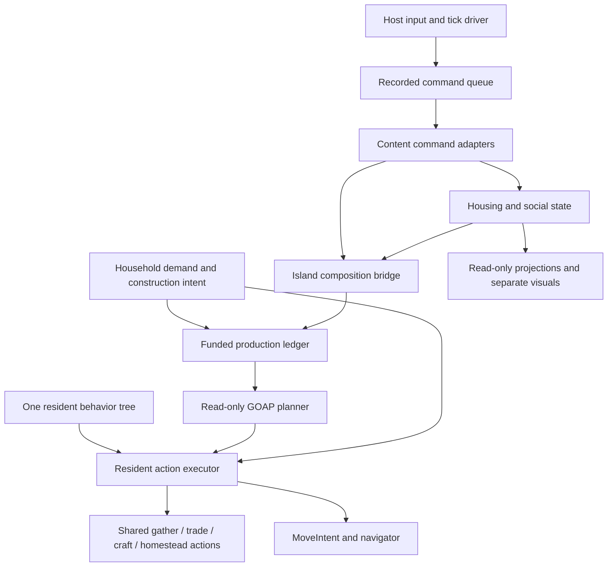

# Island simulation ownership and extension contracts

The regional `living_world` extension composes immutable construction, settlement
identity, employment, ecology, routes and recorded restoration in `village/frontier`.
[ADR 0037](adr/0037-regional-living-world.md) defines those owners and their profile-only
registrations. Employment changes feed the existing resident Work boundary; they
do not introduce a second needs/work controller. Rendering uses derived terrain
chunks and persistent appearance IDs; it cannot drive authoritative scheduling.
The published settlement chart contains immutable public destinations, while all
live resources, residents and property retain actor-scoped observation rules.

Island Village is content built on the framework's existing capabilities. Its
composition root is `content/testbed_content/src/village/mod.rs`; the generic
crates do not know about residents, cottages, island terrain or colony policy.
The opt-in `colony` and `island_ai` descriptors are validated before registration
and frozen into the world's construction data. Older scenarios retain their
registrations and numerical model. See [ADR 0035](adr/0035-island-colony-showcase.md).

## Ownership

| Context | Owner | Public integration contract |
| --- | --- | --- |
| Simulation lifecycle | `npc_kernel`, host app | `NpcSimTick`, ordered `NpcSet`s, `SimControl`, recorded commands and snapshots |
| Resident arbitration | `village/behavior.rs` | One `island_life` behavior tree and its saved `LifeDecision`; need and work priorities use the same runtime |
| Regional resident behaviour data | `village/resident/` | Validate the `behavior` block (trees, traits, schedule, places); register the granular `life.*` leaves, named conditions and scorers; seed `ResidentTraits`; write `VillageDecision` records from unhashed scratch state |
| Physical action execution | `village/ai.rs`, shared action capabilities | Interpret the selected goal; use `VillageAct`, `HomesteadAct`, crafting and `MoveIntent`; own cancellation of resident work |
| Production allocation | `village/production.rs` | Forecast demand, allocate finite stock/cash, expose funded targets; own every mutation of `ProductionPlan` |
| Planning | `village/goap.rs` | Read live facts and return a bounded `WorkPlan`; pure assessment distinguishes no funded goal, unavailable prerequisites and search limits; execution revalidates every first step |
| Regional economy data | `village/frontier/economy_spec.rs` | Validate the `economy` block (goods, recipes, professions, patches, endowments, tuning); build the frozen `EconomyRegistry` that `village/catalog.rs` lookups read; hashed with the world construction |
| Buildings, stores and civic planning (regional) | `village/civic/` | `placement` owns the pure placement query and the recorded `PlaceBuilding`/`CancelBuilding`; `sites` owns paid deliveries, staged work, completion and refunds; `depot` owns stores and stalls as sellers of record; `haul` owns the resident steps behind `life.haul` and `life.build`; `planner` owns the staggered per-settlement review. `CivicState` indexes all of it by settlement and is hashed and saved |
| Live mode and homestead work (regional) | `village/live.rs`, `village/live/jobs.rs` | `LiveState` (bonds, goals, tiers, upgrades, chests, errands) and the recorded `LiveAct`; a homestead upgrade is a private site paid from the owner's escrow, supplied by `life.haul materials` and built by `life.build` (after the village's own sites) and helped by `life.help`, all at the door; the civic planner never sees it ([ADR 0040](adr/0040-homestead-work-and-the-payer.md)) |
| Merchant boat (regional) | `village/merchant.rs` | The island's outlet and source at the berth: buys surplus above the stock targets from the port's stores, sells shortfalls to the civic fund into the trading post; purse and limits are data; `view::boat` reports the berth |
| Shaping the world (regional) | `village/frontier/shape.rs` | Recorded `PlaceResourcePatch`/`RemoveResourcePatch` and the pure `export_world` |
| Authored life policy | `village/policy.rs` | Validate priority/threshold/search configuration; register and save the immutable policy |
| Household mechanics | `village/colony/housing.rs` | Beds, assignments, commissions, hearths, material demand, own-household heating facts and read-only `ConstructionIntent` |
| Social mechanics | `village/colony/social.rs` | Proximity meetings, affinity, morale, shared leisure eligibility and read-only meeting destinations |
| Colony state | `village/colony/model.rs` | Authoritative components/resources, stable hash names, exact serialization and hash encodings |
| Colony input | `village/colony/commands.rs`, `arrival.rs` | Recorded civic changes and one-time arrival; validation and application share the same domain rules |
| Colony observation | `village/colony/summary.rs` | Read-only aggregate projections for UI and tools |
| Player homestead and crops | `village/homestead` | Shared claim/build/plant/water/harvest validation and execution; crop definitions reuse saved crop kind and deadlines |
| Player guidance | `village/player_journey.rs` | Pure current-objective projection from actor-scoped observations; no rewards, saved checklist or command execution |
| Learned island places | `village/discovery.rs` | Island-only known-target and position providers over the actor's existing `SeenStatics`; immutable-place identity is distinct from unseen live state |
| Terrain | `village/terrain.rs` | Integer cells, static navigation, atomic brush validation and recorded editing |
| Save integrity | `village/integrity.rs` | Read-only content validation after load; the host owns I/O and reports failures |
| Native control coordination | `testbed_view/island_control.rs` | Latest desired mode, recorded attach/detach receipts, actor/epoch scoping, deferred release during committed work, movement input and one-shot hero selection |
| Native action adapter | `testbed_view/player_actions.rs`, `player_actions/progress_feedback.rs` | Actor-scoped shared action requests, approach continuations, cancellation and receipt/event-scoped result feedback |
| UI read models | `testbed_view/player_hud/model.rs`, colony and homestead models | Pure projections of live state and valid choices; no command application |
| Native widgets | `testbed_view/player_hud`, colony and legacy homestead panels | Presentation state, focus, input feedback and recorded civic/terrain/action requests |
| Shared game UI | `testbed_view/game_ui.rs` | Typography, semantic buttons and focus/hover/disabled states; no feature behavior or simulation state |
| Shared panel scrolling | `testbed_view/panel_scroll.rs` | Scrollbar, bounded paging and overflow hints; callers retain focus/input ownership |
| Camera and rendering | `testbed_view/island_camera.rs`, `colony_scene.rs` | Usable-area framing and separate visuals; no authoritative state writes |
| Local persistence | `actor_testbed/island.rs` | File lock, immutable construction, strict restore, atomic writes, backups and save-before-quit acknowledgement |
| Player application lifecycle | `actor_testbed/frontend`, `island/session.rs` | One-window title/New/Continue/Pause flow, modal input gate, staged world replacement and recoverable save transitions |
| Normal entry dispatch | `game_menu/frontend_dispatch.rs` | Invoke the actor host library directly, forwarding configured save/rules paths before creating any launcher window |
| Developer launcher lifecycle | `game_menu/run.rs`, `quit.rs` | Explicit toolbox's owned child process and endpoint; require matching saved/PID acknowledgement, preserve the host on refusal |
| Blueprint authoring | `game_menu/worlds.rs` | Validated preset drafts; saved worlds retain their immutable copies |

`colony/mod.rs` composes the private colony modules and preserves the public
`village::colony::*` paths. Its registration is opt-in and its upkeep has one
entry point. Moving types between source files must not change their stable
registration names, component fields, hash encodings or snapshot JSON.

## Dependency and execution seams

The diagram describes responsibility and data flow, not an extra scheduler.
In particular, a work planner has no independent update loop and cannot decide
when hunger interrupts work.

Housing answers `construction_intent(&World, actor)`: either construction is
already in progress, a funded material bundle is ready for a specified plot,
or no construction step is available. It does not write `MoveIntent`, choose
navigation recovery or create `JobIntent`. `ai::construction_step` interprets
that request, approaches the door, and calls the same claim/build action used
by a player. The original `colony::construction_step` path is a compatibility
re-export of this executor; observers should use the read-only query.

Production reads `construction_materials` and `household_materials` as demand.
Colony commands and upkeep report a demand change through
`village::colony_demand_changed`; that composition bridge calls
`production::invalidate`. Colony mechanics do not borrow `ProductionPlan` or
write its cache timestamps. This keeps invalidation at the original simulation
point without adding a hidden host cache or another authoritative revision.

Only the owning context performs a mechanic. An inspector obtains a summary;
an input adapter submits a command; an action asks for physical work. Queries
must remain pure even when called many times or when the world is paused.

## One authoritative orchestrator

The host driver decides how many fixed simulation ticks run. Each tick follows
the framework's `Inputs → Needs → Sense → Think → Actions → Effects → Cleanup`
order. Island Effects execute in the existing explicit order:

1. Climate, survival, finite-resource replenishment and completed gathering or
   hunting; then dividends, funded production/market updates and staged life
   decisions.
2. Shared homestead completion.
3. Colony upkeep, every twenty simulation ticks: household membership,
   completed commissions, real hearth fuel, then morale and proximity meetings.

`behavior.rs` uses one tree for need recovery, player orders, active work and
routine priorities. `goap.rs` searches within the Work branch; its fallback is
another work-selection policy under that same leaf. Neither owns a separate
clock. All authoritative iteration uses stable IDs and integer state.

The regional profile (`living_world`) replaces that tree with data. Its tree is
`trees/resident.json` (or `living_world.behavior.trees`), validated with the
world, hashed and kept in the construction data. The one decision leaf is split
into granular leaves (`life.buy`, `life.gather`, `life.craft`, `life.eat`, ...),
and GOAP is one of them (`life.pursue_goal`). A regional leaf takes its step
when it **starts**, in the think pass, through the same `VillageAct`,
`HomesteadAct`, crafting and `MoveIntent` seams, and fails at once when it
cannot begin so its selector tries the next option in the same think. The think
pass runs residents in `SimId` order, so these effects stay deterministic. The
other profiles still stage a goal at start and apply it in the island Effects
pass. Both share `LifeDecision`, the stop contract below and `advance`, which
holds a leaf for one decision interval or until its physical work ends.
`resident/record.rs` owns `DecisionTrace`: per-tick scratch and the last
recorded leaf per resident. It is not hashed or saved and is never read by a
decision; with the journal off nothing is recorded.

The external AI CLI scheduler is a host-side operator service. Its wall-clock
polling and credentials are outside simulation hashes; its actions enter through
the recorded command interface. Camera distance, window focus, UI refresh rates
and rendering budgets must never change the island's authoritative update rate.

## Identity, reservations and interruption

`SimIndex` is the stable-ID access point for runtime objects. Authored actions,
recipes and needs come from the framework's named registries. A stored gameplay
reference uses `SimId`, not a renderer entity, scene name lookup or visual node.
Queries iterate sorted identities; reservation ownership is held by the shared
`Reservations` resource and saved with the world.

The resident behavior tree's interruption contract is **cancel and replan**. Aborting a
resident Work leaf calls `ai::cancel_owned_work`: cancel the resident's physical
gather/craft/hunt/build/interaction activity and release its reservations through
the owning action's cancellation API. `ai::stop_work` adds cancellation of
external action queues and player orders. A BT need interruption must not cancel
those external queues merely because it shares the physical cleanup helper.

Construction reserves real materials; cancelling releases the reservations and
retains unconsumed goods. A later work decision rechecks available stock and
replans. This does not promise suspension at an arbitrary tree node with all
claims retained. Adding that feature would require an explicit reservation and
save-state contract across every affected action.

A host presentation change has a different contract. Inspector/Editor changes the
visible mode immediately, but the existing native controller remains attached while
accepted or active gather/craft/build/hunt/rest work completes. The coordinator checks
the latest requested mode after settlement and submits the ordinary detach command
only when needed. Returning to Character before settlement keeps the same authority.
This is deferred detachment, not a second controller or a general suspended behavior
tree. Explicit Stop still cancels through the shared action API; critical needs and
death keep their normal semantics. The host never forces a tick to settle a receipt.

Player completion feedback is transient presentation state, scoped by actor ID,
entity, host epoch and command/action handle. It distinguishes submission, actual
progress, completion and refusal. It must not announce completion from a submitted
button alone, replay an old event after a life change, or own work state itself.

Full `SimIndex` scans are currently adequate for twelve residents. If profiling
shows lookup cost dominates at a larger population, add a deterministic index
owned by the relevant context and rebuilt from authoritative state on load.
Do not introduce independent view-maintained collections or duplicate inventory
truth merely to avoid a scan.

## Observations, discovery and derived work

The `island.discovered_places` known-target/position providers read the actor's
existing `SeenStatics`. Only fixed village places, resource patches and homestead
plots qualify. Providers return recorded positions, not unseen current transforms;
moving residents, wildlife and loose items retain ordinary perception rules.
Remembering a workshop allows a return trip after short-term perception expires.
It does not reveal resource stock, foreign ownership, occupants or crop state.
Actions revalidate current physical reach and availability through the shared path.
No second discovery database or new persisted component is introduced.

Heating observations belong to the household context and expose only the actor's
home and carried fuel plus public hearth rules. `social_available` is used both to
choose leisure targets and to settle proximity meetings, so resting or committed
work cannot earn meeting effects merely by sharing a location. These pure queries
must not consume fuel, reserve objects, steer movement or settle a social effect.

View optimization starts with avoiding unused projections: no full observation for
an unselected construction preview, and no hidden legacy Home & farm observation
while the player experience owns that interface. Existing profiler tags attribute
the HUD, colony UI/scene, island control and shared UI separately. These gates reduce
derived work only; they do not change simulation ticks, perception or domain rules.
No frame-rate improvement follows without a measured before/after comparison.

## Persistence and lifecycle

The local host owns the save path, OS lock, periodic save timing, atomic writes,
backup naming and close protocol. The immutable scenario/preset describes how to
reconstruct registries; the snapshot describes the current simulation. Content
integrity belongs to `village::integrity`, so the host does not need to encode
household or terrain rules itself.

Normal play enters that host in-process through the `actor_testbed` application
library. `frontend` owns menu transitions; `FrontendGate` suppresses underlying
input and presentation, and `PlayerMenuRequest` carries the view's request to the
host. Opening the title does not advance or write a saved world. New constructs
and validates an isolated world before replacement; replacement renews host-side
action epochs and clears transient UI intent. Returning to the title clears
navigation through recorded commands while preserving committed work and its
reservations. See [ADR 0036](adr/0036-one-window-island-player-flow.md).

Inspector-first New/Continue leaves an unarrived visitor's `AwaitingArrival` intact.
Only explicit character entry submits arrival. Death-panel dismissal is view state,
scoped to the current actor and epoch; it allows continued inspection without
reviving the actor, and later successor creation still uses the recorded life action.

Opening a save must validate compatibility, required snapshot data and content
references before any replacement write. Unreadable or incompatible input stays
on disk. A requested fresh world backs up the old save. Closing a persistent
window through its launcher must use its graceful save protocol, and a refused
save must remain visible and retryable.

The structure check (`integrity::validate_snapshot_structure`) compares a save
with a freshly built world. Permanent construction identities (settlements, their
founding sites, workplaces and homes, homestead plots, wildlife habitats, the
arrival) must all be there. Mortal ones may be missing only as the simulation
removes them: an animal (hunted or died), a resident laid to rest (named in
`Demography.departed`), a resource patch removed while another patch of its good
still serves its settlement, and a building site laid out from an exported world
and cancelled. Anything else missing is refused as a truncated or edited save.

There is no historical local-island schema migration implemented in this
iteration. Strict compatibility and the local format discriminator are explicit
contracts. When a real schema change is needed, implement a versioned transform
of a copy before loading, test representative previous versions, then validate
the resulting content. Keep the original until the new save succeeds. Do not use
lenient loading or defaulted missing objects as an implicit migration.

## Extending a mechanic

Choose the state owner first. Add persisted integer state and stable names in
that context; add read-only queries for consumers and one validated operation for
mutations. Wire cross-context effects in the island composition layer rather
than borrowing another context's private resources. Register optional content
before freeze and add its work to the existing tick order.

For a new physical activity, use the shared action/reservation/movement seams and
define start, completion, cancellation, death and save/load behavior together.
Feed new household demands into funded production rather than granting materials
from policy code. A view submits recorded commands and never executes a domain
operation directly.

The focused boundary tests are `colony_architecture`; existing `island_colony`,
`colony_ai` and `colony_route_recovery` cover physical execution, interruption,
determinism, observer purity and snapshot continuation. Economy soak tests give
bounded survival/production evidence. The complete workspace gate and native
visual verification remain separate requirements; this document makes no claim
that a test has been run merely because it is listed here.

The current authoring surface validates routine priorities, need thresholds and
planner budgets. In the regional profile the behaviour-tree topology, the daily
schedule, resident trait ranges and the economy catalog are data
([behaviour](island-ai-authoring.md), [economy](island-economy-authoring.md));
the other profiles keep their tree and catalogs in Rust. There is no arbitrary BT graph editor, demographic labor replacement, terrain
undo history or authored audio system in this increment. A bounded shortage fixture
tests one replenishing-resource disruption; it does not prove resilience to permanent
loss of a specialist or arbitrary disasters.

## Lessons applied from the supplied experience

The user-supplied development experience describes duplicated need/work
controllers, uneven interruption behavior and a costly later unification. The
island retains one behavior engine and makes the action and cleanup seams
explicit now. The supplied example retains reservations while suspended; the
island deliberately documents its existing cancellation semantics instead of
claiming equivalent suspension behavior.

Bard Tree's current architecture describes explicit feature registration and
shared startup contracts. Here, the existing facade, opt-in content registration
and island composition root serve those roles; another service-locator framework
would duplicate them. [Architecture overview](https://bardtreelimited.com/architecture/overview),
[Module](https://bardtreelimited.com/architecture/module).

Its service and repository descriptions separate operations from collection
access. The island applies that distinction through validated commands/action
executors, pure domain queries, named registries and stable-ID lookup.
[Service](https://bardtreelimited.com/architecture/service),
[Repository](https://bardtreelimited.com/architecture/repository),
[Object repositories](https://bardtreelimited.com/architecture/object-repositories).

Its orchestrator coordinates update work without owning domain rules. The island
already has a host-owned schedule; performance work must preserve deterministic
tick semantics rather than make authoritative NPC behavior depend on the camera.
[Orchestrator](https://bardtreelimited.com/architecture/orchestrator).

The November 9 follow-up compares primary developer sources with the actual source
and native evidence in three briefs:
[experience](research/2026-11-09-experience-research.md),
[simulation](research/2026-11-09-simulation-research.md), and
[implementation](research/2026-11-09-implementation-research.md).
The selected changes use the existing owners above: legible selected work and
outcomes, retained learned places, deferred native release, shared social eligibility,
own-home heating facts and distinct planner diagnostics. Research proposals and
implemented contracts are not test results; the
[validation note](_notes/2026-11-09-island-player-flow-validation.md) owns that evidence.
