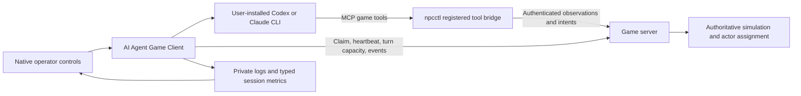

# AI agent clients for an authoritative simulation server

Research date: 2026-11-01. Scope confirmed by the user: **same-PC server first**,
including a headless game. This report combines primary-source web research with
inspection of the current implementation and its real Codex playtest evidence.

## Recommendation

Keep the game authoritative and keep AI session management outside the simulation.
The existing registered game tools, separate CLI client and native controls are a
sound foundation. This pass should correct concrete lifecycle, observability and
input failures before adding networking frameworks or replacing provider adapters.

The game server and a provider's app-server are different layers. A future Codex
app-server adapter would replace the provider control channel, not the game's
authority, actor authorization or observation interface.

## Findings from primary sources

### Authority, observations and time

[Nakama's authoritative model](https://heroiclabs.com/docs/nakama/concepts/multiplayer/authoritative/)
keeps gameplay validation and fixed-rate match logic on the server, with a lifetime
independent of a particular connection. Apply that separation here: clients submit
intents, while the game validates them and applies recorded commands on its owned
schedule. Losing an AI connection must not implicitly stop, reset or accelerate
the world.

[Unity ML-Agents' low-level interface](https://github.com/Unity-Technologies/ml-agents/blob/develop/com.unity.ml-agents/Documentation~/Python-LLAPI.md)
separates agent identity, observations, requested decisions, action specifications
and terminal steps. These are useful interface boundaries. Its externally driven
training clock is not a suitable permission model for our real-time gameplay
client: the AI must not receive simulation step/reset powers to finish an action.

[Gymnasium's environment API](https://gymnasium.farama.org/api/env/) distinguishes
task termination from externally imposed truncation. Our corresponding distinction
is between a finished AI turn, a completed game action, a transport interruption
and the assigned actor's permanent death. None should silently stand in for another.

[Project Malmo](https://microsoft.github.io/malmo/blog/Getting_Started/)
and [MineDojo](https://docs.minedojo.org/sections/getting_started/sim.html) illustrate
explicit observation/command/task surfaces. They support a structured game-tool
boundary rather than requiring a rendered desktop or a replacement simulation.

### Agent feedback and memory

[Voyager](https://voyager.minedojo.org/) combines environment feedback, execution
errors, verification and reusable knowledge. The transferable lesson is to observe
fresh state after an outcome and retain useful knowledge. Its executable-code skill
library is not permission to give our model unrestricted game mutation or expose
hidden world state.

[SIMA research](https://deepmind.google/blog/sima-generalist-ai-agent-for-3d-virtual-environments/)
demonstrates another interface based on visual perception and ordinary controls.
It does not establish that we should replace existing registered tools with screen
automation. Keep game affordances and sensing as the primary interface; use native
screenshots as product-validation evidence.

[Anthropic's effective-agent guidance](https://www.anthropic.com/research/building-effective-agents)
emphasizes composable loops and carefully designed tools. Its older article now
notes that implementation tooling has changed. Use its feedback/complexity lessons
without treating its historical framework examples as current integration APIs.

### Connections, cancellation and replay

[Colyseus reconnection](https://docs.colyseus.io/room/reconnection) separates
temporary drops, server-authorized rejoining and explicit departure. Our connection
handling should similarly distinguish unavailable/busy/capacity conditions from
invalid credentials, changed assignment, revoked access or incompatible protocol.
Rejoining is not an excuse to replay an uncertain game mutation.

[AWS's timeout and retry guidance](https://aws.amazon.com/builders-library/timeouts-retries-and-backoff-with-jitter/)
explains that timeouts and retries can amplify failure and that side effects need
careful treatment. Use bounded control-plane calls and classify retryability.
Preserve game action/event long-poll budgets separately. A new loopback connection
or a received byte must not reset an overall control-call deadline indefinitely.

[The 2025-era MCP lifecycle](https://modelcontextprotocol.io/specification/2025-06-18/basic/lifecycle)
includes initialization, capability/version negotiation, shutdown and timeout
guidance. [That revision's tools semantics](https://modelcontextprotocol.io/specification/2025-06-18/server/tools)
distinguish protocol failure from tool execution failure. A transport-successful
tool response can still deny game access. Preserve structured revocation and stop
before a later CLI completion can enable another prompt.

The official [latest MCP specification](https://modelcontextprotocol.io/specification/2026-07-28)
now describes a stateless base with per-request capabilities. That differs from
the deployed handshake-based generation: the bridge negotiates 2025-11-25,
2025-06-18, 2025-03-26 and 2024-11-05, preferring 2025-11-25. Do not change wire versions merely
because a documentation alias moved; qualify support against the installed
provider and bridge, and test both sides of any future migration.

### Provider sessions and subscription boundaries

[Codex noninteractive execution](https://learn.chatgpt.com/docs/non-interactive-mode)
supports structured output and conversation continuation. The existing exact-ID
resume adapter remains viable. [Codex app-server](https://learn.chatgpt.com/docs/app-server)
provides persistent thread/turn control, notifications, interruption and steering.
Its schemas are version-specific. Those capabilities justify a later adapter
experiment, not assuming every current method works in our installed 0.145 CLI.

[Claude's noninteractive CLI](https://code.claude.com/docs/en/headless) documents
structured streaming, exact continuation and failure reporting. Its
[streaming SDK interface](https://code.claude.com/docs/en/agent-sdk/streaming-vs-single-mode)
offers richer ongoing control, but is not required for this same-PC release.
[Authentication and product conditions](https://code.claude.com/docs/en/legal-and-compliance)
make the user-owned, unmodified CLI boundary important: keep end-user login with
the provider and do not copy or centrally route subscription credentials. This
research is not a determination that every distribution/payment arrangement is allowed.

[Claude's cost guidance](https://code.claude.com/docs/en/agent-sdk/cost-tracking)
and [OpenTelemetry token conventions](https://github.com/open-telemetry/semantic-conventions-genai/blob/main/docs/gen-ai/gen-ai-token-metrics.md)
support retaining reported consumption with provenance. Requested settings,
reported execution metadata, cached input, cumulative snapshots and billed money
are different quantities. Keep unreported costs null. The OTel GenAI conventions
remain in development; adopt useful distinctions without adding an SDK or
renaming the stable JSON interface wholesale.

### Trust and sensitive content

[MCP security guidance](https://modelcontextprotocol.io/docs/2025-11-25/tutorials/security/security_best_practices)
and [OpenAI's agent safety guidance](https://developers.openai.com/api/docs/guides/agent-builder-safety)
support scoped interfaces and structured treatment of untrusted input. Game
dialogue, notebook content and tool text are data, not authority to change
permissions, register a new actor or alter the clock. Keep operator/debug truth
outside the model's normal game tool surface.

The existing client lease coordinates process ownership and turn capacity; it
does not bind every provider MCP connection to that lease owner. This pass makes
explicit game-access revocation responses fatal and sticky. A stronger fence
against independently registered connections sharing the same game credentials
needs a versioned server capability, including intentional registration rollover
between provider turns. It is deferred rather than implied by the local lease.

[OTel inference-content guidance](https://github.com/open-telemetry/semantic-conventions-genai/blob/main/docs/gen-ai/client-inference.md)
treats prompts/tool content as sensitive and supports explicit capture choices.
Our requested private full logs need redaction before persistence, separate from
transcript-free metrics. Local loopback and a trusted installed CLI do not create
an OS sandbox against malicious processes running as the same user.

## Repository audit and implementation decisions

| Concrete finding | Consequence | This pass |
|---|---|---|
| `RpcClient.call` takes the maximum of a 30-second call floor and the requested 2-second client timeout | A stalled control reply blocks Stop, supervision and lease renewal | Add a separate bounded control RPC path; retain action/event waits |
| Claim errors collapse into one retry loop | Invalid credentials/protocol look like a missing game | Closed permanent/transient categories and accurate waiting/error messages |
| Provider parsing ignores structured revoked game-tool results except the separate cancellation case | CLI success can override game access loss and permit continuation | Sticky, narrowly recognized game-access revocation with independent cleanup/accounting |
| Status says the AI is playing before the host reports actor attachment | Operator connection and actual game control are confused | Persist/display actor-control state separately from provider/session state |
| Transcript writes hold a mutex through disk synchronization | Slow external log folders can block supervision | Bounded writer queue, nonblocking failure inspection, bounded drain/flush |
| Per-newline Markdown headers/fsync amplify a bounded raw stream | Excessive output/disk work, including blank-line floods | Batch/coalesce and separately bound encoded capture with explicit limit markers |
| Compact plaintext secret assignments evade current redaction markers | Credentials may survive inside ordinary message strings | Normalize sensitive assignment/query keys; preserve neighboring gameplay text |
| A single mixed 256-entry catalog truncation can hide all metrics | The Metrics tab can be empty despite its ledger | Bound each kind independently and keep discovery scoped |
| Usage adapter decisions are not retained per attempt | Unknown/version-dependent accounting is harder to audit | Add sanitized CLI version and verified/unknown scope provenance without changing totals |
| Fast complete keyboard chords are read with final-frame modifier state; clipboard samples old selection | Native Settings replacement/copy can fail under fast input | Ordered, supported app input handling and request-time clipboard consistency tests |

The last row is supported by the real native playtest and the installed Bevy
0.20 input/focus/text-input sources, not by speculation about the automation tool.
No observer-order hack, artificial typing delay or global dependency edit should
be used as a production fix.

## Deferred experiments

- Persistent Codex app-server adapter: measure startup/registration savings,
  support the installed schema and explicit approval/cancellation before replacing exec.
- LAN/WAN connections: separate authenticated operator and game surfaces, secure
  transport, server identity and deployment concerns; outside the confirmed scope.
- Broader action idempotency/fencing and multi-client orchestration: design as
  versioned server capabilities, not a silent widening of today's tool schema.
- Learning/skill libraries: use validated game affordances and outcome evidence;
  no guarantee of autonomous survival or permission to execute arbitrary game code.

## Verification approach

Use deterministic fault servers and native fake provider processes with the real
game host for stalled/trickled replies, malformed frames, revocation, restart,
slow-log storage, queue pressure, redaction and actor-control transitions. Use
native desktop/narrow screenshots and same-frame keyboard event regressions for
the UI. Keep provider usage/authentication unchanged and start no new paid model
turn merely to prove infrastructure behavior. Finish with the workspace's full
gate, preserve protected oracles, and report skips/warnings and limits accurately.
