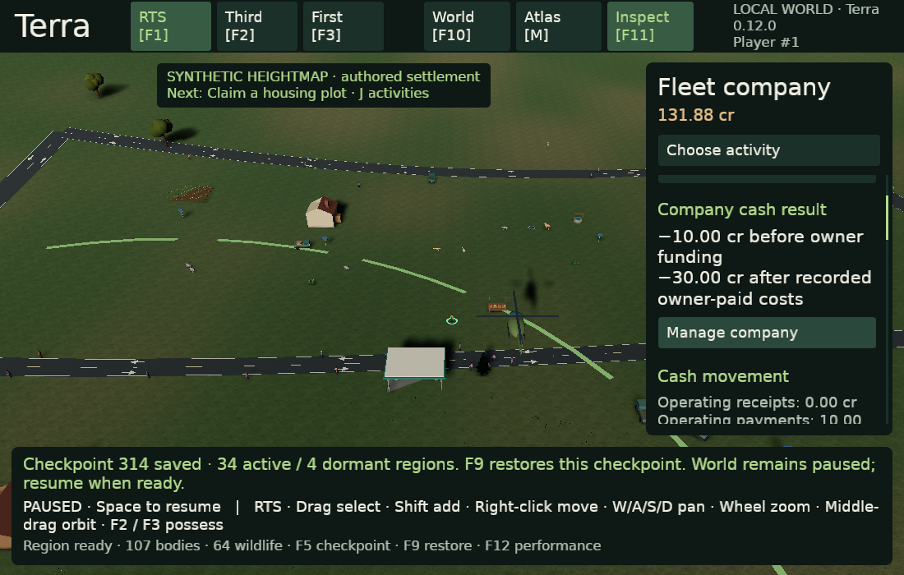
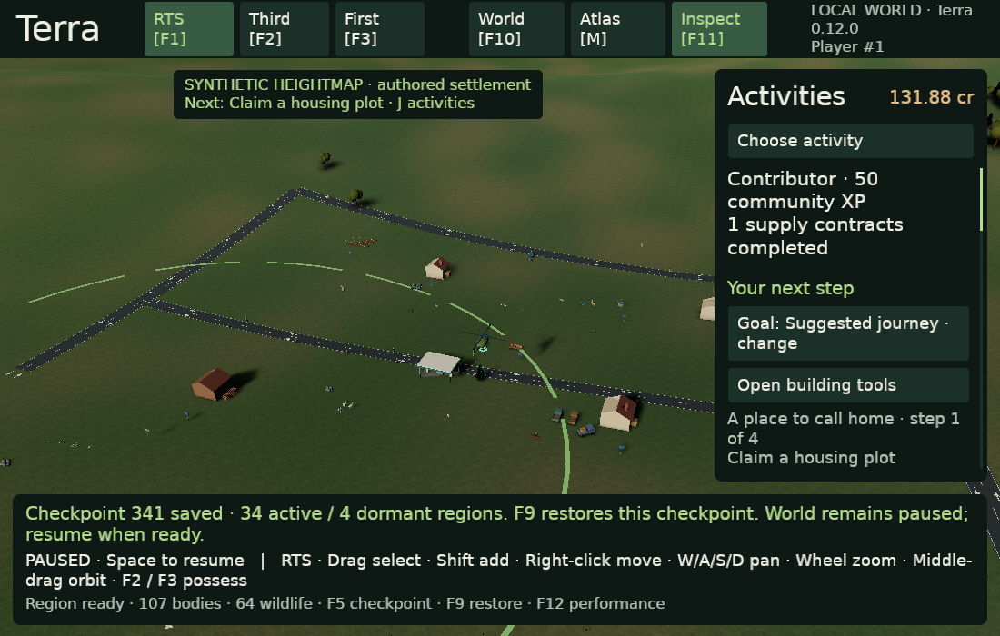
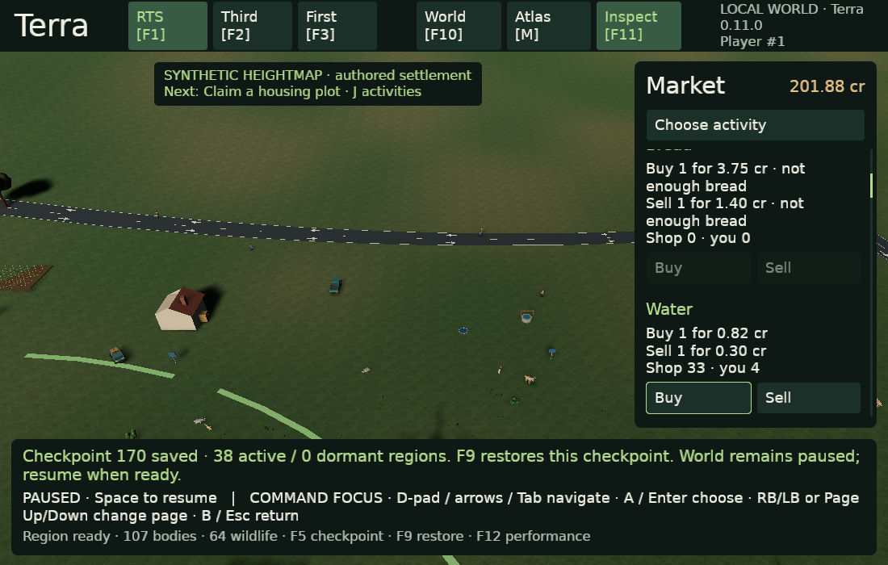
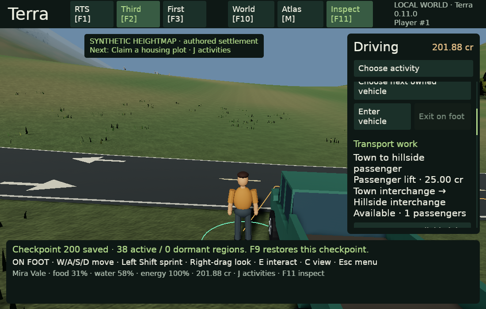
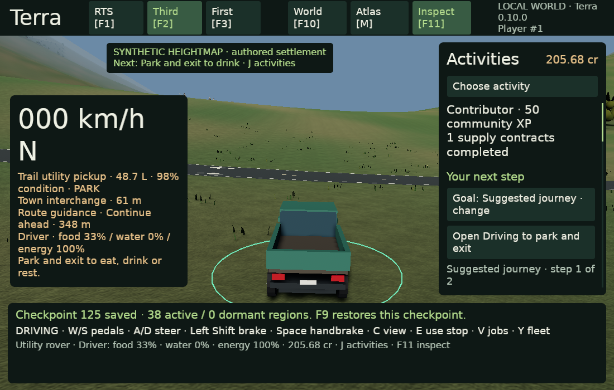
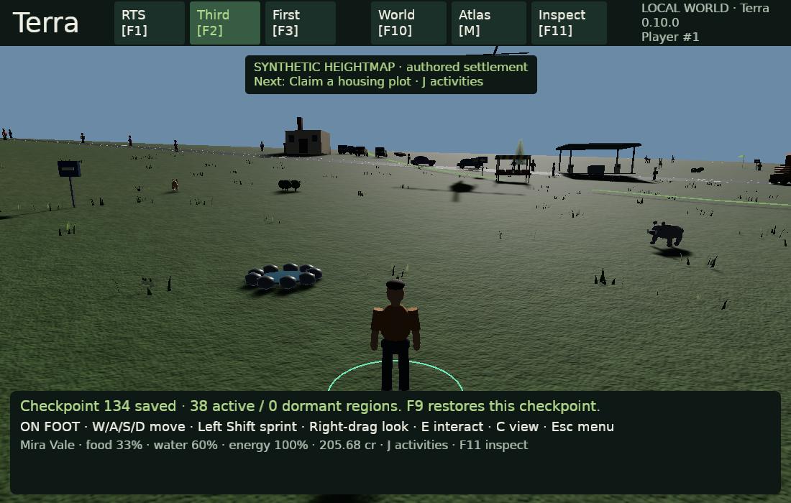
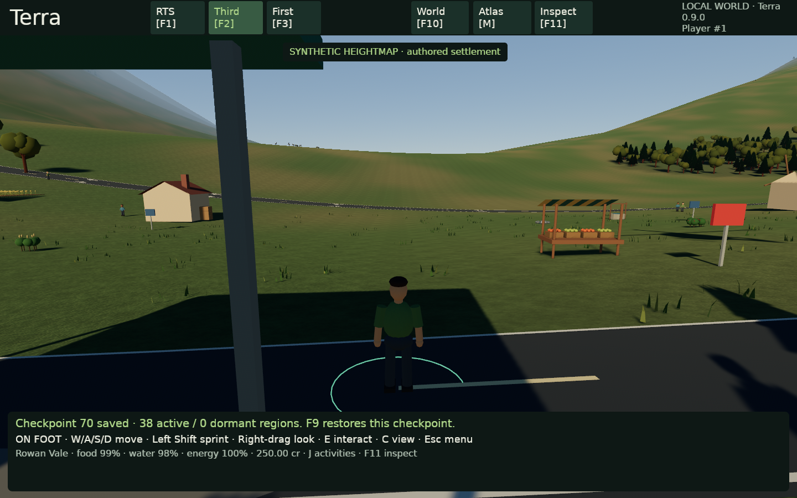
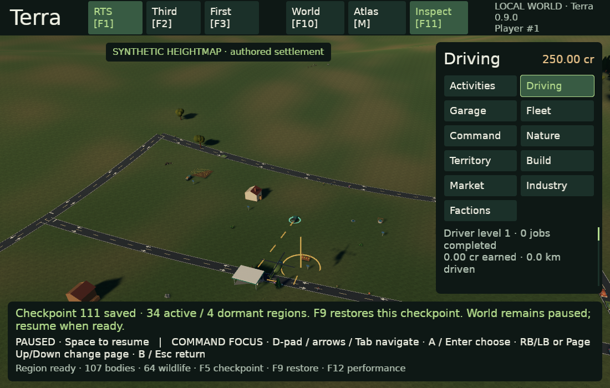
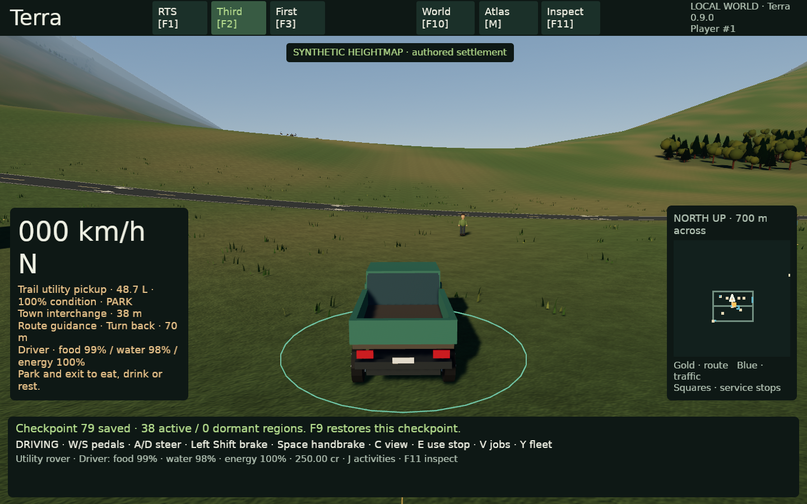

# Terra World 0.24

**A reusable Rust and Bevy world SDK with a playable living frontier.**
Stream heightfields and semantic features around real GPS positions, command a
crew in RTS mode, possess a character or vehicle in first or third person, and
build a persistent settlement over the original source world. Residents, shops,
finite money, production, couriers, traffic and wildlife share the gameplay rules
used by the native demo and authoritative multiplayer reference. Gather natural
resources, fulfill funded supply requests and establish a neighborhood that can
grow into a village or city, personally owned or governed by your faction.

The default playground is deterministic and synthetic, placed at real geographic
coordinates. Opt-in adapters load public elevation, OpenStreetMap features and
current weather. Explicitly dated local packs supply historical/scenario worlds;
the included era fixtures are synthetic examples. Every sourced chunk retains
provenance, attribution and fallback warnings.

This is an implemented foundation for games and simulation tools, with a native
reference game. The goal is an extensible world system for ambitious online
games. The current release has explicit rendering, population and network
budgets; it is not a production AAA renderer, an MMORPG service, a reconstruction
of every place and date, or a scientific model of ecology, traffic or economics.

## New in 0.24

Supply work follows real demand over a continued career. New offers reserve
funds only for useful quantities that fit their receiver. Confirmed obsolete
public requests retire only after their exact escrow can return to the original
issuer; accepted promises keep their terms. Capped refunds retain value for
later recovery, and missing replica data is never treated as deletion.

Industry operations, routine Fleet operations and building damage retain the
operation and target reviewed at activation. Explicit missing selections remain unavailable. Production names
its actual pause/resume operation; building damage names its target and health
consequence with Cancel and Confirm.

Protected output checks now compare portable file identity and resolve existing
aliased ancestors, including a Windows test path. Canonical verification bounds
output and owned-process lifetime, and CI verifies a fresh extracted desktop
before upload. Actual Windows/device qualification remains separately recorded.

| Start with | Purpose |
|---|---|
| [Product review](docs/PRODUCT_REVIEW.md) | All-perspective findings and current native observations |
| [Research](docs/RESEARCH_v0.24.md) | Primary patterns, explicit economic policy and limits |
| [Implementation plan](docs/IMPLEMENTATION_PLAN_v0.24.md) | Dispatched packages, owners and acceptance |
| [Full gap register](docs/REVIEW_GAPS_v0.24.md) | Scoped closures and remaining requirements |
| [Validation](docs/VALIDATION.md) | Actual test, native and artifact evidence |
| [Playtesting](docs/PLAYTESTING.md) | First/returning journeys and issue template |
| [Desktop delivery](docs/DESKTOP_DELIVERY.md) | Build, verify, package and launch |

Save 1, regional schema 1 and asset schema 1 remain unchanged.
**Wire protocol 11** and TLS **terra-world/11** remain unchanged from 0.23.
Use matching clients and hosts. [Earlier overviews](docs/RELEASE_HISTORY.md)
and the [changelog](CHANGELOG.md) preserve prior milestones.

## Start here

Run commands from this repository's root. `rust-toolchain.toml` pins Rust 1.99.1;
the workspace uses Bevy 0.20.0 and includes a lockfile. The desktop target needs a
graphical session, a working GPU backend and the platform development libraries
required by Bevy. The headless CLI does not need a window or GPU.
Building the regional persistence crate or host also needs a C compiler for
bundled SQLite; it does not require a separately installed database server.

If the pinned toolchain is not installed yet, install it through Rustup:

```sh
rustup toolchain install 1.99.1 --profile minimal --component rustfmt
```

The native renderer in this workspace enables X11 and the gilrs gamepad backend on Linux. The Ubuntu CI build
installs these development libraries, in addition to a C/C++ build toolchain and
`pkg-config`:

```sh
sudo apt-get install build-essential pkg-config libudev-dev libx11-dev libxkbcommon-dev libvulkan-dev
```

You also need an active graphical session and a compatible graphics driver to
run the window. A first desktop build compiles the Bevy graphics stack and can
take substantially longer than a headless command. Windows and macOS native
builds have not been exercised in this environment; see the validation record
before assuming platform coverage. The [desktop delivery guide](docs/DESKTOP_DELIVERY.md)
documents the new Windows/Linux CI matrix and exact-executable packaging.

### 1. Verify construction, farming and faction rules without a window

```sh
cargo run -p terra-cli -- sandbox-demo --output saves/sandbox-demo.json
```

The JSON report walks through claiming land, gathering, crafting, building a
house and workbench, farming, harvesting, demolition, and a two-player faction
transfer with shared building permissions. The output save is validated and
reloaded, including exact geographic coordinate round trips.

The living-world integration checks exercise trading, possession, RTS orders,
production, physical deliveries and full-state restoration in an actual Bevy app:

```sh
cargo test -p terra-bevy --no-default-features --test living_world
cargo test -p terra-bevy --no-default-features --test procedural_settlement
```

### 2. Play the native world

```sh
cargo run -p terra-demo
```

Choose **New world**, create a character, configure the source and world, then
review and play. **Your worlds** resumes a saved world. **Multiplayer** supports
a local server or verified TLS connection. Escape opens the in-game session
menu; it waits for a successful save before returning to the launcher.

Explicit command-line options enter a world directly. For automatic
checkpointing and resume:

```sh
cargo run -p terra-demo -- --quality balanced --region-store saves/frontier.db
```

In this mode F5 checkpoints and F9 restores the latest checkpoint. The database
also saves at region/command boundaries, the timed interval and graceful exit.
Use the same source configuration when reopening it. For an explicit JSON
session use `cargo run -p terra-demo -- --save saves/my-world.json`; F5 writes
that save. The launcher also offers a managed portable-JSON world, which saves
on a clean exit as described in the game-flow guide.

Open **Driving [V]**, select the utility pickup and enter it. W/S accelerate and
request reverse, A/D steer, Shift brakes, and Space applies the handbrake. C
switches the cockpit/chase camera. Accept a passenger lift or freight offer,
follow the marked stop, come to rest and use **E** to collect or deliver. The
garage **[G]** sells fuel, services, upgrades, vehicles and qualifications. Its
rental section quotes fee, fuel and bond, lets you select an owned or rented
vehicle, and exposes renewal or a stopped, empty return. **Fleet [Y]** registers
a company, transfers money into its separate account, hires employees, drafts
routes, opens storage depots and recovers interrupted work. Start with one
vehicle and a funded route; keep enough company cash for recruitment and wages.

The default view loads **49 geographic chunks with 65 × 65 height samples each**.
The authored settlement contains residents, traffic, six couriers, a market and
seven production facilities. Habitat populations add deer, boar, hares, foxes and
ibex where loaded terrain supports them. Your account owns an avatar, two crew
members, a utility rover and a survey helicopter. The HUD shows the active local
population, or the received population in multiplayer. Dormant records are
reported separately through regional diagnostics. Coverage, habitat capacity
and world budgets affect these counts. These
are authored people, animals and businesses at real coordinates, not observed
demographic or wildlife data. For a larger prepared/offline view, use
`--config configs/large-region.json`: 121 requested chunks, with bounded workers
and explicit residency limits. Use `--quality performance` on slower hardware.

The right inspector starts on **Activities [J]**, with a state-derived journey
and a funded supply noticeboard. Choose Suggested, Supply, Home, Community,
Road or Company directly to change your goal. Your commitments gathers existing
work and obligations. The primary action names its actual next step; rewards
and costs are always checked by the existing economy and ownership rules. **Nature [N]** finds resources and wildlife;
**Territory [T]** manages community claims. **Command**, **Build**, **Market**,
**Industry** and **Factions** retain their detailed tools. **F10** opens the
**World** drawer; **F11** hides the inspector. Scroll inside a panel for its
remaining controls. **F12** opens measured frame/CPU, terrain, AI and network
statistics. **World** contains quality and sky controls.

Possession automatically hides the large panels once. **E**, **J/N/T** or
**F10/F11** can reopen an interaction while controlling a body; returning to RTS
restores the previous inspection layout. Disable this behavior with
**World → Focus view** if you prefer persistent panels.

1. In **F1 RTS** mode, select an owned actor, or drag a group selection. Right-click
   loaded ground to issue a move order. **Tab** focuses the selection. Aircraft RTS
   orders are horizontal terrain destinations; use possession for altitude control.
2. Press **F2** to possess the selected actor in third person, or **F3** for first
   person. **WASD** moves; right-drag looks; **Shift** sprints. **R / F** changes
   aircraft altitude. **C** switches first/third person; **F1** releases control.
3. Press **N** to locate berries, fiber, timber, stone, water, fish or iron ore.
   Order your active actor to a patch and gather within 20 m. The panel shows
   remaining yield, recovery and required tools. Depleted patches stay depleted
   until their configured recovery; stone and ore are finite.
4. Press **J**, choose a supply request and accept it. Obtain its goods through
   gathering, crafting or trade, travel to the named facility, and deliver within
   20 m to receive its reserved credits and community XP. The delivered goods
   enter actual production or shop stock. You can hold three requests at once.
5. Open **Market** to buy supplies or sell goods. Money and stocks are finite;
   prices respond to stock levels. Eat, drink and rest before depleted needs slow
   your active body. **Industry** shows the water → grain → flour → bread and
   wood → planks chains, with physical courier deliveries.
6. Press **T** to found a named neighborhood using 20 wood, 10 stone and 50.00
   credits. Claim housing plots in **Build**, craft a home and workbench, plant
   crops, and contribute to the territory's public stock. Houses, farms,
   community XP, materials and treasury funds unlock larger village/city claims.
   The [gameplay guide](docs/GAMEPLAY.md) gives the full sequence and exact costs.

**O** opens a landscape view and **M** opens the political atlas. Camera travel
changes the viewed region. Trading and building still use the active body's
position. Local **World → Move active actor to this region** is an explicit
sandbox relocation; multiplayer movement remains host-controlled.

In explicit JSON mode, local progress is saved with **F5** and restored with **F9**. The
`--save` argument chooses a path; it does not autoload or save on exit. Restart
with matching source settings, wait for terrain, then press F9. Wallets, needs,
orders, facilities, delivery cargo, wildlife habitats, depleted resources,
territory treasuries, supply work and the construction/faction overlay are
restored together. A client session file is used separately for multiplayer
identity; it is not a world save.

With `--region-store`, reopening the same database resumes automatically; F5
checkpoints and F9 restores its latest checkpoint. The automatic checkpoints
described above also apply. A JSON file is not converted by renaming it or
passing it to `--region-store`.

### 3. Import a heightmap

```sh
cargo run -p terra-demo -- \
  --heightmap crates/terra-stream/data/heightmap-demo/manifest-v2.json
```

The included 16-bit PNG is an explicitly **synthetic** mountain/valley fixture.
Replace it with a licensed georeferenced grayscale PNG and its provenance-bearing
manifest to use your terrain. The demo selects a covered focus and reduces the
requested radius to complete tiles. A raster supplies elevation; optional explicit GeoJSON supplies semantics. The
living settlement and its fallback roads remain authored. See
[graphics and map formats](docs/GRAPHICS_AND_MAPS.md) for limits and the schema.

### 4. Inspect real data explicitly

```sh
cargo run -p terra-cli -- probe --live --no-osm --strict --output snapshots/munich.json
cargo run -p terra-demo -- --live --lat 48.137 --lon 11.575
```

The first command probes elevation and current weather while keeping the first
request small. Omit `--no-osm` to include map features. `--strict` fails on
provider errors instead of accepting synthetic fallback. The desktop reports
source/fallback status as it streams. A plain `--live` start uses a smaller
3 × 3 neighborhood and 33 × 33 grids unless a config or radius is supplied.
Public endpoints have coverage and usage limits; read [data sources and terms](docs/DATA.md) before configuring a game or
larger download.

## What is implemented

| Area | Working behavior | Scope and extension seam |
|---|---|---|
| Global coordinates | WGS84 geodetic ↔ ECEF, local east/up/south frames, floating-origin rebasing, date-line/pole-aware geographic tiles | Authoritative coordinates stay `f64`; source vertical datums need explicit conversion for precise use |
| Streaming | Background loading, request and memory budgets, disk cache, retries/backoff, stale-result rejection, mesh integration budgets | Replace `ChunkProvider` with your prepared world packs or data service |
| Terrain and features | Crack-free render LOD, mipmapped materials, atmospheric quality profiles, PNG heightmaps, tagged buildings/roofs, roads/bridges, water/waterways, fields, orchards, trees and bounded nearby ground cover | Feature detail tiers and mesh caches bound rendering; no full OSM relations, interiors, satellite textures or globe clipmap |
| Environment | UTC clock, approximate solar direction, day/night, hemisphere seasons, weather samples, heuristic biomes | Weather is a sampled condition; offline weather and biome inference are illustrative |
| Actors and control | Eight actor kinds; owned crew, RTS orders, first/third-person possession, needs, resident patrols and interpolated replicas | Kinematic movement with resident-world checks; game-owned model overrides; no full vehicle/flight physics or general navigation mesh |
| Economy and logistics | Integer credits, finite shop stocks/tills, stock-sensitive prices, funded NPC pay, seven production sites, physical cargo, retry/return handling and supply contracts | Bounded authored economy and road graph; no auction exchange, taxation, general industry builder or traffic engineering |
| Ecology and resources | Five wildlife species with habitat/need/time-based behavior, indexed threats and scheduled near/far decisions; finite/renewable timber, stone, berries, fiber, fish, ore and water | Authored carrying capacities and yields; no census-derived populations, hunting/combat, food web or scientific ecosystem model |
| Sandbox | Plots, materials, recipes, structures, housing, damage/destruction, resources, wheat growth/harvest and persistent tree edits | Immutable source geometry plus a mutable gameplay overlay; configurable catalog |
| Factions | Invitations, leader/builder/member roles, atomic transfer of plots and contained assets, shared housing and workbenches | Gameplay permissions are separate from real political sovereignty |
| Settlements and activities | Named 100/300/700 m neighborhood/village/city territories, personal or faction rights, public stock/treasury, funded requests and community XP | Circular gameplay claims with protected prior ownership; no conquest, electoral government, taxation or automatic city generation |
| History and politics | Validated dated packs, date-scoped political GeoJSON, overlapping claims, atlas and authored territory drawing/export | Imported coverage is explicit; no invented historical reconstruction or autonomous border simulation |
| Multiplayer | Server-owned actors and commands, movement/reach/ownership checks, indexed AOI, revisioned deltas/keyframes/resync, replay protection, save/resume | Single-process TCP/LAN reference; production transport, account services and distributed simulation are host concerns |
| Persistence | Transactional regional SQLite checkpoints, dependency-aware working sets, complete JSON exports, strict source/catalog/reference validation, conflict detection and consistent backup | Single authority and bounded complete validation; dormant environment freezes; source/catalog/schema migrations are explicit |

## Workspace map

| Crate | Responsibility |
|---|---|
| [`terra-core`](crates/terra-core/README.md) | Pure geographic math, tiles, time, solar/seasons, semantic world types, weather and actor contracts |
| [`terra-stream`](crates/terra-stream/README.md) | Providers, deterministic offline content, cache and bounded asynchronous chunk lifecycle |
| `terra-history` | Immutable dated world packs and political polygons, provenance, containment and GeoJSON import/export |
| [`terra-sandbox`](crates/terra-sandbox/README.md) | Transactional construction/farming/faction rules, wildlife/resources, settlement claims/contracts, bodies, needs, money, production and cargo |
| [`terra-persistence`](crates/terra-persistence/README.md) | Durable regional pages, atomic global/host checkpoints, dependency-closed working sets, backup and recovery |
| [`terra-net`](crates/terra-net/README.md) | Authoritative multiplayer library, server executable and command-line client |
| `terra-bevy` | Reusable world, living, environment, sandbox and network plugins; optional renderer |
| `terra-demo` | Native RTS/possession cameras, contextual gameplay UI and political atlas |
| `terra-cli` | Headless data probes, deterministic simulation and complete sandbox demonstration |

Core, streaming, history and gameplay are independent of Bevy. The Bevy adapter's
`render` feature is optional, so games can use their own meshes, materials, UI and
physics, or run a headless simulation. [Integration contracts](docs/INTEGRATION.md)
cover schedules, resources, actor attachment and host responsibilities;
[architecture](docs/ARCHITECTURE.md) describes the data and authority boundaries.
The [MMORPG foundation guide](docs/MMORPG_FOUNDATION.md) maps the current extension
seams, concrete hard limits and the remaining production engineering work.

## Native demo gallery

### Archived 0.12 captures

These **0.12 final-executable captures** show the financial report and continuing
player goals at **1100×700 with 150% text**. The compact Fleet chooser exposes
all six sections. An unregistered company has one explanation and a visible,
keyboard-accessible **Manage company** action. For the reviewed registered
company, 50.00 cr of owner funding and 10.00 cr of recruitment leave **40.00 cr**
company cash; the report separately includes the 20.00 cr owner-paid registration.
Its **−10.00 cr before owner funding / −30.00 cr after recorded owner costs**
are cash results, not a claim of full profit.

The [0.12 native record](docs/native-v12-verification.json) retains **14
captures and three clean sessions** from the exact executable produced by the
[20-gate release run](docs/verification/v0.12-final/gates.json). Save/reopen checks
match the company journal, player wallet and inventory, full avatar body,
character appearance, progression, territories, owned vehicle, politics and
source identity. Returning from third person to the RTS overview keeps the
character in view. The original 0.11 acceptance database remains unchanged.

These Linux/X11 software-Vulkan sessions complement **747 distinct passing Rust
tests**; they do not qualify graphics hardware or other operating systems. The
reviewed Performance view displays **57 imported wildlife instances and seven
distant procedural fallbacks**, with an estimated 9.6 MiB scene payload against
its 128 MiB limit. The reopened view ends at 59 imported instances and five
fallbacks as the camera's distance-based selection changes. GPU allocation and
GPU time are explicitly unmeasured. See the
[0.12 validation record](docs/VALIDATION_v0.12.md) and
[0.12 product review](docs/PRODUCT_REVIEW_v0.12.md)
for the measured scope and remaining qualification boundaries.





### Archived 0.11 captures

These **0.11 final-executable captures** show the reviewed Market and supported
vehicle exit at **1100×700 with 150% text**. Buying five water units charged the
displayed **4.10 cr**; selling one returned **0.30 cr**, with exact money and stock
conservation. The short drive, normal dismount and clean save/reopen retained
Mira's appearance, position, inventory, progression and owned pickup state.
The [0.11 native record](docs/native-v11-verification.json) retains 18 captures,
both clean-exit logs and telemetry. All 64 wildlife instances loaded without
fallback. These Linux/X11 software-Vulkan observations complement the
**700 distinct passing Rust tests** in the [0.11 validation record](docs/VALIDATION_v0.11.md).





### Archived 0.10 captures

These **v0.10 final-executable captures** show the restored driver guidance and
the completed water-recovery journey at 1100×700 with 150% text. Gathering and
consuming one real water unit restored the need to 60%; Suggested then returned
to the housing goal. The [final native record](docs/native-v10-verification.json)
identifies the executable, saved-state checks and capture hashes. The original
wildlife pack loaded all 64 instances with no loading or fallback instances.





### Archived 0.9 captures

These are actual **v0.9 native captures**. The heightmap, land cover and settlement
are authored synthetic content at real coordinates. Linux/Mesa software Vulkan
was used for interaction and layout review. The geometric art remains prototype
quality; these captures do not establish gaming-GPU performance. Each image's
review build and dimensions are recorded in the evidence.







Follow the [main menu](docs/screenshots/v9-main-menu.png),
[character creation](docs/screenshots/v9-character.png),
[heightmap world settings](docs/screenshots/v9-world-settings.png),
[review and creation](docs/screenshots/v9-world-review.png),
[multiplayer source selection](docs/screenshots/v9-multiplayer-source.png),
[company text entry](docs/screenshots/v9-company-keyboard.png),
[warehouse purchase](docs/screenshots/v9-warehouse-buy.png),
[warehouse sale](docs/screenshots/v9-warehouse-sale.png),
[keyboard focus revealing a scrolled action](docs/screenshots/v9-focus-reveal.png),
[first-person actor view](docs/screenshots/v9-first-person.png), and
[first-person cockpit](docs/screenshots/v9-cockpit.png).

[Native evidence](docs/native-v9-verification.json) records the actual source
join, company transactions, local world creation, possession, physical driving,
save/reopen checks and capture hashes. The [validation record](docs/VALIDATION.md)
separates observed native behavior, automated correctness and finite measurements.

Archived [v0.8 native evidence](docs/native-v8-verification.json) retains the
building, farming, territorial, rental and household gameplay review;
[v0.7 native evidence](docs/native-v7-verification.json) retains loaded
fleet continuation, two physical paid deliveries and roadside service;
[v0.6 evidence](docs/native-v6-verification.json) retains the personal passenger
job, saved-world browser and TLS setup flow. Their
[v0.8](docs/VALIDATION_v0.8.md), [v0.7](docs/VALIDATION_v0.7.md), [v0.6](docs/VALIDATION_v0.6.md),
[v0.5](docs/VALIDATION_v0.5.md) and [v0.4](docs/VALIDATION_v0.4.md) validation
records remain historical and are not combined with the current test counts.

## Historical and political scenarios

```sh
cargo run -p terra-demo -- --config configs/historical-1950.json --atlas
cargo run -p terra-demo -- --config configs/historical-1980.json --camp-view
```

These presets use two deliberately synthetic era packs and a dated political
fixture. They exercise different terrain/features and political validity
intervals without claiming to portray Munich or any country's actual history.
For your own data, use `--world-pack path/to/manifest.json --epoch YYYY-MM-DD`
and optionally `--politics path/to/borders.geojson`.

The **source epoch** selects immutable base data. The **simulation clock** can
then evolve from that starting point. Changing the season does not re-download
another historical terrain revision. Political features are queried against the
simulation date and show only claims whose declared interval covers that time.
An unavailable historical tile stays unavailable; it never falls through to a
current public API. See [historical formats and provenance](docs/HISTORY.md).

The atlas can display imported countries/regions/disputed claims and draw
additional authored scenario polygons. An atlas polygon's optional faction link
is descriptive. The **Territory [T]** gameplay system separately creates
authoritative community claims; plots and current faction roles determine
construction rights. Drawing an atlas polygon does not confiscate property.
The default local explorer also loads the bundled current Natural Earth country
snapshot when available. That generalized atlas layer is dated 2026-10-26; it is
separate from the synthetic terrain and from the fictional historical fixtures.

## Multiplayer

Start the reference server and two native clients in separate terminals:

```sh
cargo run -p terra-net --bin terra-server -- --save saves/server.json
cargo run -p terra-demo -- --connect 127.0.0.1:7777 --session saves/alice-session.json --camp-view
cargo run -p terra-demo -- --connect 127.0.0.1:7777 --session saves/bob-session.json --camp-view
```

Each client receives its own player ID, wallet and owned bodies. **F1** commands
units; **F2/F3** possess one and **WASD** sends movement intent. The host owns
positions, needs, wildlife, resources, territory rights, contracts, stock, money,
production and delivery outcomes. Gameplay
commands are checked for identity, sequence, quantity, reach and permission. All peers must use matching source revisions and data epochs. Give each
player a separate `--session` file and reuse that file to resume their identity.

For a resumable command-line session:

```sh
cargo run -p terra-net --bin terra-client -- --seconds 60 --session saves/alice.json
cargo run -p terra-net --bin terra-server -- --load saves/server.json --save saves/server.json
```

Stop the first server before restarting it. The session file carries the player's
resume capability; reuse it with the same server. The server saves periodically
and on a clean shutdown. To start a **new** database-backed world, use
`--region-store saves/server.db` instead of `--save`, then repeat that same
command to resume it; no `--load` argument is needed. Clients keep using their
separate session files for that world. Switching flags does not import an
existing JSON world or its identities: first use the explicit SDK import into a
new store described in [regional persistence](docs/REGIONAL_PERSISTENCE.md).
Only that import preserves the old world's client resume capabilities.
Read [multiplayer operation](docs/MULTIPLAYER.md) for
desktop resume support, historical sessions, command JSON, identity handling and
the reference transport's limits.

## Configure and reuse

`WorldConfig` controls focus coordinates, seed, tile level/radius, resident and
request budgets, terrain resolution, layers, day/night, seasons, time scale,
floating-origin distance, public-data adapters, heightmap manifests, source packs
and save paths, including opt-in regional storage and checkpoint cadence. Add `TerraLivingPlugin` to opt into the reusable living adapter;
`living::LivingSettings` selects demo seeding, simulation and collision policies.
`SandboxState.ecology.config` contains validated species, habitat and resource
balance settings. `SandboxState.settlements` owns gameplay territories, funded
work and saved price anchors. `render::WorldDetailSettings` controls nearby ground
cover, resource visuals and settlement boundary cues when the reference renderer
is enabled. Presets in [`configs`](configs) give concrete starting points.

```sh
cargo run -p terra-demo -- --config configs/offline.json
cargo run -p terra-cli -- probe --lat -33.9249 --lon 18.4241 --level 16
cargo run -p terra-cli -- simulate --steps 120 --dt 0.05
```

The sandbox catalog is JSON data. Change item IDs, recipe inputs/outputs,
blueprint costs/footprints and crop timing/yields through `Catalog::from_json`.
[`catalog.example.json`](crates/terra-sandbox/catalog.example.json) matches the
built-in content. A custom game can register its own trusted starter inventory
through `add_player_with_inventory`; catalog-aware restore checks existing
asset parameters before accepting a changed ruleset.

For large worlds, prepare immutable regional chunks and host them through your
own distribution service. Player overlays, inventories and actor state are a
separate authoritative persistence layer. The reference's public adapters and
in-process maps are useful development components, with explicit interfaces for
larger storage, spatial indexing and simulation partitioning.

## Verification and project notes

The complete release check requires Python 3.11+, the pinned Rust toolchain,
native build dependencies and localhost socket access for TCP/TLS tests:

```sh
python3 scripts/verify.py --jobs 3
# Once dependencies are cached:
python3 scripts/verify.py --offline --jobs 3 --report-dir verification-results
```

On Windows, use `python` if that is the installed Python executable. The runner
uses portable paths and recognizes `.exe`; the current execution evidence is
Linux-only. It opens no window. Reports default to a fresh timestamped directory
under the repository's `target/verification`; a supplied directory must be new or empty.
This preserves earlier evidence. Native play, assistive technology, controller
hardware and representative GPU/network performance require separate acceptance.
CI runs the same script and retains its evidence artifact, including on failure.

For a smaller development loop:

```sh
cargo test
cargo test -p terra-bevy --no-default-features
cargo check -p terra-demo
```

The default workspace test targets are headless. Tests cover geographic edge
cases, provider decoding and cache behavior, chunk budgets, temporal coverage,
transactional commands, ownership, economy conservation, living orders,
heightmap/semantic decoding, persistence and real loopback multiplayer.
Bevy tests exercise the actual plugin with a manual clock and no renderer.
The [validation record](docs/VALIDATION.md) separates checks actually run from
hardware/network-dependent verification, and the [product review](docs/PRODUCT_REVIEW.md)
records the final end-to-end assessment and remaining scope. The detailed
[living-world rules](docs/LIVING_WORLD.md) and [graphics/data guide](docs/GRAPHICS_AND_MAPS.md)
separate implemented mechanics from extension work.

Code is available under MIT or Apache-2.0. Public datasets retain their own
licenses and attribution requirements; see [third-party notices](THIRD_PARTY_NOTICES.md)
and [data documentation](docs/DATA.md). Synthetic fixtures are explicitly marked
as such and contain no real downloaded OSM extract.
