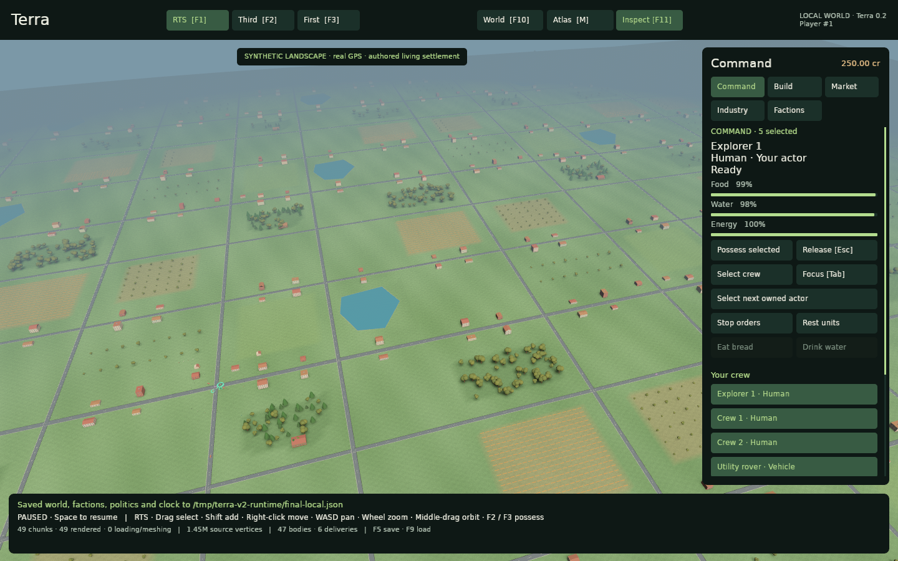
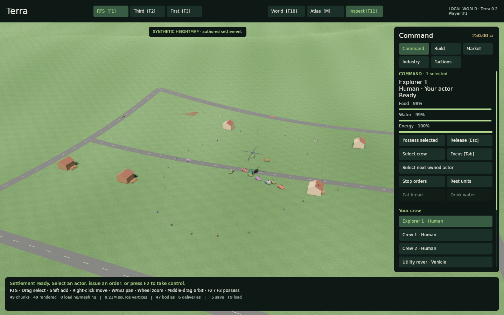

# Terra World 0.2

**A reusable Rust and Bevy world SDK with a playable living settlement.**
Stream heightfields and semantic features around real GPS positions, command a
crew in RTS mode, possess a character or vehicle in first or third person, and
build a persistent settlement over the original source world. Residents, shops,
finite money, production, couriers and traffic share the gameplay rules used by
the native demo and authoritative multiplayer reference.

The default playground is deterministic and synthetic, placed at real geographic
coordinates. Opt-in adapters load public elevation, OpenStreetMap features and
current weather. Explicitly dated local packs supply historical/scenario worlds;
the included era fixtures are synthetic examples. Every sourced chunk retains
provenance, attribution and fallback warnings.

This is an implemented foundation for games and simulation tools. It does not
claim to reconstruct every place and date on Earth, or to provide a full ecology,
fluid, traffic-engineering, geopolitical or rigid-body simulation.

## Start here

Run commands from this repository's root. `rust-toolchain.toml` pins Rust 1.99.1;
the workspace uses Bevy 0.20.0 and includes a lockfile. The desktop target needs a
graphical session, a working GPU backend and the platform development libraries
required by Bevy. The headless CLI does not need a window or GPU.

If the pinned toolchain is not installed yet, install it through Rustup:

```sh
rustup toolchain install 1.99.1 --profile minimal --component rustfmt
```

The native renderer in this workspace enables X11 on Linux. Linux builds need
these development libraries, in addition to a C/C++ build toolchain and
`pkg-config`:

```sh
sudo apt-get install build-essential pkg-config libudev-dev libx11-dev libxkbcommon-dev libvulkan-dev
```

You also need an active graphical session and a compatible graphics driver to
run the window. A first desktop build compiles the Bevy graphics stack and can
take substantially longer than a headless command. Windows and macOS native
builds were not exercised in the original deliverable; see the validation record
before assuming platform coverage.

This workspace is now part of Bevy Experiments; shared CI lives in the repository
root `.github/workflows/ci.yml` and checks each workspace on Windows. See the root
`CONTRIBUTING.md` and local `AGENTS.md` for the current development workflow.

### 1. Verify construction, farming and faction rules without a window

```sh
cargo run -p terra-cli -- sandbox-demo --output saves/sandbox-demo.json
```

The JSON report walks through claiming land, gathering, crafting, building a
house and workbench, farming, harvesting, demolition, and a two-player faction
transfer with shared building permissions. The output save is validated and
reloaded, including exact geographic coordinate round trips.

The living-world integration checks exercise trading, possession, RTS orders,
production, physical deliveries and full-state restoration in an actual Bevy app:

```sh
cargo test -p terra-bevy --no-default-features --test living_world
cargo test -p terra-bevy --no-default-features --test procedural_settlement
```

### 2. Play the native world

```sh
cargo run -p terra-demo -- --save saves/my-world.json
```

The default view loads **49 geographic chunks with 65 × 65 height samples each**.
The authored settlement contains residents, traffic, couriers, animals, a market
and seven production facilities. Your account owns an avatar, two crew members,
a utility rover and a survey helicopter. The normal fallback settlement has 47
bodies for its first player; imported road and surface coverage can reduce the
population. This is authored gameplay at real coordinates, not demographic data.

Use the right inspector's **Command**, **Build**, **Market**, **Industry** and
**Factions** tabs. The **World** drawer opens with **F10**; **F11** hides the
inspector to give the landscape more room.

1. In **F1 RTS** mode, select an owned actor, or drag a group selection. Right-click
   loaded ground to issue a move order. **Tab** focuses the selection. Aircraft RTS
   orders are horizontal terrain destinations; use possession for altitude control.
2. Press **F2** to possess the selected actor in third person, or **F3** for first
   person. **WASD** moves; right-drag looks; **Shift** sprints. **R / F** changes
   aircraft altitude. **C** switches first/third person; **F1** releases control.
3. Open **Market**, order the active actor to the shop, and buy bread or water
   when within 20 m. Purchases debit your wallet and the shop's stock. Sell gathered
   wood or crafted goods to earn credits. Eat, drink and rest through **Command**.
4. Open **Industry** to inspect the water → grain → flour → bread chain and courier
   deliveries. Facilities consume actual stock; the first player owns the demo
   production sites and can pause/resume them while nearby.
5. Open **Build** to claim a plot, gather, craft, build a home, plant and harvest.
   The [gameplay guide](docs/GAMEPLAY.md) gives the exact first-house sequence.

**O** opens a landscape view and **M** opens the political atlas. Camera travel
changes the viewed region. Trading and building still use the active body's
position. Local **World → Move active actor to this region** is an explicit
sandbox relocation; multiplayer movement remains host-controlled.

Local progress is saved explicitly with **F5** and restored with **F9**. The
`--save` argument chooses a path; it does not autoload or save on exit. Restart
with matching source settings, wait for terrain, then press F9. Wallets, needs,
orders, facilities, delivery cargo and the earlier construction/faction overlay
are restored together.

### 3. Import a heightmap

```sh
cargo run -p terra-demo -- \
  --heightmap crates/terra-stream/data/heightmap-demo/manifest.json
```

The included 16-bit PNG is an explicitly **synthetic** mountain/valley fixture.
Replace it with a licensed georeferenced grayscale PNG and its provenance-bearing
manifest to use your terrain. The demo selects a covered focus and reduces the
requested radius to complete tiles. A heightmap supplies elevation only; the
living settlement and its fallback roads remain authored. See
[graphics and map formats](docs/GRAPHICS_AND_MAPS.md) for limits and the schema.

### 4. Inspect real data explicitly

```sh
cargo run -p terra-cli -- probe --live --no-osm --strict --output snapshots/munich.json
cargo run -p terra-demo -- --live --lat 48.137 --lon 11.575
```

The first command probes elevation and current weather while keeping the first
request small. Omit `--no-osm` to include map features. `--strict` fails on
provider errors instead of accepting synthetic fallback. The desktop reports
source/fallback status as it streams. A plain `--live` start uses a smaller
3 × 3 neighborhood and 33 × 33 grids unless a config or radius is supplied.
Public endpoints have coverage and usage limits; read [data sources and terms](docs/DATA.md) before configuring a game or
larger download.

## What is implemented

| Area | Working behavior | Scope and extension seam |
|---|---|---|
| Global coordinates | WGS84 geodetic ↔ ECEF, local east/up/south frames, floating-origin rebasing, date-line/pole-aware geographic tiles | Authoritative coordinates stay `f64`; source vertical datums need explicit conversion for precise use |
| Streaming | Background loading, request and memory budgets, disk cache, retries/backoff, stale-result rejection, mesh integration budgets | Replace `ChunkProvider` with your prepared world packs or data service |
| Terrain and features | Smooth heightfield meshes, PNG heightmaps, tagged buildings/roofs, roads/bridges, water/waterways, fields, orchards and trees | Feature detail tiers bound rendering; no full OSM relations, interiors, satellite textures or globe clipmap |
| Environment | UTC clock, approximate solar direction, day/night, hemisphere seasons, weather samples, heuristic biomes | Weather is a sampled condition; offline weather and biome inference are illustrative |
| Actors and control | Eight actor kinds; owned crew, RTS orders, first/third-person possession, needs, resident patrols and interpolated replicas | Kinematic movement with resident-world checks; no full vehicle/flight physics or general navigation mesh |
| Economy and logistics | Integer credits, finite shop stocks/tills, buy/sell/consume, seven production sites, courier cargo and traffic | Fixed prices, bounded authored settlement, simple road graph/following; no wages, taxation or traffic engineering |
| Sandbox | Plots, materials, recipes, structures, housing, damage/destruction, resources, wheat growth/harvest and persistent tree edits | Immutable source geometry plus a mutable gameplay overlay; configurable catalog |
| Factions | Invitations, leader/builder/member roles, atomic transfer of plots and contained assets, shared housing and workbenches | Gameplay permissions are separate from real political sovereignty |
| History and politics | Validated dated packs, date-scoped political GeoJSON, overlapping claims, atlas and authored territory drawing/export | Imported coverage is explicit; no invented historical reconstruction or autonomous border simulation |
| Multiplayer | Server-owned actors and commands, movement/reach/ownership checks, bounded AOI snapshots, replay protection, save/resume | Single-process TCP/LAN reference; production transport, account services and distributed simulation are host concerns |
| Persistence | Atomic JSON saves, strict reference/ownership checks, world/epoch identity in host save envelopes | Catalog/source changes require explicit migration; offline elapsed-time progress is not automatic |

## Workspace map

| Crate | Responsibility |
|---|---|
| [`terra-core`](crates/terra-core/README.md) | Pure geographic math, tiles, time, solar/seasons, semantic world types, weather and actor contracts |
| [`terra-stream`](crates/terra-stream/README.md) | Providers, deterministic offline content, cache and bounded asynchronous chunk lifecycle |
| `terra-history` | Immutable dated world packs and political polygons, provenance, containment and GeoJSON import/export |
| [`terra-sandbox`](crates/terra-sandbox/README.md) | Transactional construction/farming/faction rules plus bodies, needs, shops, money, production and cargo |
| [`terra-net`](crates/terra-net/README.md) | Authoritative multiplayer library, server executable and command-line client |
| `terra-bevy` | Reusable world, living, environment, sandbox and network plugins; optional renderer |
| `terra-demo` | Native RTS/possession cameras, contextual gameplay UI and political atlas |
| `terra-cli` | Headless data probes, deterministic simulation and complete sandbox demonstration |

Core, streaming, history and gameplay are independent of Bevy. The Bevy adapter's
`render` feature is optional, so games can use their own meshes, materials, UI and
physics, or run a headless simulation. [Integration contracts](docs/INTEGRATION.md)
cover schedules, resources, actor attachment and host responsibilities;
[architecture](docs/ARCHITECTURE.md) describes the data and authority boundaries.

## Native demo gallery

These are actual captures from the verified native build. The default world is
synthetic gameplay at real GPS coordinates. The bundled heightmap is an authored
elevation fixture, and the native source banner identifies it explicitly.





Inspect [third-person possession](docs/screenshots/v2-third-person.png),
[first-person play](docs/screenshots/v2-first-person.png),
[a completed multiplayer purchase](docs/screenshots/v2-market-purchase.png),
[working production and deliveries](docs/screenshots/v2-industry-logistics.png),
the [minimum window](docs/screenshots/v2-minimum-window.png), and
[native reconnect](docs/screenshots/v2-multiplayer-resume.png).
The [validation record](docs/VALIDATION.md) connects the captures to automated
checks and authoritative saved-state evidence.

## Historical and political scenarios

```sh
cargo run -p terra-demo -- --config configs/historical-1950.json --atlas
cargo run -p terra-demo -- --config configs/historical-1980.json --camp-view
```

These presets use two deliberately synthetic era packs and a dated political
fixture. They exercise different terrain/features and political validity
intervals without claiming to portray Munich or any country's actual history.
For your own data, use `--world-pack path/to/manifest.json --epoch YYYY-MM-DD`
and optionally `--politics path/to/borders.geojson`.

The **source epoch** selects immutable base data. The **simulation clock** can
then evolve from that starting point. Changing the season does not re-download
another historical terrain revision. Political features are queried against the
simulation date and show only claims whose declared interval covers that time.
An unavailable historical tile stays unavailable; it never falls through to a
current public API. See [historical formats and provenance](docs/HISTORY.md).

The atlas can display imported countries/regions/disputed claims and draw
additional authored scenario territories. A territory's optional faction link
is descriptive. Construction rights come from the sandbox's owned plots and
roles, so drawing a large polygon does not confiscate other players' property.
The default local explorer also loads the bundled current Natural Earth country
snapshot when available. That generalized atlas layer is dated 2026-10-26; it is
separate from the synthetic terrain and from the fictional historical fixtures.

## Multiplayer

Start the reference server and two native clients in separate terminals:

```sh
cargo run -p terra-net --bin terra-server -- --save saves/server.json
cargo run -p terra-demo -- --connect 127.0.0.1:7777 --session saves/alice-session.json --camp-view
cargo run -p terra-demo -- --connect 127.0.0.1:7777 --session saves/bob-session.json --camp-view
```

Each client receives its own player ID, wallet and owned bodies. **F1** commands
units; **F2/F3** possess one and **WASD** sends movement intent. The host owns
positions, needs, stock, money, production and delivery outcomes. Gameplay
commands are checked for identity, sequence, quantity, reach and permission. All peers must use matching source revisions and data epochs. Give each
player a separate `--session` file and reuse that file to resume their identity.

For a resumable command-line session:

```sh
cargo run -p terra-net --bin terra-client -- --seconds 60 --session saves/alice.json
cargo run -p terra-net --bin terra-server -- --load saves/server.json --save saves/server.json
```

Stop the first server before restarting it. The session file carries the player's
resume capability; reuse it with the same server. The server saves periodically
and on a clean shutdown. Read [multiplayer operation](docs/MULTIPLAYER.md) for
desktop resume support, historical sessions, command JSON, identity handling and
the reference transport's limits.

## Configure and reuse

`WorldConfig` controls focus coordinates, seed, tile level/radius, resident and
request budgets, terrain resolution, layers, day/night, seasons, time scale,
floating-origin distance, public-data adapters, heightmap manifests, source packs
and save paths. Add `TerraLivingPlugin` to opt into the reusable living adapter;
`living::LivingSettings` selects demo seeding, simulation and collision policies.
Presets in [`configs`](configs) give concrete starting points.

```sh
cargo run -p terra-demo -- --config configs/offline.json
cargo run -p terra-cli -- probe --lat -33.9249 --lon 18.4241 --level 16
cargo run -p terra-cli -- simulate --steps 120 --dt 0.05
```

The sandbox catalog is JSON data. Change item IDs, recipe inputs/outputs,
blueprint costs/footprints and crop timing/yields through `Catalog::from_json`.
[`catalog.example.json`](crates/terra-sandbox/catalog.example.json) matches the
built-in content. A custom game can register its own trusted starter inventory
through `add_player_with_inventory`; catalog-aware restore checks existing
asset parameters before accepting a changed ruleset.

For large worlds, prepare immutable regional chunks and host them through your
own distribution service. Player overlays, inventories and actor state are a
separate authoritative persistence layer. The reference's public adapters and
in-process maps are useful development components, with explicit interfaces for
larger storage, spatial indexing and simulation partitioning.

## Verification and project notes

```sh
cargo test
cargo test -p terra-bevy --no-default-features
cargo check -p terra-demo
```

The default workspace test targets are headless. Tests cover geographic edge
cases, provider decoding and cache behavior, chunk budgets, temporal coverage,
transactional commands, ownership, economy conservation, living orders,
heightmap/semantic decoding, persistence and real loopback multiplayer.
Bevy tests exercise the actual plugin with a manual clock and no renderer.
The [validation record](docs/VALIDATION.md) separates checks actually run from
hardware/network-dependent verification, and the [product review](docs/PRODUCT_REVIEW.md)
records the final end-to-end assessment and remaining scope. The detailed
[living-world rules](docs/LIVING_WORLD.md) and [graphics/data guide](docs/GRAPHICS_AND_MAPS.md)
separate implemented mechanics from extension work.

Code is available under MIT or Apache-2.0. Public datasets retain their own
licenses and attribution requirements; see [third-party notices](THIRD_PARTY_NOTICES.md)
and [data documentation](docs/DATA.md). Synthetic fixtures are explicitly marked
as such and contain no real downloaded OSM extract.
