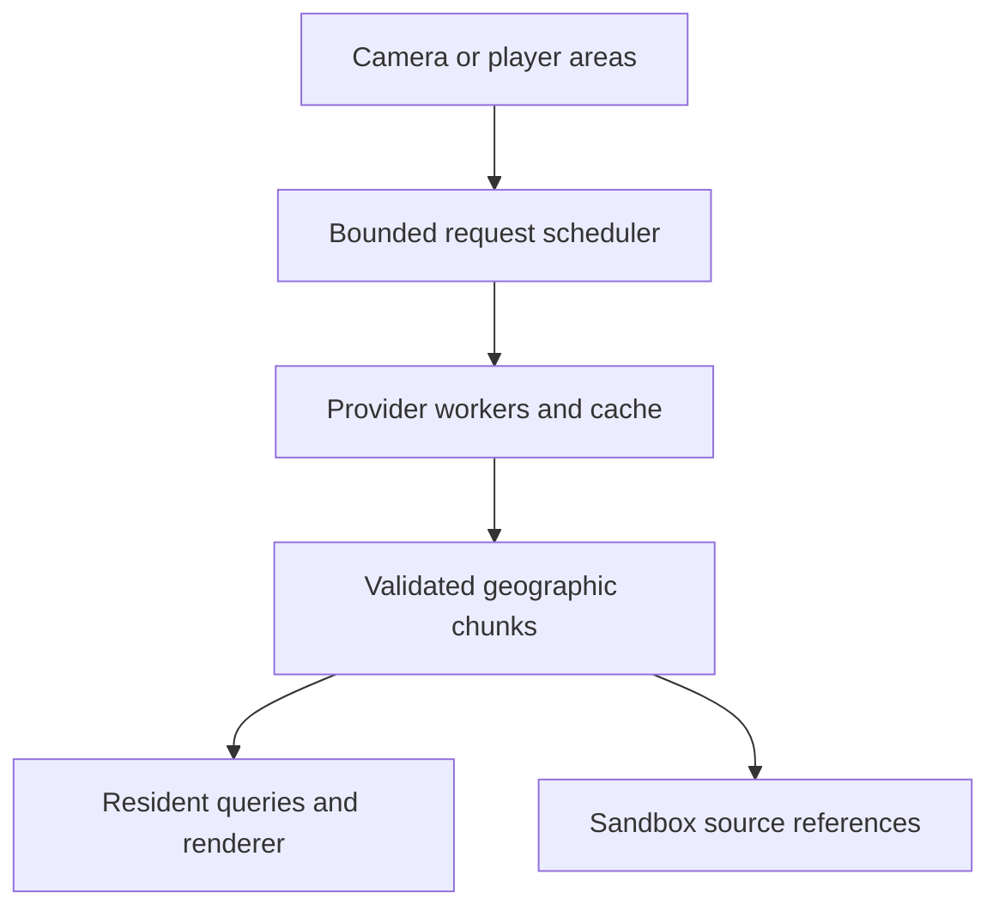
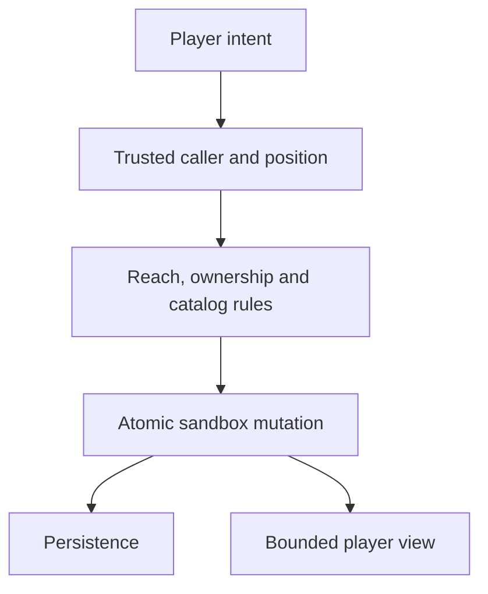

# Architecture and extension guide

Terra World is a reusable geospatial environment with an executable reference
game. Absolute geography, normalized source data, mutable game state, rendering,
and replication have separate ownership. The whole globe is addressable while
only a bounded neighbourhood is resident. The implementation does not assume an
entire planet's data or actors fit in memory.

## Crate boundaries

| Crate | Responsibility | Main extension surface |
|---|---|---|
| `terra-core` | WGS84 coordinates, local frames, geographic tiles, normalized chunks/features, environment models, clocks and actor types | Serializable domain types; `GeoPosition`, `TileKey`, `WorldChunk`, `ActorState` |
| `terra-stream` | Bounded chunk requests, worker execution, provider parsing, cache and provenance | `ChunkProvider`, `ChunkStreamer::with_provider`, `request_tiles` |
| `terra-history` | Explicit temporal source packs and dated political GeoJSON | `HistoricalPack`, `HistoricalCatalog`, `PoliticsDataset` |
| `terra-sandbox` | Persistent overlays, factions, living bodies/needs, integer money, shops, production and cargo | `Catalog`, `Command`, transactional `SandboxState::apply`, environment-resolved living advancement |
| `terra-net` | Authoritative simulation, input validation, bounded replication and server saves | `Server`, `NetClient`, server `WorldEnvironment`, `SessionIdentity` |
| `terra-bevy` | Bevy resources/schedules, floating origin, streaming integration and optional rendering | `TerraWorldPlugin`, `TerraLivingPlugin`, `TerraRenderPlugin`, `TerraNetworkPlugin` |
| `terra-demo` | RTS selection, first/third-person possession, contextual gameplay panels and political atlas | Example application, not a dependency of the reusable crates |
| `terra-cli` | Domain-level sandbox script execution and save/reload tooling | JSON command scripts for headless gameplay workflows |

The pure domain crates do not depend on Bevy. A host can use the streaming,
historical, sandbox, and network crates without a graphics device. The Bevy
renderer is feature-gated so environment logic can also run headlessly.

## Coordinates and chunk topology

`GeoPosition` stores latitude, longitude, and altitude in `f64`. Positions remain
absolute in saved state and network messages. WGS84 geodetic/ECEF conversion
provides a local tangent frame for rendering. The renderer uses local east/up/
south axes; physical actor velocity is east/north/up. Integrators must preserve
that distinction when mapping controller input to geographic motion.

The viewer rebases its local frame after moving beyond its configured origin
distance. It recalculates render transforms from absolute anchors; rebasing does
not change geographic truth or require a shared origin between multiplayer
clients. This keeps ordinary Bevy `f32` transforms useful across distant places.

`TileKey` is an equirectangular quadtree covering the poles and wrapping longitude.
It is not a slippy/Web Mercator tile key. Provider adapters explicitly map source
grids to geographic tile bounds. Height grids include shared edge samples, and
surface queries interpolate the normalized grid. Neighbour selection clips at
the poles and wraps across the antimeridian.

## Source data path

The scheduler deduplicates requested keys and caps queued, in-flight, and resident
work. `request_tiles` supports a priority-ordered union of several player areas;
`set_focus` provides a single-camera neighbourhood. Completed requests return
loaded/failed/evicted events. A completion budget bounds main-thread integration.
Stale results cannot silently replace an unrelated current request.

The built-in offline provider generates explicitly synthetic terrain and semantic
features under revision `terra-procedural-v2`. A local PNG heightmap provider
imports georeferenced 8/16-bit grayscale elevation with explicit bounds and
provenance; incomplete geographic tiles remain unavailable. Live providers can sample Terrarium elevation, parse OpenStreetMap
features, and retrieve Open-Meteo weather. Network use is opt-in, response sizes
and request counts are limited, disk cache has a byte budget, and source records
carry attribution and synthetic status. Geographic data is normalized before it
reaches the game; a source failure remains visible. Configurable live fallback is
different from historical mode, which forbids substituting current or synthetic
data for an explicitly requested dated pack.

A game can implement `ChunkProvider` and pass it to
`TerraWorldPlugin::with_provider(config, Arc<dyn ChunkProvider>)`. This retains the
bounded scheduler and Bevy integration while changing data access. Stable
`base_data_revision` values should identify immutable data versions so saves and
clients cannot accidentally mix incompatible geometry. A production provider can
serve prepared regional packs instead of asking public demonstration APIs for
every camera movement.

## Terrain and visual detail

The default native neighborhood contains 7 × 7 geographic tiles, each with a
65 × 65 source elevation grid. The same heightfield serves actor queries and
indexed terrain meshes. Smooth normals, authored micro-textures, land-use tint
and typed source features enrich its presentation without claiming satellite
surface imagery. `WorldFeature.properties` preserves source tags used by roof,
road, bridge, waterway, vegetation and gameplay adapters.

Feature geometry has near, middle and far detail tiers with hysteresis. Terrain
keeps its full grid while distant windows, trees, agricultural rows and road trim
are simplified. At most two mesh jobs run concurrently; main-thread integration
remains budgeted. The renderer reports integrated chunks, pending/building work,
mesh count and source vertices through `RenderTelemetry` (`RenderDiagnostics`
is an alias). Living actors and player construction use independent bounded
mesh caches so changing money or stock does not rebuild source geometry.

This is a regional renderer over globally addressable geography. It does not
render the entire planet at full resolution, assemble every OSM relation or
supply a building-interior/rigid-body engine. See
[GRAPHICS_AND_MAPS.md](GRAPHICS_AND_MAPS.md) for the implemented tag matrix and
geometry limits.

## History and political layers

A `HistoricalPack` has an explicit validity interval, provenance, synthetic flag,
immutable revision ID, and contained chunk paths. Loading rejects missing dates,
invalid chunks, traversal outside the pack directory, duplicate tile keys, and
source/provenance inconsistencies. A missing tile remains missing. A bounded
historical catalog can choose among era packs while rejecting ambiguous coverage.

The selected `data_epoch_unix` identifies the geographic source snapshot. The
simulation clock can advance independently. Advancing game time does not invent
new historical buildings, roads, terrain, or population, and does not silently
switch packs. Supplying additional time-specific data is a provider/content task.

`PoliticsDataset` imports dated GeoJSON with provenance and retains source
properties, claimant information, region type, and temporal validity. Geographic
queries can return overlapping claims. Countries and administrative regions are
source geography. Player factions are gameplay organizations with membership and
permissions. An explicitly authored territory can link to a faction, but this
link does not rewrite the source's sovereignty or claimant properties.

The demo's political atlas and scenario tools are client presentation and local
authoring. Shared multiplayer sessions require every peer to receive the same
exported/versioned dataset and revision. The reference protocol replicates the
revision, not an interactive political geometry editing service.

## Mutable world state

Source chunks remain immutable. `SandboxState` stores authored structures, land
claims, farms, resource depletion, inventories, homes, factions, living state and
source-feature tombstones. Registering a source chunk repeatedly does not refill a harvested
resource or resurrect a removed tree. Source buildings and roads are not freely
destroyed through the tree-removal command; authored construction has its own
validated damage/destruction path.

Commands are intent objects. The caller ID and geographic position come from the
trusted local game or server, and each command validates all preconditions before
committing. Inventories use a small bounded catalog. Recipe and blueprint costs,
workbench requirements, placement overlap, reach, and role permissions live in
the domain layer so a UI and a network server share the same rules.

Faction assets keep their original creator for audit and an optional faction
owner for current authorization. Permission checks follow current roles, so
demoting the creator removes mutation authority on their shared asset. The host
selects new-player equipment through a catalog-aware policy. Saves validate
cross-references and cached construction/crop rules against that catalog; balance
changes that alter those rules require explicit migration.

`SandboxView` is a bounded partial replica containing one player's inventory and
wallet, nearby objects/bodies/facilities and relevant faction rosters. It is not a complete save. Code
must not validate or persist that partial replica as though it owned every
player, plot, or source reference in the world.

## Living bodies, economics and movement

A player principal and a controlled body have different IDs. `LivingAccount`
links that principal to an original avatar and the currently active owned unit.
The active unit's position is also the principal's position for interaction
checks. Possession changes control mode, not ownership, inventory or permissions.
RTS selection can change active context without cancelling an autonomous order.
Releasing possession retains that body so trading does not jump back to an old
avatar position.

The domain stores one shared inventory/wallet per principal and individual
needs per biological body. Credits use checked integer minor units. A trade
validates customer/retailer stock, funds and reach before committing both sides.
Production consumes real inputs and finite extraction capacity. Courier pickup
moves stock into actual cargo; dropoff moves it into destination stock. A delivery
is completed only after the host accepts the movement reaching its endpoint.

The reference settlement creates authored residents, road traffic, courier
vehicles and animals, plus five owned bodies per player. Map tags can locate its
facilities and road graph. All economic state remains authored even when a real
feature supplied the location. Bounded road-vertex routing, simple following
and local obstacle detours are appropriate to a reference game; they do not
constitute a complete city traffic model or general pathfinder.

`advance_living_with_environment` separates real-step movement/exertion from
calendar-driven hunger, thirst and production. The host resolver decides whether
a proposed geographic step is supported before position or delivery arrival is
committed. Local Bevy uses resident terrain, water/bridge support, slopes, source
footprints and authored obstacles. The reference headless server uses a bounded
`ResidentSurface` fed from the same normalized chunks for water, slope, bridge and source-footprint admission, plus
server-owned dynamic obstacle checks. Custom hosts must supply equivalent
policies for their chosen data. Neither domain code nor a client-supplied
destination bypasses host authority.

The world stores at most 512 living units. The client receives a bounded view,
never NPC private money, private cargo inventory or full internal path arrays.
Full persistence validates ownership, active-body positions, goods, reservations
and cross-references. Loading a save does not regenerate the settlement or grant
a second starting allowance. See [LIVING_WORLD.md](LIVING_WORLD.md).

## Bevy scheduling and game integration

`TerraWorldPlugin` inserts `WorldRuntime`, `ResidentChunks`, `SandboxRuntime`,
`SandboxQueue`, and the streaming service. It runs source integration in the
`WorldSet::Stream` update set, local clock/actor advancement in a fixed schedule,
and sandbox commands in `WorldSet::Sandbox`. `TerraLivingPlugin` seeds after resident-source integration and advances
authoritative population after the fixed world simulation. Rendering consumes
the resulting resident world and mutable overlay. A game may omit the renderer and supply its
own visual representation.

`GeoAnchor` locates an arbitrary entity in absolute geography. `GeoActor` provides
the sample kinematic controller; it does not require a game to adopt the demo's
AI, movement, or appearance. Actor kinds cover human, animal, creature, vehicle,
ship, helicopter, balloon, and airplane. The environment interface returns
resident height, slope, water, and weather information for a game's controller.

Day/night and season models derive from location and calendar time. Deterministic
weather and crop growth provide a useful offline simulation; they are illustrative
models, not climate prediction or agronomic/flight simulation. Live weather is a
timestamped external observation/forecast with provider limits. The optional living layer supplies lightweight population AI, needs, economy
and routes. Games can replace or extend those rules and connect specialized
physics, ecology, quests and navigation through the domain/environment seams.

When `TerraNetworkPlugin` is installed after `TerraWorldPlugin`, it locks authority
before the first fixed tick. Local sandbox commands are sent to the host, local
calendar/actor simulation does not compete with authoritative state, and streamed
source data does not invent mutable resources in the replica. Disconnect clears
stale network actors and blocks further mutations. Native visuals interpolate
validated authoritative poses; there is no speculative movement prediction. A `NetworkSession` resource
enables durable player identity with the same file helper used by terminal
clients.

## Multiplayer and persistence boundaries

The host maintains absolute actor state and fixed simulation ticks, validates
velocity intent, expires stale input, and uses resident terrain/coverage queries.
Its source manifest is checked before a compatible client becomes a saved player.
Clock metadata and actor snapshots are authoritative; each client converts them
into its own floating origin. Actor poses arrive at 10 Hz; living sandbox views arrive at up to 5 Hz. Actor
interest uses great-circle distance and explicit capacity truncation. Mutable sandbox interest follows the player's
position, not the spectator camera.

`terra_net::WorldEnvironment` is the headless host's height/coverage interface;
`terra_bevy::WorldEnvironment` samples Bevy resident chunks. They are separate
adapters because the networking library has no Bevy dependency. A game can point
both at the same prepared geographic data. Neither interface currently provides
a complete rigid-body collision engine.

Local desktop saves and server saves wrap domain state with a world identity and
clock, while the pure sandbox persistence API is suitable for domain workflows.
Server saves additionally retain capabilities, command sequence history, NPCs,
all living accounts/cargo/production, catalog and starter equipment. JSON serialization uses precise float round-trip
support so saved `f64` GPS values survive restore. Unknown schema versions and
incompatible world identities are rejected before mutation.

The current limits are deliberate, visible engineering boundaries: finite chunk
caches, finite domain collections, bounded replicas, and one authoritative
process. World-scale persistence and multiplayer need geographic partitioning,
durable regional storage, ownership-aware loading/unloading, interest indexes,
identity/admission services, and a transport with the required latency/security
properties. See [MULTIPLAYER.md](MULTIPLAYER.md) for the actual budgets and runnable
verification commands.
