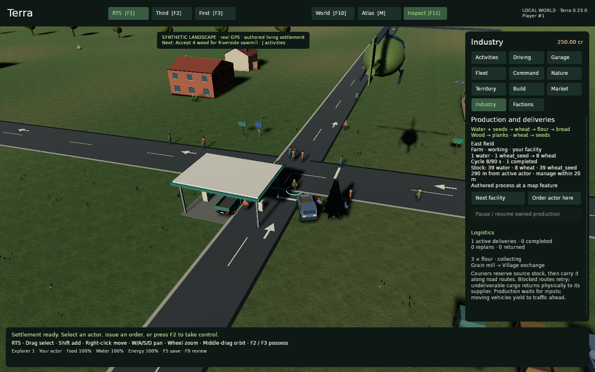
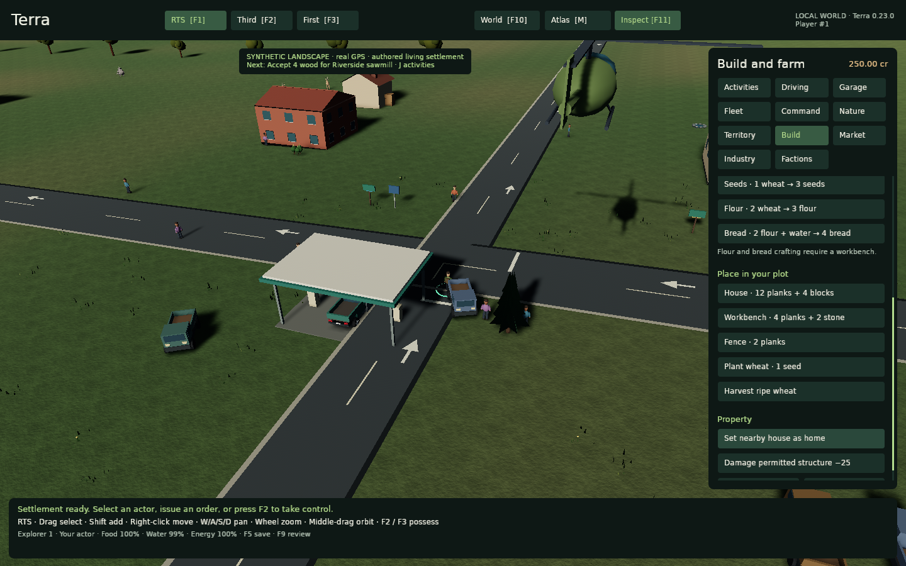

# Terra World 0.24 — comprehensive product review

Review began **30 October 2026** against the exact delivered **0.23.0**. The [implementation plan](IMPLEMENTATION_PLAN_v0.24.md) was written before dedicated implementation dispatch; [research](RESEARCH_v0.24.md) records primary-source patterns and explicit product policy. Actual acceptance is recorded in [Validation](VALIDATION.md); pending work is not passed work.

## Product assessment

The framework connects streamed geography, RTS and possession, needs, finite trade and production, communities, transport, persistence and authoritative multiplayer. The next increment strengthens continued useful work and predictable operations across these existing systems.

The review found public supply offers that can become obsolete while retaining board slots forever, new offers exceeding useful demand or receiver capacity, native operations that can resolve a different target after activation, unnamed building damage, a cross-platform file-alias omission, and a verification runner that can accept while an ordinary child is still writing.

The selected pass addresses these failures through explicit lifecycle and interaction rules. Existing visual identity, source/catalog identity, finite funds, compatible saved shapes and historical evidence remain protected. The [G01–G18 register](REVIEW_GAPS_v0.24.md) retains wider production requirements and the proof needed to close them.

## Dedicated ownership

| Owner | Review and implementation |
|---|---|
| Player specialist | Native Industry, Fleet, Build and faction interaction; reviewed targets, labels, destructive review, focus and input. |
| World specialist | Supply demand/capacity, public escrow lifecycle, accepted promises, determinism, conservation and continued careers. |
| Reliability specialist | Protected file identity, process/log bounds, extracted desktop verification and CI. |
| Integrator | Product breadth, research/policy, plan/version/docs, native audit, acceptance, preservation and complete delivery. |

Specialists cross-review other streams before final acceptance. Source findings, executed regressions and rendered observations are separate evidence.

## Assessment across product perspectives

| Perspective | Finding and selected response | Remaining qualification |
|---|---|---|
| Product fit/scope | Strengthen useful existing careers and reference-game operations. | Measured target-player/product success criteria. |
| First-session onboarding | Activities offers a goal, but new funded work can already exceed receiving capacity. | Uncoached first useful action and comprehension. |
| Returning-player continuity | Obsolete requests can hold all board slots indefinitely. | Long careers and return after extended absence. |
| Interaction/consent | Routine Industry/Fleet operations and damage lack the stronger context retention used by Market/Frontier. | Device and latency coverage as surfaces grow. |
| Information architecture | Keep compact panels and provide deliberate browse/review recovery. | Comparative task-discovery evidence. |
| Accessibility/input | Generic pause/resume and unnamed damage obscure consequences. | Full 200% reflow, narration, contrast, localization and physical devices. |
| Progression | Capacity-fitting small requests and turnover support continued work. | Measured stalls across Supply, Home/Community and Road/Company. |
| Finite economy | Retirement must return exact escrow to the original issuer within the money cap. | Sustained balance and labor/capital/living costs. |
| Community/property | Keep exact explicit faction selection and conservative existing dissolution. | Absent-leader succession and populated/asset-owning dissolution policy. |
| World simulation | Deterministic bounded board maintenance and accepted commitments. | Density/endurance and simulation budgets. |
| Navigation/vehicles | Preserve exact targets in Fleet operational handoffs. | Traffic/obstacle endurance and physical handling. |
| Geography/data | Preserve source identity and partial-view uncertainty. | Licensed shipping data, datum/topology/NoData and constrained placement. |
| Rendering/performance | Check legibility with existing renderer and settings. | Physical GPU frame/loading/residency tails. |
| Content/art/audio | Preserve original assets, examples, rights notices and authoring inputs. | Production animation/equipment/audio and art budgets. |
| SDK/developer experience | Shared demand queries, typed blockers and compatible saved shapes. | External integrator feedback and future API evolution. |
| Multiplayer/authority | Commands revalidate authority; replica absence is not deletion. | WAN latency/loss/soak and deployment capacity. |
| Security/privacy | Portable protected-file identity and passive package checks before execution. | Public-service threat model and signed updates. |
| Recovery/concurrency | Preserve leases, publication outcomes and rejected-operation value. | Target-filesystem power-loss and offsite rehearsal. |
| Delivery/support | Fresh extraction/startup checks become part of CI. | Actual Windows/clean-machine and upgrade/rollback acceptance. |
| Observability/operations | Bound logs and process lifetime before accepting a gate. | Retention, alerting, crash diagnosis and responsible operators. |

## Prioritized findings

1. **P1: obsolete public supply work never retires.** Expiry renews requests, holding escrow and a finite slot. Retire confirmed obsolete public work only after exact issuer credit. Honor accepted promises.
2. **P1: posting can create excessive or impossible work.** The previous minimum-four clamp exceeds small shortages and omits capacity checks. Derive a useful admissible amount before funding.
3. **P1: routine native operations can change target or meaning after activation.** Explicit missing Industry/Fleet selectors fall back, and a toggle derives its desired state at dispatch. Retain stable reviewed operands and recheck eligibility.
4. **P1: building damage lacks a named consequence review.** The generic action resolves a nearby structure later. Name the exact target and health effect with cancel/confirm.
5. **P1: canonical gate success can precede child completion.** The reviewer reproduced a child publishing output and a marker after reported leader success. Bound output, EOF and owned-process completion.
6. **P1: protected output checks omit non-Unix hard links.** Resolve portable file identity and existing aliased ancestors.
7. **P2: CI uploads desktops without testing a fresh extracted tree.** Add safe extraction, passive verification and bounded startup.
8. **P2: a missing explicit faction can silently become another membership.** Require deliberate browsing.

## Fresh native baseline

The exact accepted 0.23 executable, SHA-256 `432748a47f507d23e3efdbd2862f4e5beaae68c41801eeaf4a057392d4f3c99f`, ran on Linux/X11 with software Vulkan. It saved and quit normally, exit 0. Screenshots below were captured and visually inspected during this review.

| Step | Observation and health | Capture |
|---|---|---|
| 1 — Activities | Useful visible objective, actor and reward explanation. Long-term offer usefulness requires domain tests. | [Activities](verification/v0.24-native/01-baseline-activities.png) |
| 2 — Industry | Facility, stock and reach are visible; generic “Pause / resume owned production” obscures the next operation. | [Industry](verification/v0.24-native/03-baseline-industry-complete.png) |
| 3 — Build entry | Claiming, materials and recipes are grouped and scrollable. | [Build](verification/v0.24-native/04-baseline-build.png) |
| 4 — Fleet entry | Registration and personal/company finances are distinct. Target replacement findings are source evidence. | [Fleet](verification/v0.24-native/05-baseline-fleet.png) |
| 5 — Property actions | “Damage permitted structure −25” is unnamed and enabled with no player structures. | [Damage entry](verification/v0.24-native/07-baseline-build-damage.png) |
| 6 — Save/quit | Pause explains JSON semantics and exposes Save and quit; normal exit succeeded. | [Session menu](verification/v0.24-native/08-baseline-session-menu.png) |

An intermediate PNG 02 was incomplete and rejected; its bytes and original receipt remain failed evidence. Fresh complete capture 03 supplies the accepted Industry observation. Capture publication now atomically exposes complete bytes. The initial process helper mislabeled the baseline release field as 0.24; the pinned binary, starting source map and rendered 0.23 title identify the actual baseline. The original receipt remains unchanged and the helper was corrected. The checkout changed during parallel implementation, so its ending map is not claimed as baseline or final accepted source.

## Implementation and final review

The three implementation streams completed the selected domain, interaction and reliability work. Supply posting now follows useful demand and admission capacity; confirmed obsolete public requests release their scarce slot only after exact original-issuer credit is possible. Accepted promises retain their terms. Industry and thirteen routine Fleet operations retain stable reviewed context through real activation and dispatch, while missing explicit selections stay unavailable. Building damage names the exact structure, health change and consequences, with safe cancellation and one-use confirmation.

Protected outputs use portable existing-file identity and canonical existing ancestors. Canonical subprocesses have explicit output/lifetime/EOF/cleanup bounds, and ordinary surviving POSIX groups prevent success. Desktop archives are safely extracted and passively verified before optional startup; the configured Linux and Windows CI paths perform this qualification before upload. Actual Windows execution remains unclaimed.

Rotated reviews closed rental countdown overbinding, incomplete current receipt admission, ambiguous Windows unresolved aliases, and changes after a preservation checkpoint. Failed attempts remain retained. The actual native candidate completed supply delivery, named Industry pause/resume, plot/craft/build/damage review, company registration/funding/recruitment, route assignment and start/pause, followed by save and restoration. Independent checkpoint audits reconciled the resulting money, inventory, progression, fence, company and paused assignment. [The native record](verification/v0.24-native/README.md) distinguishes the actual sequence, saved-state proof and platform limits.

Final polish shortened two damage labels at the minimum window. A later visual assessment incorrectly reported missing inspector paragraphs. Independent pixel comparisons proved the named-consequence region in 208/209 and the Build prose in 219/220 were byte-for-byte identical and present. The finding was withdrawn and its experimental rendering workaround and regression removed exactly. Original images, attempted-build receipts and the correction record remain available; no unsupported renderer fix is shipped. [The independent comparison](verification/v0.24-review/pixel-comparison.md) documents the evidence.

Final proof belongs in [Validation](VALIDATION.md) and the [execution ledger](IMPLEMENTATION_PLAN_v0.24.md#execution-ledger).

## Evidence limits

This is a framework/reference-game increment. It does not establish Windows runtime, physical GPU/device performance, uncoached usability, blanket accessibility, public-service readiness or distributed MMORPG capacity. Those requirements remain explicit in the gap register.

