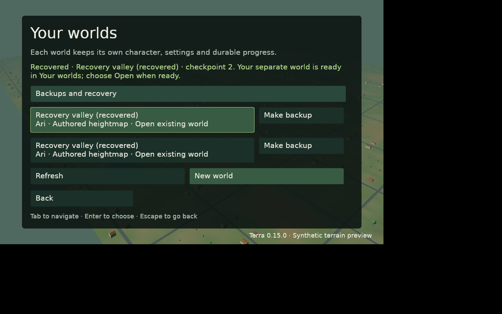
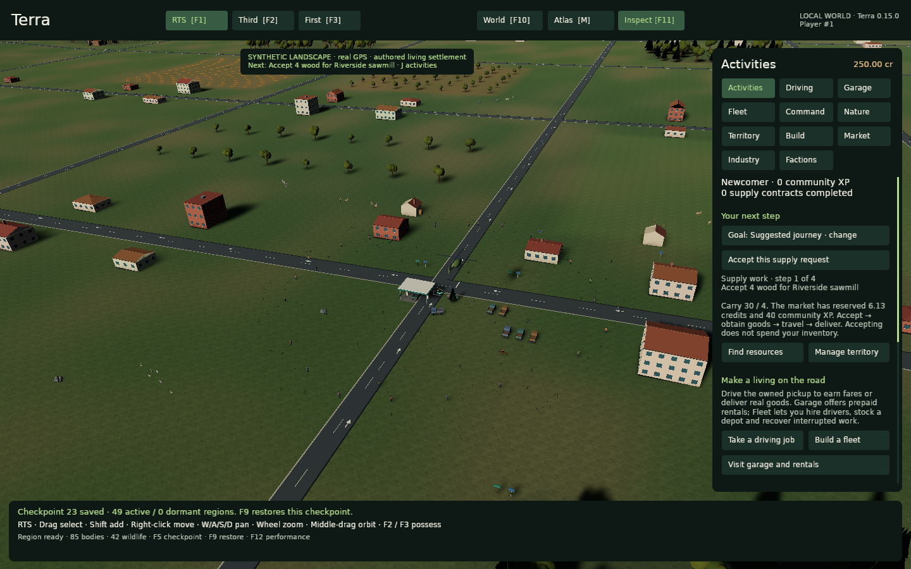
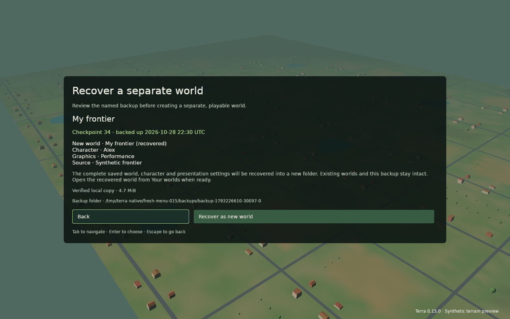
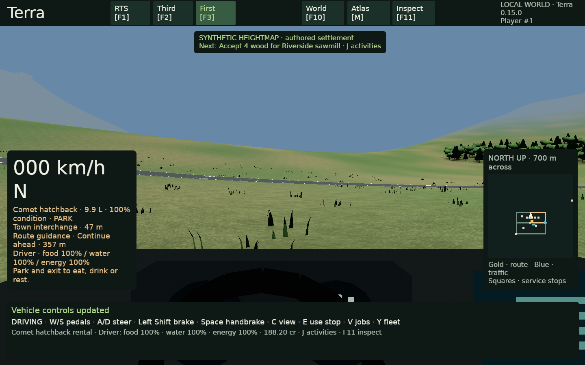
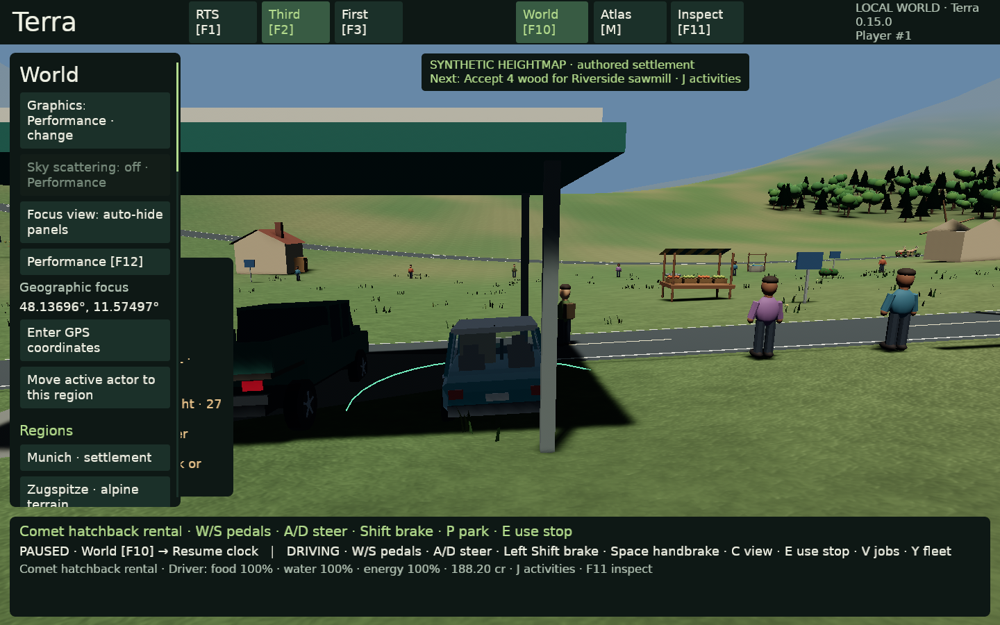
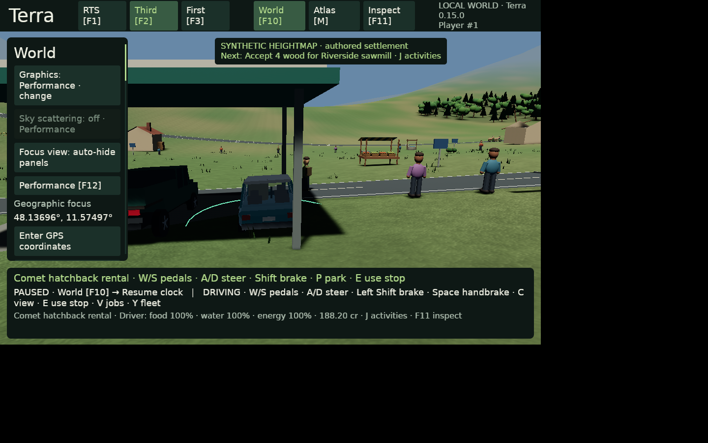
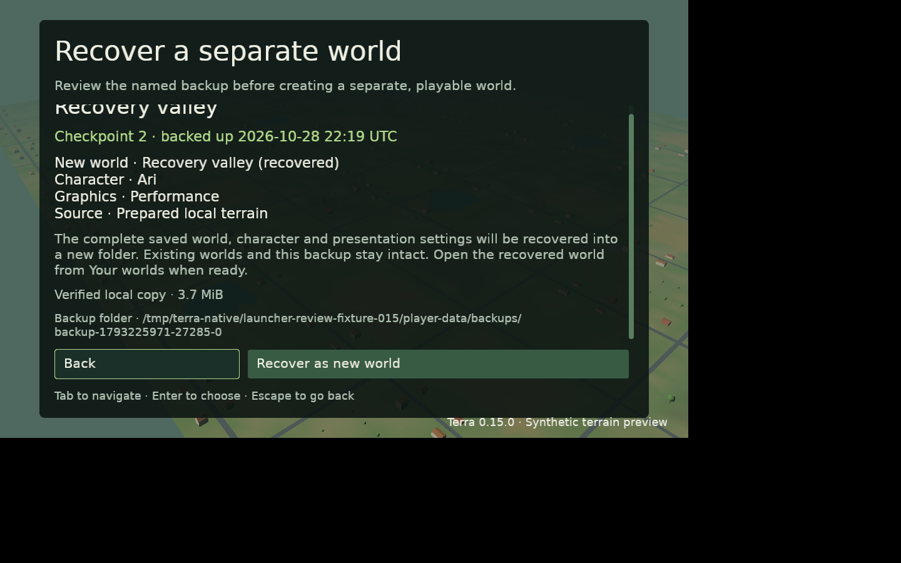

# Product review and improvement pass — 0.15

Review date: **2026-10-29** (Europe/Berlin). This review follows the preserved
[0.14 product review](PRODUCT_REVIEW_v0.14.md). The current
[gap register](REVIEW_GAPS_v0.15.md) retains all **G01–G18** identifiers and their
remaining acceptance criteria.

**The automated and native checks passed.** All 34 final gates passed with
860 distinct Rust tests, 929 passing executions and no failed or ignored tests.
Three confirmation processes used the exact final executable and exited cleanly
with all 356 implementation inputs unchanged. The [release record](release-verification-v0.15.json)
binds the [native confirmation](native-v15-verification.json),
[Linux package review](desktop-package-v0.15.json) and source-preservation evidence.
This is acceptance of the recorded regional reference scope. The exploratory
candidate was not replaced while its HUD correction was being implemented.

## Product outcome and evidence boundary

Three previously disconnected tasks now have concrete continuations: an
autonomous vehicle can plan around a small group of stopped bodies; an artist
can publish an original animated vehicle through the validated pack workflow;
and a player can verify a local backup, recover a separate world and return to
the same accepted activity. Independent reviews then corrected completed-result
discoverability, paid paint with no visible effect, documentation drift and a
native driving overlay conflict.

The screenshot journeys used candidate executable SHA-256
`cf9f03f18ca77d714bbdbaf482717f2281d8e0d72c4de4cd43546fa8fba3e80e`.
The [fresh-world process](verification/v0.15-native/v15-candidate-menu-process.json),
[Comet process](verification/v0.15-native/v15-candidate-comet-process.json) and
[enlarged-text recovery process](verification/v0.15-native/v15-candidate-recovery-large-text-process.json)
all exited **0**. Source inputs changed during the Comet run only for the HUD
fix described below; its process record correctly reports that change. These
are exploratory candidate observations, not frozen-source acceptance,
uncoached player studies or timed performance benchmarks.

## Confirmation on the final executable

The final native pass repeated the new recovery and vehicle interfaces at
1100 × 700 with 150% text. Keyboard verification and explicit confirmation
created a separate Recovery valley profile. Before opening it, a
[retained comparison](verification/v0.15-native/v15-confirm-recovery-exact.json)
verified every SQLite definition, column and value: 19 region rows and one world
row. Character, quality, start hour, prepared/political inputs and rebased paths
matched the selected backup. All 42 existing files remained unchanged, including
after reopening. The original world and source tree were still absent.

The recovered profile opened from an unrelated working directory, reached
**49 ready terrain chunks**, reported a restored regional checkpoint and exited
cleanly with no world, simulation, persistence or asset error. Separately, the
paid Comet loaded with **23 ready instances** in third person. First person
reported **22 ready instances and one deliberately hidden exterior**; that hidden
instance remains in fallback accounting and is not a failed import. No models
failed and no instances were rejected. These later checks did not repeat the
candidate's throttle/reverse measurement.

Repeated recovery currently gives copies the same title and subtitle. The exact
new result is pinned and focused, and the worlds have distinct persisted
identities, but later identification would benefit from a creation/checkpoint
suffix or a rename action. This is a retained, nonblocking G16 usability item.

## Player experience: create, save, recover and continue

The native journey connects onboarding to durable progress through ordinary
controls:

1. **Create a world.** The reviewer chose the normal character flow, Alex with
   outfit 1, and Performance graphics. The ready world showed Activities beside
   the playable settlement and a persistent next-step banner.
2. **Accept useful work.** Activities offered four wood for Riverside sawmill.
   The action accepted the request; the carried supply then satisfied its goods
   requirement. This observation establishes acceptance and guidance, not a
   completed delivery or a resource-gathering journey.
3. **Save and make a backup.** After returning to the launcher, Make backup
   retained checkpoint **34**. An empty external-folder submission produced an
   error. Keyboard cancellation of the verified review left **one managed world
   and one backup**, without creating a recovered copy.
4. **Review the named copy.** The review identified the world, checkpoint, Alex,
   Performance settings and synthetic source. Back was visibly focused. The
   explanation said that recovery creates a new folder and that opening it is
   a separate action.
5. **Recover and reopen.** Actual restoration returned to Your worlds with both
   the original and **My frontier (recovered)** listed. Opening the recovered
   entry returned to Activities at supply step 3: **all four wood ready**, with
   the destination **176 metres** away. Save/quit completed normally.

The first screen makes the next action more specific than a list of sandbox
features. The resumed screen proves a useful continuity property: recovery
preserves the accepted task and its current requirements. The banner, Activities
primary button and explanatory text agree on bringing the supplies to the
sawmill. The full observation is visible in the
[recovered-world screenshot](screenshots/v15-candidate-recovered-world-ready.png).

This flow earns trust by naming what will be restored before committing and
showing the resulting world afterward. The
[completed screen](screenshots/v15-candidate-recovery-completed.png) keeps the
original reachable. A recovered profile intentionally receives a new creation
time; the wrapper retains the original world's creation time, while character,
quality and start-hour settings are preserved. Timestamp identity is therefore
not a requirement for the newly created profile.

Continuing goals still need longer observation. Existing Supply, Home/Community,
Road and Company guidance uses actual needs, ownership, funds and obligations;
this increment does not establish that new players understand every branch or
find enough sustained work. G03–G04 retain beginner strategy, setbacks,
replenishment, returning-player comprehension and uncoached-session criteria.
See [Guidance](GUIDANCE.md) and [Game flow](GAME_FLOW.md).

## Autonomy, economy and physical credibility

The navigation change addresses a measured failure: a 60-metre trip with three
parked bodies across the approach. The prior implementation advanced only
**7.30 metres in 120 physical seconds**. The new case reaches the ordinary goal
in **14.5 physical seconds**, travelling **75.49 metres** around the group.
The baseline has unbounded flat support; the final SDK fixture additionally
bounds the supported region. This is a reproducible geometry case, not a
prepared-map traffic or hardware-speed comparison.

The ordinary one-body detour remains first. A fallback considers at most four
stopped bodies, corners within 64 metres and a complete reconnecting route within
160 metres. Its twelve extra corridor admissions are shared across an entire
vehicle update. Each leg, including reconnection, must pass full-envelope
support, traffic and body-sweep checks. Moving or unsupported obstacles cannot
be treated as a convenient static passage. Shared vehicle handling, ordinary
arrival distance and the waypoint cap remain intact.

The [cluster regressions](../crates/terra-sandbox/tests/navigation_clusters.rs)
check physical progress, bounded steps and steering, unchanged parked bodies,
conserved goods and money, bounded source work and **143 exact resumed steps**.
Additional cases cover missing support returning, choosing the supported side,
a moving obstruction and patrol continuation. The planner does not erase a
commercial obligation to escape a blocked route. See
[Contacts and routing](CONTACTS_AND_ROUTING.md) and
[Vehicle dynamics](VEHICLE_DYNAMICS.md).

Native Comet driving is a separate controlled-vehicle observation. Its prepared
review fixture uses ordinary paid rental commands: **250.00 credits becomes
188.20**, including a **45.00-credit bond** within the 61.80-credit debit. It
uses no synthetic wallet grant or overwritten position. The fixture is already
near the garage; boarding occurs at **5.517 metres**, with each short approach
using **0.05 seconds** of ordinary simulation. That setup is not a meaningful
walking-distance test. The fixture and report originate in
[the native frontier tests](../crates/terra-demo/src/frontier.rs).

Neither addition rebalances careers or proves unattended profitability. Finite
fuel, stock, wages, rental costs and obligations remain material. Multiple
moving blockers, narrow roads, intersections and blocked alternate exits still
need the declared G05 geometry matrix; broader career balance remains G03.

## Artists, SDK users and compatibility

The optional Comet pack gives the presentation workflow a second content class.
Its original hatchback has an exterior, transparent glazing, four empty seats,
a dashboard, four rolling wheels and front steering pivots. The explicit
Compact-model target avoids replacing every generic vehicle. Public model
appearance does not require access to an owner's private inventory.

Artists can inspect the GLB, build the composed recipe into a new directory,
validate that output and preview it in the game. The recipe combines Comet with
the five unchanged wildlife models. The standalone transport manifest contains
only Comet; the combined demo manifest keeps wildlife. The original woodland
pack remains the default. The generator's check mode verifies reproducibility.
See [Asset authoring](ASSET_AUTHORING.md),
[Asset packs](ASSET_PACKS.md) and the
[Comet example](../crates/terra-bevy/assets/transport-pack/README.md).

Wheel phase follows signed admitted travel and declared radius/scale. Stops
retain phase; reverse travel reverses rotation. Steering follows admitted
vehicle behavior. Pause freezes clips, blending and the wheel rig. Hierarchy,
scale, animation-channel and aggregate-work checks reject unsupported content;
the procedural actor remains visible until its admitted replacement is ready.
These controls make the handoff reproducible without giving presentation assets
authority over saved gameplay.

The candidate loaded the paid fixture through ordinary **F9 JSON restore**.
Review observed reverse downhill rolling at **16 km/h**, forward W input at
**41 km/h in D2**, and parking at **0 km/h**. The combined pack reported six
models and **23 ready instances** in third person. First person hid the possessed
exterior and retained the procedural cockpit, producing **22 ready instances**.
No failed models or rejected instances were reported. The
[telemetry](verification/v0.15-native/v15-candidate-comet-telemetry.json) retains
bounded recent samples and the graceful-exit state; its final first-person
count must not be described as a missing vehicle import.

The fixed teal/ivory livery does not display saved paint changes. Garage now
explains that limitation and disables the paid paint action for the selected
imported appearance, as shown in the
[maintenance view](screenshots/v15-candidate-comet-maintenance-return.png).
A queued action rechecks the appearance and displayed vehicle before dispatch;
procedural paint retains its ordinary five-credit command. This correction
protects the connection between a purchase and its visible result.

Gameplay save **1**, regional schema **1**, wire **10** and TLS
**terra-world/10** remain unchanged. Asset schema stays **1**, but new
`vehicle_model` and `vehicle_motion` features require the 0.15 reader; older
readers reject them. Existing kind/species packs retain normalized identity.
[Compatibility](COMPATIBILITY.md) separates those contracts. Empty seat geometry
is not passenger occupancy. Human customization rigs, seated people, boarding,
attachments, audio, production LODs and target-GPU budgets remain G09 work.

## Native interface and accessibility polish

The observed driving defect was concrete. At 150% text, the World drawer covered
most of the left driving card while fragments of speed and navigation text
protruded beside it. The route-map card already yielded to drawers; the driving
card did not.

The correction gives both floating cards the same rule: hide while World,
Inspector or Performance is open, and restore when the drawers close. The
footer and panel controls retain their behavior. A new ECS regression runs the
actual HUD and map systems through every drawer combination, first and third
person, closing/reopening and RTS. **All nine focused driving tests passed**,
as did the existing scaled-footer layout test. Source and test trace:
[driving](../crates/terra-demo/src/driving.rs) and
[interface layout](../crates/terra-demo/src/interface.rs). The final native pass
confirmed the corrected behavior for all three drawers at 1100 × 700 and 150%
text, then confirmed that both cards return when drawers close. The candidate
screenshot above remains the evidence of the discovered defect.

The final [Garage view](screenshots/v15-confirm-comet-service.png) also shows the
fixed-livery explanation and unavailable paint action, with 188.20 credits
unchanged. The enlarged session menu scrolls to a fully reachable
[Save and quit action](screenshots/v15-confirm-comet-save-quit.png). Partial rows
at a scroll boundary do not strand the underlying action. These observations
establish reachability at the stated configuration, not complete accessibility
qualification.

The separate recovery review used an **1100 × 700 window at 150% text**.
After the original prepared-world tree was gone, verification still opened
Recovery valley with Ari, Performance graphics, checkpoint **2**, prepared local
terrain and a **3.7 MiB** copy. The
[backup browser](screenshots/v15-candidate-backups-150-small.png) kept a visible
focus outline and labelled external-folder field. The
[named review](screenshots/v15-candidate-original-loss-review-150.png) explained
the new-world consequence before its controls.

Scrolling exposed the full path while Back and Recover stayed visible.
Keyboard cancellation, return Home and quit preserved **one managed profile and
two backups**. This is observed reachability at the stated configuration.
Screenshots and a guided keyboard pass do not establish screen-reader support,
contrast compliance, controller/wheel coverage, localization or motion comfort.
Those G08 requirements remain open. Software-rendered interaction also required
allowing frames to settle; an initially unchanged screenshot did not establish
a failed supply acceptance.

## Operations, scale, privacy and support

Native recovery wraps the existing complete local recovery bundle with bounded
character/presentation metadata. It verifies the named bundle before review,
rechecks identity before restore, rebases runtime paths and publishes the new
profile only after validation. One background operation runs at a time; browsing
remains available while another operation or launch waits. Unsupported host or
source modes receive an explicit explanation. See
[Recovery bundles](RECOVERY_BUNDLES.md) and
[launcher recovery tests](../crates/terra-demo/src/launcher/recovery_tests.rs).

Cross-review caught a discoverability failure: 24 future-dated entries could
hide a just-completed backup or recovered world. The launcher now retains and
revalidates the exact completed path, pins it within the existing list bound
and reapplies that pin after navigation or refresh. A regression exercises the
actual polling and action systems. The list still shows at most 24 entries and
inspects at most 256 directories; the correction does not widen scanning.

The managed recovery rehearsal removes its original world and input tree,
then checks complete state, principals, cold records, source/political inputs,
character/settings, discoverable profile, retained backup and another backup
of the recovered copy. The larger backend rehearsal is separate. Resource
records at distant coordinates do not prove terrain coverage there. An exact
local restore does not implement offsite storage, encryption, retention,
operator ownership or deployment RPO/RTO. Server, live-source, historical and
custom-catalog policies remain outside this recovery contract.

Import, planner and worker bounds constrain admitted work; they do not measure
GPU residency, loading peaks or frame tails on supported hardware. The native
review ran on Linux with llvmpipe software rendering. It cannot establish a
consumer performance promise or Windows acceptance. G02, G07, G14 and G15 retain
platform, device, WAN, sustained-capacity and storage-stall criteria.

Backups contain private world state and host metadata. Retained diagnostics
contain bounded timings, counts and errors; local paths and source identifiers
still require review before sharing. Integrity hashes do not authenticate a
publisher. Public account recovery, moderation, external audit retention and
alerts retain their separate G11, G13, G16 and G17 requirements; see
[Operations](OPERATIONS.md) and [Diagnostics](DIAGNOSTICS.md).

## QA, delivery and remaining priorities

Implementation owners cross-reviewed the navigation, asset and recovery work.
The review also checked report schemas, shipped pack paths, historical
preservation and exclusive source-package publication. These checks support the
release process; final counts and accepted executable/package identities appear
in [Validation](VALIDATION.md) and the bound release receipts. Candidate
observations remain separate from the three accepted-executable confirmations.

The final source and Linux package evidence bind their exact accepted inputs.
The source deliverable excludes private saves, databases and session capabilities.
The Linux package has separate extracted-folder execution and payload checks. The
[desktop guide](DESKTOP_DELIVERY.md) documents explicit pack selection; this
increment does not add a launcher asset-picker claim.

The next product priorities are uncoached first/returning sessions, a wider
physical blockage matrix, representative human/boarding content, and actual
Windows/device qualification. Deployment work takes precedence if Internet
hosting becomes the next target. The linked [18-row register](REVIEW_GAPS_v0.15.md)
keeps the remaining community lifecycle, regional data, migration and global
architecture criteria visible alongside these immediate priorities.
