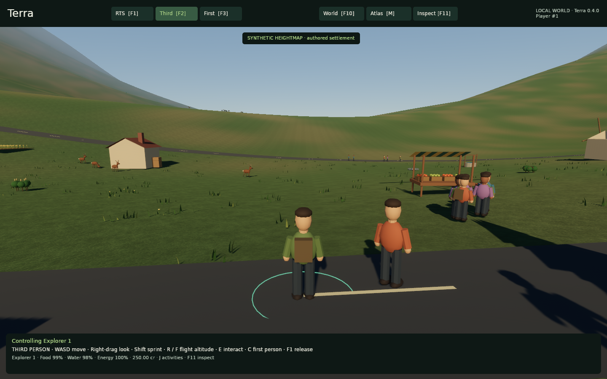
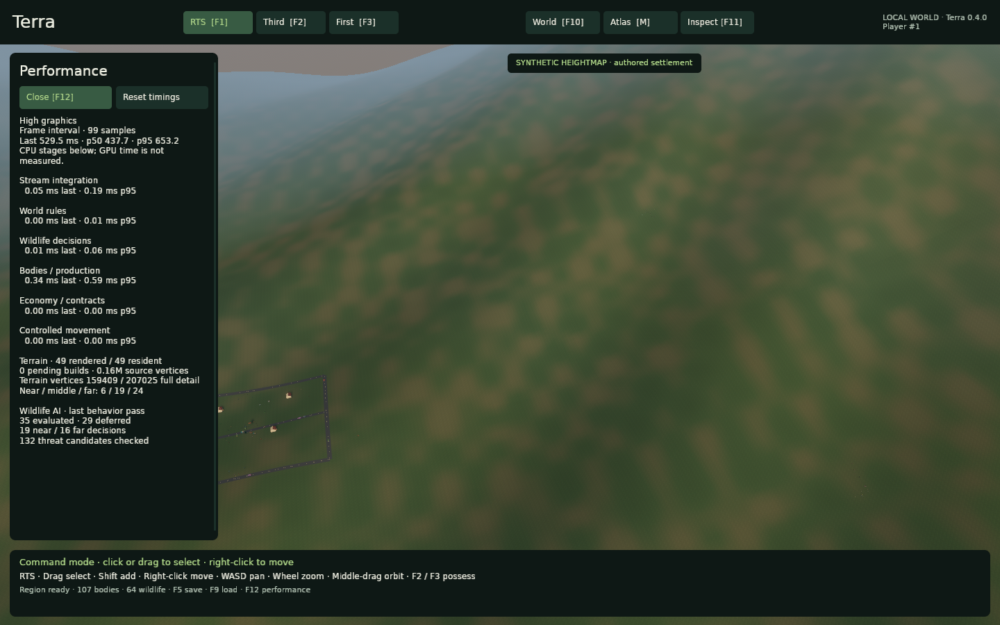

# Terra World 0.4 product review and polishing record

Review date: 2026-10-27. Scope: the reusable Rust/Bevy SDK, its authoritative
regional host, and the native reference game. Renderer, simulation, networking
and integration work received separate implementation and review passes. This
record distinguishes implemented behavior, measured fixtures and inspected
screenshots from work still required for a production game. The prior review is
preserved in [PRODUCT_REVIEW_v0.3.md](PRODUCT_REVIEW_v0.3.md).

## Product outcome

Version 0.4 improves three concrete foundations: the renderer exposes bounded
quality and terrain detail choices; repeated geographic and wildlife work is
reduced without suspending the physical economy; and multiplayer sends validated
entity deltas instead of unconditional complete views. The possession interface
also gives more of the screen to the world while retaining access to activities,
needs, money and contextual actions. The reference still connects construction,
farming, gathering, shops, production, delivery, wildlife, factions and community
claims through the same authoritative gameplay state.

This is a stronger regional-world SDK and playable integration reference. Its
current evidence does not establish AAA content quality, gaming-hardware frame
rate, Internet-service readiness or MMORPG concurrent-player capacity. The
measured improvements and existing ceilings are separate facts; increasing a
ceiling would not supply the missing production systems. The
[foundation guide](MMORPG_FOUNDATION.md) and
[performance guide](PERFORMANCE.md) state those boundaries explicitly.

The completed release gates reported **258 distinct passing tests**, **six
standalone process smoke groups**, and **two finite headless integration
examples**. The [validation record](VALIDATION.md) owns the exact commands,
deduplicated counts and final native acceptance evidence. The completed native
confirmation includes the High heightmap, all 121 chunks of the larger procedural
region, the 1100 × 700 window, and an actual protocol-3 graphical client. Full
sanitized exit reports are retained in
[native-v4-verification.json](native-v4-verification.json).

## Review by product perspective

| Perspective | Finding and implemented response | Evidence and limit |
|---|---|---|
| Player immersion and task access | Large persistent panels competed with third-person exploration. Possession now hides the world/inspector panels once, contextual actions can reopen them, and returning to RTS restores the earlier layout. An explicit preference keeps panels open. | Native possession capture and two immersion-state regressions; no claim of controller or full accessibility coverage |
| Presentation quality and portability | One graphics configuration could not serve both a larger landscape and slower adapters. Performance, Balanced and High bound shadow, antialiasing, atmosphere and nearby-detail cost. Unsupported atmospheric features use a compatibility path. | [Graphics profiles](GRAPHICS_AND_MAPS.md); native review caught optional 2× MSAA support, corrected to 4× for Balanced/High |
| Terrain fidelity and visible land | The source neighborhood needed more render headroom without weakening physical terrain. Distant mesh interiors use lower detail while preserving source edge samples; collision and height queries retain full grids. A 121-chunk preset is available separately from the 49-chunk default. | Terrain topology/edge regressions and deterministic geometry counts; the larger preset is not a new population or source-service capacity claim |
| Production-art integration | Procedural people and animals remain visibly reference art. Games can now supply actor/species glTF scenes while retaining geographic identity, possession hiding and authoritative behavior. Loading/failed scenes keep a usable fallback. | Actual Bevy scene-readiness/replacement regression and registry validation; production models, rigs, animation graphs and licenses are not bundled |
| Regional selection cost | Repeating full scans for each client wastes work as mutable overlays grow. Immutable geographic and sandbox indexes are rebuilt once per batch and reused across views. Their lifetime prevents selection against mutated state. | [Scaling probe](scaling-probe-v0.4.json) verifies identical selected IDs and complete private-filtered serialized views |
| Living simulation continuity | Distant behavior decisions can run less often, but motion, needs and cargo must not jump or stop. Fair near/far ecology scheduling defers decisions only; actual nearby threats retain priority. Traffic/threat broad phases replace repeated global candidate scans. | Thirteen scaling regressions and a 1,000-step domain fixture; no full crowd or navigation-mesh simulation is implied |
| Multiplayer responsiveness and consistency | Complete snapshots repeatedly retransmitted unchanged state. Protocol 3 adds independent actor/sandbox revisions, removals, periodic keyframes, smaller-frame selection and automatic resync. | Fifty-four network tests, including actual TCP gap/recovery and interest-removal cases; transport remains bounded TCP JSON |
| Privacy and authoritative ownership | Compression must not expose private wallets/journals or let a partial patch change the recipient. The decoder validates temporary reconstructed views before committing its baseline. Commands, reach, stock, money and replay admission remain host-owned. | Private-view equivalence, malformed-recipient/order tests, cumulative byte-budget attack regression and existing trade/ownership loopback tests |
| Diagnostics and operational clarity | A single frame-rate label would hide loading, host work and network overhead. F12 separates frame intervals, local CPU stages, terrain counts, ecology jobs and actual replication/socket counters. | Bounded rolling-window test and native diagnostics; frame interval is explicitly not GPU time and clients do not claim host CPU measurements |
| Persistence and compatibility | New transient indexes and decision cursors must not rewrite saved identity or custom game policy. Runtime indexes are rebuilt, scheduling resets on world replacement, and earlier catalog/source/save rules remain enforced. | Save/restart/resume, custom-catalog and historical/political compatibility tests; protocol compatibility is independent from save migration |
| Gameplay and economic coherence | The existing resource-to-production-to-market-to-funded-work loop needs to survive optimization. Full-rate production, physical cargo, needs, escrow and ownership remain in the domain path. | Complete Bevy living/frontier integrations and physical-delivery fixtures; the authored economy is not a balanced long-running MMO economy |
| Geography, history and politics | A mapped feature or dated pack must not be presented as observed population, business stock or simulated historical truth. Source provenance and authored gameplay remain separately labeled. | Native synthetic-heightmap banner, source manifest checks and historical/politics process groups; no global archival coverage is claimed |
| SDK handoff and extensibility | A game needs reusable boundaries rather than the demo's art and controls imposed on it. Pure domain crates, optional rendering, custom providers/catalogs, model overrides and serializable diagnostics remain separate integration surfaces. | Both finite headless examples passed; pinned Rust/Bevy versions and contracts are documented in [INTEGRATION.md](INTEGRATION.md) |

## Concrete issues closed during the polishing pass

1. **Unsupported antialiasing configuration.** Native execution exposed that
   2× MSAA could not be assumed on the tested adapter. Balanced and High now use
   Bevy's supported 4× setting; Performance uses no multisampling. Profile names
   are cost policies, not frame-rate guarantees.
2. **Sky control with no visible effect.** An adapter without atmospheric support
   previously left the toggle active while always displaying a fallback label.
   Availability now includes the adapter capability, making the disabled state
   consistent with the explanation.
3. **Misleading network baseline status.** Diagnostics could report a synchronized
   baseline before connection or after disconnect. Connection state now takes
   precedence over baseline/recovery state. Retained traffic counters remain
   historical evidence rather than implying an active session.
4. **Normal-close telemetry export ordering.** Native window closure exposed an
   unordered `Last` system that could run before Bevy produced `AppExit`. Export
   now belongs to `OnAppExitSystems` after `ExitSystems`. Two actual Bevy App
   regressions verify same-update export after the real window-exit system and
   a failing exit status when a requested report cannot be written.
5. **Replica accumulation and partial-application risk.** A bounded individual
   delta alone does not bound the state accumulated across many deltas. The
   decoder enforces collection limits and the complete 240 KiB sandbox-view
   budget, checks recipient/reference consistency, and installs only a fully
   validated result. A regression constructs individually small updates that
   would otherwise grow an oversized baseline.
6. **Missing-baseline recovery and stale interest.** Actual socket tests exercise
   a skipped revision, one automatic resync request, complete recovery, and
   removal of departed/deleted actor replicas. The host rate-limits resync and
   sends periodic full refreshes; unchanged views still carry time heartbeats.
7. **State replacement and observer semantics.** Ecology scheduling resets when
   loading/replacing a world even if the saved clock is unchanged. Server near
   observers are owned bodies of connected principals, so disconnected accounts
   and spectator camera movement do not manufacture near-tier activity.
8. **Appearance readiness and possession visibility.** Imported appearances wait
   for actual scene readiness; absent, failed or meshless assets retain the
   procedural body. Imported visible children inherit the body's visibility,
   preserving first-person hiding. Removing an override restores the fallback
   on the same authoritative body.

The implementation and targeted tests are in
[native performance integration](../crates/terra-demo/src/performance.rs),
[native interface](../crates/terra-demo/src/interface.rs),
[replication](../crates/terra-net/src/replication.rs),
[TCP replication regressions](../crates/terra-net/tests/delta_replication.rs),
[scaling regressions](../crates/terra-sandbox/tests/scaling.rs) and
[actor scene integration](../crates/terra-bevy/src/render_scenes.rs).

## What the measurements establish

These workloads answer different questions. Their populations, representations
and connection counts must not be combined into a larger capacity claim.

| Workload | Recorded result | Product implication |
|---|---|---|
| Deterministic 49-chunk source-geometry fixture | 87,121 terrain vertices versus 207,025 full-grid samples; 1,620,763 source terrain/feature vertices total | 57.9% less terrain render geometry in that fixture while authoritative heights and border samples remain intact |
| 100,000 position representations, 64 index queries | 5,720 exact candidate checks versus 6,400,000 direct checks; identical IDs | The geographic broad phase removes repeated distant comparisons; these are points, not complete simulated actors |
| 64 actual sandbox views over 512 living bodies and 10,000 resource nodes | 37.145 ms scanning versus 5.906 ms index construction + 5.542 ms indexed views; identical 779,280 serialized bytes | Approximately 3.24× faster for this batch including index construction; this fixture opens no network connections |
| 1,000 domain steps over 50 physical / 3,000 calendar seconds | 550 behavior evaluations versus 1,100 possible full-pass evaluations; 223 production cycles and one physical delivery | Decision deferral coexists with continued production and transport; halved decision count is not a claim of halved total simulation CPU |
| 16 real loopback TCP clients, 4,096 generic kinematic records plus 16 principals, separate 140-body living domain | 28,919,752 encoded replication bytes versus 77,864,588 equivalent full-view bytes; zero disconnects/domain errors | 62.86% payload reduction in the finite run, with per-client principal views still capped at 128 records |

The TCP run's moving-record phase saved 59.76%; the stationary-record phase,
with the living world still advancing and periodic keyframes included, saved
68.46%. Actual total socket receive traffic was 28,936,090 bytes. Host updates
averaged 14.82 ms with 37.32 ms p95 in an optimized development build on the
eight-visible-CPU Linux environment. These CPU timings exclude client decoding
and the harness's scheduling pause. They are not a comparison with a separately
timed old host or a prediction for production hardware.

The exact fixtures, environment and commands are in
[GRAPHICS_AND_MAPS.md](GRAPHICS_AND_MAPS.md),
[SCALING.md](SCALING.md), [scaling-probe-v0.4.json](scaling-probe-v0.4.json),
[NETWORK_REPLICATION.md](NETWORK_REPLICATION.md) and
[network-load-v0.4.json](network-load-v0.4.json).

## Native evidence reviewed

The following copied v0.4 captures were opened and inspected during this review.
They are Linux/Mesa software-Vulkan visual evidence. Displayed frame intervals
include software rendering and the rest of the native application; they do not
establish a target-hardware frame-rate result. New native checks not listed here
must be accepted in [VALIDATION.md](VALIDATION.md) before being cited as complete.

| Step | Inspected view | Health and observation |
|---|---|---|
| 1 | [Heightmap landscape](screenshots/v4-heightmap-landscape.png) | Visible elevation and a small authored settlement provide geographic scale. Sparse content, repeated material detail and the bounded landscape edge remain apparent; this is a terrain fixture rather than a finished environment |
| 2 | [Third-person exploration](screenshots/v4-third-person.png) | Controlled actor, forward sightline, provenance and needs/wallet remain readable with large panels hidden. Resident overlaps near the service area remain visible |
| 3 | [Performance pane](screenshots/v4-diagnostics.png) | Quality, frame samples, CPU stages, terrain counts and wildlife decisions are legible and explicitly scoped. The pane exposes the slow software-rendered frame intervals instead of masking them with a server-performance claim |
| 4 | [1100 × 700 view](screenshots/v4-minimum-window.png) | The world, footer and scrolled diagnostics coexist at the minimum window size. Dense small text remains a readability limitation; the pane's heading/actions scroll out of view, with F12 still available for closing |

This inspection does not establish screen-reader accessibility, remappable
controls, controller support, high-DPI behavior or full cross-platform operation.
The screenshots also cannot prove that a particular resident is moving or
stalled. Those claims require motion/state evidence rather than a still image.

## Remaining population and presentation limits

The junction/service-point crowd is an identifiable reference-behavior limit.
All 24 seeded residents begin with the same market destination, travel through
shared road vertices and use the same nominal walking speed. Vehicle following
has nearby yielding, but pedestrians do not have separation, passing or spaced
service queues. This explains convergence and intersecting silhouettes without
establishing a new AI deadlock. Authored facilities already keep their service
points outside their own collision circles; changing that offset again would
not solve shared-route crowding. See the
[population seed](../crates/terra-sandbox/src/living/seed.rs),
[routing](../crates/terra-sandbox/src/living/routing.rs) and
[movement rules](../crates/terra-sandbox/src/living/simulation.rs).

The next crowd pass should add deterministic itinerary staggering, individual
service stopping positions, activity dwell states, bounded pedestrian separation
and observable stalled-waypoint recovery. Randomly scattering initial bodies or
raising the population limit would not provide those behaviors. Lane-level
traffic, general navigation meshes and vehicle/flight physics remain separate
production work.

Procedural human forms, repeated building styles, simplified wildlife poses,
sparse environmental storytelling and the lack of a production animation/audio
library still limit presentation. Model overrides are a useful asset integration
path, not delivery of the missing assets. Heightmaps provide elevation; they do
not supply photogrammetry, complete buildings, interiors, population data or
historical reconstruction. Materials and lighting improve the reference scene
without changing those source/content facts.

The regional host still has a global living-body budget, bounded ecology and
mutable collections, per-view truncation and snapshot persistence. The larger
render neighborhood does not page an unbounded persistent population. TCP
replication still has head-of-line blocking, no prediction/reconciliation and no
authentication, encryption, regional handoff or transactional backend service.
Existing caps and exact responsibilities are listed in
[MMORPG_FOUNDATION.md](MMORPG_FOUNDATION.md).

## Prioritized production work

| Priority | Deliverable | Acceptance evidence to seek |
|---|---|---|
| 1 — Representative visual slice | One prepared geographic region with licensed production actor/environment assets, animation, audio, atmosphere and coherent art direction | Release-build GPU timestamps, frame-time percentiles, memory/upload budgets and camera/possession checks on intended hardware; asset fallback and loading remain correct |
| 2 — Population that behaves convincingly | Citizen activity schedules, spaced service interactions, pedestrian avoidance, stalled-route recovery and a larger navigation model | Long-running crowded-junction and blocked-route scenarios with measurable progress, bounded work and no loss of cargo/ownership |
| 3 — Durable regional world ownership | Persistent region paging, durable identities, crash recovery, migration tools and explicit ownership across region boundaries | Restart/fault/handoff tests preserve exact inventory, money, contracts, claims and command idempotency before global caps are raised |
| 4 — Public online-game boundary | Authenticated encrypted sessions, rate/abuse controls, prediction/reconciliation where gameplay needs it, observability and regional authority routing | Representative-latency/loss tests, adversarial command tests, recovery exercises and measured command/fanout budgets; the LAN bearer-capability reference is not exposed as a finished account service |
| 5 — Sustained game economy and progression | Balanced production/consumption, persistent player markets, meaningful activities, resource contention and faction lifecycle | Multi-session economy runs and playtests track shortages, inventory/currency conservation, exploits, recovery and reasons to keep playing |
| 6 — Prepared world and historical ingestion | Licensed/versioned geographic tiles, epoch/coverage policies, vertical-datum conversion and distribution services | Source lineage, unavailable-data behavior, reproducible conversions and usage-compliant delivery; no invented gaps in historical data |
| 7 — Inclusive and portable client | UI scaling, readable text, retained panel actions, input remapping, controller support and supported-platform packages | Native accessibility/input/resize checks and target-platform builds in addition to current Linux captures |

The release is suitable for SDK evaluation, local sandbox development and
trusted-session multiplayer integration. Moving toward a shipping AAA MMORPG
requires these measured content, simulation and service projects. The v0.4 work
provides tested integration points and evidence for the next decisions rather
than substituting larger constants for those projects.
