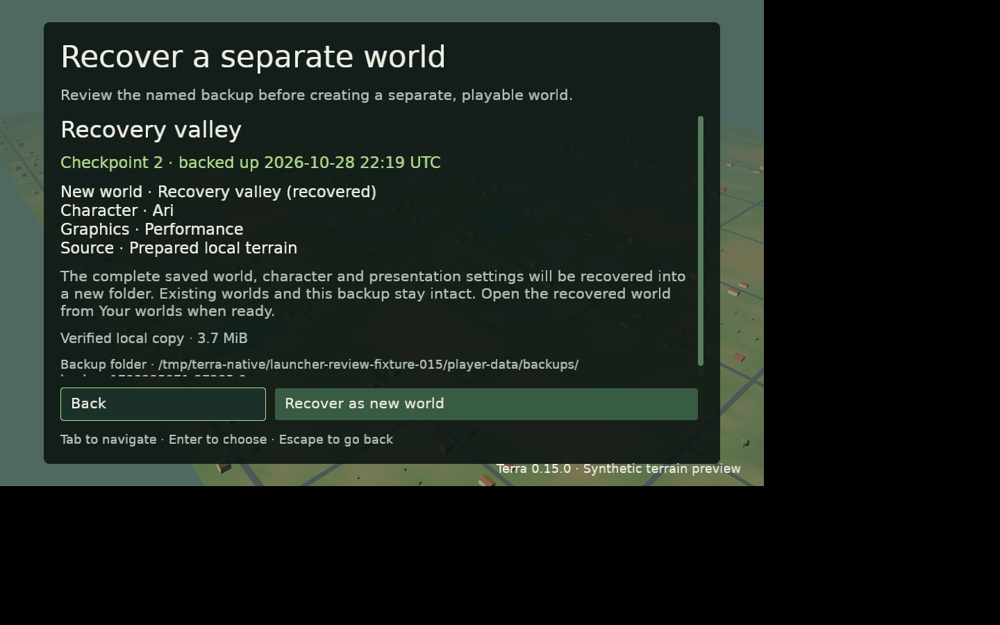
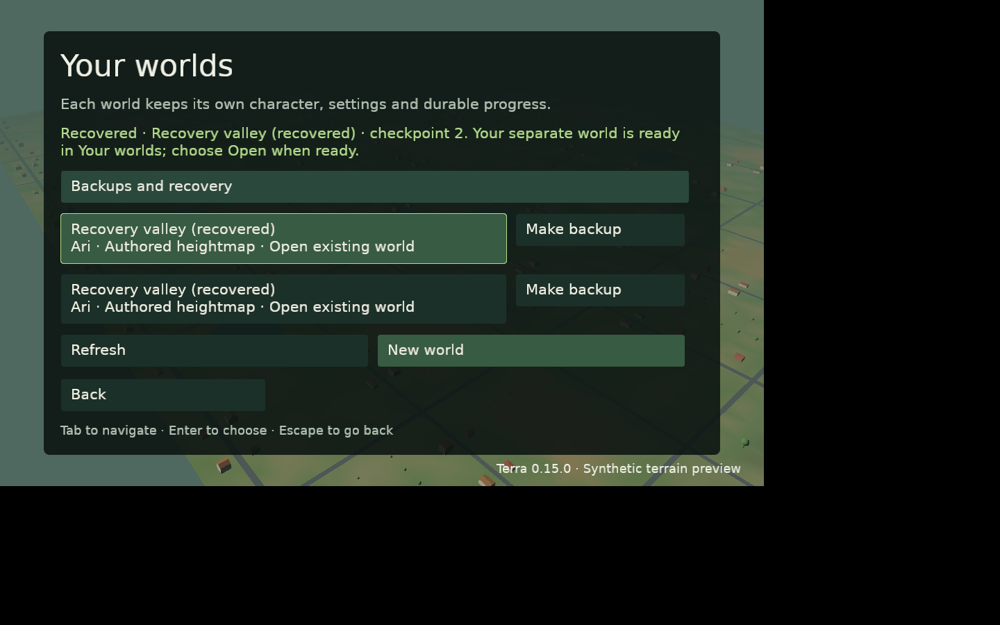
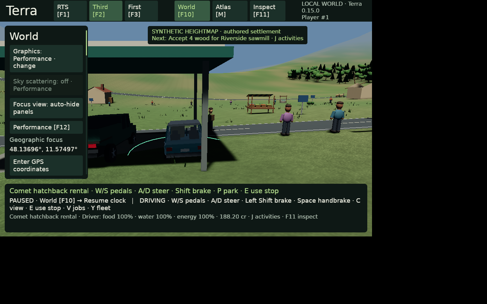
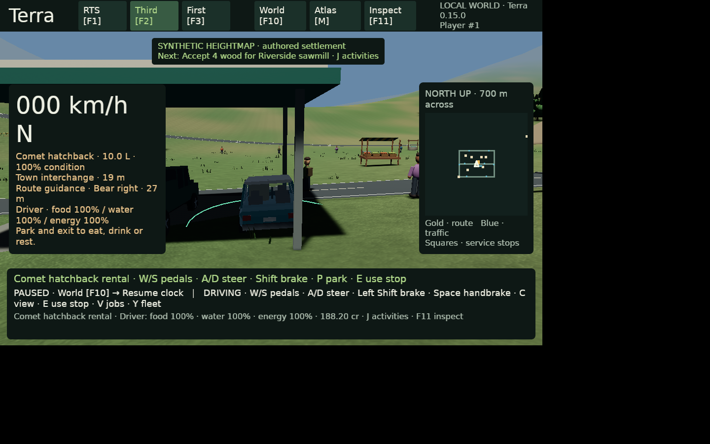
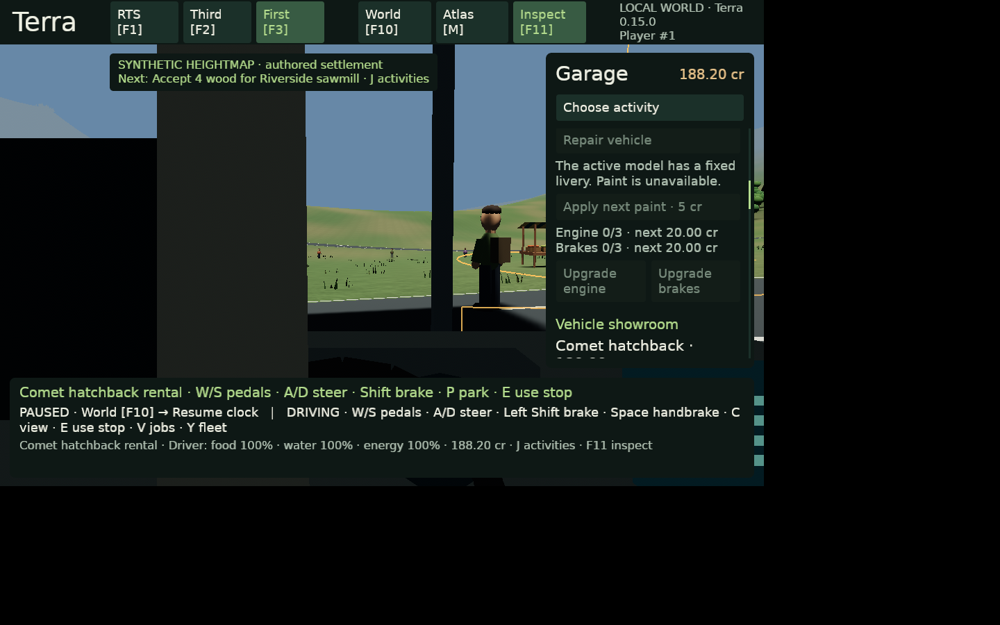
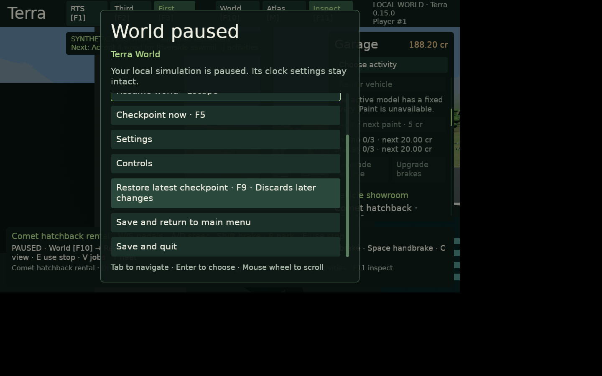

# Final native UX cross-review — 0.15

Review date: **2026-10-29 (Europe/Berlin)**. Reviewer: `final_docs_polish_015`.

## Verdict and scope

**No new blocking usability or layout defect was found in the provided final
confirmation journeys.** The driving-overlay correction is visibly effective,
recovery names its consequence and keeps confirmation reachable, and the enlarged
session menu exposes both save/exit choices after scrolling. One nonblocking
repeat-recovery naming ambiguity remains and should stay visible in G16/G08.

This is an independent review of the parent's current-run captures and retained
receipts. I inspected all **14 requested screenshots before reading the final
process, recovery and telemetry records**. I did not drive another session,
change project files, rerun the database comparison or run additional tests.
The Product Design audit workflow supplied the screenshot-first review structure;
its context preflight found no saved context, so the assigned project and current
captures are the grounding material. The optional critical-overrides resource
could not be read; no product claim depends on it.

The reviewed executable is:

`c12970d499bd2f9045cad0f9c106cdc870dddd64ef7804fd496d8b37c96cc504`

All three confirmation process records report **exit 0**, **356 implementation
inputs**, and unchanged inputs across their respective runs. Their saved log
SHA-256 values match the actual log files. These processes began before the final
gate run completed. This review therefore does **not** declare release or package
acceptance; the final gate and package receipts must bind this exact executable.

## User goals and reviewed configurations

The first goal is to recover a supported local world after its original world
and prepared input directories are gone, understand what will be created, and
open the separate result. The second is to use the optional Comet presentation
without competing overlays or paying for an invisible paint change, then save
and leave the world.

The small-window captures show an **1100 × 700 client with 150% text** inside the
1440 × 900 desktop capture. Black space outside that client is the surrounding
capture surface, not missing game content. The reopened-world and initial Comet
captures use the larger client. Every supplied image shows the intended loaded
screen; none was accepted as a blank, loading or wrong-window observation.

## Step-by-step observations

Screenshot names below are exact files under `docs/screenshots/`.

| Step | Captured state | Health and evidence |
|---|---|---|
| **1** | `v15-confirm-backups-150.png` — Backups and recovery | Healthy entry. Both saved copies show world name, checkpoint, character and timestamp. The selected row has a visible focus outline; the external-folder field has a visible label. A scrollbar indicates that its lower verification action is in a scroll area. |
| **2** | `v15-confirm-recovery-review-150.png` — Named review | Healthy consequence review. Recovery valley, checkpoint 2, Ari, Performance, prepared terrain and 3.7 MiB are readable. Copy explicitly says a new folder is created and existing worlds and backup stay intact. Back is initially focused; Back and Recover remain outside the scroll body. |
| **3** | `v15-confirm-recovery-focus-150.png` — Confirm focus | Healthy explicit confirmation. The outline moves to Recover as new world while the named review remains visible. The screenshot establishes visible focus, not an independently executed full keyboard audit. |
| **4** | `v15-confirm-recovery-completed-150.png` — Result in Your worlds | Healthy completion and one polish issue. The success message says the separate world is ready and must be opened explicitly. The new entry is selected at the top. Two entries share the same visible recovered title and subtitle; see finding UX-01. |
| **5** | `v15-confirm-recovery-world.png` — Opened recovered profile | Healthy return to play. The scene, Activities, four-wood next action and regional checkpoint status render. This fixture is at supply acceptance, not the earlier candidate's accepted four-wood delivery step. Its live checkpoint has advanced after reopening. |
| **6** | `v15-confirm-comet-restored.png` — Paid Comet fixture | Healthy presentation state. The imported hatchback is visible, the normal driving and route cards are present, the session is paused and the footer shows 188.20 credits. A garage support column partly occludes the parked car; this capture is not a clean showroom or moving-camera qualification. |
| **7** | `v15-confirm-world-hud-clear.png` — World open | Fixed overlay behavior. The World drawer has readable text and controls, and neither floating driving card leaves protruding fragments. The footer and next-step banner remain visible. |
| **8** | `v15-confirm-world-hud-return.png` — World closed | Fixed restoration behavior. The speed/vehicle card and route map both return with their content intact. |
| **9** | `v15-confirm-inspector-hud-clear.png` — Inspector open | Fixed overlay behavior. Activities uses the compact chooser; its primary supply action remains visible. Both floating driving cards yield. |
| **10** | `v15-confirm-performance-hud-clear.png` — Performance open | Fixed overlay behavior. The diagnostic drawer is readable, the cards yield, and six models / 23 ready / zero loading is visible. Lower diagnostic material remains in the indicated scroll area. |
| **11** | `v15-confirm-comet-first-person.png` — First person | Scoped presentation success. The possessed imported exterior is hidden, the existing cockpit remains, and the driving UI still fits. The parked position faces garage columns; this does not prove an unobstructed camera or motion comfort while driving. |
| **12** | `v15-confirm-comet-service.png` — Garage maintenance | Healthy paid-action explanation. The panel says the active model has a fixed livery and paint is unavailable. Apply next paint is visibly disabled, with 188.20 credits still shown. Other service controls and lower showroom content belong to the scroll area. |
| **13** | `v15-confirm-comet-exit-review.png` — Session menu at top | Healthy but scroll-dependent. The modal names the paused state and portable-save behavior, visibly focuses Resume, and provides keyboard and mouse-wheel instructions. Lower exit choices are below the viewport at this scale. |
| **14** | `v15-confirm-comet-save-quit.png` — Session menu scrolled | Healthy reachable exit. Save and return to main menu and Save and quit are both fully visible. The unchanged header/footer and moved scrollbar distinguish ordinary scrolling from a permanently clipped action. |

### Recovery evidence

### Overlay correction and exit reachability

## Remaining finding

### UX-01 — Repeated recoveries need distinguishable visible names — P3, nonblocking

**Evidence:** Step 4 shows two rows titled **Recovery valley (recovered)** with
the same **Ari · Authored heightmap · Open existing world** subtitle. The new
row is focused at the top, and the completion message identifies the requested
operation, so this observation does not show a lost result or wrong-world open.
The exact recovery receipt establishes separate managed identities and an
additional profile with all prior files retained.

**Consequence:** On a later visit, the player cannot distinguish these copies by
their visible title or subtitle. Position alone is a weak durable identifier
after several recoveries. This is a naming and comprehension limitation, not
evidence of overwritten data, lost identity or broken bounded-list pinning.

**Next acceptance criterion:** Provide a visible creation/checkpoint suffix or a
rename affordance that distinguishes repeated copies. Recover the same backup
at least twice, leave and reopen Your worlds, and identify/open either copy from
the visible labels while preserving exact stored world identities and the
completed-result pin. Keep this under G16/G08 rather than treating scoped native
recovery as the completion of operational UX.

No P1/P2 issue was found in this evidence. The following scroll and density
constraints should remain explicit rather than being mislabeled fixed clipping
defects:

- The backup path extends below the initial review viewport, while the review's
  identity, consequence and both actions remain visible. These final images do
  not show the complete path after scrolling; the candidate journey recorded
  that separate observation.
- The initial enlarged session menu does not fit every action simultaneously.
  Step 14 demonstrates that both exit actions become fully visible after a
  normal scroll. The partially visible Resume row at the top of that scrolled
  state is an ordinary viewport boundary, not an inaccessible quit action.
- Driving guidance wraps **27 m** across lines in the compact card. It remains
  readable but is less quick to scan. No new clipping or lost action follows
  from that wrap in these captures.

## Receipt and telemetry cross-check

The retained records are under `docs/verification/v0.15-native/`.

The pre-open `v15-confirm-recovery-exact.json` reports a passed generation-2
comparison with **19 regional rows and one world row**, including every column,
database definitions and integrity checks. Its 15 check flags are true. It
records byte-exact prepared and political inputs, matching source identities,
rehomed absolute runtime paths, matching non-path configuration, preserved
character/quality/start hour, exactly one additional managed profile and all
42 original files unchanged. Both original world/input directories remain
absent. A new recovered-profile creation timestamp is intentional and recorded
separately from the original time retained by the backup wrapper. I reviewed
this receipt; I did not independently repeat its SQL comparison.

`v15-confirm-recovery-world-process.json` opens the exact new profile named by
that receipt from `/tmp/terra-native`, exits 0 and records unchanged inputs.
Its telemetry reports the prepared source revision, `restored: true`, a clean
graceful exit, no world/simulation/persistence/export error and zero rejected or
failed models. The final checkpoint is generation **17** because simulation and
checkpointing continued after the exact pre-open generation-2 comparison. The
default wildlife pack reports **46 ready and 18 distant fallback instances**;
those distance-policy fallbacks are not import failures.

The Comet third-person telemetry reports the combined six-model pack identity
`sha256:235d1eff7604771e9a5ee78569093df56253439254d38fffda346f03e4a519c0`,
**23 ready**, zero loading/fallback/rejected instances, zero failed models and
no asset error.
The first-person and final captures report **22 ready, one hidden and one
fallback instance**, with zero loading/rejected instances, zero failed models
and no asset error. The hidden possessed exterior accounts for that difference; it must not
be summarized as zero final fallbacks or as a missing import. Final export status
is `graceful_exit`, with no world/simulation/export error or prior write failure.

The three logs contain Xvfb/X11 environment warnings and explicitly identify
llvmpipe software Vulkan. They are not warning-free hardware runs. The retained
process exits and domain diagnostics establish the scoped success stated here.

## Accessibility, product and evidence limits

Visible strengths are clear labels, readable enlarged text, distinguishable
selected/focused controls, written state and payment explanations, persistent
recovery actions and an explicit scroll instruction in the session menu. The
next-step banner agrees with the visible Activities supply action. Those facts
support this local journey; they do not establish sustained player engagement.

This review does not establish a full keyboard-only journey, focus trapping,
screen-reader semantics, measured contrast ratios, controller/wheel input,
localization, touch targets or motion comfort. No WCAG compliance is claimed.
Screenshots cannot prove animated wheel synchronization or a long driving
session; those have their own regression and candidate-play evidence. The final
Comet confirmation images remain paused, so they should not be represented as a
fresh motion benchmark. Software-rendered frame timings do not qualify target
GPUs or consumer performance.

The reviewer found the previously reported HUD overlap visually closed on the
rebuilt confirmation executable and left one explicit naming-polish item open.
Full release acceptance still depends on the completed gate, preservation and
extracted-package records matching that executable and frozen implementation.
