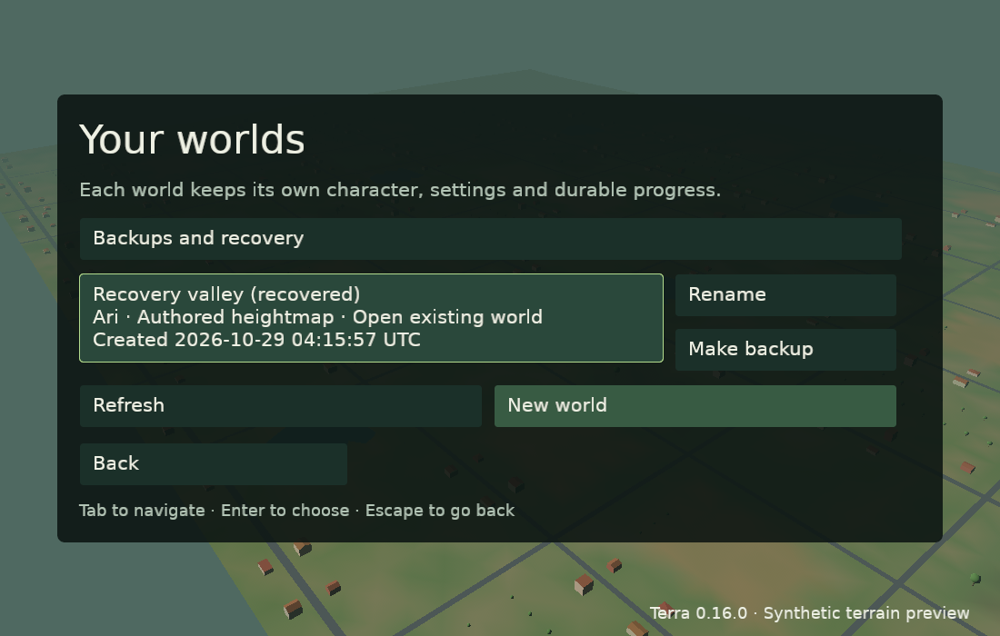
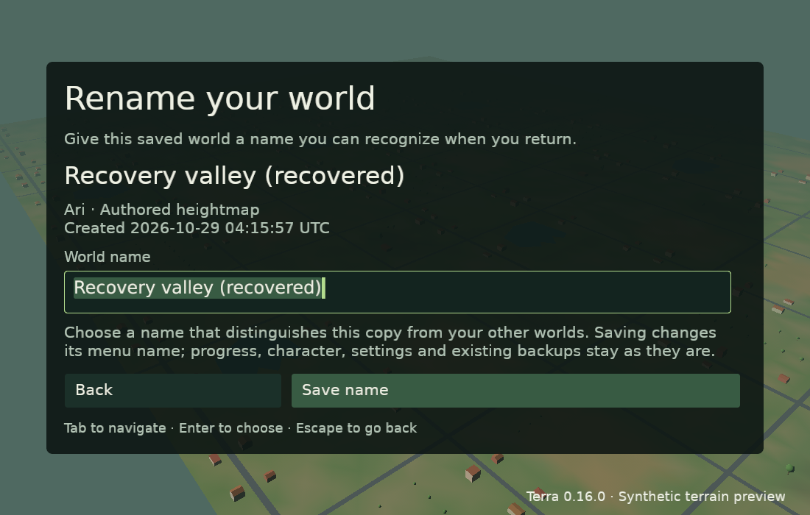
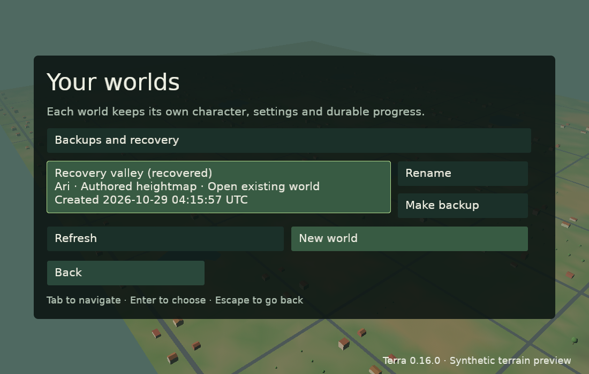
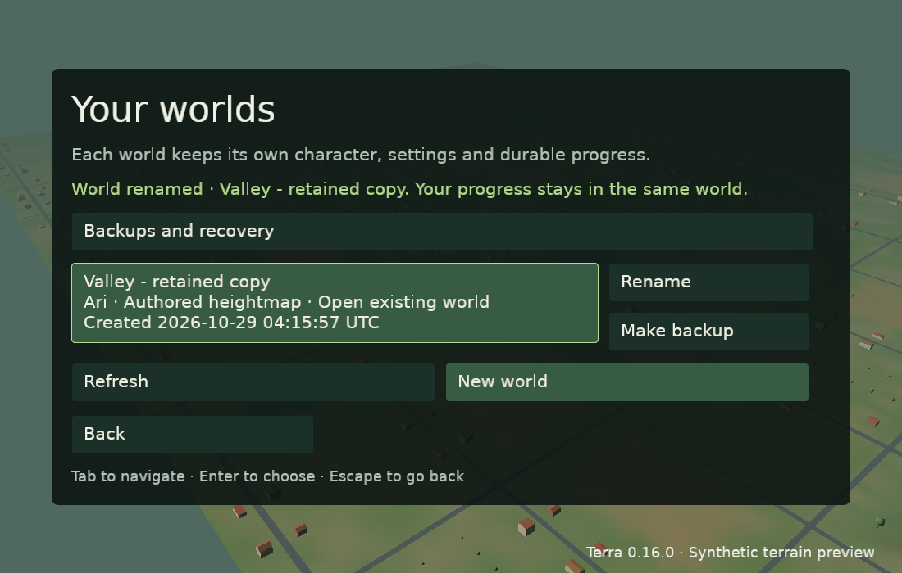
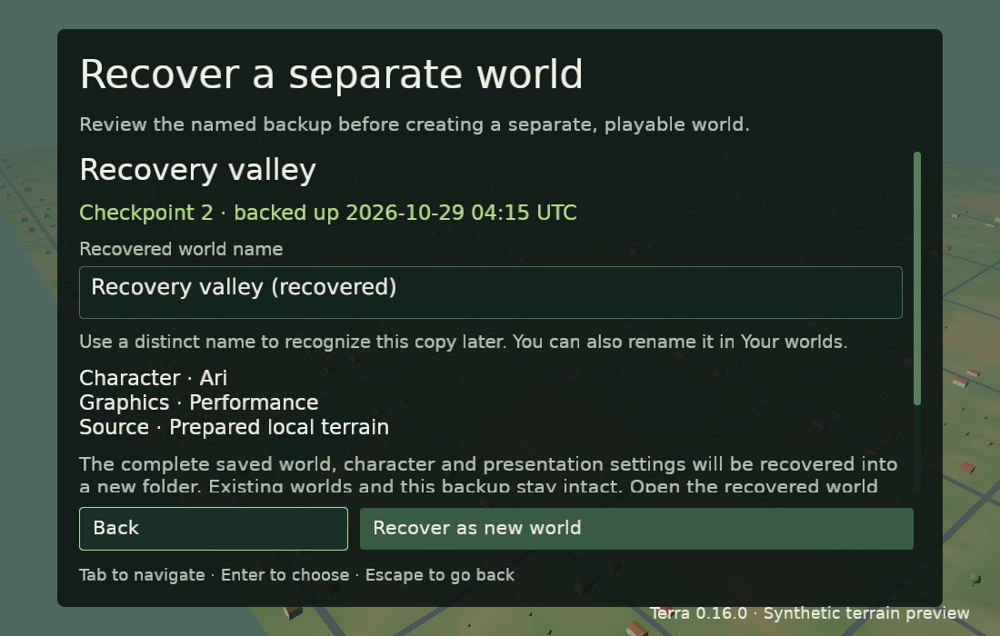
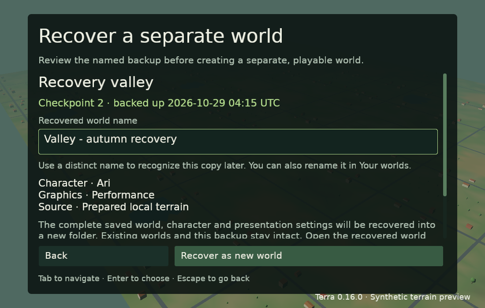
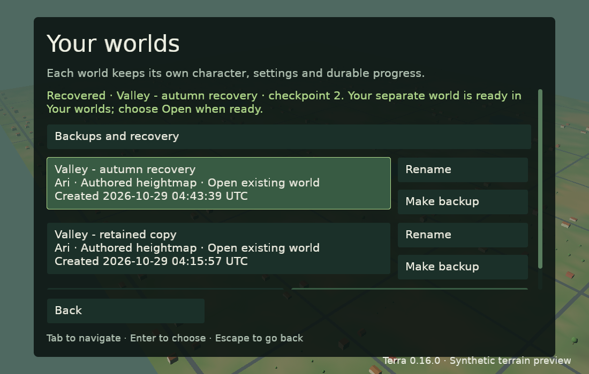

# Independent native product cross-review — 0.16 candidate

Date: 2026-10-29 UTC. Reviewer: navigation/release subagent, independent of the
native capture operator and the guidance/driving polish owners. This review
inspected the supplied candidate screenshots, compared retained recovery bytes
and read the subsequent source changes. It did not operate the display, run
Cargo or certify the final executable.

The naming captures are **1100 × 700 at 150% text**. Their recorded candidate
process used executable SHA-256
`90448c7b042d2d87f811dfbe442005543e696c67f898ff8a9d64db97c1be94db`,
retained 366 source inputs unchanged through that session and exited cleanly.
The later guidance/driving polish changes the implementation; final frozen gates
and native confirmation must therefore supersede candidate observations. The
seven project screenshots below match the exact inspected candidate bytes.

## Naming and recovery journey

### 1. Find the existing world — clear

The title, character, authored terrain source and creation time appear together.
Rename and Make backup are adjacent to the correct world card. The highlighted
world remains readable at enlarged text; naming does not replace directory
identity.

### 2. Review and edit the name — clear

The editor retains the original world title and character/source context above
the input. The selected text is visible. The explanation accurately limits the
operation to its menu name and says progress and backups remain. Back and Save
name both fit without scrolling.

### 3. Cancel the draft — preserved

The original title remains in the world list. The supplied comparison records
that cancelling preserved all 43 pre-existing files. This is a byte-state claim
supported by the comparison, not an inference from the unchanged label alone.

### 4. Save the selected name — clear and independently rechecked

The success message names the result and explicitly states that progress stays
in the same world. The list shows the new title, original character/source and
original creation time.

The independent review compared the two 43-file inventories: one profile changed.
Replacing only the new title text with its original title in memory reproduced
the original file's SHA-256 exactly. No file was written during this check.

### 5. Review the verified backup — clear

The recovery screen identifies the source world, checkpoint and backup time
before offering the copy's editable name. “Recover a separate world” and
“Recover as new world” establish the result before confirmation. The longer
explanation scrolls; the primary action and Back remain visible. This supports
review of the demonstrated short names, not arbitrary localized text lengths.

### 6. Name the new copy — clear

The chosen copy name is visible without obscuring the source checkpoint or
character/source information. The user can distinguish the existing backup's
name from the destination copy's name, and can cancel before creation.

### 7. Finish recovery and choose when to open — clear and preserved

Completion names the new copy and checkpoint, then leaves opening it as a
separate action. Both the new copy and the previously renamed world are visible
with their distinct names and creation times. Independent read-only verification
confirmed that all 43 pre-restore files still match their hashes, two distinct
profiles exist and both chosen titles are persisted. The named restore did not
replace the earlier world or its backups.

## Source review of the batched polish

**Guidance:** the private `MarketDetail` selection changes Supply copy without
changing acquisition ordering, permissions, action selection or trade authority.
Recipe recursion retains the actual prerequisite item and seller. The complete
missing-goods price comparison remains distinct from a market that can sell
only one unit or has partial stock. Cash/inventory-capacity blockers remain
explicit. Checked-arithmetic failure produces an unavailable comparison, rather
than an incorrect claim that the stock does not exist. Reward, XP, deadline,
delivery reach and unpriced carried-goods/travel context remain.

A deliberate goal selection or successful exact-request review advances the
new UI scroll revision. Stale/rejected requests and ordinary guidance refreshes
do not. Layout resets only the inspector, leaving other panel positions and
later reading/text-scaling changes intact. Existing principal, restore and full
request checks still guard the handoff. Added regressions cover real quote
arithmetic, nearest partial stock versus a full-quantity comparison, capacity and
funds, equal-name ingredient/final-goods distinctions and scroll behavior. They
require the root's next executed acceptance run.

**Driving:** Exit pins the resolved UI vehicle choice before authority switches
to the avatar. It still submits the ordinary untargeted ExitVehicle command;
the host resolves the actual active controlled vehicle. An explicitly selected
other vehicle cannot redirect that exit, move or incur a charge. A rejected
exit preserves the visible choice, and the camera transition still waits for
authority confirmation. The regression explicitly labels its 500-metre snapshot
setup, then exercises ordinary paid rental, Enter, actual Exit and nearby
re-entry, including explicit-other selection and unchanged other vehicle/money.

The possession message now names the actor/view and leaves the configured
movement hint as the source of actual key labels. Parking brake and held
handbrake remain distinct controls. “m remaining” clarifies the existing route
length rather than changing routing or steering. No additional source defect
was found in either polishing change. Compact-window/native readback and the
frozen full suite remain required.

## Remaining product and delivery boundaries

No further blocking naming issue was observed in this candidate journey.
Identical chosen names, character/source labels and creation timestamps can
still make two cards look alike; directory identity remains safe, and the UI
encourages distinct names. This is a recognition limit, not evidence of a
retargeted or overwritten world.

The captures show readable labels, focus/selection cues, reachable actions and
working wrapping at the demonstrated text scale. They do not establish screen
reader support, full keyboard/controller/wheel completion, localization,
contrast ratios, motion comfort or usability for uncoached players. Invalid
names, alias rejection and stale-context behavior require their automated and
operator evidence; screenshots alone cannot prove them.

The delivery guide now separates the unchanged original empty-seat Comet from
the optional Fieldhand/cabin composition, documents direct fresh-store and
saved-profile commands, and states the 0.16 reader and known-manual-occupancy
boundary. The complete original Comet section was compared byte-for-byte with
0.15 and all twelve local documentation links resolved. Source archives and
extracted desktop packages remain separate artifacts; the optional authoring
CLI is built from source. Windows/physical-GPU qualification, signing/trust,
public-host controls and deployment recovery policies remain open conditions.

Final receipt bindings, extracted-archive contents/modes and fresh final native
results are outside this candidate review. See the independent
[release engineering review](release-engineering-review.md),
[guidance cross-review](guidance-cross-review.md),
[driving polish record](native-driving-polish.md) and the root's final
[validation](../../VALIDATION.md) for their distinct evidence scopes.
