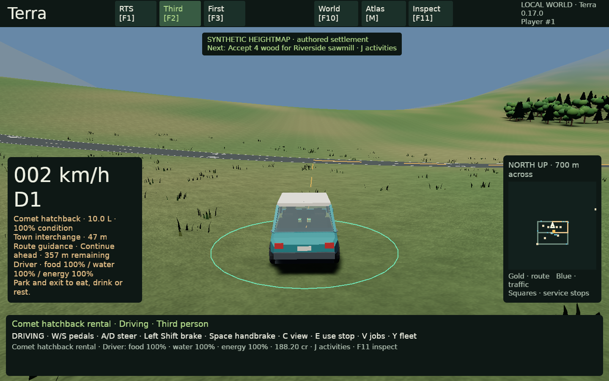
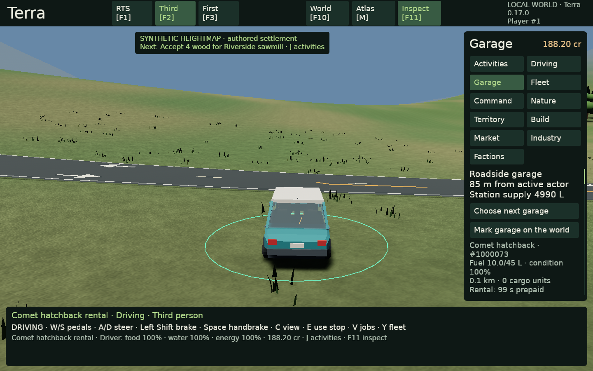
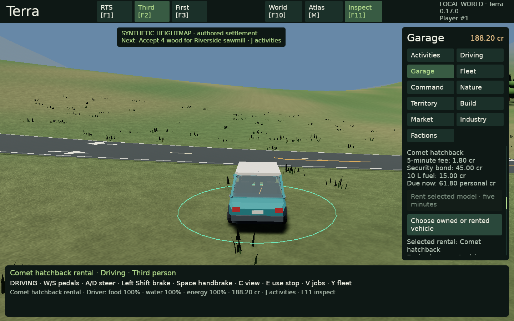

# Player journeys and input handoffs — 0.17 review

Review date: 2026-10-29. This review starts from the accepted 0.16 source and its
gap register, then examines the 0.17 changes. Historical screenshots and prior
acceptance receipts remain historical evidence. They are not represented as
fresh 0.17 captures or as uncoached playtest results.

## Scope and evidence

The source review follows new and returning players through Activities, accepted
supply requests, transport work, Garage, possession and checkpoint restoration.
It reads `GUIDANCE.md`, `GAME_FLOW.md`, `CONTROLS.md`, `REVIEW_GAPS_v0.16.md`, the
native frontier/driving/control/interface paths and their existing authority
commands. The first implementation is confined to `control.rs`, `driving.rs` and
four small interface handoff/label sites. Cross-review subsequently adds a
terminal storage recovery exit in `flow.rs` and the corresponding footer wording.
Domain commands, save/schema/wire versions,
economic prices, deadlines and authority validation are unchanged by this work.

The initial integrated demo suite passed all 179 tests, including the five new
driving regressions and extended possession checks. After the terminal recovery
exit was added, the [integrated demo run](demo-integration-after-review.log)
passed **181 tests, zero failed and zero ignored**, including both new terminal
regressions. Three fresh candidate native captures were independently inspected
below. These candidate observations are separate from the release owner's later
frozen-executable confirmation and final release gates.

## Prioritized findings and repairs

| Priority | Player step and source finding | Bounded repair | Verification target |
|---|---|---|---|
| High | Garage return uses a boolean confirmation, then recalculates the selected rental and refund on the second click. A restored context, changed quote or implicit selection fallback can therefore submit terms different from those reviewed. | Retain the displayed and reviewed principal, restore revision, vehicle/model, selected and originating garage, bond and complete refund breakdown. Require the confirmation label to be refreshed before dispatch, consume it once, and submit its retained quote to the existing authority check. Routine prepaid countdown does not invalidate unchanged refund terms. | Queued double clicks; changed refund/breakdown, principal, restore, vehicle and garage; real external rental return followed by implicit fallback; post-dispatch quote rejection; successful re-review and exact refund. |
| High | At an accepted transport stop, Interact retained whichever offer was last browsed. A different offer could make the key open Driving without servicing the actual assignment or explaining the problem. | Resolve the active vehicle's own accepted job, reveal it and its route, and queue its exact stop/phase/deadline context. A later browse cannot retarget it, and a changed phase/restore cannot reinterpret an old pickup as delivery. Missing assignment, motion, distance or missing loaded stop have explicit feedback. | Accept and board through ordinary authority commands after browsing another offer; preserve the unrelated offer; reject old phase and restore; show stopped/reach/no-job explanations. |
| High | The terminal storage-worker failure tells the player to close and reopen, but Save and quit first attempts another impossible Save and returns to the failed-save menu. | In local terminal failures only, Loading and Session show Close failed world with an unconfirmed-progress explanation. It uses the existing error-exit/final-checkpoint/handoff pipeline; stale close actions cannot abandon normal, recoverable or host-owned sessions. Terminal Retry/Restore/Save actions are replaced by the recovery explanation. | Menu choices and dispatch guard agree; ordinary save, restore, recoverable filesystem failure, retry and acknowledged quit continue to work. The footer directs the player to the actionable close. |
| Medium | The Service button advertised fixed `[E]` even after Interact was rebound. The direct Open market button also claimed the contextual key although that key may open a nearer resource instead. | Service uses the configured interaction key when that displayed assignment belongs to the active vehicle. The direct market button is labelled simply Open market; contextual movement guidance retains the actual configured key. | Rebind Interact to K and check pickup/delivery captions in the real accepted-job handoff. |
| Low | A vehicle handoff appends FocusSelection after SetMode; focus then overwrites the driving status with the vehicle's generic internal Worker role. This explains the retained 0.16 re-entry copy finding. | Share an actor-status formatter. Registered vehicles report Driving and the current possession view, or Vehicle selected in command mode. Human actor roles retain their existing interpretation. | Existing restore/possession regression now also queues SetMode then FocusSelection in both possession views. Fresh native capture after the operator's actual F9 restore visibly agrees with the driving footer. |

## Journeys checked in source

1. **Open Activities and select a goal — coherent in source.** The chooser
   opens a direct goal selection, and explicit review reveals the current next
   step. Ordinary refresh retains scroll. Guidance re-derives from authority;
   there is no extra tutorial wallet or completion ledger.
2. **Review and fulfill accepted supply work — guarded in source.** Preferred
   accepted requests retain their identity; otherwise the earliest world-clock
   deadline wins. Actions compare the complete displayed request and restored
   principal context. Expired delivery is disabled while return preserves goods.
3. **Compare request reward and acquisition cost — scope is clear in source.**
   Advice compares gross reward with all missing units at a fully stocked visible
   seller. It identifies input shortfall and insufficient funds, and explicitly
   leaves carried goods and travel unpriced. The actual Market still validates
   its current quoted transaction.
4. **Resume an accepted road assignment — repaired handoff.** The contextual
   key now opens and services the active vehicle's accepted job even if another
   offer was browsed. Availability still uses the stopped/reach checks, with the
   ordinary domain command deciding the actual outcome.
5. **Review a rental return — repaired confirmation.** The first click arms a
   review; a second click can return only after its confirmation was displayed
   with matching identity and refund. A changed or consumed review requires a
   fresh view, and host-side quoted-refund validation still applies.
6. **Exit, re-enter, switch view and restore — preserved authority path with
   corrected copy.** Existing restore synchronization retires input backlogs,
   adopts restored possession once, and preserves an explicit later F1 release.
   The repair changes status text, not the controlled actor or boarding rules.
7. **Leave a terminal storage failure — repaired recovery path.** Normal OS
   close already reaches the final-checkpoint error pipeline, while the old menu
   exit loops through another failed checkpoint. The new terminal-only action
   reaches that existing pipeline directly and prompts reopening to validate
   committed progress. A lost acknowledgement is not labelled a rollback.

## Added regression coverage

- `interact_resumes_the_active_assignment_after_browsing_another_offer`
- `interact_stop_rechecks_restore_and_explains_nonserviceable_states`
- `rental_return_requires_a_rendered_confirmation_and_retains_the_domain_quote`
- `rental_return_rejects_changed_refund_selection_principal_garage_and_restore`
- `rental_return_never_follows_an_implicit_replacement_vehicle`
- `terminal_recovery_menu_matches_its_guard_and_does_not_retry_uncertain_work`
- `ordinary_session_keeps_save_restore_retry_and_quit_after_rejecting_terminal_close`

The existing rental-renewal/refund test now performs the real display-review-
display-confirm sequence. The existing restored-possession test also checks
focus after both possession modes. Fixture positioning is explicit in the tests:
it isolates input and transaction handoffs and does not measure travel, human
completion time, uncoached comprehension or play balance.

The terminal menu policy test supplies the observed failure classification to
the production decision helper; it does not inject a failed worker into the
application. Worker channel-failure and uncertain-commit behavior have separate
persistence regressions in this increment. The normal-session regression uses
the actual command/save/restore path and a temporary filesystem obstruction.
There is no production failure switch.

## Accessibility and evidence limits

Source review confirms that management focus, controller menus, editable drafts,
text scale, remapped keys and no-input-leak handoffs already have explicit paths.
The new labels remove a contradiction for players who rebind Interact. The three
fresh captures show readable labels and no overlapping panels at the captured
1440 × 900 viewport. This narrow visual check does not certify screen readers,
physical gamepad/wheel devices, numerical contrast, keyboard focus behavior,
other viewport sizes or 150% text reflow. New-player discoverability and long-term
engagement still need actual playtest participants.

## Fresh native inspection

The following PNGs were opened and inspected from the current candidate run at
`/tmp/terra-native-017/`. Their retained copies under `docs/screenshots/` have
matching SHA-256 digests. All three show Terra 0.17.0 at 1440 × 900. No old image
is counted as a current confirmation, and no agent-operated interaction is
counted as a human playtest.

1. **Restore the possessed driver — healthy visible status.** The native-review
   owner identifies this capture as following an actual F9 restore. The image
   shows Third selected, the Comet in chase view, the status “Comet hatchback
   rental · Driving · Third person,” and the DRIVING control line. The previous
   Worker description is absent. The route/needs cards and footer are readable
   without overlapping each other. This image confirms the visible handoff
   result; exact saved-state continuity remains a separate authority/test claim.

   

2. **Open Garage while driving — healthy visible eligibility context.** The
   inspector identifies Roadside garage as **85 m from the active actor** and
   shows the selected Comet, fuel, condition and remaining prepaid time. The
   floating driving HUD and minimap yield to the inspector, while the driving
   status and controls remain visible. This shows the current vehicle and
   distance context; it is not an eligible-return or completed-return capture.

   

3. **Scroll to the rental offer — healthy visible cost disclosure.** The offer
   shows the five-minute fee **1.80 cr**, security bond **45.00 cr**, ten litres
   of fuel **15.00 cr**, and **61.80 personal cr due now**. These components add
   to the displayed total. The rental button is disabled in this captured
   context, and the selected-rental section begins below it within the scroll
   area. This is the rental acquisition offer, not a return-refund quote or
   return-confirmation screen.

   

The native fixture remained active and away from its garage. **No actual refund
or rental-return confirmation was observed in these screenshots.** The
changed-quote, rendered-confirmation, duplicate-click, restore-context and
implicit-selection return protections are covered by the passing headless
regressions. The terminal-only close flow and rebound-key stop handoff likewise
retain their source/headless evidence; this three-image inspection does not add
native confirmation of those interactions. No material visual correction is
requested from this capture set.

## Final native driver captures — separate visual confirmation

Independently inspected the two final driver PNGs at 1440 × 900; the retained
copies match the supplied `/tmp/terra-native-017/` files by SHA-256. The
[restored-driver capture](../../screenshots/v17-confirm-driver-restored.png)
shows Third selected, the Comet chase view and **Comet hatchback rental · Driving
· Third person**, with **K use stop** in the DRIVING footer. The
[first-person capture](../../screenshots/v17-confirm-driver-first-person.png)
shows First selected, a cockpit view and the matching **Driving · First person**
status. Its Driving inspector is open and visibly reports **0 jobs completed**;
the configured K hint remains readable. No material visual correction is
requested from these frames. This independently confirms visible mode/status
agreement and the remapped hint only. The operator's input sequence, completed
process exit and telemetry remain separate evidence. These screenshots do not
establish accepted-job delivery, a rental refund/return confirmation or complete
checkpoint-state equality.
